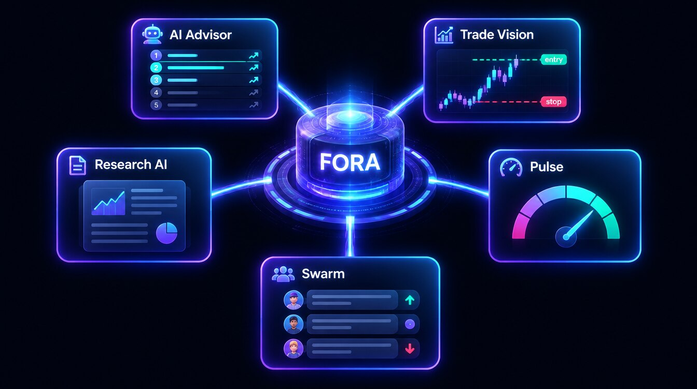
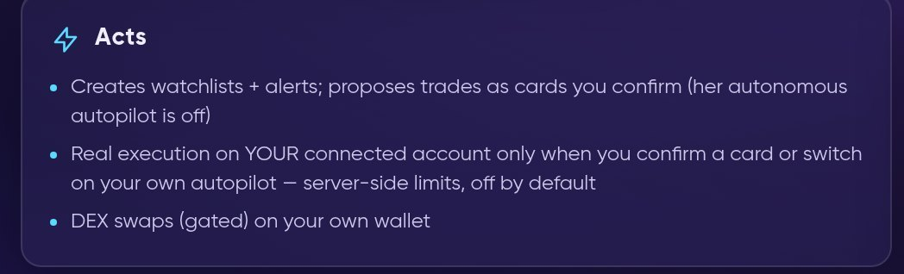
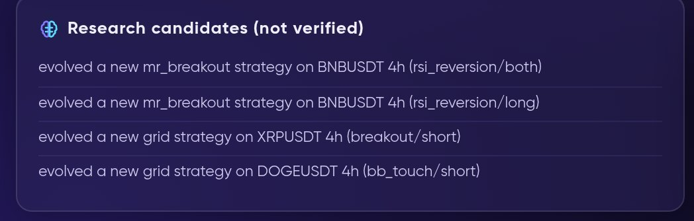

# 💬 AI & FORA

<figure><figcaption></figcaption></figure>

Formion's AI layer: FORA, the assistant that works across your whole account, plus focused AI tools for ideas, chart reading, research and market sentiment.

<table data-view="cards"><thead><tr><th></th><th></th><th data-hidden data-card-target data-type="content-ref"></th></tr></thead><tbody>
<tr><td><strong>💬 FORA — Trading Intelligence</strong></td><td>The assistant on web and Telegram: analysis, alerts, backtests and gated trading on your accounts.</td><td><a href="fora.md">fora.md</a></td></tr>
<tr><td><strong>🧬 FORA Neurons</strong></td><td>Always-on watchers with a dashboard and timeline, the personal planner (what, when, how much, how to exit) and KOL watch.</td><td><a href="fora-neurons.md">fora-neurons.md</a></td></tr>
<tr><td><strong>🔍 Dossier — Our Calls</strong></td><td>Our research on new small-cap tokens, the learned exit plan and calls on Telegram with your plan.</td><td><a href="dossier.md">dossier.md</a></td></tr>
<tr><td><strong>🤖 AI Advisor & Smart Trading</strong></td><td>Ranked trade ideas for your style and risk, AI Chat and a public Track Record.</td><td><a href="smart-trading.md">smart-trading.md</a></td></tr>
<tr><td><strong>👾 Trade Vision</strong></td><td>Drop a chart or type an idea — get bias, levels, stop, targets and a DCA ladder.</td><td><a href="trade-vision.md">trade-vision.md</a></td></tr>
<tr><td><strong>🌐 Research AI (RAG-LLM)</strong></td><td>Long-form, cited research reports and a Portfolio Builder.</td><td><a href="research-ai-rag-llm.md">research-ai-rag-llm.md</a></td></tr>
<tr><td><strong>📡 Formion Pulse</strong></td><td>X, YouTube and crowd sentiment blended into one score — filtered to the voices you trust.</td><td><a href="pulse.md">pulse.md</a></td></tr>
<tr><td><strong>🐝 Swarm</strong></td><td>The trader social hub: ideas, graded calls, profiles and leaderboards.</td><td><a href="swarm.md">swarm.md</a></td></tr>
</tbody></table>

## 🧭 FORA knows the page you are on

FORA has a written guide to every page and tab of the app: what it measures, where the data comes from, what each column, tile and filter means, how to read it, what it is *not*, and its measured status (Verified, Collecting data or Context signal).

- **Page and tab aware.** When you open FORA, she knows which page and which tab you are looking at — for example a single screener view — and answers about exactly that, not a generic page description.
- **Live numbers, same access as you.** When a page has numbers for a coin, FORA reads them from the same data the page shows and with your own plan's access. If you can't see something on a page, FORA can't read it for you either.
- **Only what is there.** FORA quotes the numbers she reads. If data is missing or stale she says so. She never invents a level, an entry or a stop.
- **Every new page ships with FORA's guide.** A new page or tab can't go live until FORA has its explanation, so FORA keeps up as the app grows.

Try it: open any page and ask FORA *"what am I looking at?"* or *"explain this for BTC"*.

## 📅 Live data questions — calendar, funding, news

Questions that need fresh numbers are always answered from live data, never from a stored FAQ answer:

- **Economic calendar.** *"When is the next CPI?"*, *"what's on this week?"* — FORA reads the upcoming macro events with their time, forecast and previous value.
- **Funding now.** *"What is ETH funding right now?"* — FORA reads the current funding rate (a bare coin name like "ETH" works).
- **Crypto news.** *"Latest Bitcoin news?"* — FORA reads the same headline feed as the News page.

If a live source does not answer, FORA says so instead of guessing.

## ⛔ FORA does not trade on her own

FORA's own autonomous autopilot is **switched off**. FORA proposes a trade as a card and **you** confirm it — or you switch on **your own** autopilot for your account, within the limits you set. The **"Research candidates"** on the FORA page are strategies from our research that are **not verified**: they have not passed out-of-sample testing and are not trade recommendations.

<figure><figcaption>
On the FORA page: FORA proposes trades as cards you confirm; her own autonomous autopilot is off.
</figcaption></figure>

<figure><figcaption>
"Research candidates (not verified)" — research ideas, not proven strategies.
</figcaption></figure>
