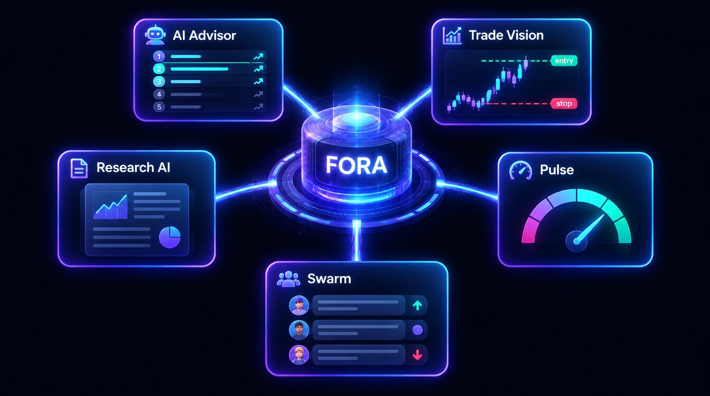

# 💬 AI & FORA

<figure><figcaption></figcaption></figure>

Formion's AI layer: FORA, the assistant that works across your whole account, plus focused AI tools for ideas, chart reading, research and market sentiment.

<table data-view="cards"><thead><tr><th></th><th></th><th data-hidden data-card-target data-type="content-ref"></th></tr></thead><tbody>
<tr><td><strong>💬 FORA — Trading Intelligence</strong></td><td>The assistant on web and Telegram: analysis, alerts, backtests and gated trading on your accounts.</td><td><a href="fora.md">fora.md</a></td></tr>
<tr><td><strong>🤖 AI Advisor & Smart Trading</strong></td><td>Ranked trade ideas for your style and risk, AI Chat and a public Track Record.</td><td><a href="smart-trading.md">smart-trading.md</a></td></tr>
<tr><td><strong>👾 Trade Vision</strong></td><td>Drop a chart or type an idea — get bias, levels, stop, targets and a DCA ladder.</td><td><a href="trade-vision.md">trade-vision.md</a></td></tr>
<tr><td><strong>🌐 Research AI (RAG-LLM)</strong></td><td>Long-form, cited research reports and a Portfolio Builder.</td><td><a href="research-ai-rag-llm.md">research-ai-rag-llm.md</a></td></tr>
<tr><td><strong>📡 Formion Pulse</strong></td><td>X, YouTube and crowd sentiment blended into one score — filtered to the voices you trust.</td><td><a href="pulse.md">pulse.md</a></td></tr>
<tr><td><strong>🐝 Swarm</strong></td><td>The trader social hub: ideas, graded calls, profiles and leaderboards.</td><td><a href="swarm.md">swarm.md</a></td></tr>
</tbody></table>
