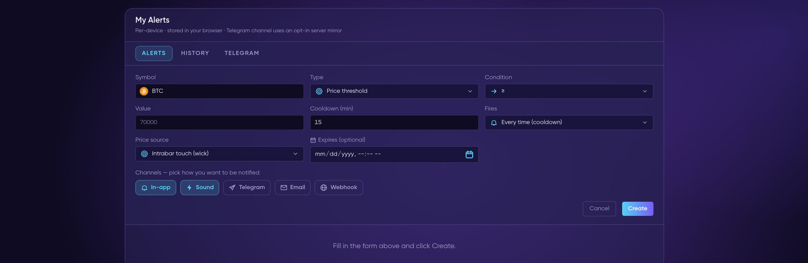
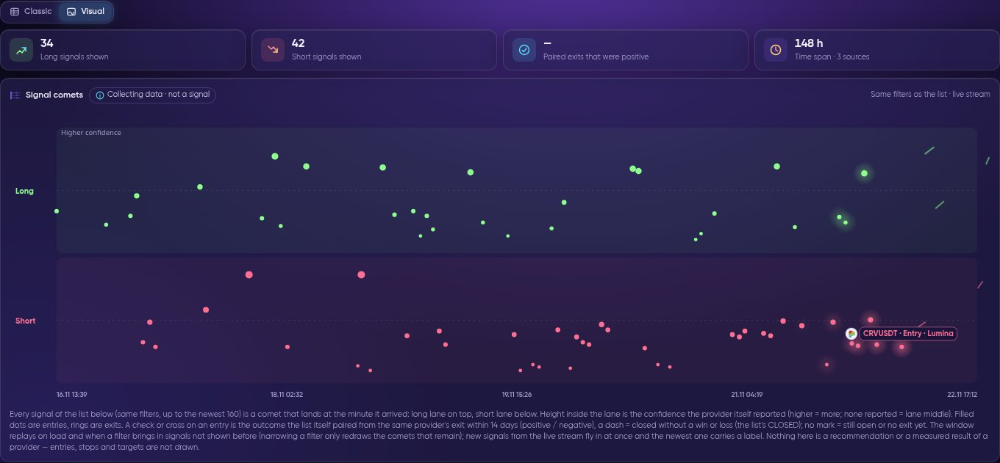

# 🔔 Alerts

<figure><figcaption></figcaption></figure>

Never miss a setup. Formion delivers alerts across **five channels** and lets you build your own rules — plus per-strategy alerts on every bot and engine.

<figure><video src=".gitbook/assets/clip-alerts.mp4" title="Alerts in 4 steps: new alert, condition, delivery channels, alert fires"></video><figcaption>
One rule from start to finish: new alert → condition → channels → alert fires (demo values).
</figcaption></figure>

<figure><video src=".gitbook/assets/rec-alerts-create.mp4" title="Live recording: My Alerts → New alert — BTC ≥ 80,000, firing rule, channels (In-app and Sound on), Create."></video><figcaption>
Live recording: My Alerts → New alert — BTC ≥ 80,000, firing rule, channels (In-app and Sound on), Create.
</figcaption></figure>

## Channels

<figure><video src=".gitbook/assets/clip-alerts-channels.mp4" title="One alert, five delivery channels: Browser, Sound, Telegram, Email, Webhook"></video><figcaption>
One rule can notify you through any combination of the five channels.
</figcaption></figure>

| Channel | Use |
|---|---|
| **Browser** | Browser notification + on-page toast while the app is open |
| **Sound** | Audio ping for hands-off monitoring |
| **Telegram** | Push to your Telegram so you're alerted with the browser closed — see **[Telegram Signals](telegram-signals.md)** for linking |
| **Email** | Inbox delivery |
| **Webhook** | POST to your own endpoint (automation, Discord, your bot) |

## What you can alert on

* **Custom rules** — price, % change, RSI, MACD cross, EMA alignment, SMC order-block / FVG events, divergences, liquidation clusters, your drawn zones, custom-indicator conditions and multi-condition confluence
* **Per-strategy / per-bot** — get pinged when any tracked engine fires a signal (contextual 🔔 on Trade History, Strategy Lab and indicator panels)
* **Market events** — funding thresholds, open-interest changes, GEX flips, smart-money (whale) flows, economic-calendar releases and crypto-calendar events


Active custom alerts: **Neural 3**, **Pro 100**, **Institutional unlimited**; Pro and Institutional add email alerts. See **[Pricing & Tiers](pricing.md#daily-limits)**. You can also ask [FORA](fora.md) to prepare an alert for you to confirm.


The **Signals** tab collects every provider's signals into one live feed, and **app.formion.ai/signals/alerts** is where you create and manage your own alert rules. Telegram delivery needs your Telegram linked in profile → Connections with Telegram notifications on in profile → Account → Preferences.

## 🎛️ Classic · Visual — Live Signals and My Alerts

* **Signals → Live Signals** — **Signal comets**: the same rows as the list (same filters, newest 160 entries and exits) on a time axis — long lane on top, short below. Each signal lands at the minute it arrived; height in the lane = the confidence the provider itself reported. Filled dots = entries, rings = exits; a check or cross = the outcome the list paired from the same provider's exit within 14 days, a dash = closed without a win or loss. New signals from the live stream fly in at once. Labelled **Collecting data · not a signal** — not a recommendation or a measured provider result.
* **Signals → My Alerts** — **Alert bells**: one bell per alert of this device (armed first, then the most recently fired) with the asset logo, type and state (Armed, Paused or Expired). A price alert shows its distance in % from the last checked price; others show how often they fired. The **Fires · last 7 days** strip replays every logged fire — the bell swings and rings as the sweep passes it. With no alert yet, the view says how to create one. Your own conditions, not signals of ours — **Context signal · not a signal**.

<figure><figcaption>
Live Signals → Visual: long and short signals landing on a time axis; height = the provider’s reported confidence.
</figcaption></figure>

Same data as Classic, same plan limits; **Auto** (the default in [Settings → Visual mode](settings.md)) starts it in Classic — one click on **Visual** switches, and the panel remembers it.

## Current workflow

Use alerts alongside [News](news.md), [Telegram Signals](telegram-signals.md) and your market views. An alert notification is distinct from an authorised trading action. Check the destination and rule before enabling it.
