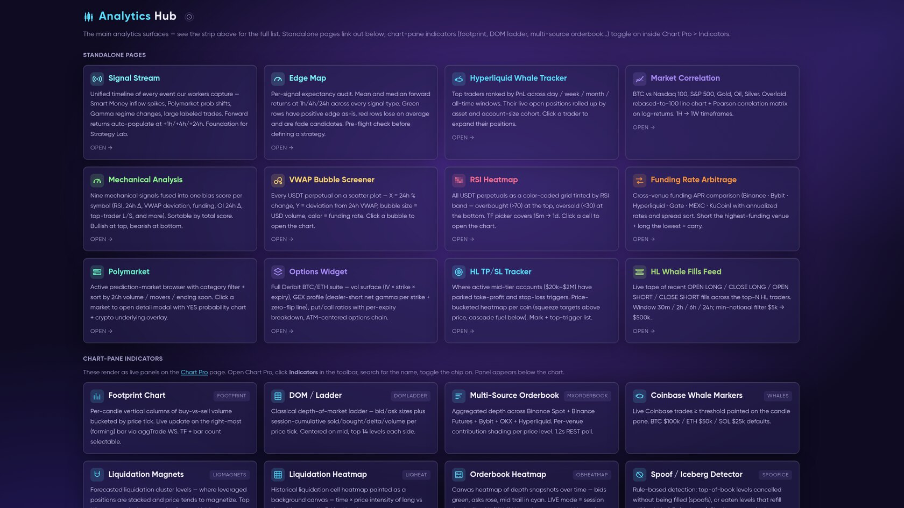
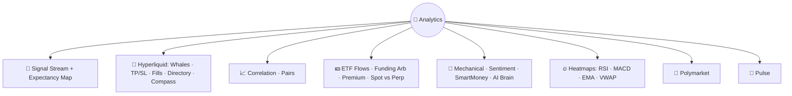
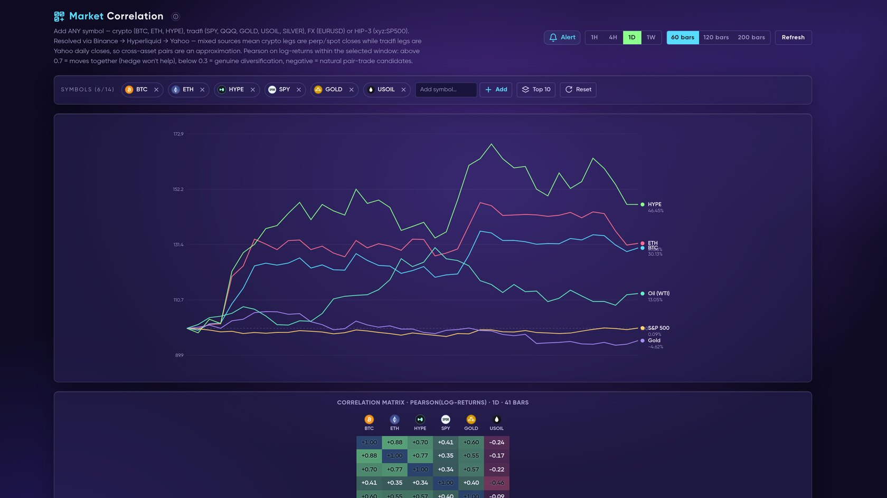
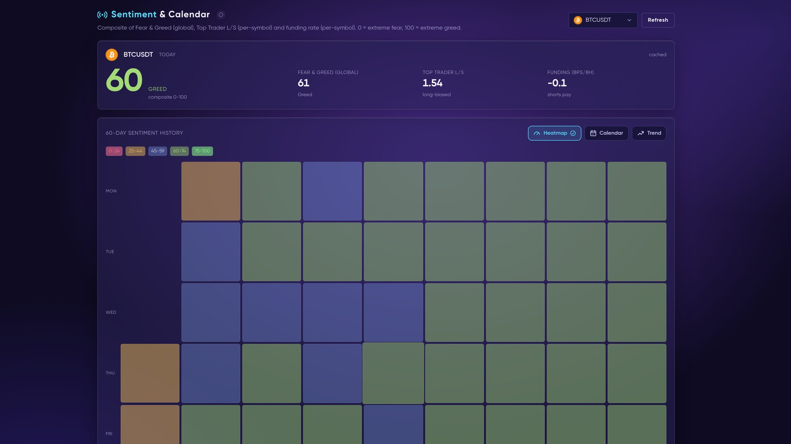
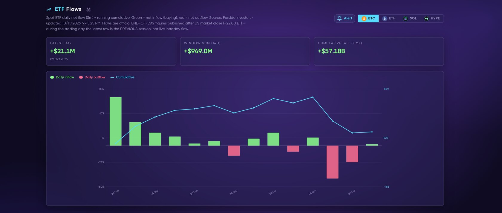
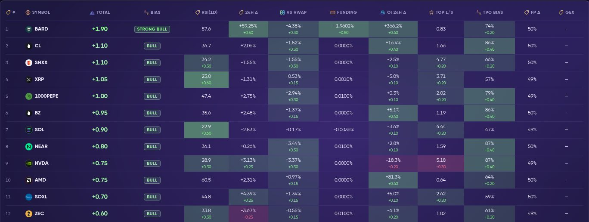
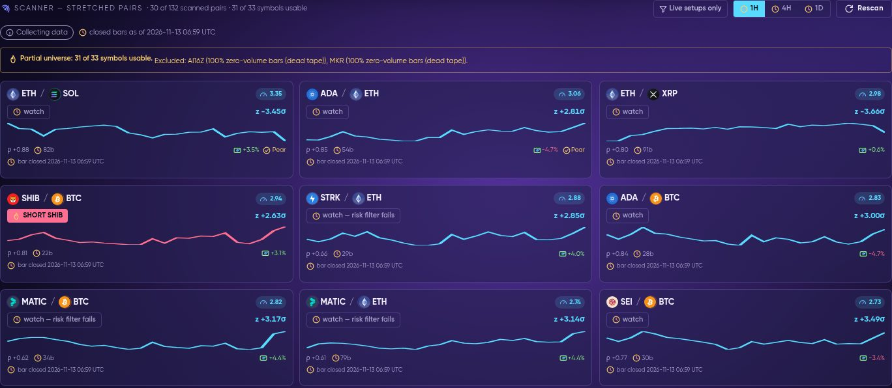

# 🧠 Analytics

<figure><figcaption>A hub of standalone analytics tools, each one tab away.</figcaption></figure>

<figure><video src=".gitbook/assets/rec-analytics-tour.mp4" title="Live recording: the Analytics hub, then HL Whales, Correlation, ETF Flows and Sentiment."></video><figcaption>
Live recording: the Analytics hub, then HL Whales, Correlation, ETF Flows and Sentiment.
</figcaption></figure>

The **Analytics** hub (app.formion.ai → Analytics) is a collection of focused, standalone tools — each answering one specific question about market structure, smart money or cross-asset behaviour.

## What's inside

* **Signal Stream & Expectancy Map** — a unified timeline of the events Formion's workers capture (smart-money inflow spikes, Polymarket probability shifts, gamma regime changes, large labeled trades) with forward returns at +1h/+4h/+24h, plus the per-signal **Expectancy Map** (see below) (what happened after each kind of signal). In the app: **Signals → Stream**.
* **Hyperliquid suite** — **HL Whales** (top traders by PnL and their open positions), **HL TP/SL** (where mid-tier accounts park stops and targets), **HL Fills** (live open/close fills from top traders), **HL Directory** (labeled funds, KOLs, market makers and deployers) and **HL Whale Compass** (live feed of labeled-wallet trades).
* **Correlation** — BTC vs Nasdaq 100, S&P 500, Gold, Oil and Silver — is crypto trading risk-on or decoupling?
* **Pairs** (see below) — a scanner of stretched pairs (two assets whose price ratio has moved far from its mean), a desk with a backtest for any pair, and the paper record of the Pairs bot. In the app: **Analytics → Relations → Pairs**.
* **Flows** — **ETF Flows** (spot BTC/ETH ETF in/outflows), **Funding Arb** (cross-venue funding APR across Binance, Bybit, Hyperliquid, Gate, MEXC and KuCoin), **Premium Index** (perp vs spot) and **Spot vs Perp** (which side is pushing price).
* **Mechanical, Sentiment & SmartMoney** — **Mechanical** (see below) fuses nine mechanical inputs into one bias score per symbol (in the app: **Quantum Screener → Trend → Mechanical**); **Sentiment** combines Fear & Greed, top-trader long/short and funding into a composite score with a 60-day calendar; **SmartMoney** shows smart-money and whale trades, inflows and leaderboards.
* **AI Brain** — one dashboard for Formion's AI subsystems: AI trade ideas with outcomes and the AI consensus pipeline.
* **Heatmaps** — market-wide **RSI / MACD / EMA-cloud / VWAP-bubble** views (shared with the [Screener](screener.md)) to spot extremes at a glance.
* **Polymarket** — prediction-market browser + trader leaderboard: live odds on crypto/macro/event markets as a crowd-priced probability input.
* **[Formion Pulse](pulse.md)** — market-narrative sentiment from X, YouTube and crowd chatter, also reachable here.

<figure><figcaption>
Correlation — BTC vs Nasdaq 100, S&#x26;P 500, Gold, Oil and Silver.
</figcaption></figure>

<figure><figcaption>
Sentiment — composite score and a 60-day sentiment calendar.
</figcaption></figure>

<figure><figcaption>
ETF Flows — daily spot ETF inflows and outflows with the cumulative line.
</figcaption></figure>

## Mechanical board

<figure><figcaption>
The Mechanical board (Pro view, 1d): one row per symbol with the total score, the bias pill and the nine inputs. On Free the rows after the first 10 are locked.
</figcaption></figure>

**Where:** app.formion.ai → **Quantum Screener → Trend → Mechanical** (`/mechanical`). The chip has three views: **Live** (the board), **Recorder** and **Study**.

**What it measures.** For each symbol, the board reads nine mechanical inputs on closed bars and adds their scores into one **Total** (roughly −3 to +3; above zero leans bullish, below zero bearish). Pick the timeframe (15m, 30m, 1h, 2h, 4h, 1d), how many symbols to load (16, 30 or 40) and the view (**Table**, **Mosaic**, **Matrix**, **Quadrant**, **3D**, **Strength** or **Confluence**). The universe mixes crypto with TradFi perps (gold, oil, indices) under one rule.

| Column | How to read it |
|---|---|
| **Total** | Sum of the nine input scores. A missing input shows "—" and adds nothing. In each input cell, the small number under the value is that input's score; tinted cells are the inputs that push the total up (green) or down (red). |
| **Bias** | **Strong Bull** (≥ +1.5), **Bull** (≥ +0.6), **Neutral**, **Bear** (≤ −0.6), **Strong Bear** (≤ −1.5). **Incomplete** = at least one input missing (hover shows which). **Stale** = the board copy is older than 15 minutes and is being refreshed. Incomplete and Stale rows are not counted as bullish or bearish. |
| **RSI** | RSI(14) on closed bars of the chosen timeframe. |
| **24h Δ** · **vs VWAP** | 24-hour price change and distance from VWAP. |
| **Funding** | The raw rate per settlement interval (1h, 4h or 8h depending on the symbol), not normalised. |
| **OI 24h Δ** | Rolling 24h change of USDT-notional open interest (it moves with price too). |
| **Top L/S** | Top-trader long/short ratio. |
| **TPO Bias** | Where price sits inside its 24h high–low range. |
| **FP Δ** | Taker-buy share over the last 4 closed bars. |
| **GEX** | Price vs the BTC/ETH zero-gamma level (dealer positioning is an assumption, not observed — see [Options](options.md)). |

The header tiles count **Symbols scored**, **Bullish bias** and **Bearish bias** (complete rows only) for the whole board, and **Paper signals** of the bot below.

**What it is NOT.** The score is a descriptive reading of nine inputs. No out-of-sample test has shown that it predicts price: the board shows **Collecting data** and the line "treat it as context, not an entry". It never gives an entry, stop or target.

### Mechanical paper bot (v2)

Under the board, **Paper bot · Mechanical v2** shows the clean v2 paper record, labelled **Context signal**. A v2 signal fires on a 1h score of ±1.5 and enters at the next Binance futures 1-minute open; it is resolved on the 1-minute path, stop first. The older v1 record was voided by an audit and is not counted.

| Tile | Meaning |
|---|---|
| **Signals since restart** | v2 rows, open and closed (voided rows excluded). |
| **Open** | Positions still being resolved. |
| **Closed with P&L** | Closed trades with a price; the hint splits them into TP, SL and TTL (time exit). |
| **Win rate** | Share of priced closes that ended in profit, side-adjusted (TTL exits included). |
| **Mean net / trade** | Average per trade after a 0.12 % round-trip cost — a per-trade average, not an account return. No slippage or funding is charged. |

Exit times are simulation markers, not execution times: a stop or target touched inside a 1-minute bar is stamped at that bar's close, and a gap fills at the bar's open. Exits are checked on **final** 1-minute bars: a daily re-check at 06:30 UTC compares every closed trade with the final exchange bars and corrects it if they differ. **Open the full book** goes to [Trades History](trades-history.md).

### Recorder and Study

* **Recorder** — coverage, score versions and per-timeframe health of every recorded board snapshot.
* **Study** — runs the forward-return study on the recorder history by score bucket and horizon. Each study counts against your daily backtest limit.

### Mechanical — who sees what

| | Free | Free + FOM Hold | Free + FOM Lock | Pro | Pro + FOM Lock | Institutional |
|---|---|---|---|---|---|---|
| Mechanical board rows | first 10 (most liquid) | 12 | 20 | all | all | all |
| Recorder + Study | locked | locked | 1 study a day | 50 backtests a day | 150 | unlimited |

On every step the whole-board counts (scored / bullish / bearish) are shown; locked rows carry no data. The paper bot's headline tiles are open to everyone; on Free the trade list in Trades History covers the last 7 days, Pro and Institutional see the full book. See the full ladder in [Pricing](pricing.md).

## Expectancy Map

**Where:** app.formion.ai → **Signals → Stream → Expectancy Map** (`/analytics/edge-map`). The **Signal Stream** next to it lists the signals themselves.

**What it measures.** For each signal cohort (source · signal type · timeframe · direction) it shows what price did after the signal fired, in the chosen window (7d, 30d or all):

| Column | How to read it |
|---|---|
| **Source** · **Cohort** | Where the signal comes from and which kind it is. |
| **n** | How many signals are in the cohort. |
| **Mean 1h / 4h / 24h** | Average forward return after the signal. |
| **Median 24h** · **Hit-rate 24h** · **σ 24h** | Middle result, share of positive 24h results, and how spread out the results are. |
| **n by window** | How many signals already have a 1h, 4h and 24h result. |

Rows with fewer than 10 results at 24h are grey (not enough data). With enough data, a green row averaged above +0.5 % at 24h and a red row below −0.5 %. Header tiles count **Signal types**, **Enough data**, **Positive 24h** and **Negative 24h**.

**Clean data rules.** Rows from dead or settled tokens are left out, and so are rows whose horizons are all exactly zero (a frozen price feed). A row that is still waiting for its final data shows as **pending** instead of a number.

**What it is NOT.** These are averages of past forward returns, not a forecast and not an entry rule; a positive mean in one window can disappear in the next.

**Plans:** Free sees the current 7-day window and the newest 10 rows of the Signal Stream; Pro and Institutional see every window and the whole stream.

## Pairs

<figure><figcaption>
The Pairs scanner: each card is a pair with its spread z-score, setup, correlation, half-life and net funding carry.
</figcaption></figure>

**Where:** app.formion.ai → **Analytics → Relations → Pairs** (`/pairs`).

A pair trade is LONG one asset and SHORT the other. It does not bet on the market direction, only on the **ratio** A/B returning towards its mean.

### Scanner — stretched pairs

Ranks pairs whose ratio is far from its mean, on 1H, 4H or 1D closed bars (**Live setups only** shows just the pairs with a setup now). Each card shows:

* **Pair** and a **score** (rank of the opportunity).
* **Setup** — **LONG A** or **SHORT A** when the rule has a setup; **watch** when it has none, or **watch — risk filter fails** when the z-score is stretched but the correlation / half-life filter does not pass.
* **z** — how many standard deviations the ratio is from its mean (from ±2σ the rule looks at it).
* **ρ** — correlation of the two assets; **half-life** (in bars) — how fast the spread has been reverting.
* **Funding carry** — net funding APR on the combined position; green = you would receive it, red = pay it, "—" = unknown.

The scanner shows the current state, not a proven signal, and carries the **Collecting data** label. A **Partial universe** note lists symbols left out (for example a dead feed with only zero-volume bars).

### Pairs desk and pair backtest

The page has three modes: **Desk**, **Scanner** and **Backtest**. On the desk, pick **any pair** (A and B, **Swap**, or a quick-pick chip), a timeframe (1H, 4H, 1D, 1W), the number of bars (120, 200, 300) and the hedge ratio (**β=1** = plain A/B ratio, or **β OLS**). The desk shows the live z-score chart, the pair's **correlation**, **half-life** and current **z-score**, the net funding carry, and **What to trade now** — the setup with **entry, target and stop** on the ratio, all taken from the rule (or **WAIT — no setup** when the z-score is inside the ±2σ band). **When you PROFIT** / **When you LOSE** explain both outcomes in plain words. Below it, the ledger lists every trade of the rule on that pair since 2 Nov 2026 12:00 UTC with your settings (win rate, profit factor, net per trade, net total, max drawdown, trades, average win, average hold) — titled **Fixed-start ledger** when it is your view of the rule, or **Paper book ledger** when the pair and timeframe are the paper bot's own (the bot trades 4H only). **Backtest** mode runs the same rule on the selected pair (1H, 4H or 1D).

**The rule** (the same for the backtest, the desk and the paper bot): the z-score of the A/B ratio over the last 100 closed bars; entry only while the ratio is between 2.0σ and 2.8σ from its mean, at the next bar's open; target 0.5σ and stop 2.8σ, frozen at entry; a time exit after 48 bars. A trade opens only when the 400-bar gate passes (correlation ρ ≥ 0.7 and half-life ≤ 150 bars). A plan whose z-score, correlation or half-life fails these rules is refused. Entry and exit are **ratio** levels, not the price of one asset.

**Costs:** every result is net of **0.12 % per trade** (round trip). **Funding is not included** in the backtest or the paper results. The backtest is in-sample.

### Paper bot track record

The **Paper bot track record** panel counts the Pairs paper book: **Paper signals**, **Open**, **Closed with P&L**, **Win rate** and **Avg net / trade** (net of the 0.12 % cost, funding not included). It shows **Collecting data** until 30 trades have closed. The current record started on **2 Nov 2026 at 12:00 UTC**; the earlier v1 record is archived and not counted. **Open the full book** goes to [Trades History](trades-history.md).

### Pairs — who sees what

| | Free | Free + FOM Hold | Free + FOM Lock | Pro | Pro + FOM Lock | Institutional |
|---|---|---|---|---|---|---|
| Pairs scanner | top 2 pairs | 5 | 15 | all | all | all |
| Pairs desk + pair backtest | locked | locked | 1 pair a day | full desk | full desk | full desk |

Locked pairs carry no data. The paper track record tiles are open to everyone; Pro and Institutional also get the full book in Trades History. See the full ladder in [Pricing](pricing.md).


These are research tools, not signals to trade blindly. The most useful pairing is the **Expectancy Map** (what happened after this kind of signal?) with the **[Screener](screener.md)** (is it firing now?).

