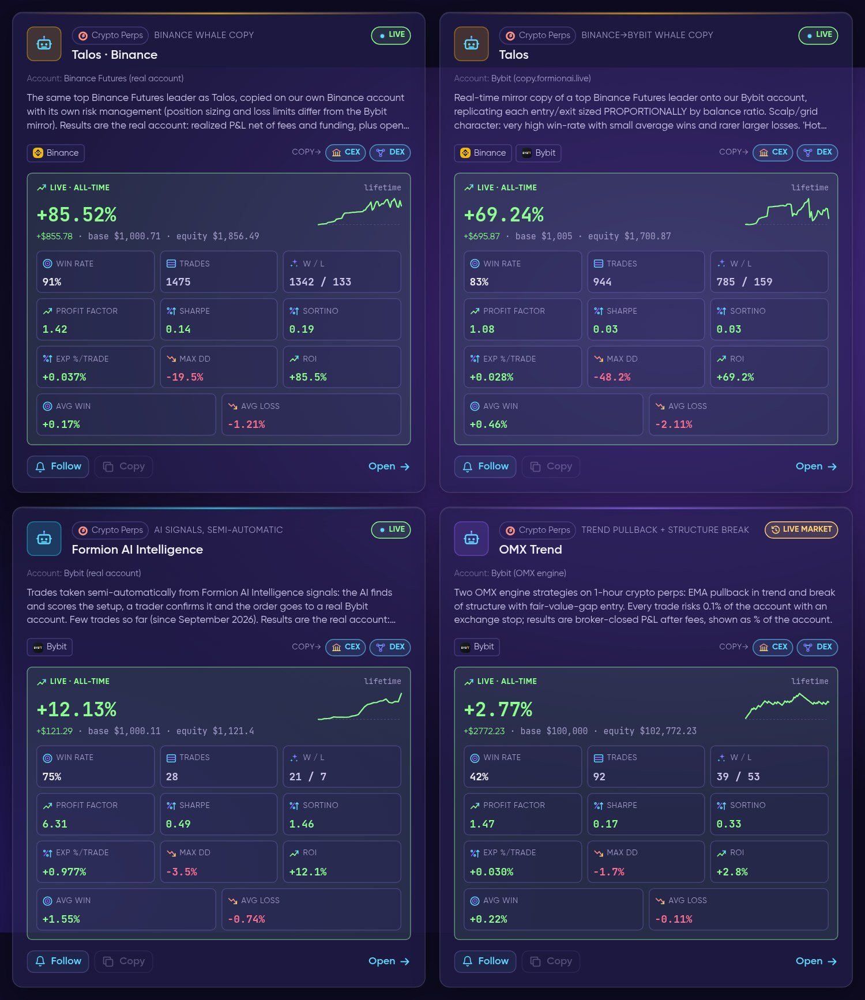
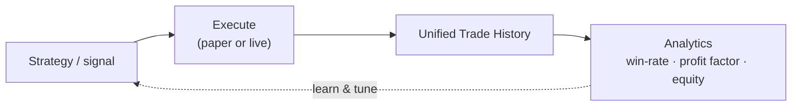
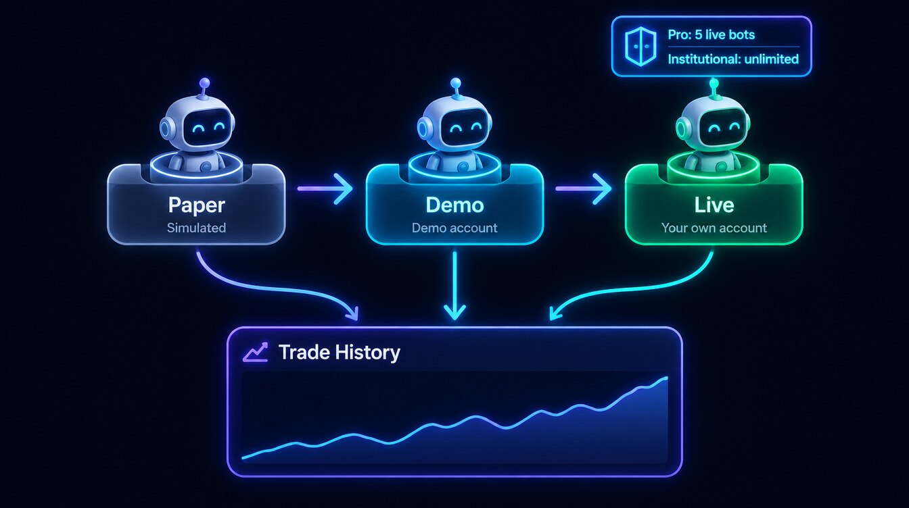

# 🦾 Bots & Automation

<figure><figcaption>
The Formion catalog in the Bots hub: every card shows its real account and all-time result (snapshot 30 Oct 2026).
</figcaption></figure>

Formion runs a catalog of automated strategies in the **Bots** hub. The public catalog shows only strategies that trade on a **real account** or the **live market** — each card shows that account and its all-time result, wins and losses included. New strategies are validated on **paper** first and only join the catalog once they run for real. Every strategy's trades flow into the unified **Trade History** hub so you can compare them side by side (KPIs, equity curve, win-rate, per-strategy analytics).


**Live execution** requires a **Pro** plan (5 live bots) or **Institutional** (unlimited). Neural (free) has no live bots but runs unlimited **paper** bots, and demo attachments are open to every plan. You can build your own bot from a strategy, and automate chart alerts — see **[Webhook Automation](how-to-automate-trades-tradingview-alerts.md)**.


## Build your own — Strategy Lab → Bots Hub → Marketplace

<figure><figcaption>
Every bot starts on paper, can be attached to a demo account, and goes live on your own account within your plan limit — all results land in Trade History.
</figcaption></figure>

You're not limited to Formion's catalog. The full creator flow, **no code required**:

1. **Strategy Lab** — build a strategy from rules, indicators and conditions, then validate it in the **Backtester**. The **Edge Finder** (AutoML) goes further: give it just a symbol and it searches for the best-fitting strategy class (DCA / grid / mean-reversion / breakout…) for the current market regime.
2. **Bots Hub** — build a **paper** bot from a supported catalog strategy (**Bots → Build**), or attach an attachable Formion bot or marketplace strategy to **your own** connected account in **demo** or **live** mode. Live attachments count toward your plan's live-bot limit. Your bots, your keys, your account.
3. **Marketplace** — publish your strategy once it passes the publish quality gate (fresh 1-year backtest, at least 30 trades, drawdown ≤ 30%, positive out-of-sample expectancy). Other traders subscribe, **you earn**, and the platform takes a fee. Paid strategy subscriptions are checked out on formion.ai.

Every strategy and bot — Formion's and yours — streams into the unified **Trade History** with the same analytics suite, so a community strategy is judged on the exact same KPIs as a flagship engine.

## Bot building blocks (@formiontradingbot)

These bot types run from the **@formiontradingbot** Telegram bot on your own connected exchange:

| Bot | Command | What it does |
|---|---|---|
| **DCA** | `/dca` | Buys (or opens long/short) a fixed USDT amount on a repeating interval, with an optional cap on the number of runs. |
| **Grid** | `/grid` | Places a ladder of limit orders between a low and high price (5–30 levels) in neutral, long-only or short-only mode. |
| **Indicator** | `/signal` | Fires when a built-in indicator (RSI, MACD, EMA 20, Bollinger band or price) crosses your threshold, then buys, sells, closes or just notifies. |
| **Trailing** | `/trailing` | Software trailing stop on an open position, trailing by a set % from the peak (long) or trough (short). |
| **Funding-arb** | `/funding_wizard` | Opens a delta-neutral hedge across two venues (long where funding is cheaper, short where it is richer) and closes it after the duration you set. |
| **Alarm** | `/alarm` | Notifies you when price crosses a target (above / below). No order is placed. |

TradingView alerts can also place orders on your connected CEX/DEX through **TradingView Automation** on formion.ai (see **[Webhook Automation](how-to-automate-trades-tradingview-alerts.md)**).

## Strategy catalog

The public **Bots** hub shows each bot's pool (**live** or **live market**) on its card, with the real account behind it. Numbers below are the all-time results shown on the cards on **30 October 2026**; the hub updates them continuously, so always check the live card.

### Crypto perps

| Bot | Pool | Account | All-time result | What it does |
|---|---|---|---|---|
| **Talos · Binance** | live | Binance Futures (real account) | **+84.9%** · 1,475 trades · 91% win rate · max DD −19.5% | Copies a top Binance Futures leader on our own Binance account with its own position sizing and loss limits. |
| **Talos** | live | Bybit (real account) | **+66.3%** · 944 trades · 83% win rate · max DD −48.2% | Real-time mirror of the same top Binance Futures leader on our Bybit account, each entry/exit sized proportionally by balance ratio. Scalp/grid character: very high win rate with small average wins and rarer, larger losses. |
| **Formion AI Intelligence** | live | Bybit (real account) | **+14.6%** · 27 trades · 74% win rate · profit factor 4.60 · max DD −3.5% | Semi-automatic: the AI finds and scores the setup, a trader confirms it and the order goes to a real Bybit account. Few trades so far (since September 2026). |
| **OMX Trend** | live market | Bybit (OMX engine) | **+2.8%** · 92 trades · profit factor 1.47 · max DD −1.7% | Two OMX engine strategies on 1-hour crypto perps: EMA pullback in trend and break of structure with fair-value-gap entry. Every trade risks 0.1% of the account with an exchange stop. |

### Prediction markets

| Bot | Pool | Account | All-time result | What it does |
|---|---|---|---|---|
| **Poly Solo Directional · Beta** | live | Polymarket wallet (real money) | **+14.0%** · 30 resolved bets · max DD −30.3% | Directional bets on Polymarket short-term crypto markets using the low-risk leg from our arbitrage scanners. Since 16 Oct 2026 it runs in paper mode while it is re-checked, so the live record is paused. |
| **Polymarket Whale Copy · Beta** | live | Polymarket wallet (real money) | **−12.8%** · 44 trades | Copies the BUY orders of a tracked Polymarket whale at the smallest allowed size (max $3 per trade, $15 per day, automatic stop at −$15). Early beta, shown honestly. |


Past results are not a promise of future results. Small samples (beta cards, few trades) can change quickly — the card says when a record is still young.


## Tracking performance

Open **Trade History** in the app (Backtest → All Trades) and filter by bot to see its KPIs, equity curve, win-rate, hold-time buckets, and per-symbol / per-session breakdowns. Every new bot automatically inherits the full analytics dashboard.
