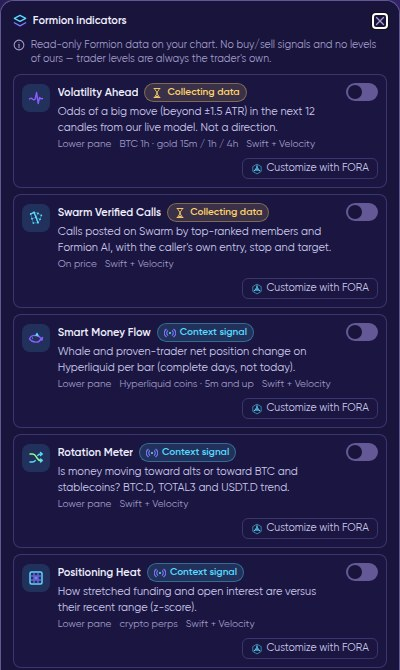
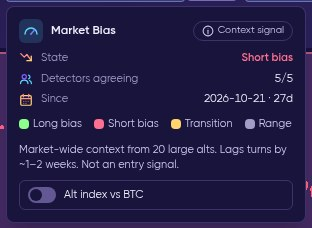
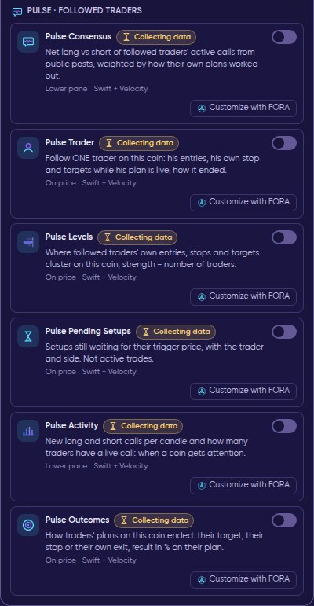
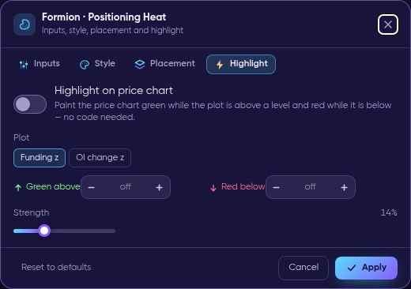

# 🎛️ Chart Indicators

Chart Pro (**app.formion.ai/chart**) has a second set of indicators next to the classic grid: **Formion indicators**. They read Formion's own data — trader calls, positioning, market-wide state — and draw it on your chart. Every indicator on this page works on both chart engines, **Swift** and **Velocity** (see [Chart Pro](chart-pro.md)).


None of these indicators gives a buy or sell signal, and none draws levels of ours. Where a level is shown, it is the trader's own level, exactly as he wrote it. Each card shows its **measured status** — **Verified**, **Collecting data** or **Context signal** — so you know how much weight it can carry.


## Formion indicators gallery

Open it with the **Formion indicators** button in the tools row above the chart (the number next to it = how many are on).

<figure><figcaption><p>The gallery: every card says what it shows, where it draws, which markets it covers and its measured status.</p></figcaption></figure>

Every card shows:

* an icon, the name and one line on what it shows;
* where it draws — **On price**, **Lower pane** or **Time axis** — and which markets it covers;
* its status (hover the pill for the explanation);
* an on / off switch;
* **Customize with FORA** on the ready-made indicators — it opens [FORA](fora.md) with a ready prompt and the indicator's source code. Nothing is sent until you finish the sentence; FORA then builds **your own copy**.

There are two kinds of cards:

* **Chart layers** you already know — **Market Bias**, **Liquidation pressure** and **Events** — are only switched on and off from here. Events carries a **Calendar** tag instead of a status: it is a calendar of releases, not a measured signal.
* **Ready-made Formion indicators** — turning one on saves a copy into your indicator library, so it needs sign-in and is remembered on your account (you also find it in **My indicators**). They are computed on the server from Formion data aligned to each candle's close — no look-ahead.

| Indicator | Where | What it shows | Status |
| --- | --- | --- | --- |
| **Volatility Ahead** | Lower pane | The odds (%) that price leaves a band of ±1.5 ATR within the next 12 candles, from our live move model. **It does not predict direction.** Amber line = "Big move expected", teal line = "Quiet expected". BTC 1h and gold (XAU) 15m / 1h / 4h only. | Collecting data |
| **Pulse Consensus** | Lower pane | Net long vs short of followed traders' **active** calls on this coin, from public posts — green columns while net long, red while net short. Details below. | Collecting data |
| **Swarm Verified Calls** | On price | Calls posted on [Swarm](swarm.md) by authors with FRS ≥ 300 and at least 10 graded calls — members and **Formion AI** — with the caller's own entry, stop and target while the call is open. | Collecting data |
| **Smart Money Flow** | Lower pane | Hyperliquid: whales' net position change per candle (purple histogram) and proven directional traders' net over the last 20 candles (amber line). Complete UTC days only — today is empty. Hyperliquid coins, 5m and up. | Context signal |
| **Rotation Meter** | Lower pane | % change of BTC dominance, TOTAL3 and USDT dominance, plus a **Rotation score**: above 0 = money moving toward alts, below 0 = toward BTC or stablecoins. The same on every symbol. | Context signal |
| **Positioning Heat** | Lower pane | z-score of funding (columns, amber beyond ±2) and of the open-interest change (line), each against its own last 200 candles. Dashed ±2 levels; the pane tints amber while either is beyond ±2 (crowded). Crypto perps. | Context signal |

How to read them:

* **Volatility Ahead** — "big move expected" means expect range expansion (breakouts, wider stops); "quiet expected" means expect a range. A value appears only once the hourly model has written it, and it lasts for its 12-candle horizon.
* **Smart Money Flow** — trader classes are set from the 3 previous days only. It is context, not a copy or entry signal.
* **Positioning Heat** — above +2 = longs crowded and paying a lot, below −2 = shorts crowded. Extremes can last; it is not a reversal signal on its own.

<figure><figcaption><p>ETH 4h: Market Bias bands behind the candles, then Positioning Heat (amber columns = crowded funding), Pulse Consensus and Rotation Meter.</p></figcaption></figure>

## Market Bias layer

**Market Bias** is a button in the tools row (and a card in the gallery). It is off by default, works on every plan and shows **one market-wide state per day — the same on every chart**, because it reads the whole market, not the coin you are looking at.

* Translucent **day bands** behind the candles: 🟢 green = **Long bias**, 🔴 red = **Short bias**, 🟡 amber = **Transition** (detectors disagree or turning), grey = **Range**.
* Data: Formion's live market bias — 5 detectors on an index of 20 large alts plus BTC.
* The **ⓘ** button opens a card with the current state, how many detectors agree (for example **5/5**), since which day it holds, and the note *"Market-wide context from 20 large alts. Lags turns by ~1–2 weeks. Not an entry signal."*
* The optional strip **Alt index vs BTC** (off by default) shows the alt index and BTC, both set to 100 on the first visible day, for the last ~90 days. It is not drawn on phones or in a very low price pane, so the candles stay readable.
* A **Stale** tag appears when the data is older than 12 hours.

Status: **Context signal**. It confirms a trend after it started and lags turns by about 1–2 weeks; it has no levels and no buy / sell markers.

<figure><figcaption><p>The ⓘ card: current state, detectors agreeing, since when, the colours and the Alt index vs BTC switch.</p></figcaption></figure>

## Pulse indicators

The gallery has its own section **Pulse · Followed traders**. These indicators draw what the traders followed in [Formion Pulse](pulse.md) actually called on this coin — and how it ended. All of them are **Collecting data**.

| Indicator | Where | What it shows |
| --- | --- | --- |
| **Pulse Consensus** | Lower pane | Net long − short (%) of active calls on this coin. One vote per trader, weighted by his win rate on **his own** closed plans known at that candle (only traders with at least 5 closed plans count). Optional **Top traders line (N)** — a second violet line with only the N heaviest traders — and **Markers on flip** where the consensus crosses 0. |
| **Pulse Trader** | On price | **One** trader on this coin: markers where his entry actually filled, his entry / stop / targets while his plan is active, how each plan ended (**Target hit**, **Stop hit**, **His exit**, with % on his plan) and a corner table with his closed plans and plan outcome. Under 5 closed plans the table says *Collecting data*. |
| **Pulse Levels** | On price | Where traders' own levels cluster: **Entry** zones (cyan), **Stop** zones (red — where their stop liquidity sits) and **Target** zones (green), with the number of traders in each zone. Only active plans count. |
| **Pulse Pending Setups** | On price | Setups still waiting for their trigger: a dashed line at his trigger price with *@handle long · waits*. The line ends when it fills, is cancelled or expires (at most 30 days). Not trades, not signals. |
| **Pulse Activity** | Lower pane | Attention on this coin: green columns = new long calls per candle, red columns = new short calls, violet line = traders with an active call. Not a direction signal. |
| **Pulse Outcomes** | On price | Every closed plan at the candle it closed — **Target hit** (green), **Stop hit** (red) or **His exit** (violet) — with *@handle +x.x %* on his plan. The original post is linked in his [trader profile](pulse-trader-profile.md). |

The rules are the same as everywhere in Pulse:

* **Only the trader's own levels.** Nothing is drawn where he gave no stop or target — we never invent one.
* **The clock starts at activation**, when his entry price actually traded — not when he posted.
* A call stays active until his own exit, at most for his typical hold (the median of his earlier closed plans).
* **Public posts only** — X, YouTube and public Telegram channels.

<figure><figcaption><p>The Pulse section of the gallery — six indicators built only from followed traders' own public calls.</p></figcaption></figure>

### Pulse settings

The Pulse indicators share one set of settings in **Settings → Inputs**, saved on your account. Each indicator shows the rows that apply to it — Pulse Trader, for example, has a single **Trader** picker instead of the trader list:

| Setting | What it does |
| --- | --- |
| **Traders** | All followed traders, or a picked list — each with avatar, @handle, calls on this coin, closed plans and measured style. Pulse Trader has a single **Trader** picker (empty = the trader with the most public calls on this coin). |
| **Sources** | X / YouTube / Telegram. |
| **Public posts only** | Always on (locked). |
| **Trader style** | Scalper / intraday / day trader / swing / position — measured from his own closed trades. Unmeasured traders drop out while a style is picked. |
| **Min closed plans** | His closed plans known at that candle. |
| **Weighting** | Win rate on his plans, or equal (Pulse Consensus). |
| **Include pending setups** | Off = the clock starts at his trigger fill; on = setups count from the post, shown as pending. |
| **Include projections** | Price targets that are not trades — off by default, labelled when on. |
| **Lookback (days)** | Only calls posted in the last N days; 0 = all. |
| **Display** | Show markers / levels / labels. |
| **Hide levels farther than %** | Pulse Trader, Pulse Levels and Pulse Pending Setups. Default 50 %. A level farther from the price than that is not drawn, so the candles stay readable; Pulse Trader lists it in its table as *His target (off chart)* with the price. Nothing is removed from the data. |

<figure><figcaption><p>Pulse Trader → Settings → Inputs: the trader picker, sources, display and calls options.</p></figcaption></figure>

A coin with no calls shows an empty state with an icon in the legend — not an error. You can also ask FORA in words, for example *"follow only CrypNuevo on the chart"*.

## Indicator styles

Your own indicators — Pine, TS, the ones FORA builds — and the Formion indicators can draw in the same looks traders know from Pine charts:

* **Plot types:** line, step line, area, histogram, columns, circles, cross — width 1–6, solid, dashed or dotted, with transparency.
* **A colour per candle** — for example a histogram green above 0 and red below.
* **hline** levels with a line style, and **fills** between two plots.
* **Background per candle** (`bgcolor`) in the indicator's own pane — or **on the price chart** (`force_overlay` in Pine, `onPrice` in TS).
* **Candle colours** (`barcolor`) — recolours the price candles.
* **Own candles** (`plotcandle` / `plotbar`) — for example CVD candles.
* **Labels, lines and boxes** (up to 500 of each) and a **table** in a chart corner (up to 12 × 6) — from TS.

Colours follow the theme by default (formion, dark, light…). A colour that would vanish on the background is swapped for a readable one.

<figure><figcaption><p>Settings → Style: change the type, colour, width and line style of every plot — no code.</p></figcaption></figure>

## Indicator settings

Every custom indicator has a chip in the **legend** at the bottom left of the price chart — colour mark, name and a live value (green ↑ / red ↓). On Swift the legend sits behind one chip, **Indicator styles**. The **⋯** menu on a chip has:

* **Settings: inputs, style, placement** — the window below;
* **Move to: price chart (own scale)** — or back to its own pane;
* **Highlight on price chart…**;
* **Hide from the chart**.

<figure><figcaption><p>The ⋯ menu on a legend chip.</p></figcaption></figure>

**Settings** opens a window with four tabs. Your choices are saved per indicator on your account.

| Tab | What you set |
| --- | --- |
| **Inputs** | Every input the indicator declares: numbers with min / max / step, a choice from a list, on / off switches, multi-choice and — for Pulse — the trader pickers. **Apply** recomputes the indicator at once; **Reset to defaults** restores the declared values. |
| **Style** | Per plot: type, colour, width, line style, show / hide. |
| **Placement** | As the script says, **Price chart** or **Own pane**. On the price chart it gets its own left scale or no scale, so the candles are never squashed. Pane height. |
| **Highlight** | **Highlight on price chart**: paint the price chart green while a plot is above X and red while below Y, with a strength — no code. |

<figure><figcaption><p>Settings → Highlight: paint the price chart green above a level and red below another, with the strength you choose.</p></figcaption></figure>

## Build your own: Indicator Lab, FORA and ctx data

Indicators you write or FORA builds for you can read the same Formion data as the presets. A TS indicator is a function `indicator(candles, inputs, ctx)` that returns plots; every `ctx` call is aligned to each candle's close (no look-ahead). Test any indicator against random entries in **Indicator Lab** (**app.formion.ai/my-indicators**).

### Formion data sources

| Call | What it returns |
| --- | --- |
| `ctx.swarm(mode, opts)` | Swarm trade calls on this symbol. Modes: `net` (FRS-weighted long − short of open calls, −1…+1), `count` (open calls), `top` (like `net`, only authors with FRS ≥ `minFrs`, default 300, and ≥ `minCalls`, default 10), `signal` (+1 / −1 at the candle a qualifying call was posted), `level` (the author's own `entry` / `stop` / `target` of the newest open call via `field`; empty when he gave none). `ai`: 1 everyone (default), 0 members only, 2 Formion AI only. A call counts from its post time; FRS is recomputed per day only from calls graded before that day. |
| `ctx.pe('move')` / `ctx.pe('label')` | Volatility Ahead: `move` = odds 0…1 that price leaves ±1.5 ATR within 12 candles; `label` = +1 big move expected, −1 quiet expected, 0 undecided. BTC and gold (XAU) only. |
| `ctx.calls('*', { field: 'consensus' })` | Pulse Consensus, −1…+1 (`count` = active traders, `weight` = summed weight). The same filters as the Pulse settings (`traders`, `src`, `style`, `minClosed`, `weight`, `pending`, `proj`, `lookback`). |
| `ctx.calls('<handle>', { field })` | One followed trader's own calls: `signal` (+1 / −1 at a new call), `side`, `entry`, `sl`, `tp`, `tp2` (his levels while his call is active, empty when he gave none), `exit`. |

The other sources — `ctx.hl(…)`, `ctx.market(…)`, `ctx.funding()`, `ctx.oi()`, `ctx.bias()`, `ctx.regime(…)` — are explained by FORA when you ask for an indicator.

Example — the Swarm top-author stance as a coloured column histogram:

```js
function indicator(candles, inputs, ctx) {
  var s = ctx.swarm("top", { minFrs: 300, minCalls: 10 });
  return { overlay: false, plots: [
    { kind: "columns", title: "Swarm top net", data: s,
      colors: s.map(function (v) { return isNaN(v) ? null : (v >= 0 ? "up" : "down"); }) },
    { kind: "hline", title: "Zero", color: "muted", style: "dotted", data: s.map(function () { return 0; }) }
  ] };
}
```

### Plot styles in TS

* `kind`: `line`, `step`, `area`, `histogram`, `columns`, `circles`, `cross`, `hline`, `marker`, `fill`, `bgcolor`, `barcolor`, `candle`, `bar` (give `open` / `high` / `low` / `close` arrays for own candles).
* Every plot may carry `colors: […]` (one colour per candle, `null` = none), `width` 1–6, `style` `"solid"` / `"dashed"` / `"dotted"`, `base` (area / columns baseline) and `onPrice: true` (draw this plot or background on the price chart).
* Colours: `#rrggbb`, `#rrggbbaa`, `rgba()`, or theme tokens `up`, `down`, `accent`, `violet`, `amber`, `muted`, `text` — add `@0.2` for 20 % opacity (`"up@0.15"`). Prefer tokens: they look right in every theme.
* Shorthands next to `plots`: `bg: [{ color: "up@0.12", data: [1/0 per candle], onPrice: true }]` and `barColors: […]`.
* Drawings: `labels: [{ t, price, text, color, style }]`, `lines: [{ t1, p1, t2, p2, color, width, style, extend }]`, `boxes: [{ t1, t2, top, bottom, color, border, text }]`, `table: { position: "top_right", rows: [[{ text, color, bg, bold }]] }` (up to 12 × 6). `t` is the candle time in seconds.
* `pane: { height: 48–600 }` sets the pane height.
* Inputs for the **Inputs** tab: a comment line `// formion:input len {"type":"int","title":"Length","default":24,"min":2,"max":500}` (types `int`, `float`, `bool`, `select`, `multi`, `traders`, `trader`), read as `inputs.len`.

Example — colour the price chart green while a ratio is above 0.3:

```js
return { overlay: false,
  plots: [{ kind: "line", title: "Ratio", data: r }],
  bg: [{ color: "up@0.12", data: r.map(function (v) { return v > 0.3 ? 1 : 0; }), onPrice: true }] };
```

### Plot styles in Pine

The Pine subset supports the same looks:

```pine
plot(d, "Hist", color = d > 0 ? color.green : color.red, style=plot.style_histogram)
plot(d, "Cols", color = color.new(color.green, 20), style=plot.style_columns, histbase=0)
plot(m, "Step", color=color.orange, style=plot.style_stepline, linewidth=2, linestyle=plot.linestyle_dashed)
hline(0, "Zero", color=color.gray, linestyle=hline.style_dotted)
bgcolor(d > 3 ? color.new(color.green, 85) : na, force_overlay=true)
barcolor(d > 2 ? color.lime : na)
plotcandle(open, high, low, close, "Own candles", color = close > open ? color.teal : color.maroon)
```

Also supported: `plot.style_area`, `plot.style_circles`, `plot.style_cross`, `plot.linestyle_dotted`, `color.new(c, transparency)`, `color.rgb(r, g, b, t)`, colour variables, `plotbar`, and `na` as a gap. Pine `input.int` / `input.float` / `input.bool` fields show up in the **Inputs** tab with their titles and min / max / step.


Not supported in Pine: `label.new`, `line.new`, `box.new` and `table.new`. Use TS for drawings and tables — FORA does this for you when you ask in words.


Related: [Chart Pro](chart-pro.md) · [Formion Pulse](pulse.md) · [Swarm](swarm.md) · [FORA](fora.md) · [Strategy Lab](strategy-lab.md)
