# 📊 Chart Pro — Quantum Terminal

<figure>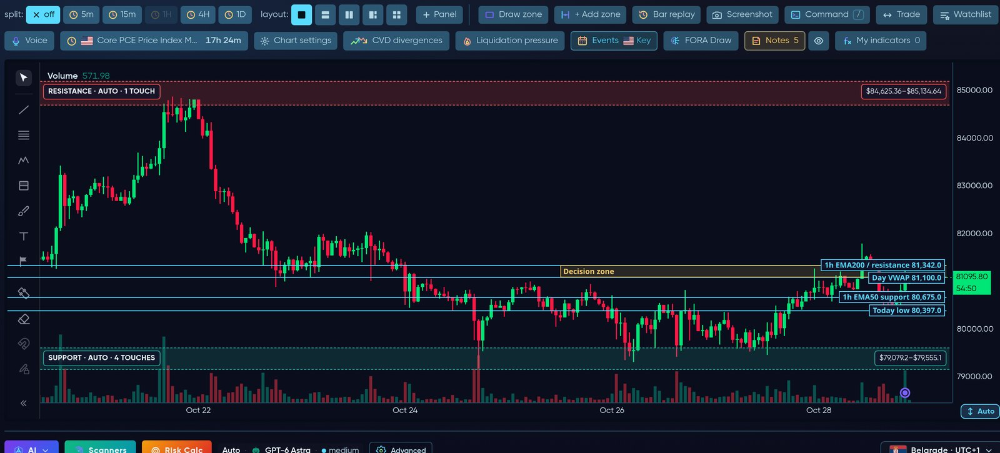<figcaption>Quantum Terminal: chart tools on top, the chart, drawing tools on the left, live price on the right.</figcaption></figure>

**Chart Pro** (app.formion.ai → Chart Pro, or straight to **app.formion.ai/chart**) is Formion's trading chart. Inside it runs **Quantum Terminal** — our chart engine that picks the fastest way to draw what you have switched on, so the chart stays smooth while you trade.

> Speed is the point. A chart that lags costs you entries. Quantum Terminal is measured every week and tuned so that turning on more studies does not slow the candles down.

## How Quantum Terminal works — Swift and Velocity

Quantum Terminal has two drawing engines under one name. You never have to choose — it switches for you.

| | ⚡ **Swift** | 🚀 **Velocity** |
|---|---|---|
| What it is | The light, very fast engine | The full engine with every study |
| Best for | Fast trading, phones, standard indicators | Advanced order-flow and positioning studies, split panels |
| Draws | Candles, volume, EMA, Bollinger Bands, VWAP, RSI, MACD and the other standard indicators, Levels, Liquidity Heat & Magnets, Whales, Sessions, S/R Zones, FVG / IFVG, Order Blocks, Breakers, Mitigation Blocks, BoS/CHoCH, Fibonacci, D/P Zones, Volume & Delta Profile, Order Book, DOM, Footprint, Heatmap, Tape | Everything Swift draws **plus** AVWAP, Big Trades, Bubbles, Weekend Gaps, CVD, Divergences, Funding, Ichimoku, Bid/Ask imbalance, Liquidations, Long/Short ratio, Net Delta, Open Interest, Patterns, Trades, Whale vs Retail, split panels |
| Phones | ✅ Always used on phones | Desktop only |

**Quantum mode (default):** the chart starts on Swift. The moment you switch on a study only Velocity can draw — for example **CVD** or **Open Interest** — or open split panels, Quantum Terminal moves to Velocity by itself, and back again when you turn it off. Symbol, timeframe and drawings stay where they are.


On a phone the chart always uses Swift, so it stays light on battery and data. Studies that need Velocity show a small **"Desktop only"** note instead of slowing the phone down.


<figure>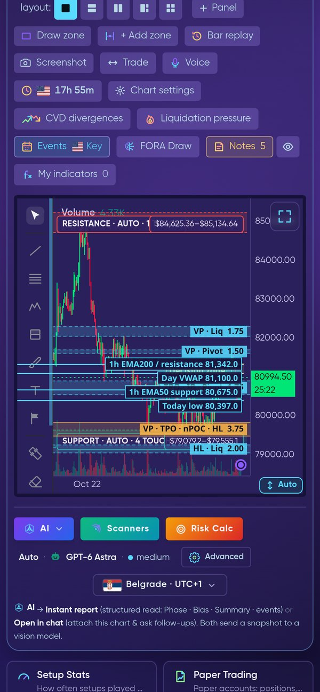<figcaption>The same chart on a phone — Swift, with the chart tools above it and AI, Scanners and Risk Calc below.</figcaption></figure>

## Indicators on the chart

The chart opens **clean** — no indicators until you switch them on in the indicator grid above the chart. A highlighted chip is on; your choice is remembered for next time. Here is what the most used ones look like on a real BTCUSDT 1h chart.

### Volume, EMA 200 and VWAP

<figure>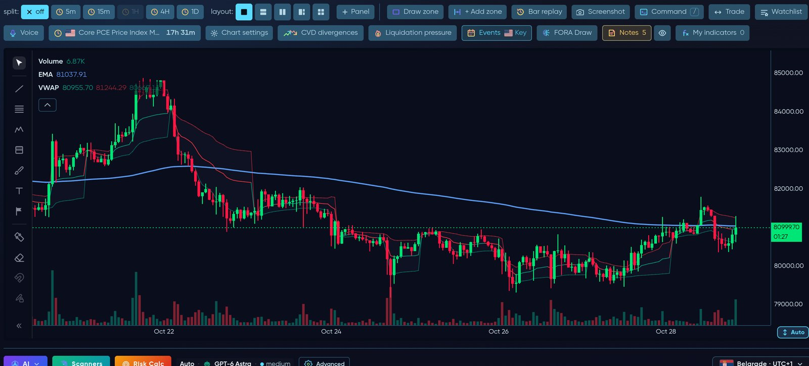<figcaption>Volume bars, the 200 EMA trend line and VWAP with its bands.</figcaption></figure>

### Bollinger Bands

<figure>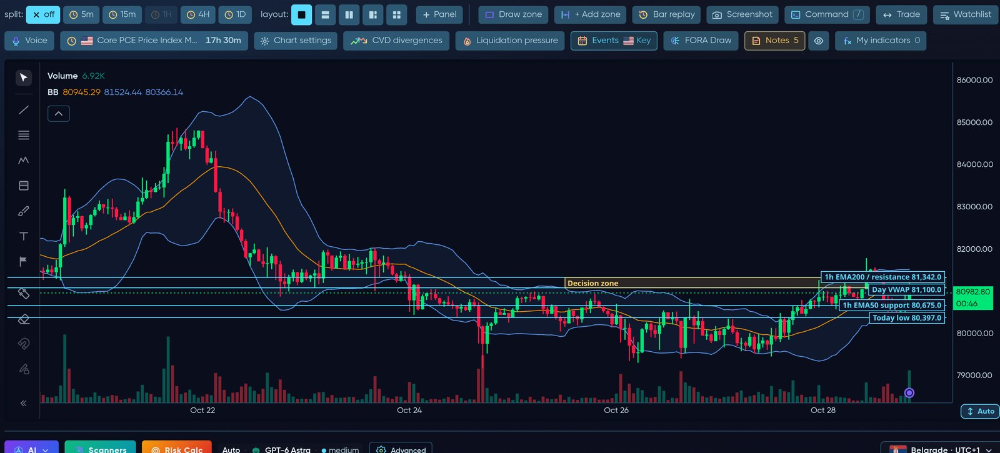<figcaption>Bollinger Bands — volatility envelope around the 20-period average.</figcaption></figure>

### Pivot levels

<figure>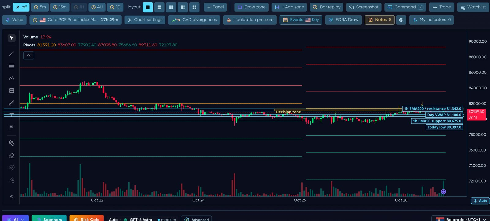<figcaption>Automatic pivot levels — resistance above (red), support below (green).</figcaption></figure>

### Liquidity Magnets and Whales

<figure>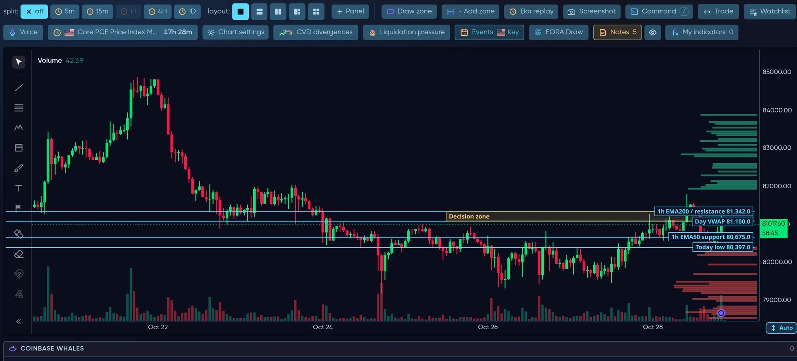<figcaption>Liquidity Magnets on the right edge show resting liquidity that tends to pull price; Whales marks large orders.</figcaption></figure>

### Smart-money concepts — FVG, Order Blocks, Breakers

<figure>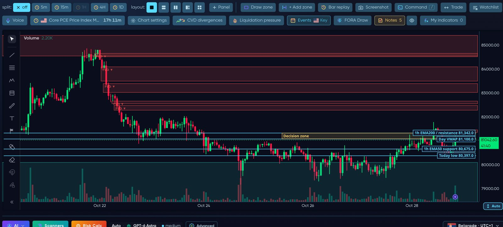<figcaption>FVG — fair value gaps (price imbalances) still open, bearish in red, bullish in green.</figcaption></figure>

<figure>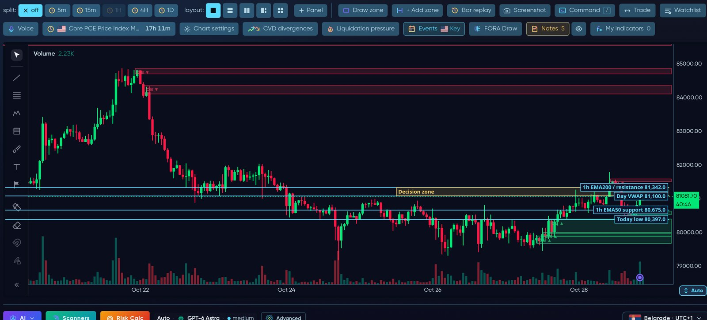<figcaption>OB — order blocks: the last opposite candle before a strong move.</figcaption></figure>

### Market structure — BoS / CHoCH and Swings

<figure>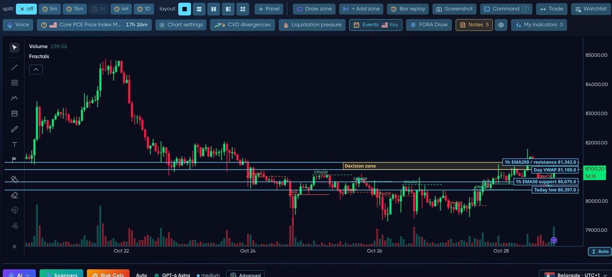<figcaption>Break of Structure / Change of Character and swing highs and lows (fractals).</figcaption></figure>

### Fibonacci and Premium / Discount zones

<figure>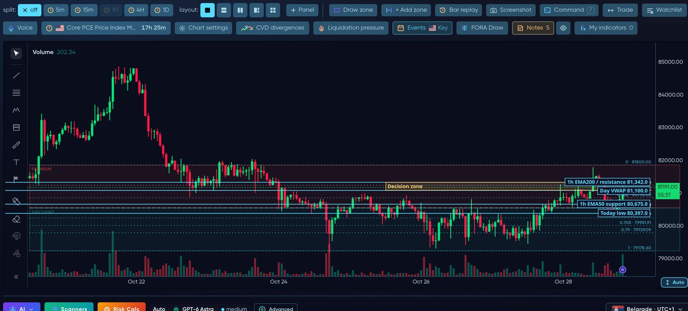<figcaption>Automatic Fibonacci levels on the last swing, with premium (expensive) and discount (cheap) halves.</figcaption></figure>

### S/R Zones

Automatic support and resistance zones with the number of touches, plus your own zones (**Draw zone** / **+ Add zone**). See the picture at the top of this page.

### RSI and MACD

<figure>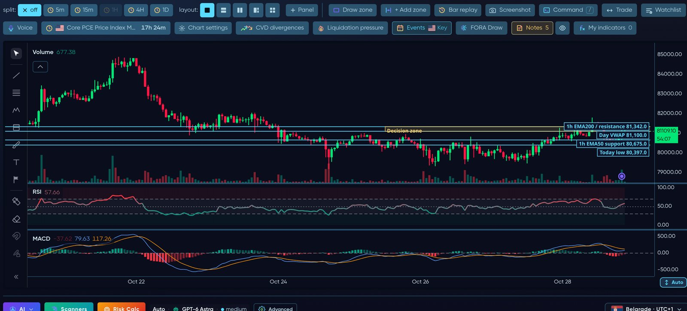<figcaption>Oscillators open in their own panes under the price, time-aligned to the candles.</figcaption></figure>

### SuperTrend and Ichimoku

<figure>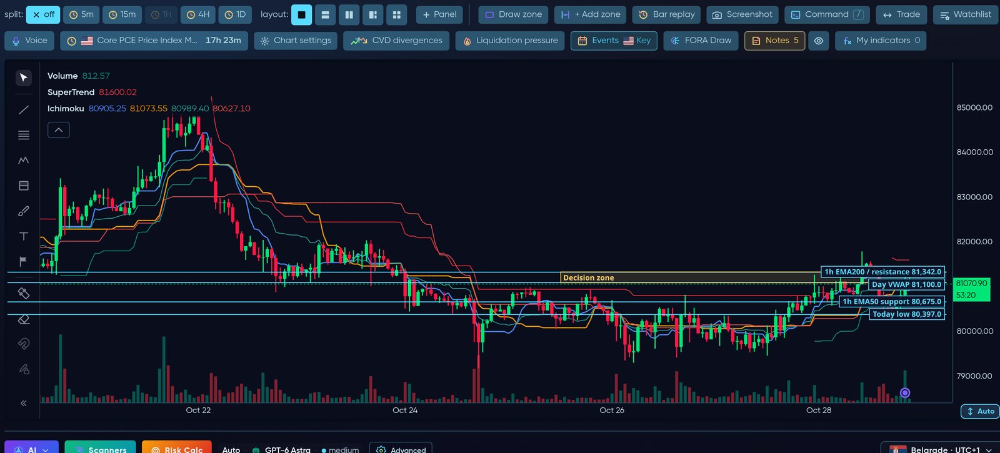<figcaption>SuperTrend and the Ichimoku cloud for trend direction.</figcaption></figure>

### CVD, Open Interest and Funding (Velocity)

<figure>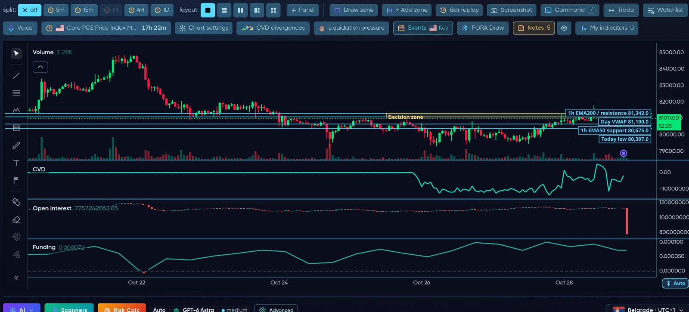<figcaption>Cumulative volume delta, open interest and funding rate in panes under the chart — the positioning behind the move.</figcaption></figure>

### Long/Short ratio and Whale vs Retail (Velocity)

<figure>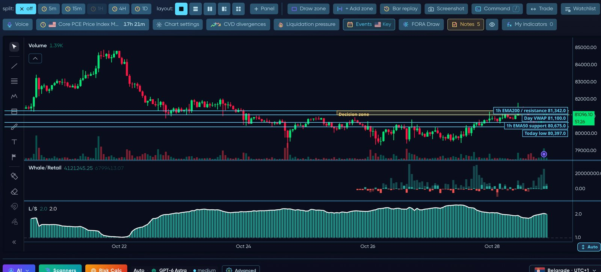<figcaption>Who is positioned how: long/short ratio and large accounts versus small ones.</figcaption></figure>

### Big Trades and Bubbles (Velocity)

<figure>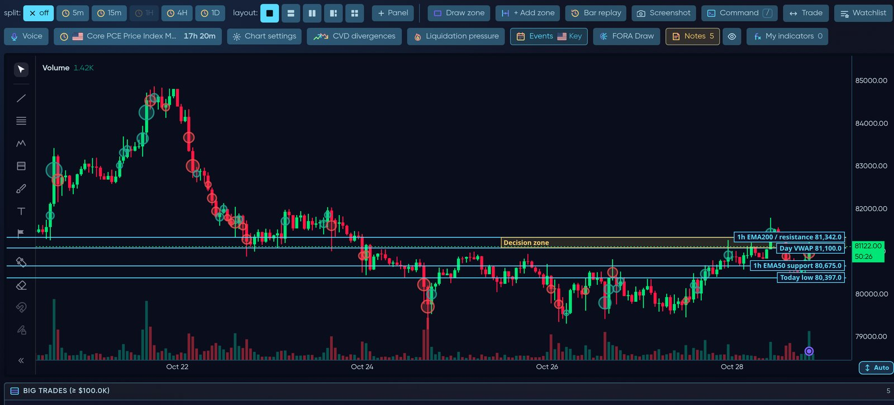<figcaption>Large prints drawn as bubbles on the candles where they happened.</figcaption></figure>

### Patterns and Divergences (Velocity)

<figure>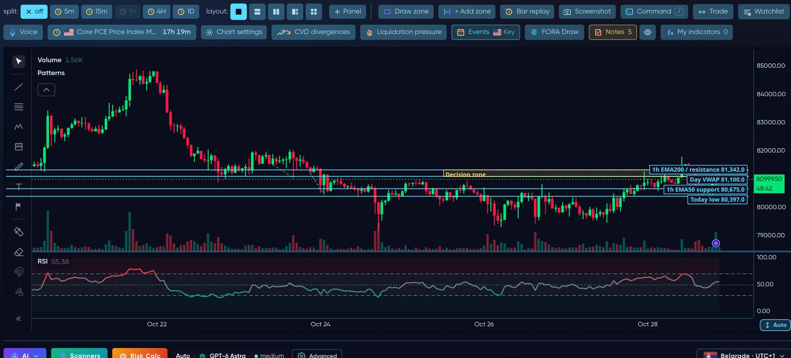<figcaption>Candle patterns on price and divergences between price and RSI.</figcaption></figure>

### Anchored VWAP (Velocity)

<figure>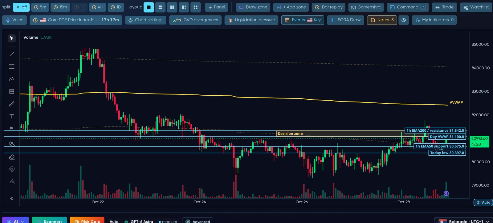<figcaption>AVWAP anchored to a swing — the average price paid since that point.</figcaption></figure>

More in the grid: Stoch RSI, Williams %R, ATR, ADX, IFVG, Mitigation Blocks, Geo levels, Weekend Gaps, Net Delta, Bid/Ask imbalance, Trades, Liquidations and the **Order Flow Suite**.

## Chart tools

Every extra layer has its own button in the tools row above the chart — never on top of the candles — and whatever you open appears **above** the chart.

| Button | What it does |
|---|---|
| **split / layout** | 1, 2 or 4 charts side by side, each with its own timeframe |
| **Draw zone / + Add zone** | Draw your own support/resistance zones |
| **Bar replay** | Step through history candle by candle |
| **Screenshot** | Save the chart as an image |
| **Command** (press **/**) | Type a symbol, timeframe or indicator and jump straight there |
| **Trade** | Opens the trade strip on the chart (see below) |
| **Watchlist** | Your symbols next to the chart |
| **Voice** | Talk to FORA about the chart you are looking at |
| **Next event** | Countdown to the next key US release |
| **Chart settings** | Candle colours, background, watermark, panels under the chart |
| **CVD divergences** | Marks where price and spot/perp CVD disagree |
| **Liquidation pressure** | Where leveraged positions would be forced out |
| **Events** | Key US economic releases on the time axis |
| **FORA Draw** | FORA marks levels and zones on your chart |
| **Notes** | Your own notes pinned to a price and time; the eye button shows or hides them |
| **My indicators** | Every indicator or strategy you saved — show or hide each one, or **Hide all** |

### Split view

<figure>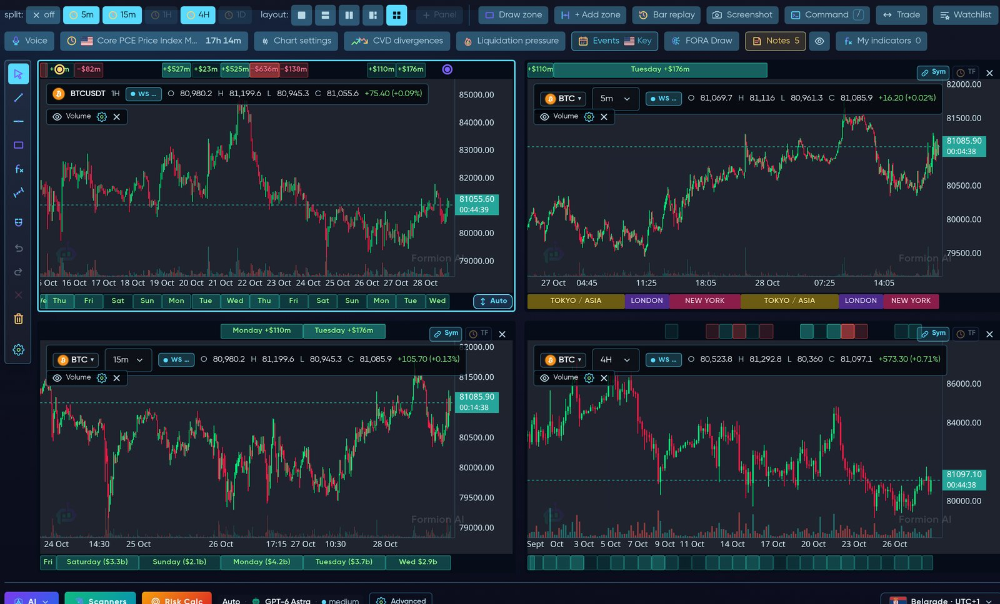<figcaption>Four charts at once — for example 1h, 15m, 5m and 4h of the same coin.</figcaption></figure>

### Events — only the releases that move markets

<figure>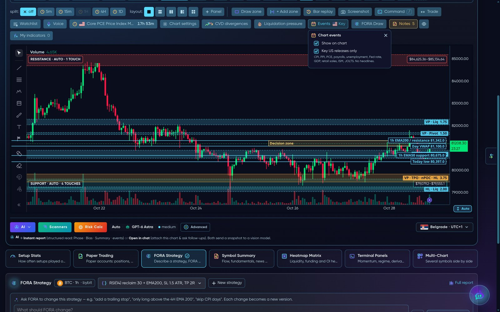<figcaption>Events shows only key US releases — CPI, PPI, PCE, payrolls, unemployment, Fed rate, GDP, retail sales, ISM, JOLTS. No headline noise.</figcaption></figure>

## Trading from the chart

<figure>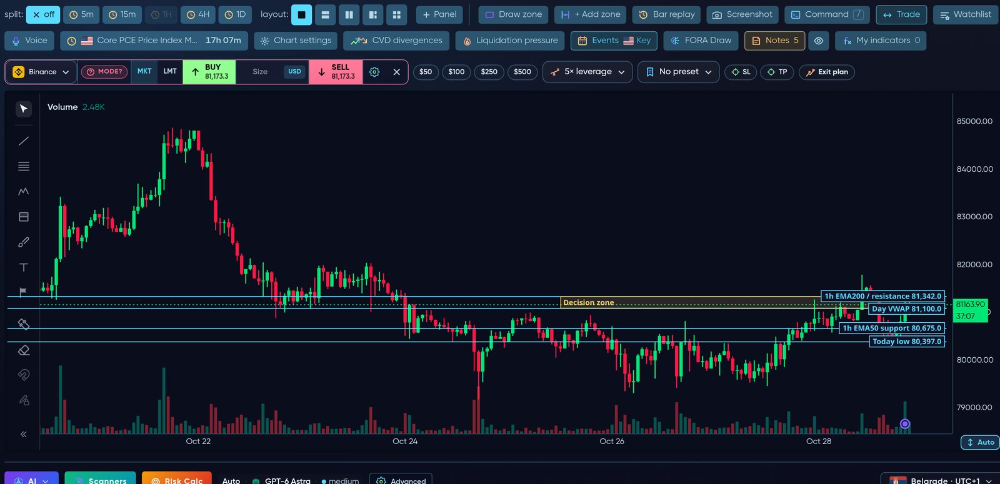<figcaption>Click Trade: market or limit, size in USD, % of capital or coins, leverage, SL/TP and an exit plan — without leaving the chart.</figcaption></figure>

* **Market** or **Limit** — for a limit order click the price on the chart or drag the line.
* Size in **USD, % of capital or coins** (crypto) and **lots or % of capital** (cTrader); quick-size buttons $50 / $100 / $250 / $500.
* Drag **Stop-loss** and **Take-profit** lines; open positions show live P&L and can be closed 25–100 %.
* Every order shows a confirmation with the full plan before anything is sent; the exchange minimum is checked first.
* Works with your connected exchange or broker account — see **[Brokers & Connections](brokers.md)**.

## FORA on the chart

### FORA 3D — ask about the chart you are looking at

<figure>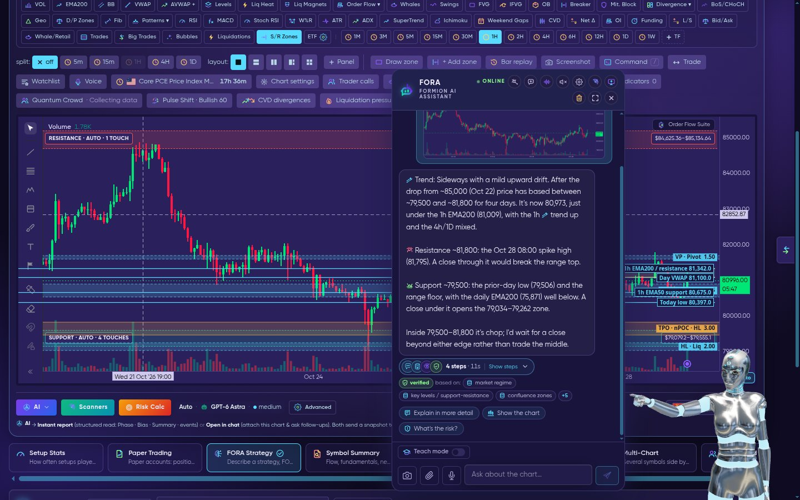<figcaption>Open FORA (bottom-right): the 3D assistant reads the chart you are on and answers with real levels — trend, resistance, support and what would change the picture.</figcaption></figure>

FORA sees the symbol, timeframe and the chart itself. Ask for an **analysis**, a **setup**, to **set an alert**, or to **backtest an idea** — she answers with real prices from the chart and shows what her answer is based on. A setup always comes as a card you review — FORA does not open trades on her own. See **[FORA — Trading Intelligence](fora.md)**.

### FORA Draw

<figure>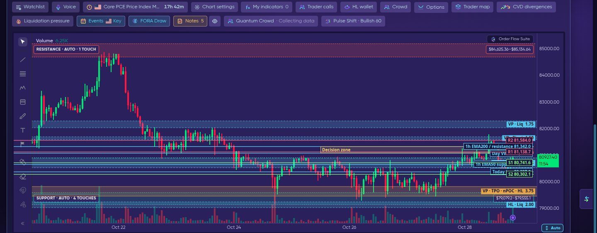<figcaption>FORA Draw → Support / Resistance: R1, R2, S1 and S2 drawn straight on the chart.</figcaption></figure>

Pick what FORA should draw: key levels, support/resistance, order blocks, FVG, structure, liquidity, sessions, Fibonacci + premium/discount, or everything.

## Order Flow Suite

Switch on **Order Flow** in the indicator grid to see what happens inside each candle: **bubbles** for aggressive buying and selling, **traps** and **absorption** markers, and **Spot vs perp CVD** in its own pane under the chart (Binance spot and USD-M futures). An amber band marks the moments when spot and perp move in opposite directions.

## Order-flow Constructor

The **Constructor** tab (Chart Pro → Constructor) is a dockable, resizable multi-panel layout with order-flow presets: Volume Profile & Footprint, Order book, multi-source order book (Binance, Bybit, OKX, Hyperliquid), DOM ladder, Orderbook heatmap, Tape, Liquidations feed and spoofing / iceberg detection.

## User Indicator Studio

Upload your own **Pine scripts** and render them on the chart — a Pine-subset compiler handles common scripts, with an AI translation fallback for the rest; both run through the same sandboxed pipeline. Your custom indicators appear in **My indicators**.


Open any **[Screener](screener.md)** row straight into Chart Pro to go from "this scored well" to "here's exactly where I'd enter" in one click.



On the free **Neural** tier charting covers 5 symbols, 4 timeframes (1H, 4H, 1D, 1W), 2 indicators and 3 drawings, without SMC zones or replay. **Pro** and **Institutional** unlock all symbols, timeframes, indicators and drawings, SMC zones and replay mode — see **[Pricing & Tiers](pricing.md)**.

