# 🪙 Coins Hub

The **Coins Hub** (app.formion.ai → Coins Hub) is where you follow coins day to day: a live coin table with trend scores, your own watchlists, a detail page for every coin, and tools for new launches and presales. The hub is labelled **BETA · experimental, no performance claim** — it shows data, not trade recommendations.

<figure><video src=".gitbook/assets/rec-coins-hub-tour.mp4" title="Live recording: search a coin, open Filters, open Bitcoin, save it to a watchlist, go back and open My watchlist."></video><figcaption>
Live recording: search a coin, open Filters, open Bitcoin, save it to a watchlist, go back and open My watchlist.
</figcaption></figure>

## Tool status

| Tool | Status | Who can open it |
| --- | --- | --- |
| 📋 **Dashboard** | ✅ Available | Everyone — also without login on hub.formion.ai and coin.formion.ai |
| 🛡️ **Presale Watch** | ✅ Available | Everyone — also without login |
| 🎯 **Sniper** | 🔒 Login needed | Signed-in users (padlock until you sign in) |
| 🔄 **DEX Swaps** | 🔒 Login needed | Signed-in users with a wallet connected in the Telegram bot |
| 🚀 **100x Finder** | 👑 Admin preview | Formion team only (BETA) |
| 🔭 **GMGN** | 🏗️ Being rebuilt | The page only shows a "Being rebuilt" notice |
| 🔍 **Token Scanner** | 🔧 Being fixed | Hidden while we fix logic errors |
| 👛 **Smart Wallets** | 🔧 Being fixed | Hidden while we fix logic errors |
| 🎓 **Graduation Radar** | 🔧 Being fixed | Hidden while we fix logic errors |
| 📋 **Listing Radar** | 🔧 Being fixed | Hidden while we fix logic errors |


Token Scanner, Smart Wallets, Graduation Radar and Listing Radar are **temporarily unavailable**: we are fixing logic errors in the data behind them, and they come back only after the fixes are verified. **Pulse** is no longer part of the Coins Hub strip — it now lives in the Analytics hub: [Pulse](pulse.md).


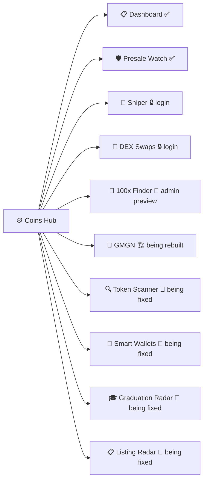

## 📋 Dashboard

The Dashboard has two parts: **Trend Watch** on the left and the **coin table** on the right. On a phone or a narrow window the table turns into cards.

### 📈 Trend Watch

<figure>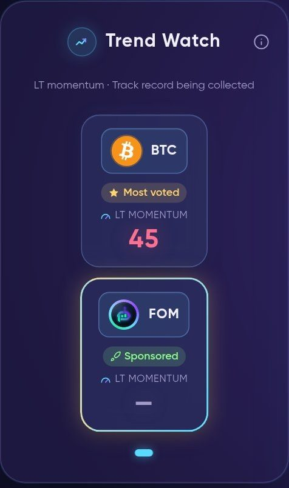<figcaption>
Trend Watch — highlighted coins, each with its LT momentum score.
</figcaption></figure>

Trend Watch shows a short, swipeable row of highlighted coins. A coin appears here when it is a **Sponsored** placement, the **Most voted** coin of the current week, **New listed**, or **Trending** (a measured 24h return of at least +8%). Every card shows the same **LT momentum** score as the table; a dash means the score is not available. Tap **ⓘ** next to the title for the full explanation.

* **⭐ Most voted** — the community's top pick this week (votes reset weekly).
* **🚀 Sponsored** — a paid placement by the project team. It is always labelled and is not a recommendation.

### 📊 Coin table

<figure>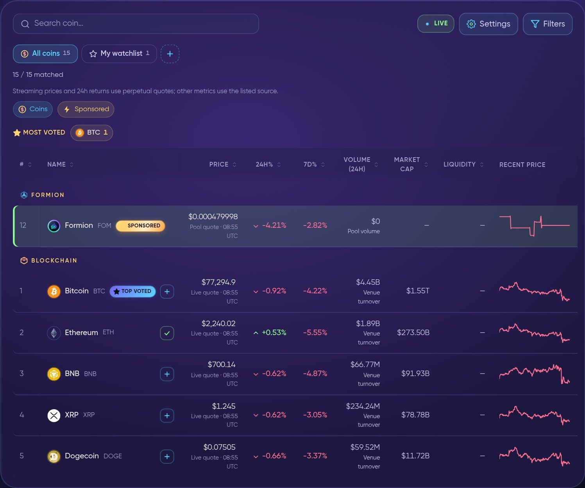<figcaption>
The coin table — search, live prices, watchlist tabs and coins grouped by category.
</figcaption></figure>

At the top of the table:

* **🔍 Search coin…** — type a name or ticker; the table narrows as you type (**Clear all** resets it).
* **🟢 LIVE** — prices are streaming in real time. You can switch to a lighter refresh in **Settings**.
* **⚙️ Settings** and **🔽 Filters** — see below.
* **All coins / My watchlist / ＋** — switch between the full list and your watchlists; **＋** creates a new watchlist.
* **⭐ MOST VOTED** — the coins with the most votes this week, with their vote count.

Coins are grouped by category (for example **Formion**, **Blockchain**, **Perp DEX**, **DeFi**, **Memecoin**). Each row has a **＋** button to add the coin to a watchlist (a ✓ shows it is already in one). Badges next to a name: **SPONSORED** (paid placement, labelled) and **TOP VOTED** (most votes this week).

<figure>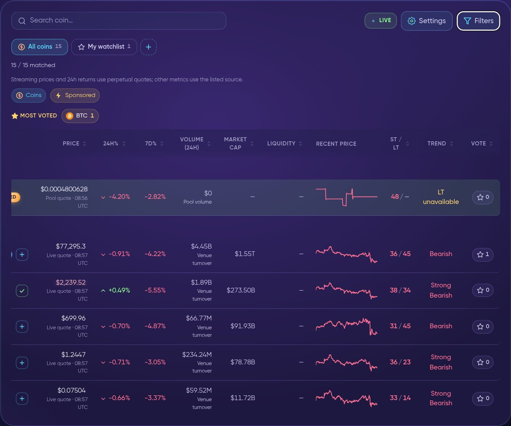<figcaption>
Scroll the table sideways for the trend columns and the weekly vote.
</figcaption></figure>

| Column | What it shows |
| --- | --- |
| **#** | Position in the list |
| **Name** | Coin name, ticker and badges |
| **Price** | Latest price. The line under it tells you where it comes from and when: **Live quote** (streaming perpetual quote), **Pool quote** (on-chain DEX pool) or **Hourly close** |
| **24h% / 7d%** | Price change over 24 hours and 7 days |
| **Volume (24h)** | Trading volume — **Venue turnover** for exchange-listed coins, **Pool volume** for DEX tokens |
| **Market cap** | Market capitalisation, when known |
| **Liquidity** | Measured DEX pool depth (a dash for coins that are not pool-priced) |
| **Recent price** | A small price sparkline |
| **ST / LT** | Two momentum scores from 0 to 100: **ST** = short term (hourly bars, about 7–12 days), **LT** = long term (daily bars, about 1 year, anchored to the 200-day line) |
| **Trend** | The LT regime in words: 70+ Strong Bullish · 60–70 Bullish · 50–60 Neutral · 40–50 Bearish · under 40 Strong Bearish. **LT unavailable** when there is not enough history |
| **Vote** | ⭐ Vote for the coin this week; the number is its current vote count |

Click any column header to sort. A coin can be short-term bullish in a relief rally while still long-term bearish below its 200-day line — that is why both scores are shown.


Streaming prices and 24h returns use perpetual quotes; the other metrics use the source named in the cell. The scores describe the market as it is now — they are not trading signals and the track record is still being collected.


### ⚙️ Settings

<figure>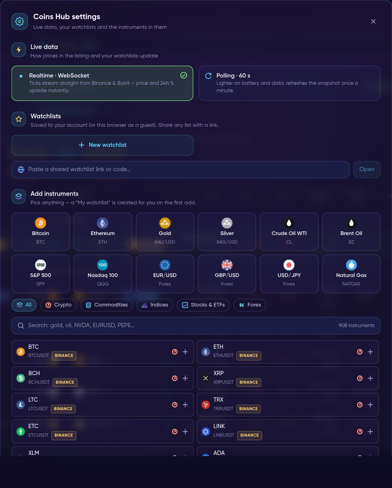<figcaption>
Settings — live data mode, your watchlists and 900+ instruments to add.
</figcaption></figure>

* **⚡ Live data** — **Realtime · WebSocket** (ticks stream straight from Binance and Bybit, price and 24h % update instantly) or **Polling · 60 s** (lighter on battery and data; refreshes once a minute).
* **⭐ Watchlists** — create a **New watchlist**, or paste a shared watchlist link or code and press **Open**. Watchlists are saved to your account (or to this browser when you are a guest), and any list can be shared with a link.
* **🗂️ Add instruments** — pick from quick picks (Bitcoin, Ethereum, Gold, Silver, Crude Oil WTI, Brent Oil, S&P 500, Nasdaq 100, EUR/USD, GBP/USD, USD/JPY, Natural Gas) or search all instruments by group: **Crypto**, **Commodities**, **Indices**, **Stocks & ETFs**, **Forex**. A "My watchlist" is created for you on the first add.

### 🔽 Filters

<figure>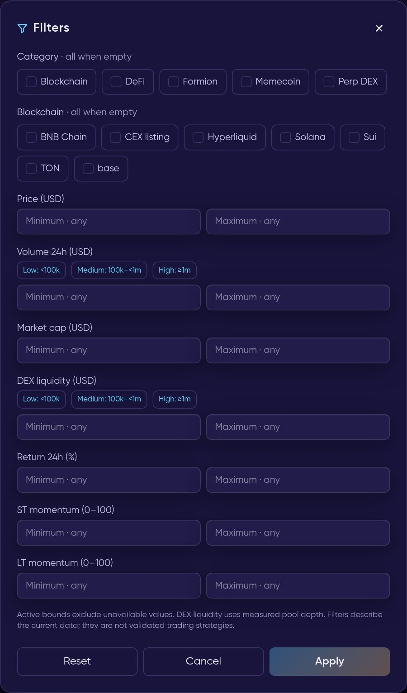<figcaption>
Filters — narrow the table by category, chain, size and momentum.
</figcaption></figure>

* **Category** and **Blockchain** — tick one or more; nothing ticked means all.
* **Price**, **Volume 24h**, **Market cap**, **DEX liquidity**, **Return 24h**, **ST momentum** and **LT momentum** — set a minimum and/or maximum. Volume and liquidity have quick buttons: **Low** (under 100k), **Medium** (100k–1m), **High** (1m and more).
* **Apply** filters the table, **Reset** clears everything, **Cancel** closes without changes.

Active bounds exclude coins whose value is unavailable. Filters describe the current data — they are not validated trading strategies.

### ⭐ My watchlist

<figure>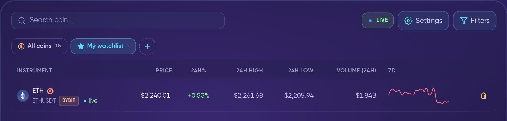<figcaption>
My watchlist — your own instruments with live price, 24h range and volume.
</figcaption></figure>

Add a coin with **＋** in the table, with **Watchlist** on a coin's detail page, or from **Settings → Add instruments**. The **My watchlist** tab then shows each instrument with its venue (e.g. BYBIT, BINANCE) and a **live** dot, **Price**, **24h%**, **24h High**, **24h Low**, **Volume (24h)** and a **7D** sparkline. The 🗑️ icon removes an instrument.

### 🔎 Coin detail view

Click a coin's name to open its detail view; **Back to coins** returns to the table.

<figure>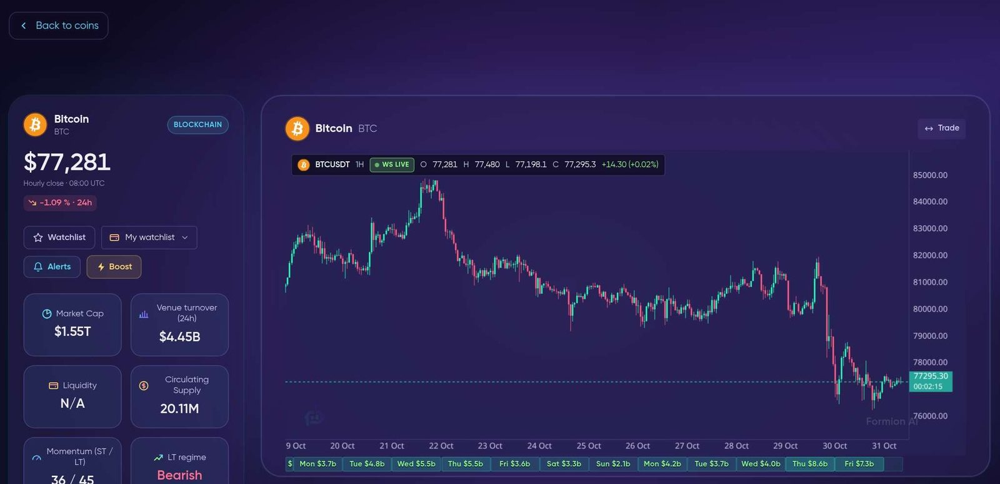<figcaption>
Coin detail — price, key metrics, watchlist and alert buttons, and a live chart.
</figcaption></figure>

* **Price card** — latest price with its time and 24h change, the category badge, **Watchlist** (shows **Saved** once added; the menu next to it picks which watchlist) and **Alerts**.
* **Key metrics** — **Market Cap**, **Venue turnover (24h)**, **Liquidity**, **Circulating Supply**, **Momentum (ST / LT)** and **LT regime**.
* **Converter** — convert the coin to USD and other currencies.
* **Live chart** — hourly candles with daily volume underneath; **Trade** shows a fast buy/sell strip on the chart (paper by default; real venues show the plan and ask before sending).

<figure>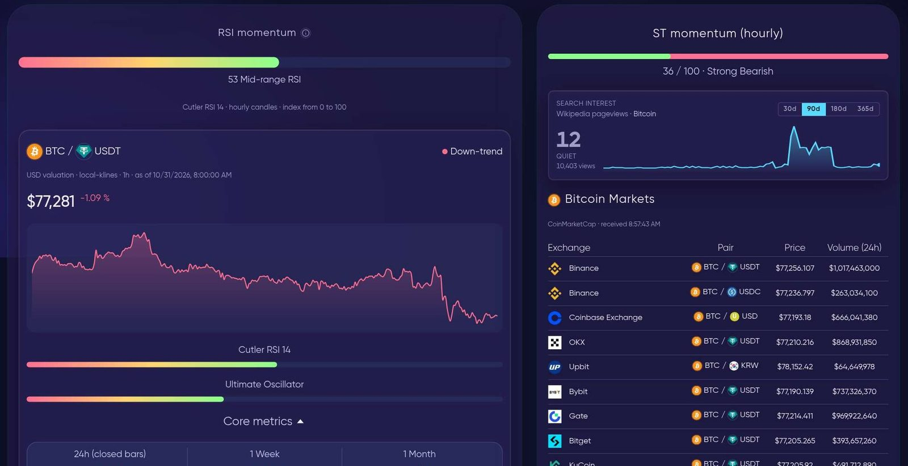<figcaption>
Further down — momentum gauges, search interest and where the coin trades.
</figcaption></figure>

* **RSI momentum** and **Core metrics** — RSI, Ultimate Oscillator, 24h / 1 week / 1 month change, EMA 13, MACD and more indicators.
* **ST momentum (hourly)** — the short-term score as a gauge.
* **Search interest** — Wikipedia pageviews for the coin over 30, 90, 180 or 365 days.
* **Markets** — exchanges and pairs where the coin trades, with price and 24h volume.

## 🛡️ Presale Watch

<figure>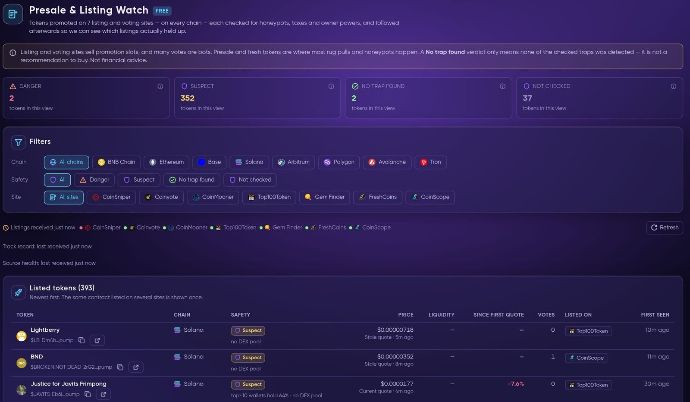<figcaption>
Presale & Listing Watch — promoted tokens, each checked for common traps.
</figcaption></figure>

**Presale & Listing Watch** (free) collects tokens promoted on listing and voting sites across chains. Each token is checked for honeypots, taxes and owner powers and gets a safety label — **Danger**, **Suspect**, **No trap found** or **Not checked** — and is followed afterwards to see which listings held up. Filter by **Chain**, **Safety** and **Site**.


Listing and voting sites sell promotion slots and many votes are bots. **No trap found** only means none of the checked traps was detected — it is not a recommendation to buy. Not financial advice.


## 🎯 Sniper and 🔄 DEX Swaps (login needed)

<figure>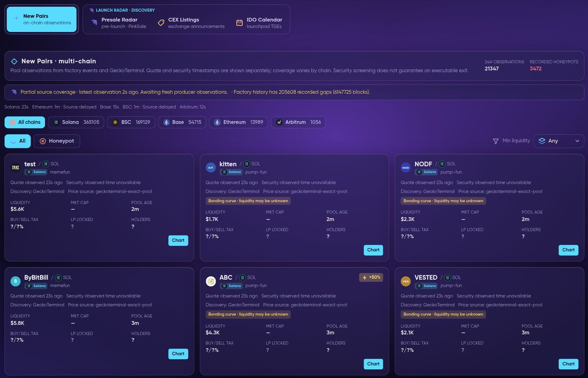<figcaption>
Sniper → New Pairs — fresh pools across chains with liquidity, pool age, tax and lock fields (sign-in needed).
</figcaption></figure>

* **🎯 Sniper** — launch tracking: **New Pairs** (on-chain pool observations), **Presale Radar** (PinkSale), **CEX Listings** (exchange listing announcements) and an **IDO Calendar** (launchpad TGEs).
* **🔄 DEX Swaps** — server-signed on-chain swaps from the wallet you connect in the Telegram bot (`/wallet`), routed via Jupiter (Solana), 7K (Sui) and LI.FI / deBridge (EVM and cross-chain), with a list of your recent swaps.


Low-cap and freshly launched tokens are high-risk by nature — thin liquidity, possible scams. Sniper and Presale Watch surface candidates to **research**, never guarantees. Size accordingly.


## Continue your research

Combine the Coins Hub with [Pulse](pulse.md) narrative context, [News](news.md) event timestamps and [FORA](fora.md) text or voice research. Coin research coverage does not establish execution support on a connected venue.
