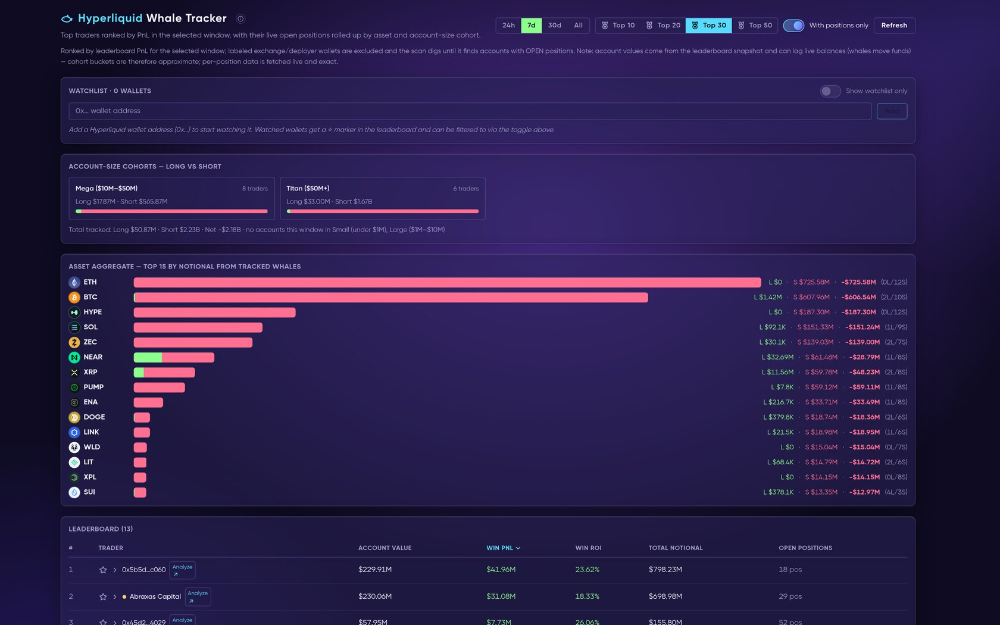
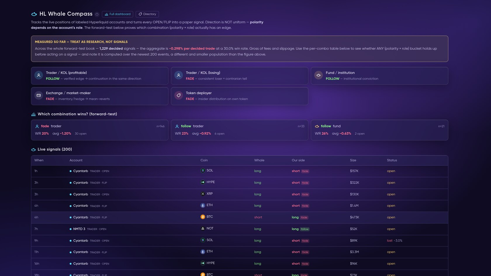
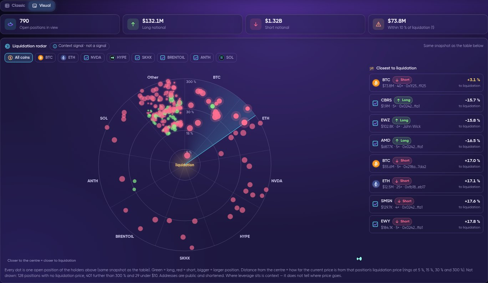
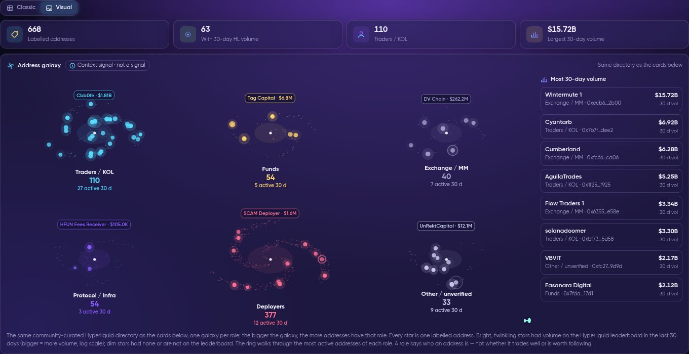
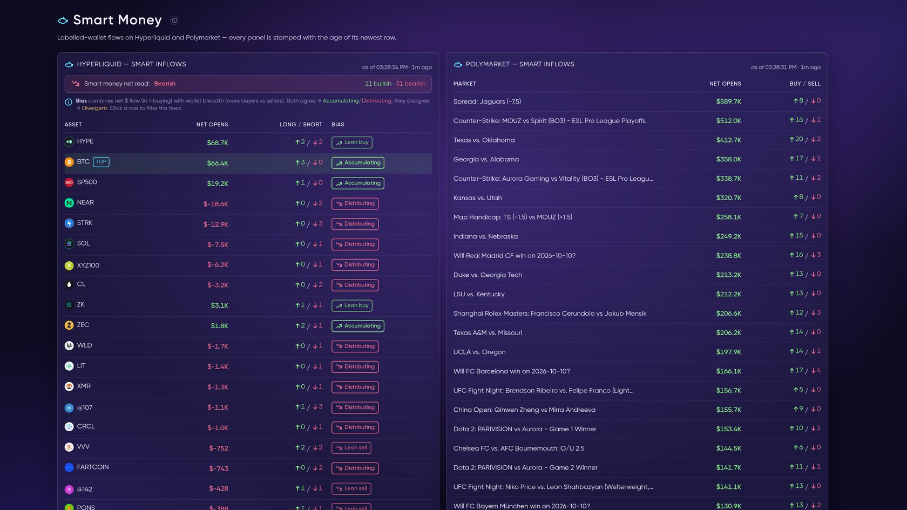
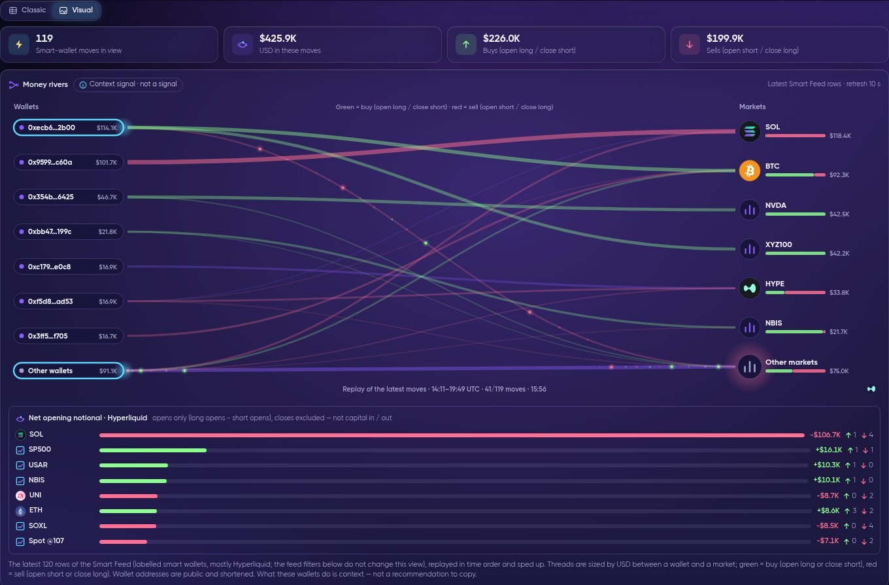

# 🤝 Copy Trading & Whale Tracking

<figure><video src=".gitbook/assets/clip-copy-trading.mp4" title="Hyperliquid whale tracking and attaching a bot"></video><figcaption>
Follow the largest Hyperliquid traders: leaderboard, live fills, wallet drill-down and TP/SL heatmap, then attach a Formion bot to your own account.
</figcaption></figure>

Follow smart money instead of guessing. Formion tracks the biggest on-chain traders in real time, and you can attach selected Formion bots to your own connected account so their signals trade for you.

## Hyperliquid whale tracking

A live window into the largest Hyperliquid traders:

<figure><figcaption>
Hyperliquid Whale Tracker — top traders, their aggregate positioning and the leaderboard.
</figcaption></figure>

<figure><figcaption>
HL Whale Compass — live trades from labelled wallets, with a forward test of which combinations work.
</figcaption></figure>

* **HL Whales** — whale leaderboard (sortable by PnL, ROI, account value, notional) with cohort and per-asset long/short breakdowns
* **HL Fills** — live fills tape
* **Wallet drill-down** — open positions, history and PnL per address
* **HL TP/SL** — heatmap of the top whales' take-profit and stop-loss trigger orders per coin
* **TP/SL Strats** — Formion's Hyperliquid strategy family (stop-hunt, TP-magnet fade and related plays), forward-tested on paper and tracked in **[Trade History](journal.md)**

### 🎛️ HL Whales — Classic · Visual

On **HL Whales** a **Classic · Visual** switch sits above the per-asset panel. **Classic** = the per-asset long/short table as before. **Visual** = **Liquidation radar** of the same answer (same window, same holders; nothing new is loaded):

* Every open position is a dot: sector = coin, size = position value, **green = long**, **red = short**.
* Distance from the centre = how far the current price is from that position's liquidation price (rings at 5 %, 15 %, 30 % and 300 %; the centre = at liquidation).
* Positions without a liquidation price (enough margin) or further than 300 % are not drawn and are counted in the note.
* A sweep beam lights the dots; the list shows the 8 positions closest to liquidation.

<figure><figcaption>
HL Whales → Visual: whale positions by coin and by distance to their liquidation price.
</figcaption></figure>

### 🎛️ HL Directory and HL Fills — Classic · Visual

* **HL Directory** — **Address galaxy**: one galaxy per role (Traders / KOL, Funds, Exchange / MM, Protocol / Infra, Deployers, Other); every star is one labelled address, bright stars had Hyperliquid leaderboard volume in the last 30 days (size = that volume). The side list links to each address's dossier. A role says who an address is, not whether it trades well.
* **HL Fills** — **Fills waterfall**: the chosen window replayed in about 10 s; each order of labelled trader and fund wallets falls into its coin's column — green = long side, red = short side, filled drop = opening, ring = closing, size = notional. The pools show long vs short notional. Following these fills was measured and did not beat the round-trip cost.

Same data as Classic, same plan limits; **Auto** starts these panels in Classic. **Context signal · not a signal**.

<figure><figcaption>
HL Directory → Visual: labelled Hyperliquid addresses grouped by role.
</figcaption></figure>

<figure><figcaption></figcaption></figure>

## On-chain smart money

Beyond Hyperliquid, **Analytics → SmartMoney** shows a smart-money feed, whale trades and liquidations, and **Coins Hub → Smart Wallets** ranks on-chain wallets by P&L (temporarily unavailable while we fix logic errors) — so you can see where informed capital is rotating across DEX markets.

### Smart Money in Visual — Money rivers

On **Analytics → SmartMoney** a **Classic · Visual** switch sits above the inflow cards. **Visual** replays the latest 120 Smart Feed rows as **money rivers**: labelled wallets on the left, markets on the right, threads sized by USD; a green particle = buy (open long / close short) flows wallet → market, a red one = sell flows back. Below: net opening notional per asset on Hyperliquid (opens only — not capital in / out).

<figure><figcaption>
SmartMoney → Visual: wallets on the left, markets on the right, every buy and sell replayed as a particle.
</figcaption></figure>

Label: **Context signal · not a signal** — what these wallets do is context, never a recommendation to copy.

## Copy trading

* ✅ **Today:** **Attach a Formion bot** — in the **Bots** hub / Strategy Lab subscriptions, attach an attachable bot or marketplace strategy to your own connected account (cTrader, Bybit, Binance, Blofin, Bitget, DEX or Polymarket, depending on the bot). Demo attachments are free; live ones count toward your live-bot limit (Pro 5, Institutional unlimited).
* 📅 **Coming soon:** **Copy trading** card on the formion.ai dashboard — copying other traders (Pro up to 5 copied traders, Institutional unlimited, not on the free plan).


Attached bots trade on **your** account via your API keys / wallet — Formion never holds your funds. Copying a strategy also copies its losses and drawdowns, so check its full history and size accordingly.

