# 🛰️ Data Hub

<figure>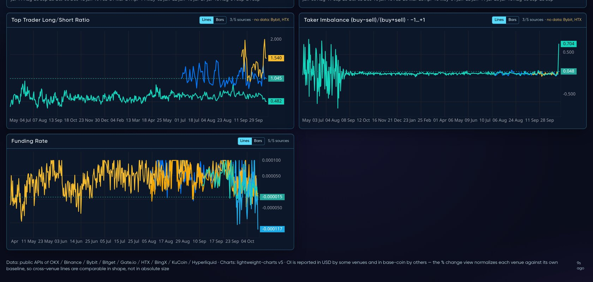<figcaption>Real-time derivatives data and scanners across every major exchange.</figcaption></figure>

<figure><video src=".gitbook/assets/rec-data-hub-tour.mp4" title="Live recording: multi-exchange open interest and long/short charts, then the Funding, OI Surge, Divergences and Movers scanners."></video><figcaption>
Live recording: multi-exchange open interest and long/short charts, then the Funding, OI Surge, Divergences and Movers scanners.
</figcaption></figure>

The **Data Hub** (app.formion.ai → Data Hub) is Formion's real-time **derivatives & flow** layer — the raw market structure the Screener scores are built on, exposed directly for power users.

## Live cross-exchange data

The **Multi-Exchange** view compares venues side by side — **OKX, Binance, Bybit, Gate and HTX** by default, with more venues selectable where they publish the data:

* **Open Interest** + OI delta — where leverage is building or unwinding
* **Funding rate** — cost of carry and directional skew
* **Long/Short ratio** + **top-trader positioning** — what retail vs the big accounts are doing
* **Taker buy/sell delta** — aggressive order flow

### Chart settings → Series

Each chart in the multi-exchange view (**Open Interest**, **Long/Short**, **Top Trader**, **Taker** and **Funding**) has its own gear with a **Series** section:

* **Draw as** — Page default, **Lines** or **Bars**.
* **Grid**, **Legend** and **Smooth lines** switches.
* **Series colours** — a colour per exchange.
* The **All Lines** / **All Bars** buttons above the charts switch every chart at once.

<figure>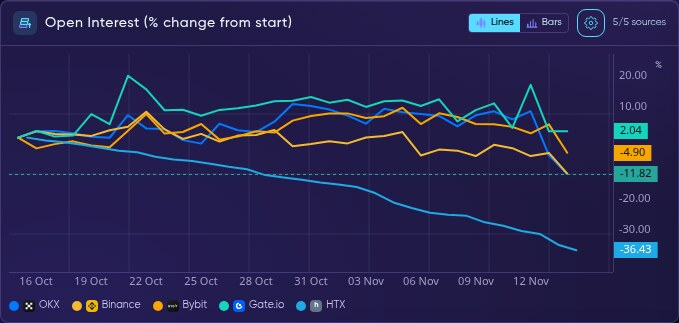<figcaption>
Open Interest across five exchanges, with the Lines / Bars switch and the settings gear.
</figcaption></figure>

<figure>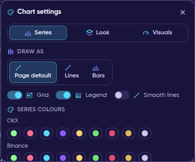<figcaption>
Chart settings → Series: draw as lines or bars, grid, legend and a colour per exchange.
</figcaption></figure>

## 🎛️ Classic · Visual

Data Hub panels can be shown two ways. A **Classic · Visual** switch sits above each supported panel: **Classic** = tables and charts as before, **Visual** = the same data drawn as motion (no new numbers, no extra limit). The choice is remembered per panel; [Settings → Visual mode](settings.md) sets the default (**Auto** turns Visual on only for Liquidation Levels and Liquidity Map on a desktop).

* **Liquidation Levels** — Magnet field and Cascade
* **Liquidity Map** — Thermal flow ([details](liquidity-map.md))
* **Order Book**, **DOM Pro**, **Walls**, **Order Flow** — Book through time, Breathing ladder, Walls as dams, Trade river + Live footprint ([details](order-flow.md))
* **Multi-Exchange** — Exchange orchestra (below)

<figure>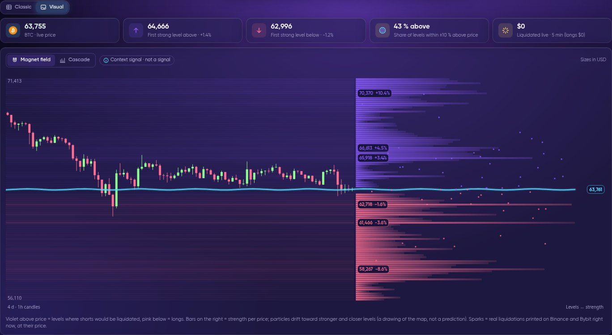<figcaption>
Liquidation Levels → Visual: liquidation levels of every exchange as a magnet field next to the candles; sparks are real liquidations happening now.
</figcaption></figure>

### Multi-Exchange in Visual — Exchange orchestra

On **Multi-Exchange** the switch sits above the charts. **Visual** draws the same answer for your coin, timeframe and venues as an **exchange orchestra** — four lanes on one time window, one line per exchange with its real logo:

* **Open interest** as % change from the common start (the same start the Classic % view uses), so big and small venues share one scale.
* **Long/short accounts ratio** (dashed line = 1), **taker buy share** and **funding** (8-hourly on most venues, hourly on Hyperliquid).
* An exchange whose open interest moves against most of the others gets a ring.

<figure>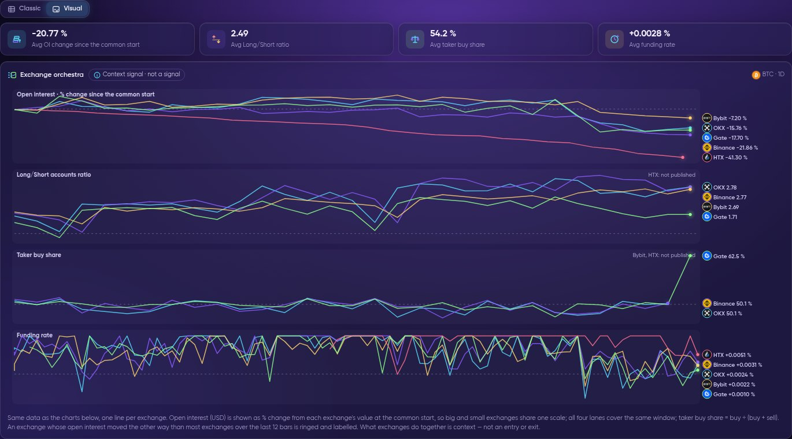<figcaption>
Multi-Exchange → Visual: open interest, long/short, taker share and funding of every venue on one time window.
</figcaption></figure>

Every Visual view is labelled **Context signal · not a signal** — it shows where liquidity and liquidations sit, not where price will go.

### More Visual views — derivatives, funding and DEX flow

Each view below has a **Classic · Visual** switch. Visual draws the **same answer** the page already loaded — nothing new is fetched, and your plan limits are the same as in Classic. **Auto** (the default in [Settings → Visual mode](settings.md)) starts these panels in Classic; one click on **Visual** switches, and the panel remembers it.

* **HL Perps** — **Live market map**: a treemap per Hyperliquid dex (Crypto, Macro & Equities); cell area = open interest, colour = 24 h change. An outline marks a crypto market whose funding runs at least 40 % APR away from its dex's neutral rate (amber = longs pay more, cyan = shorts pay).
* **Movers → OI Surge** — **OI shockwaves**: the coins with the largest open-interest change as bubbles (size = open interest); green = buildup (more contracts), red = unwind (fewer contracts); rings grow with the change in contracts.
* **Funding & Arb → Desk** — **Funding clock**: the top 8 pairs of your view on one clock face for the next 8 hours; every tick is a funding settlement of the long or short leg, green when it pays the position at today's rate, red when it costs. Net APR is the page's own number after the measured round trip — today's rates, not a forecast.
* **Funding & Arb → Spreads** — **Spread bridges**: the six spot exchanges on a circle; bridges run from the exchange where a coin is cheapest to buy to the one where it is dearest to sell (thickness = 24 h volume). A dashed amber bridge = **verify same token**. A price gap is not a profit: fees, transfer time and closed withdrawals sit in between.
* **DEX Flow** — **DEX rivers**: one river per chain (Solana, Base, Avalanche); every pool is a wave — taller = more 24 h volume, faster = busier last hour, green = more buy swaps, red = more sells. A swap count is not dollar flow.
* **Listings** — **Launch radar**: one sector per venue (Binance, Bybit, OKX); every listing of a USDT perp is a dot in its venue's sector — the closer to the centre, the more recent the listing. Colour = the coin's 24 h change (green up, red down, grey none), size = 24 h volume; a thin line joins the dots of a coin listed on several venues. When the list hits its 120-row limit the rim is the oldest returned coin (**newest 120 · back to Nd**). A map of where and when coins were listed — not a trade idea.

<figure>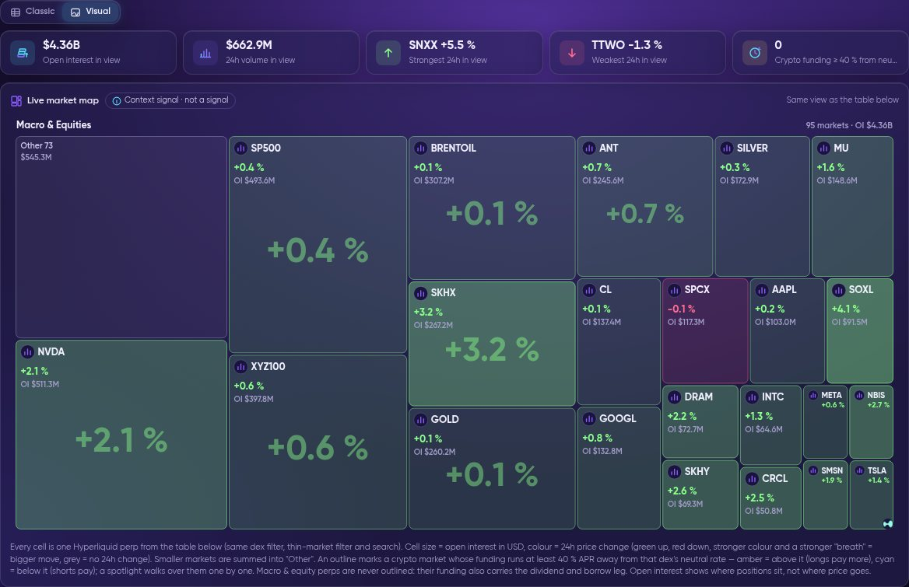<figcaption>
HL Perps → Visual: open interest per market, coloured by the 24 h move.
</figcaption></figure>

<figure>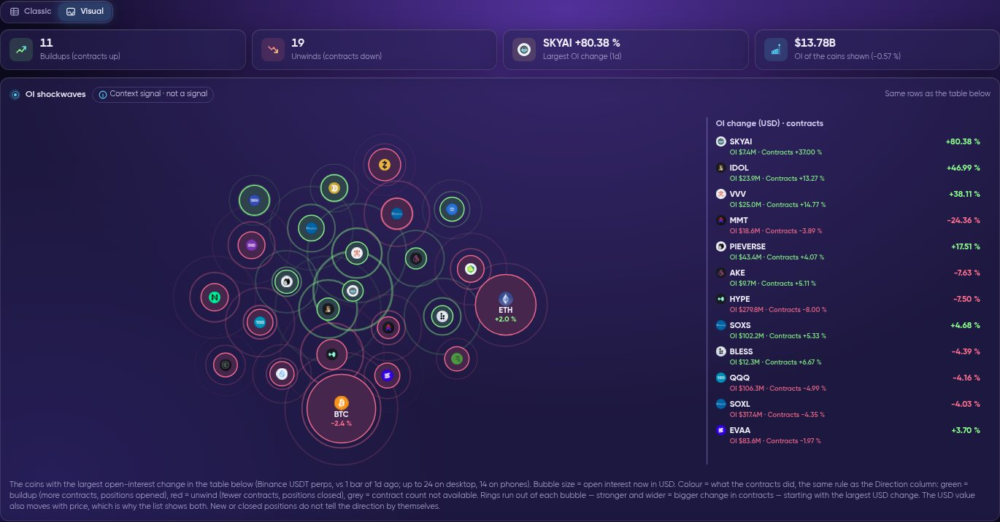<figcaption>
OI Surge → Visual: buildups (green) and unwinds (red) by contracts.
</figcaption></figure>

<figure>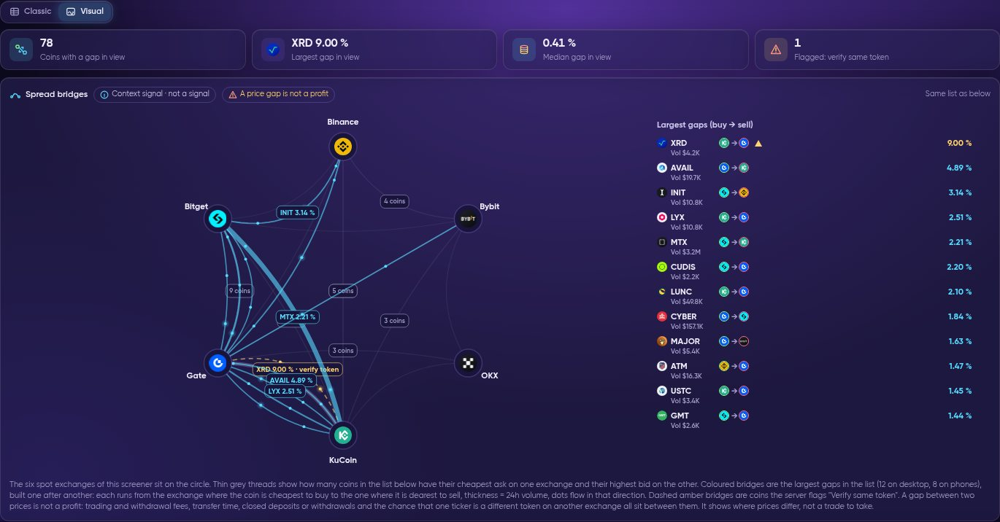<figcaption>
Spreads → Visual: from the cheapest ask to the highest bid between exchanges.
</figcaption></figure>

<figure>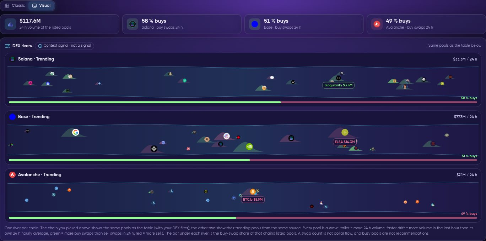<figcaption>
DEX Flow → Visual: one river per chain, one wave per pool.
</figcaption></figure>

<figure>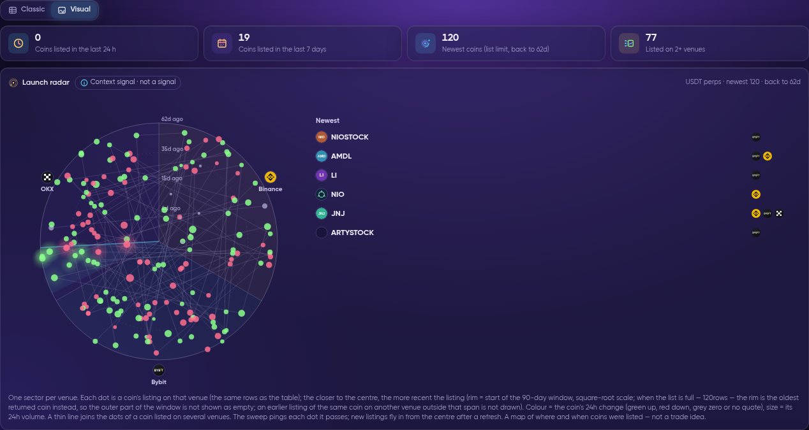<figcaption>
Listings → Visual: new USDT-perp listings per venue; closer to the centre = more recent.
</figcaption></figure>

Every view is labelled **Context signal · not a signal**.

## Built-in scanners

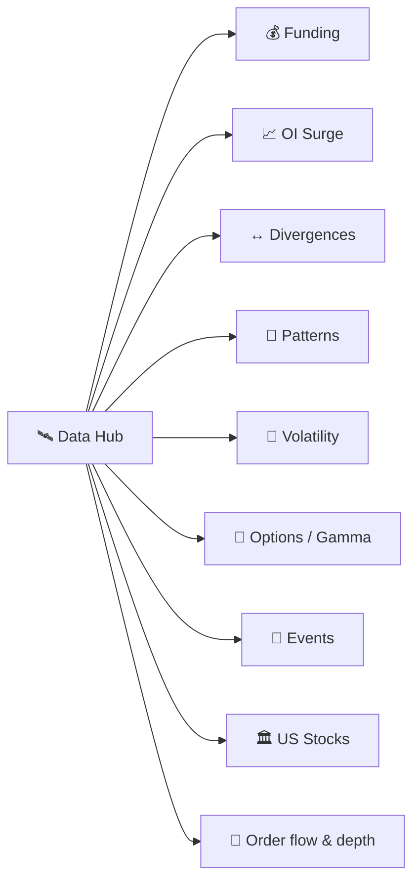

<figure>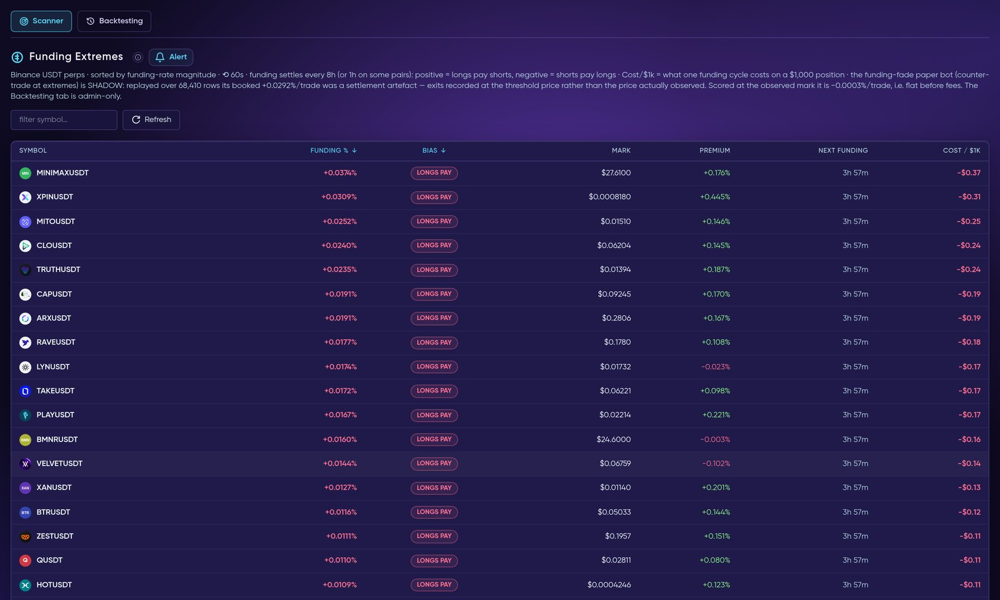<figcaption>
Funding Extremes — perps ranked by funding rate, with mark price, premium and next funding.
</figcaption></figure>

<figure>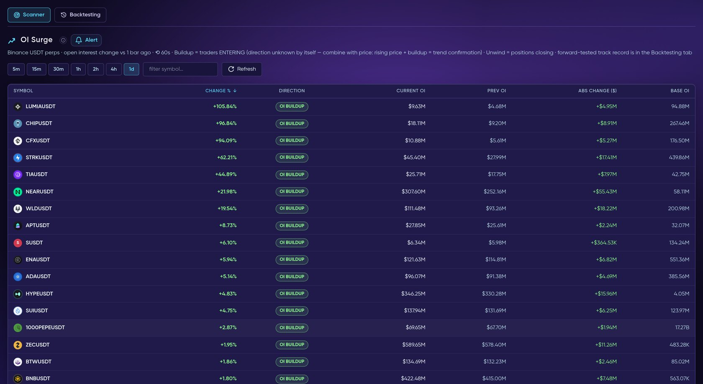<figcaption>
OI Surge — biggest open-interest changes and whether positions are building or unwinding.
</figcaption></figure>

<figure>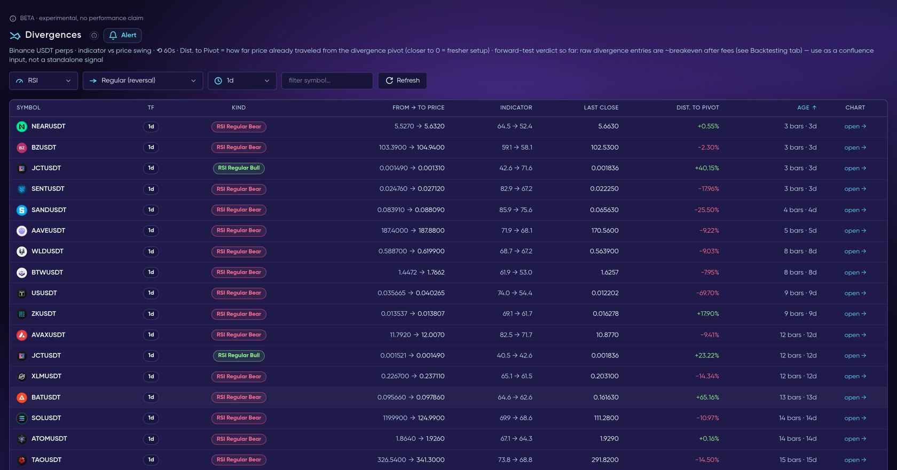<figcaption>
Divergences — price vs indicator divergences with the move since the pivot.
</figcaption></figure>

* **Funding** — Binance USDT perps sorted by funding-rate magnitude (who is paying to hold the position)
  * **Don't buy the dip right after an extreme negative settlement.** When a coin settles funding at **−0.5 % or lower per interval**, its price usually drops by about the funding amount right away, and over the next **1–4 hours** it tends to keep falling more than after a normal settlement. This is not a short signal (after costs it does not pay) — it is a reason to wait before buying that dip. Measured 21 Aug – 12 Nov 2026, 4,337 settlements on Binance, Bybit, Gate, MEXC, KuCoin and Aster. Status: **Context signal**.
* **OI Surge** — open-interest buildups and unwinds on Binance USDT perps
* **Divergences** — RSI-vs-price divergences on Binance USDT perps, with distance to the pivot
* **Patterns** — geometric chart formations (triangles, wedges, H&S…)
* **Volatility** — volatility-scanner signals with a forward-test ledger; its Performance panel has the shared filter bar (Market, Side, Outcome, Symbol, Period) — see **[Quantum Screener → Filters](screener.md#filters)**
* **Options / Gamma (GEX)** — BTC/ETH options analytics and dealer gamma on US indices, ETFs and large caps — see **[Options & GEX](options.md)**
* **Events** — per-candle up/down event series, recurring return patterns and an options-implied probability view for BTC, ETH and SOL
* **US Stocks** — daily US-equity narrative, market regime and macro indicators
* **Liquidity Map** — recorded resting liquidity of 11 markets for BTC, ETH, SOL and HYPE (heatmap, Liquidity Tracker, per-venue ladder, pull/stack, persistent walls, CVD per venue and real Hyperliquid liquidation levels); it replaces the old Heatmap and Agg Heatmap pages — see **[Liquidity Map](liquidity-map.md)**
* **Order Book** — one tab with four views: **Book**, **DOM**, **Imbalance** (resting bids vs asks near price, formerly in the Screener) and **Walls** (live walls and the Walls Bot paper book) — see **[Order Flow & Microstructure](order-flow.md)**
* **Order flow & depth** — Order Flow, Liquidity Map and Liquidation Levels — see **[Order Flow & Microstructure](order-flow.md)**
* **More** — Listings, Movers, DEX Flow, Trend Shifts, Fundamentals, Setup Scanner, Trading Signals, Lumina Picks, VIP Pulse and HL Perps (Hyperliquid perps, including gold, oil, FX and index perps)

### 🌋 Volatility — new measurement from 13 Nov 2026

* The Volatility scanner's calculation for **short** signals was fixed on **13 Nov 2026**. Before the fix, short signals never passed the scanner's reward-to-risk filter, so it gave long signals only; now it gives both **long and short**.
* Its **Forward test** started again from zero on 13 Nov 2026 and reads **Collecting data** until it has enough closed trades.
* The old book is kept as an archive marked **before the fix** in the Backtest sub-tab; it is not used for the status.
* The Volatility scanner is not open to every account yet while the new measurement collects data.

## 🏛️ US Stocks

**Data Hub → US Stocks** has the sub-tabs **Brief** (daily US-equity narrative, market regime, macro indicators and index quotes), **Top 100**, **Themes** and **Signals**. Index quotes carry *As of HH:MM UTC*; after 30 minutes they are marked **not live**.

<figure>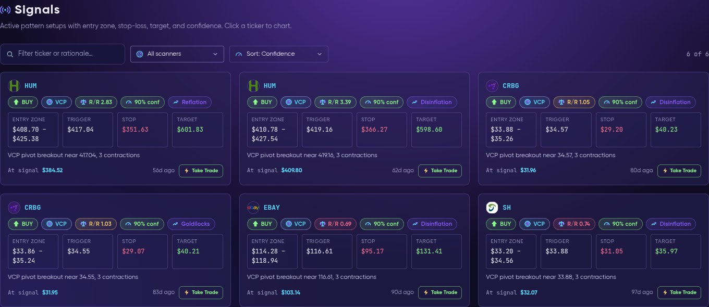<figcaption>
US Stocks → Signals: only setups that are still pending or active on real prices.
</figcaption></figure>

**Signals** lists pattern setups from a third-party scanner — each card with entry zone, trigger, stop, target, R/R, confidence and the macro regime:

* **Only live setups.** The list shows setups that are still **pending or active on real daily prices**. Setups that were stopped out, hit their target or expired are not shown.
* **"At signal"** on the card is the price **when the signal was published**, not the current price. Entries and exits are decided only on real daily bars — never on that frozen price.
* **Invalidated** = the setup broke its own stop **before** reaching the entry zone. It is closed with no trade and is left out of the statistics.
* **Duplicates count once.** Re-issues of the same setup (same ticker, side, trigger and stop within 30 days) are counted as one signal.


These are a third-party scanner's setups, all on the long side — not Formion trade recommendations and never a profit promise. Check the chart before acting on any of them.


**Themes — Classic · Visual (Theme ring).** On the **Themes** sub-tab a **Classic · Visual** switch under the filters draws the same themes (only those passing the name, crowding and type filters):

* One slice per theme (Mainstream first, then Tomorrow). A bar grows outward for a positive basket return in the chosen period (green) and inward for a negative one (red); a grey arc = no figure for that period. An amber dot on the rim = the feed marks the theme **crowded**.
* Period switch **1D · 1W** (default) **· 1M · 3M · 1Y** — every bar morphs to the new return. The centre counts themes up and down.
* Below: the 3 highest (**Leading**) and 3 lowest (**Lagging**) returns, each coloured by its own sign — on a day when every theme is down, Leading shows red numbers.

<figure>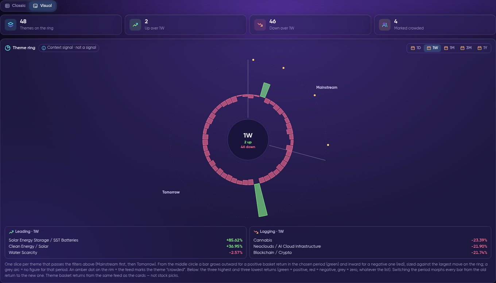<figcaption>
US Stocks → Themes → Visual: one slice per theme; green bars out = up, red bars in = down over the period.
</figcaption></figure>

Theme basket returns, not stock picks — **Context signal · not a signal**. Same data as Classic, same plan limits; **Auto** (the default in [Settings → Visual mode](settings.md)) starts it in Classic — one click on **Visual** switches, and the panel remembers it.


Use the Data Hub to answer *why* a Screener row is moving — and to catch shifts (an OI surge, a funding flip) **before** they show up in price.

