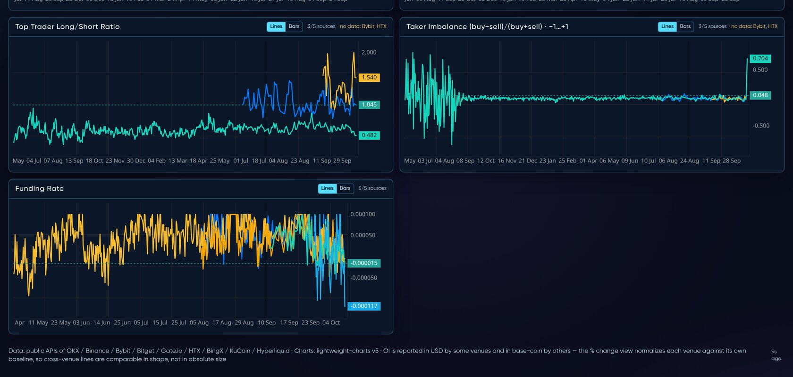
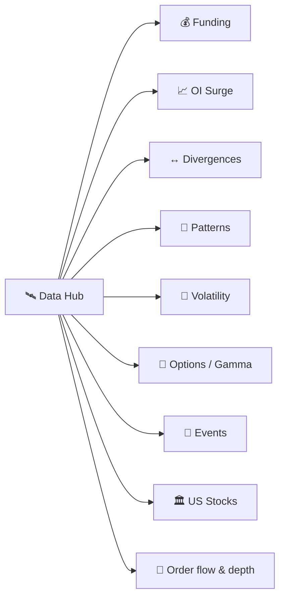
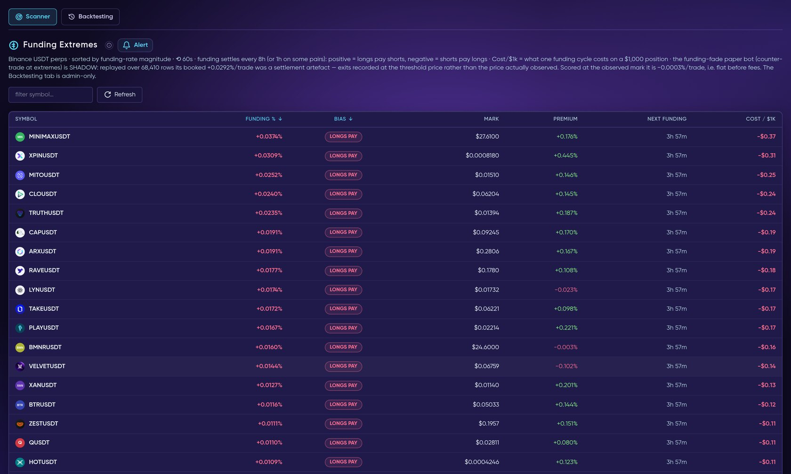
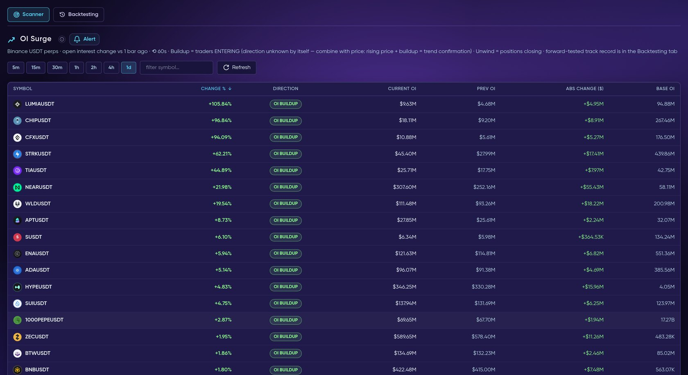
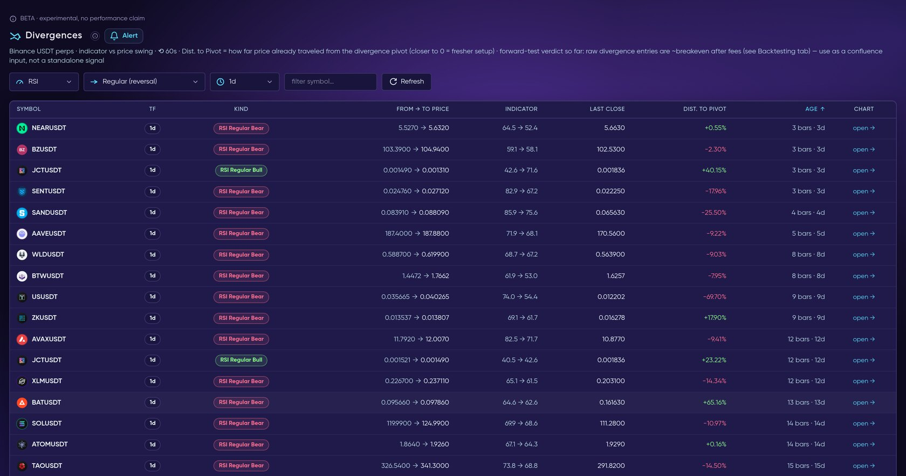
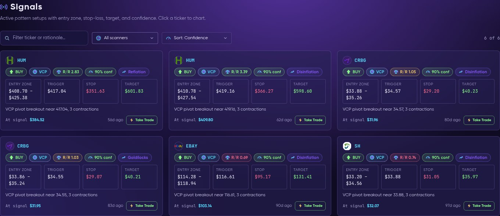

# 🛰️ Data Hub

<figure><figcaption>Real-time derivatives data and scanners across every major exchange.</figcaption></figure>

<figure><video src=".gitbook/assets/rec-data-hub-tour.mp4" title="Live recording: multi-exchange open interest and long/short charts, then the Funding, OI Surge, Divergences and Movers scanners."></video><figcaption>
Live recording: multi-exchange open interest and long/short charts, then the Funding, OI Surge, Divergences and Movers scanners.
</figcaption></figure>

The **Data Hub** (app.formion.ai → Data Hub) is Formion's real-time **derivatives & flow** layer — the raw market structure the Screener scores are built on, exposed directly for power users.

## Live cross-exchange data

The **Multi-Exchange** view compares venues side by side — **OKX, Binance, Bybit, Gate and HTX** by default, with more venues selectable where they publish the data:

* **Open Interest** + OI delta — where leverage is building or unwinding
* **Funding rate** — cost of carry and directional skew
* **Long/Short ratio** + **top-trader positioning** — what retail vs the big accounts are doing
* **Taker buy/sell delta** — aggressive order flow

## Built-in scanners

<figure><figcaption>
Funding Extremes — perps ranked by funding rate, with mark price, premium and next funding.
</figcaption></figure>

<figure><figcaption>
OI Surge — biggest open-interest changes and whether positions are building or unwinding.
</figcaption></figure>

<figure><figcaption>
Divergences — price vs indicator divergences with the move since the pivot.
</figcaption></figure>

* **Funding** — Binance USDT perps sorted by funding-rate magnitude (who is paying to hold the position)
* **OI Surge** — open-interest buildups and unwinds on Binance USDT perps
* **Divergences** — RSI-vs-price divergences on Binance USDT perps, with distance to the pivot
* **Patterns** — geometric chart formations (triangles, wedges, H&S…)
* **Volatility** — volatility-scanner signals with a forward-test ledger
* **Options / Gamma (GEX)** — BTC/ETH options analytics and dealer gamma on US indices, ETFs and large caps — see **[Options & GEX](options.md)**
* **Events** — per-candle up/down event series, recurring return patterns and an options-implied probability view for BTC, ETH and SOL
* **US Stocks** — daily US-equity narrative, market regime and macro indicators
* **Liquidity Map** — recorded resting liquidity of 11 markets for BTC, ETH, SOL and HYPE (heatmap, Liquidity Tracker, per-venue ladder, pull/stack, persistent walls, CVD per venue and real Hyperliquid liquidation levels); it replaces the old Heatmap and Agg Heatmap pages — see **[Liquidity Map](liquidity-map.md)**
* **Order flow & depth** — Orderbook, Order Flow, DOM Pro, Liq Map and Walls — see **[Order Flow & Microstructure](order-flow.md)**
* **More** — Listings, Movers, DEX Flow, Trend Shifts, Fundamentals, Setup Scanner, Trading Signals, Lumina Picks, VIP Pulse and HL Perps (Hyperliquid perps, including gold, oil, FX and index perps)

## 🏛️ US Stocks

**Data Hub → US Stocks** has the sub-tabs **Brief** (daily US-equity narrative, market regime, macro indicators and index quotes), **Top 100**, **Themes** and **Signals**. Index quotes carry *As of HH:MM UTC*; after 30 minutes they are marked **not live**.

<figure><figcaption>
US Stocks → Signals: only setups that are still pending or active on real prices.
</figcaption></figure>

**Signals** lists pattern setups from a third-party scanner — each card with entry zone, trigger, stop, target, R/R, confidence and the macro regime:

* **Only live setups.** The list shows setups that are still **pending or active on real daily prices**. Setups that were stopped out, hit their target or expired are not shown.
* **"At signal"** on the card is the price **when the signal was published**, not the current price. Entries and exits are decided only on real daily bars — never on that frozen price.
* **Invalidated** = the setup broke its own stop **before** reaching the entry zone. It is closed with no trade and is left out of the statistics.
* **Duplicates count once.** Re-issues of the same setup (same ticker, side, trigger and stop within 30 days) are counted as one signal.


These are a third-party scanner's setups, all on the long side — not Formion trade recommendations and never a profit promise. Check the chart before acting on any of them.



Use the Data Hub to answer *why* a Screener row is moving — and to catch shifts (an OI surge, a funding flip) **before** they show up in price.

