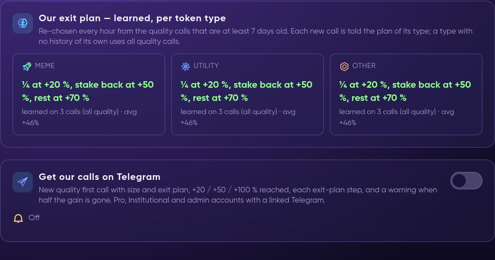

# 🔍 Dossier — Our Calls

**Dossier** is Formion's due-diligence research on new small-cap tokens: contract safety, liquidity and LP lock, holders, team and deployer, socials and volume quality, then a verdict, a risk class and a size. **app.formion.ai → Dossier → Our calls** shows the **first call on every small-cap token our research found — and what it did next**: the peak, how often +20 / +50 / +100 % was reached, OUR exit plan against just holding, and every KOL call the research checked.


**Our calls** is available on **Pro** and **Institutional** (beta). Calls and the exit plan are Formion research and Formion's own strategy — not financial advice. No profit is promised.


## Our exit plan — learned, per token type

The exit plan is re-chosen every hour from the quality calls that are at least 7 days old. Each new call is told the plan of its type (meme, utility, other); a type with no history of its own uses all quality calls.

<figure><figcaption>
Dossier → Our calls: the learned exit plan per token type and the Telegram switch.
</figcaption></figure>

## Get our calls on Telegram

Turn on **Get our calls on Telegram** (Pro, Institutional and admin accounts with a linked Telegram). You receive:

* every new **quality first call** with size and exit plan;
* **+20 / +50 / +100 %** reached;
* each **exit-plan step**, and a warning when half the gain is gone.

At most 25 call messages a day are sent per account. Every first-call message also carries:

* **👛 Buy in Formion Wallet** — opens the swap for this exact contract in **[Formion Wallet](wallet.md)**; you review and sign it.
* **Your position** — when you logged *"I entered at …"* on Our calls, each Telegram call about that token shows your entry, the price now and your P&L.
* **🧭 Your plan** — when you set a bankroll in **[My plan — FORA planner](fora-neurons.md)**, one line with your own plan from the same planner FORA uses in chat, for example *"🧭 Your plan: 🟢 ENTER NOW (our plan) · $60 (6 % for medium risk) · full plan"*. The decision can also be 🟡 WAIT, ⛔ NOT TODAY or 🔴 SKIP with the reason; **full plan** opens Neurons → My plan, where **I bought — follow this plan** makes FORA send every next step to you.

<figure><video src=".gitbook/assets/clip-fora-planner.mp4" title="FORA planner: your settings, today's plans, how much, I bought — follow this plan, do this now messages and the Monday summary (DEMO values)."></video><figcaption>
The planner behind the "Your plan" line: settings → today's plans → how much → I bought → do this now (DEMO values).
</figcaption></figure>

## Dossier Autopilot

**Dossier Autopilot** — automatic buying and selling of these calls from a separate auto-trade wallet — is a separate, invite-only beta product unlocked with FOM. Its rules, risks and country limits are on **[FOM token → Dossier Autopilot](fom-token.md#dossier-autopilot-live-trading-with-fom)**.


Small-cap tokens are high risk: liquidity can be pulled, contracts and teams can fail, and you can lose the whole position. Our exit plan is measured on past calls and labelled *Collecting data* while the sample is small.

