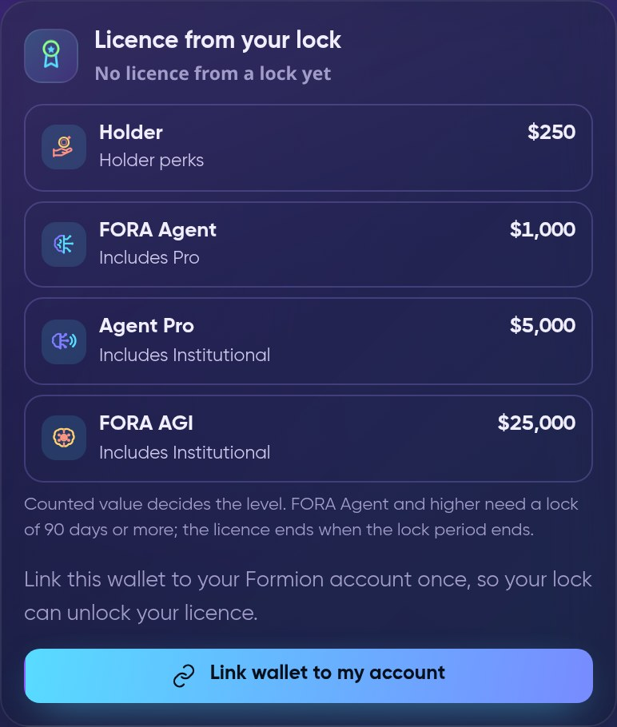
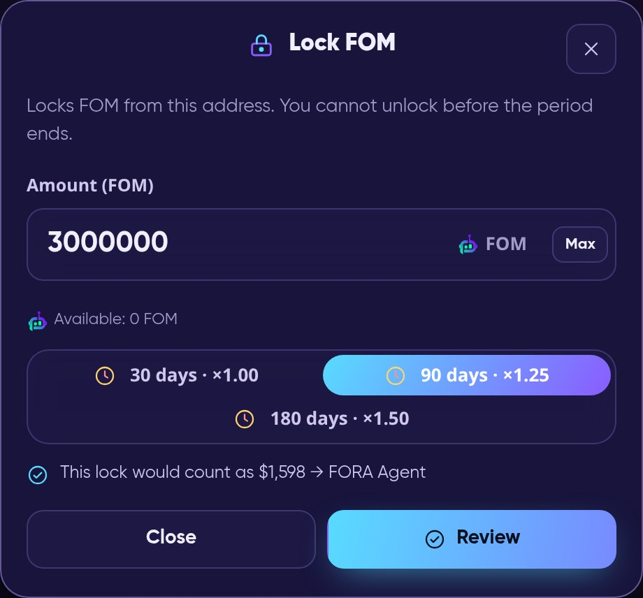
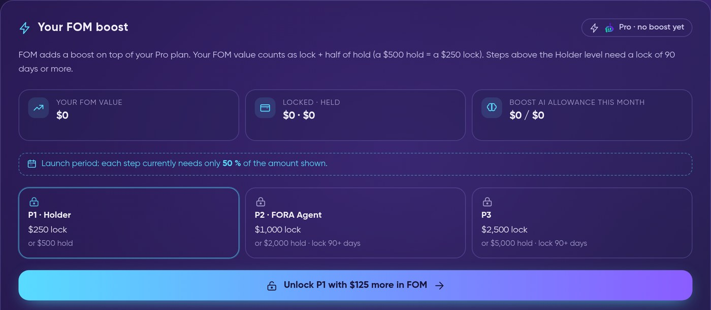

# ⚖️ FOM Hold vs Lock — which one is for you

There are two ways to use FOM for a **FORA Agent level** (and its included licence) or for a **Dossier Autopilot** package: **hold** it or **lock** it.
Both count the **US-dollar value** of your FOM, measured with the **lower of the 7-day and 30-day TWAP** of the official FOM/WETH pool on Base,
so a short price spike cannot inflate your level. This page explains the difference in plain words. The full rules are on the
[FOM token](fom-token.md#fora-agent-levels-hold-or-lock-fom) page.

> **Status (29 October 2026).** **Lock** is live in beta (Formion Wallet → Earn → FOM Lock). **Hold** for licences is **rolling out**
> in phases. Dossier Autopilot is an invite-only beta.

<figure><video src=".gitbook/assets/clip-fom-hold-vs-lock.mp4" title="FOM Hold vs Lock — how your level is counted"></video><figcaption>
Value uses the lower of the 7-day and 30-day TWAP; longer locks weigh more; Hold needs twice the lock value; a lock has no early unlock and 7 days of unbonding.
</figcaption></figure>

## Hold, Lock and the FOM Boost

Besides levels, FOM gives a **[boost on top of every plan](fom-token.md#fom-boost--more-on-every-plan)**. For the boost, a lock counts in full and a hold counts **half** ($500 held = $250 locked). Steps above $250 need a lock of 90 days or more. 

## What is Hold?

**Hold** means your FOM simply stays in **your own self-custody wallet**, which you verify once on your Formion account with a signature.
Nothing is moved, nothing is locked: you can sell or send your FOM at any time.

* Counted value = the **lowest FOM balance of the last 7 days** × the lower of the 7-day and 30-day TWAP. Because the lowest balance counts,
  FOM you just bought counts in full only after it has stayed in the wallet for 7 days.
* FOM on an exchange never counts. One wallet backs one account.
* Because you stay free to sell, Hold needs **twice the lock value**.
* If you sell or move FOM below the threshold, access ends **immediately**. If only the price falls (no transfer), you get a warning and
  **48 hours** to restore the value.

## What is Lock?

**Lock** means you put FOM into the **FOM Lock v3 contract on Base** for a fixed period. Formion never takes custody: the contract holds it,
and only your wallet can withdraw it after the period.

* Periods: **30, 90 or 180 days**, weighted **×1.0, ×1.25 and ×1.5**. Example: $800 locked for 180 days counts as $1,200.
* **FORA Agent and higher need a lock of at least 90 days.** A 30-day lock reaches the Holder level at most.
* The value is measured when you lock and **stays fixed for the whole period**. If the price rises, your level can move up at any time;
  if it falls, your level stays until the period ends. At renewal it is measured again; below the threshold you have 7 days to top up,
  otherwise the level moves one step down.
* **No early unlock.** When the period ends, withdrawal takes **7 days (unbonding)**.
* To get the included licence, link the locking wallet to your Formion account once (a signature, no spending permission). One lock backs one account.
* Contract `0xb3eBdba1188B11016B99C033055aFA7532259f69` ([Basescan](https://basescan.org/address/0xb3eBdba1188B11016B99C033055aFA7532259f69)).
  **Internal security review completed; no external audit has been performed yet.** During the beta the contract has a total lock cap.

## Side by side

| | **Hold** | **Lock** |
|---|---|---|
| Where your FOM sits | Your own self-custody wallet | FOM Lock v3 contract on Base (no custody by Formion) |
| Can you sell or move it? | Yes, any time | No — not until the period ends, plus 7 days unbonding |
| How value is counted | Lowest balance of the last 7 days × lower of 7d / 30d TWAP | Amount × lower of 7d / 30d TWAP at lock time × period weight (×1.0 / ×1.25 / ×1.5), fixed for the period |
| How much you need | **2× the lock value** | **Half of Hold** — the cheaper way for the long term |
| When access starts | When the verified balance reaches the threshold (new FOM counts in full after 7 days) | After the lock is confirmed and the wallet is linked |
| When access stops | At once if you sell/move below the threshold; 48 h grace if only the price falls | When the lock period ends (no early unlock) |
| Price drop | Can switch the level off after 48 h | Level kept until the period ends; re-measured at renewal (7 days to top up) |
| Levels (Formion Wallet: ÷2) | Holder $500 · FORA Agent $2,000 · Agent Pro $10,000 · FORA AGI $50,000 | Holder $250 · FORA Agent $1,000 · Agent Pro $5,000 · FORA AGI $25,000 (FORA Agent+ need 90+ days) |
| Included licence | FORA Agent → Pro · Agent Pro and FORA AGI → Institutional | Same |
| Dossier Autopilot (Formion Wallet: ÷2) | Starter $500 · Pro $2,000 · Unlimited $10,000 | Starter $250 · Pro $1,000 · Unlimited $5,000 |
| Extra risk | None beyond your own wallet | Smart-contract risk (beta, no external audit yet); you cannot sell while locked |
| Status | Rolling out for licences | Live in beta |

Dossier Autopilot can also be paid monthly in FOM instead ($19 / $49 / $149 per 30 days; 50% of every payment is burned).
With **Formion Wallet** as your verified wallet, every hold and lock value is halved.

## Pros and cons

**Hold**

* ✅ Your FOM never leaves your wallet; you can sell or move it any time.
* ✅ No smart-contract risk beyond your own wallet.
* ⚠️ Needs twice the value of a lock.
* ⚠️ A price drop can switch your level off after 48 hours; a sale or transfer below the threshold switches it off at once.
* ⚠️ New FOM counts in full only after 7 days in the wallet.

**Lock**

* ✅ Needs only half the value; 90 and 180 days weigh more (×1.25 / ×1.5).
* ✅ The value is fixed for the period, so a price drop does not cost you the level before renewal.
* ⚠️ You cannot sell or move locked FOM before the period ends, and withdrawal then takes 7 days — even if the price falls in the meantime.
* ⚠️ No early unlock.
* ⚠️ Beta contract: internal security review only, no external audit yet.

## Which one is for me?

* **"I want to stay free to sell at any time."** → **Hold.** You need twice the value, but nothing is locked.
* **"I plan to keep FOM for months and want the lowest amount."** → **Lock** for 90 or 180 days. It needs half the value and the level survives price drops until renewal.
* **"I only want to try the perks."** → **Lock for 30 days** reaches the Holder level ($250 counted value). For an included licence you need 90+ days.
* **"I need FOM for Dossier Autopilot only for a short time."** → **Hold**, or pay monthly in FOM.

In every case, using **Formion Wallet** as your verified wallet halves the amount.

## How to hold, lock and unlock — step by step

You just bought FOM? These six steps take you from a wallet to a counted boost or level. The labels in **bold** are the exact buttons and cards you will see.

<figure><video src=".gitbook/assets/clip-fom-lock-steps.mp4" title="How to hold, lock and unlock FOM — step by step"></video><figcaption>
Get FOM → link the wallet with one signature → hold or lock 30 / 90 / 180 days → after the period: Start unbonding, wait 7 days, Withdraw (sample values).
</figcaption></figure>

1. **Get FOM.** Buy FOM on Base in the Formion Wallet (**Swap**), or send it to a Base wallet you own. FOM on an exchange never counts.
2. **Link the wallet to your Formion account.** Signing one message is free: it only proves you own the wallet, moves no funds and gives no spending permission.
   One wallet belongs to one account. There are two ways:
   * **Formion Wallet:** open **Earn → FOM Lock**, and in the card **Licence from your lock** press **Link wallet to my account**, check the message, then **Sign and link**.
     This works before you lock anything, so it also links the wallet for holding.
   * **Any other Base wallet** (MetaMask, Coinbase Wallet…): on your formion.ai **Dashboard**, in the **FOM access** card, press **Connect wallet & sign**.
     The card appears on the Dashboard once at least one exchange or wallet is connected to your account.

<figure><figcaption>
Formion Wallet → Earn → FOM Lock → Licence from your lock: link the wallet with one signature.
</figcaption></figure>

3. **Hold — nothing else to do.** FOM on the linked wallet counts automatically. For the FOM Boost it counts at **half** its value. The **lowest balance of the last 7 days**
   is used, so new FOM counts gradually. You can sell or move it any time — the boost (or level) then drops.
4. **Lock — full value, bigger boost.** Open **wallet.formion.ai → Earn → FOM Lock** (Beta). Enter the **Amount (FOM)**, choose the **Lock period** — 30, 90 or 180 days,
   counted ×1, ×1.25 or ×1.5 — and check the line *"This lock would count as … → level"*. Press **Review**, allow the lock contract to take exactly that amount (step 1),
   tick *"I understand: the FOM cannot be withdrawn before the period ends and the 7-day unbonding is over"* and press **Sign and send**. You need a little ETH on Base for the network fee.
   * Licence levels and FOM Boost steps above $250 need a lock of **90 days or more**.
   * The FOM stays in **your own lock** in the contract `0xb3eBdba1188B11016B99C033055aFA7532259f69` on Base; only the wallet that locked it can withdraw it.
   * **Add FOM** adds to the lock (the period starts again from today); **Extend period** moves it to a longer period. There is **no early unlock**.

<figure><figcaption>
Earn → FOM Lock → Lock FOM: amount, period and what the lock would count as (sample amount).
</figcaption></figure>

5. **Unlock and withdraw.** When the period ends the status shows **Period ended**. Press **Start unbonding** in Earn → FOM Lock, wait **7 days** (status **Unbonding**),
   then **Ready to withdraw** appears and **Withdraw** sends all your FOM back to your wallet. **Renew** instead starts a new period with the same FOM (it also cancels an unbonding in progress).
   The boost and any licence from the lock end when the lock period ends.
6. **See your boost.** The card **Your FOM boost** (formion.ai **Profile → License**, also on the Dashboard) shows your FOM value (lock + half of hold), what is locked and held, every step of your plan
   (Free: $25 / $50 / $100 lock, then Holder $250 · Pro: $250 / $1,000 / $2,500 · Institutional: $1,000 / $5,000 / $25,000) and how much is missing for the next one.
   During the launch period (until **13 November 2026**) each step needs only the fraction shown in the card. The Formion Wallet 50% discount does not apply to boost steps.

<figure><figcaption>
Profile → License → Your FOM boost: your value, the steps of your plan and what the next step needs.
</figcaption></figure>

> FOM is a utility token. Holding or locking FOM grants access to product features only; it is not an investment, and no return is promised.
> The FOM price can fall. Formion may change levels, thresholds and rules; see the [FOM token](fom-token.md) page and the
> [Formion Terms of Service](https://formion.ai/terms?utm_source=docs&utm_medium=referral&utm_campaign=docs). Nothing here is financial advice.
