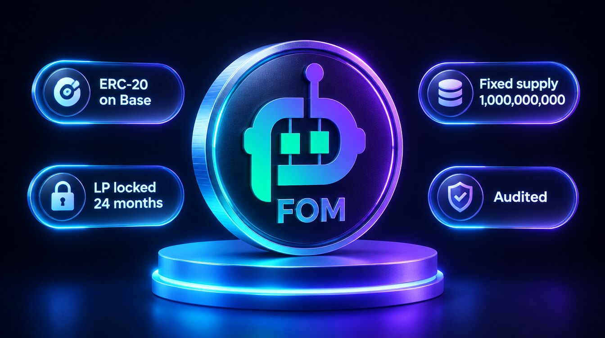
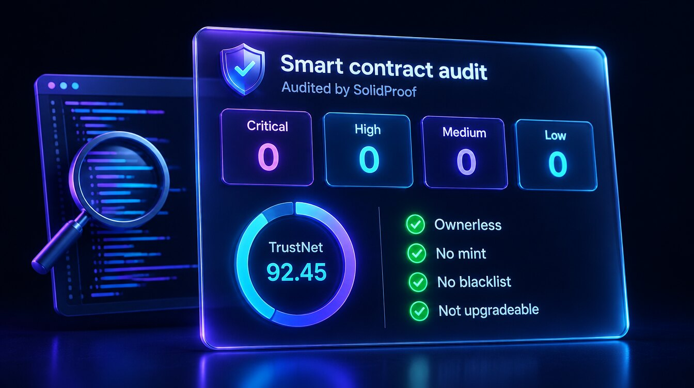
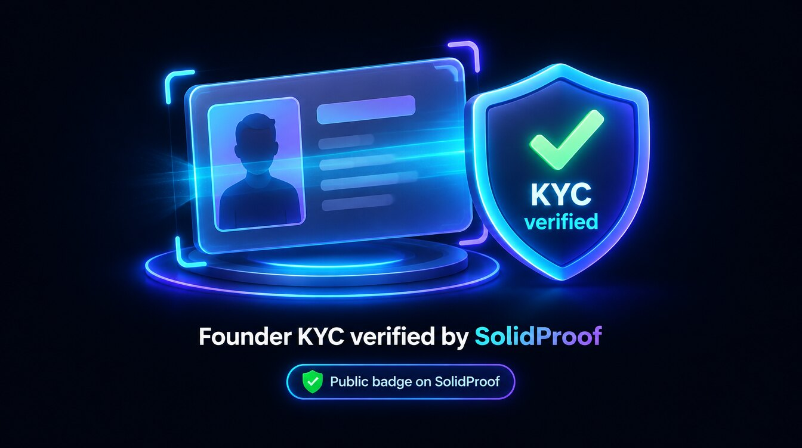
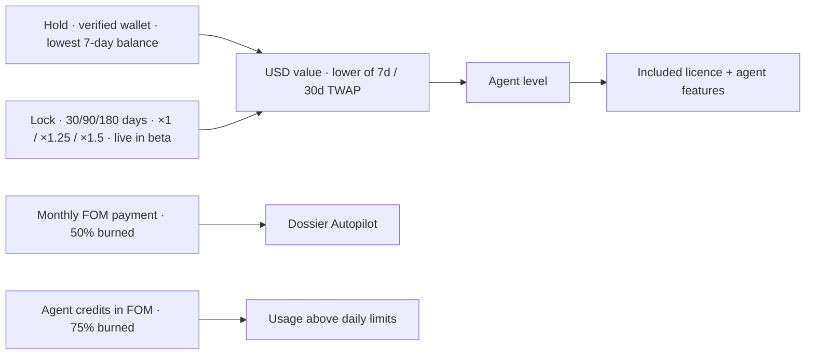

# 🪙 FOM token

<figure><figcaption>
Formion — 🪙 FOM token
</figcaption></figure>

**FOM is Formion’s token on Base (Ethereum L2)** — an ERC-20 with a fixed supply of **1,000,000,000 FOM**, minted once to a 2-of-3 Safe. The contract is OpenZeppelin v5.4 ERC-20 + Permit, with no owner, no mint function, no transfer tax, no pause and no blacklist, and it is not upgradeable. FOM grants no ownership, dividend, profit-share or claim on Formion. Full details: [formion.ai/fom](https://formion.ai/fom?utm_source=docs&utm_medium=referral&utm_campaign=docs).


🎬 **FOM — the key to the Formion AI trading ecosystem.** The FOM launch film (1:12).


## Launch and liquidity

FOM launched on **Uniswap (Base) on Wednesday, 14 October 2026** and is live there now. The launch pool is **Uniswap v3 FOM/WETH**: **40,000,000 FOM + 3 ETH**, with a 1% pool fee. The LP position is locked for **24 months on UNCX**, held by a **2-of-3 Safe**. The remaining 60,000,000 FOM of the liquidity allocation is a reserve that moves only through published programmes.

There is **no presale, no private sale, no ICO and no launchpad**. Launch liquidity (3 ETH) and launch costs (~1.08 ETH) are funded by the founder's own funds. The official **contract address** is `0xDF1202B33255Dd266bD5704e909Ce8a72BA1E4d1` (Base); it is also published on [formion.ai/fom](https://formion.ai/fom?utm_source=docs&utm_medium=referral&utm_campaign=docs) — only trust the address from official Formion channels, and verify it before you swap.

**Audit: SolidProof — token contract** (0 critical · 0 high): [audit project](https://app.solidproof.io/projects/formion-ai). **Vesting: unmodified OpenZeppelin v5.4 `VestingWallet`** (7 contracts). The token’s fixed supply does not remove vesting schedules.

## Audit and KYC

### Smart-contract audit

<figure><figcaption></figcaption></figure>

**SolidProof** audited the FOM token contract: **0 critical, 0 high, 0 medium and 0 low findings**, plus 1 optimization and 6 informational notes, with a **TrustNet score of 92.45**. The contract is **ownerless**, has **no mint function**, **no blacklist** and is **not upgradeable** — after the one-time mint there is no function that can create new tokens, pause, tax or block a transfer. Read the full report on the [SolidProof project page](https://app.solidproof.io/projects/formion-ai).

### KYC

<figure><figcaption></figcaption></figure>

The **founder's identity (KYC) is verified by SolidProof**. The KYC badge and its status are public on the same [SolidProof project page](https://app.solidproof.io/projects/formion-ai), so anyone can check it independently. Entity and team KYC are on the roadmap.


An audit and a KYC reduce specific risks — hidden mint or admin functions, an anonymous team — but they are not a guarantee of price or returns. Only trust the contract address published on [formion.ai/fom](https://formion.ai/fom?utm_source=docs&utm_medium=referral&utm_campaign=docs).


## Allocation and vesting

| Allocation | FOM | Supply | Release schedule |
|---|---:|---:|---|
| Community | 300,000,000 | 30% | 260M linear over 36 months to the Safe; 40M in the Safe from day one for the airdrop and launch programmes |
| Treasury | 245,600,000 | 24.56% | Linear over 36 months |
| Team | 150,000,000 | 15% | 12-month cliff, linear through month 36 |
| Liquidity | 100,000,000 | 10% | Pool and reserves |
| Marketing & partners | 100,000,000 | 10% | 6-month cliff, linear over 18 months |
| Core contributor | 54,400,000 | 5.44% | 1% (544,000) linear over months 0–6, rest linear months 6–25; complete at month 25 |
| Advisors | 50,000,000 | 5% | 6-month cliff, linear over 18 months |

Every locked allocation sits on a public vesting contract; the rest (40M Community and the 60M liquidity reserve) sits in the labeled 2-of-3 Safe. The Core contributor line sits on two of these contracts, and released tokens are pushed to the contributor's wallet daily. This allocation is separate from the pool tokens.

### Core contributor

**Who is the Core contributor?**
An external partner who works with Formion on growth — marketing, trader-focused campaigns and advisory. The 54,400,000 FOM line is compensation for that work, not a purchase: nothing was paid for these tokens, and there is no private sale.

**Why isn't the Core contributor part of the Team line?**
The Team line covers the people who build and run Formion day to day. The Core contributor is an external partner with a separate agreement, so the allocation is shown as its own line with its own public schedule rather than folded into Team.

**Why does the Core contributor receive tokens before the team?**
Their work — marketing and bringing traders to Formion — starts at launch, so a small part of their allocation starts at launch too: 1% of the line (544,000 FOM, about 2,980 FOM a day) over the first 6 months. The other 99% unlocks linearly from month 6 to month 25. The team waits 12 months. Both schedules sit on public vesting contracts that nobody can speed up.

## FORA Agent levels — hold or lock FOM

> **New (28 October 2026).** You can now reach a FORA Agent level by **holding** FOM in a wallet you verify. **Locking** FOM under the
> published lock rules is live in beta since 28 October 2026 (Formion Wallet → Earn → FOM Lock). Using **Formion Wallet** halves every threshold. The new **Dossier Autopilot**
> is paid monthly in FOM. Nothing that existed before is removed: level names, lock thresholds and lock rules stay the same. See the [changelog](#changelog).

A level is set by the **US-dollar value** of your FOM, measured with the **lower of the 7-day and 30-day time-weighted average price
(TWAP)** of the official FOM/WETH pool on Base. Using the lower of the two averages means a short price spike — including one caused by
your own purchase — cannot inflate your level.

| Level | Hold value | Lock value | Includes |
|---|---:|---:|---|
| Holder | $500 | $250 | 30 extra FORA messages a day, realtime screener, 20% lower add-on prices when paid in FOM, Token Explorer for any token, Radar (5-minute delay), 3 whale alerts, 50% off token profiles |
| FORA Agent | $2,000 | $1,000 | **Pro licence included**, browser agent (chart navigation, pages, research), frontier models, FORA Neurons, live Radar, unlimited Risk Scan |
| Agent Pro | $10,000 | $5,000 | **Institutional licence included**, Pine writing and testing, backtests, strategy search, paper-to-live on your confirmation, Radar strategies |
| FORA AGI | $50,000 | $25,000 | Everything in Agent Pro, plus autonomous 24/7 trading on your own accounts within your risk caps (paid with agent credits in FOM like any other usage — Formion takes no share of your profit), priority access, governance votes and early-access allowlists. Autonomous trading is not available in all jurisdictions (including the EU/EEA, the UK and the US) |

With **Formion Wallet** as your verified wallet, every hold and lock value above is halved (for example, FORA Agent: $1,000 held or
$500 locked). Formion Wallet is self-custody: only you hold its key.

Levels have no monthly FOM price. Licences keep their current payment methods (crypto or PayPal), and paying for a licence in FOM is 20% cheaper.

### Two ways to reach a level

> Not sure which one fits you? Read the plain-words comparison: [**FOM Hold vs Lock — which one is for you**](fom-hold-vs-lock.md).

**1. Hold**

* Keep FOM in a **self-custody wallet that you verify by signature** on your Formion account. One wallet backs one account.
* Counted value = the **lowest FOM balance of the last 7 days** × the lower of the 7-day and 30-day TWAP. FOM on an exchange never counts.
* Hold values are **twice the lock values**, because held FOM can be sold at any time.
* If the value only falls with the price (no transfer), you get a warning and **48 hours** to restore it; after that the level is switched off.

**2. Lock**

* **FOM Lock v3 is live in beta — contract `0xb3eBdba1188B11016B99C033055aFA7532259f69` on Base ([Basescan](https://basescan.org/address/0xb3eBdba1188B11016B99C033055aFA7532259f69)). Internal security review completed; no external audit has been performed yet.** Locks start in the Formion Wallet (Earn → FOM Lock). To get the included licence, link the locking wallet to your Formion account once (a signature, no spending permission); the licence ends when the lock period ends. During the beta the contract has a total lock cap that can only be raised.
  Formion never takes custody of locked FOM.
* **Periods:** 30, 90 or 180 days. Longer locks weigh more: ×1.0, ×1.25 and ×1.5. Example: $800 locked for 180 days counts as $1,200 → FORA Agent.
* **FORA Agent and higher need a lock of at least 90 days.** A 30-day lock reaches the Holder level at most. (The 90-day minimum applies to locks only.)
* The lock value is measured when you lock and stays fixed for the whole period. **If the FOM price rises,** your level can move up at any time.
  **If it falls,** your level stays until the period ends. At renewal the value is measured again; if it is below the threshold you have
  7 days to top up, otherwise the level moves one step down.
* **One lock, one account:** a lock backs exactly one Formion account, through a wallet you prove by signature. The wallet can be changed only at renewal.
* **Unbonding:** when the period ends, withdrawal takes 7 days. There is no early unlock. Locked FOM always stays yours.
* A lock needs half the value of holding — it is the cheaper way for the long term.

### When the condition stops being met

Access lasts only while its condition is met. Formion cannot stop a sale or transfer from a self-custody wallet — only a lock keeps FOM in place.

* **Held FOM sold or moved below the threshold, an Autopilot payment period ended, or a lock withdrawn:** access ends immediately. For Dossier Autopilot
  this means no new trades; open positions keep being managed to the end by their plan and are never closed abruptly.
* **Held FOM only lost value (no transfer):** you get a warning and 48 hours to restore the value before access ends.
* You are notified at once in your language — in the app, by Telegram and by email. Access comes back automatically when the condition is met again.
* Before you sell or move FOM while autopilot trades are open, the app warns you that this stops new trades.

### Usage, credits and capacity

* A level unlocks the features and daily limits of its licence, and an included licence comes with a monthly AI allowance. AI usage above the
  allowance or the daily limits (extra FORA messages, voice minutes, research, agent tasks) is paid with **agent credits in FOM; 75% of the FOM
  paid for credits is burned.**
* **Capacity:** included licences are offered within a monthly capacity. When it is full, new FORA Agent and higher holds and locks join a
  waitlist; existing levels are not affected.
* **No fee on profit, ever.** Formion never takes a share of your trading profit.
* Hold, lock and the levels' capabilities roll out in phases; not all of them are available yet. See the [roadmap](roadmap.md).

## Dossier Autopilot — live trading with FOM

**Dossier Autopilot** buys and sells the token calls from Formion's Dossier research automatically, on Solana and EVM chains. It starts
with calibrated default settings, and you can change every setting. Exits follow Formion's plan for each position.

Dossier Autopilot uses a separate auto-trade wallet that you fund; its key is held by the Formion signer, and withdrawals go only to your verified wallet.

> ⚠️ **Risk.** Automated trading can lose money, including the whole balance of the auto-trade wallet. No result is promised, and past results do not predict future ones. Dossier Autopilot is an invite-only beta: during the beta it can manage at most $1,000 per user and $10,000 in total across all users, and it trades only after you explicitly confirm seven risk statements, including that the product is in an experimental phase (to the maximum extent permitted by law, Formion bears no liability for results or losses) and that you understand the autopilot plan.

Dossier Autopilot is a separate product: no licence includes it. Choose a package and unlock it by holding FOM, by locking FOM (FOM Lock, live in beta)
or by paying monthly in FOM:

| Package | Capital limit | Hold | Lock | Pay per 30 days |
|---|---:|---:|---:|---:|
| Starter | $500 | $500 | $250 | $19 in FOM |
| Pro | $5,000 | $2,000 | $1,000 | $49 in FOM |
| Unlimited | No limit | $10,000 | $5,000 | $149 in FOM |

* With **Formion Wallet** as your verified wallet, the hold, lock and pay values are halved. The capital limits stay the same ($500 / $5,000 / no limit).
* **During the invite-only beta** every package is capped at $1,000 managed per user, and the whole beta at $10,000 in total; before it can trade you confirm seven risk statements one by one (including that the product is in an experimental phase and that you understand the plan).
* Hold and lock values use the same rules as the levels above.
* **50% of every Dossier Autopilot subscription payment is burned (sent to the dead address `0x000000000000000000000000000000000000dEaD`); the other 50% goes to Formion.** Paying 3 months at once is 15% cheaper. Discounts never combine to more than 50%. FOM payments are non-refundable.
* **No fee on profit.** Formion takes no share of your trading profit.
* Before you can switch it on you accept the autopilot terms: access only while the condition is met, FOM payments non-refundable (50% burned),
  no liability for trade outcomes or for the FOM price, one wallet per account (abuse means a permanent ban).
* **Dossier Autopilot is not available in the United States, the United Kingdom, the EU/EEA or sanctioned countries.**
* Dossier Autopilot rolls out in phases and is not open to everyone yet.

### Legal notice

FOM is a utility token. Holding or locking FOM, or paying with it, grants access to product features only; it is not an investment, does not represent equity, debt, a share of profits or any claim on Formion, and no return of any kind is promised. Formion may change, suspend or discontinue any level, threshold, benefit, limit, fee or feature, at any time and for any reason, with or without prior notice. Where possible we announce changes in advance on docs.formion.ai and formion.ai/fom; continued use after a change means acceptance. Benefits depend on product availability and may be rolled out in phases. Nothing here is financial, legal or tax advice. Formion cannot prevent the sale or transfer of FOM from a self-custody wallet; access based on holding ends when the condition is no longer met. FOM paid for Dossier Autopilot is non-refundable. Formion is not liable for trading outcomes or for the price of FOM. These terms are part of the [Formion Terms of Service](https://formion.ai/terms?utm_source=docs&utm_medium=referral&utm_campaign=docs).

### Changelog

* **29 October 2026** — Added a plain-words comparison page, [FOM Hold vs Lock](fom-hold-vs-lock.md): what each one is, the differences, pros and cons, and which one fits you. No rule changed.
* **28 October 2026 (v3.4)** — **FOM Lock v3 live in beta** on Base (contract `0xb3eBdba1188B11016B99C033055aFA7532259f69`): lock from the Formion Wallet; a lock on a wallet linked to your account gives the included licence (FORA Agent → Pro, Agent Pro / FORA AGI → Institutional; 90+ days) while the lock period runs. Internal review only, no external audit yet.
* **28 October 2026 (v3.3)** — Added: reach a level by **holding** FOM in a verified self-custody wallet (lowest balance of the last 7 days × the lower of the 7-day / 30-day TWAP; hold values are 2× the lock values; 48-hour grace when only the price falls). Lock rules unchanged (FOM Lock v3 contract launching soon; internal security review completed, no external audit yet). Formion Wallet halves every threshold and FOM price. Added **Dossier Autopilot** (live trading) with Starter / Pro / Unlimited packages, unlocked by holding, locking or paying monthly in FOM (50% of every payment burned). No fee on profit. Nothing existing was removed.

* **16 October 2026 (v3.2)** — FORA AGI no longer has a 10% fee on realised profit. Autonomous runs are paid with agent credits in FOM like any other usage; Formion takes no share of user profits.

* **16 October 2026 (v3.1)** — Lock value now uses the lower of the 7-day and 30-day TWAP. FORA Agent and higher need a lock of at least 90 days. Included licences come with a monthly AI allowance and are offered within a monthly capacity (waitlist when full). One lock backs one Formion account through a signature-proven wallet.

* **16 October 2026** — FOM Agent levels moved from fixed token counts (100,000 / 1,000,000 / 5,000,000 / 10,000,000 FOM) to US-dollar value at the 7-day TWAP ($250 / $1,000 / $5,000 / $25,000). FORA Agent now includes a Pro licence and Agent Pro an Institutional licence. Lock periods of 30/90/180 days with weights ×1.0/×1.25/×1.5 were added. The 7-day unbonding and the 75% burn of agent credits are unchanged.
