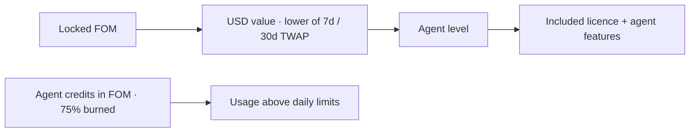

# 🪙 FOM token

<figure><figcaption>
Formion — 🪙 FOM token
</figcaption></figure>

**FOM is Formion’s token on Base (Ethereum L2)** — an ERC-20 with a fixed supply of **1,000,000,000 FOM**, minted once to a 2-of-3 Safe. The contract is OpenZeppelin v5.4 ERC-20 + Permit, with no owner, no mint function, no transfer tax, no pause and no blacklist, and it is not upgradeable. FOM grants no ownership, dividend, profit-share or claim on Formion. Full details: [formion.ai/fom](https://formion.ai/fom).


🎬 **FOM — the key to the Formion AI trading ecosystem.** The FOM launch film (1:12).


## Launch and liquidity

FOM launches on **Uniswap (Base) on Wednesday, 14 October 2026**. The launch pool is **Uniswap v3 FOM/WETH**: **40,000,000 FOM + 3 ETH**, with a 1% pool fee. The LP position is locked for **24 months on UNCX**, held by a **2-of-3 Safe**. The remaining 60,000,000 FOM of the liquidity allocation is a reserve that moves only through published programmes.

There is **no presale, no private sale, no ICO and no launchpad**. Launch liquidity (3 ETH) and launch costs (~1.08 ETH) are funded by the founder's own funds. The **contract address is TBA at launch** and will be published on [formion.ai/fom](https://formion.ai/fom) — only trust the address from official Formion channels, and verify it before you swap.

**Audit: SolidProof — token contract** (0 critical · 0 high): [audit project](https://app.solidproof.io/projects/formion-ai). **Vesting: unmodified OpenZeppelin v5.4 `VestingWallet`** (7 contracts). The token’s fixed supply does not remove vesting schedules.

## Audit and KYC

### Smart-contract audit

<figure><figcaption></figcaption></figure>

**SolidProof** audited the FOM token contract: **0 critical, 0 high, 0 medium and 0 low findings**, plus 1 optimization and 6 informational notes, with a **TrustNet score of 92.45**. The contract is **ownerless**, has **no mint function**, **no blacklist** and is **not upgradeable** — after the one-time mint there is no function that can create new tokens, pause, tax or block a transfer. Read the full report on the [SolidProof project page](https://app.solidproof.io/projects/formion-ai).

### KYC

<figure><figcaption></figcaption></figure>

The **founder's identity (KYC) is verified by SolidProof**. The KYC badge and its status are public on the same [SolidProof project page](https://app.solidproof.io/projects/formion-ai), so anyone can check it independently. Entity and team KYC are on the roadmap.


An audit and a KYC reduce specific risks — hidden mint or admin functions, an anonymous team — but they are not a guarantee of price or returns. Only trust the contract address published on [formion.ai/fom](https://formion.ai/fom).


## Allocation and vesting

| Allocation | FOM | Supply | Release schedule |
|---|---:|---:|---|
| Community | 300,000,000 | 30% | 260M linear over 36 months to the Safe; 40M in the Safe from day one for the airdrop and launch programmes |
| Treasury | 245,600,000 | 24.56% | Linear over 36 months |
| Team | 150,000,000 | 15% | 12-month cliff, linear through month 36 |
| Liquidity | 100,000,000 | 10% | Pool and reserves |
| Marketing & partners | 100,000,000 | 10% | 6-month cliff, linear over 18 months |
| Core contributor | 54,400,000 | 5.44% | 1% (544,000) linear over months 0–6, rest linear months 6–25; complete at month 25 |
| Advisors | 50,000,000 | 5% | 6-month cliff, linear over 18 months |

Every locked allocation sits on a public vesting contract; the rest (40M Community and the 60M liquidity reserve) sits in the labeled 2-of-3 Safe. The Core contributor line sits on two of these contracts, and released tokens are pushed to the contributor's wallet daily. This allocation is separate from the pool tokens.

### Core contributor

**Who is the Core contributor?**
An external partner who works with Formion on growth — marketing, trader-focused campaigns and advisory. The 54,400,000 FOM line is compensation for that work, not a purchase: nothing was paid for these tokens, and there is no private sale.

**Why isn't the Core contributor part of the Team line?**
The Team line covers the people who build and run Formion day to day. The Core contributor is an external partner with a separate agreement, so the allocation is shown as its own line with its own public schedule rather than folded into Team.

**Why does the Core contributor receive tokens before the team?**
Their work — marketing and bringing traders to Formion — starts at launch, so a small part of their allocation starts at launch too: 1% of the line (544,000 FOM, about 2,980 FOM a day) over the first 6 months. The other 99% unlocks linearly from month 6 to month 25. The team waits 12 months. Both schedules sit on public vesting contracts that nobody can speed up.

## FORA Agent levels — lock FOM

> **New structure (16 October 2026).** The Formion team has decided to change how FOM Agent levels work. Levels are now set by the
> US-dollar value of locked FOM (7-day average price) instead of a fixed number of tokens, and the FORA Agent and Agent Pro levels now
> include a Pro or Institutional licence. Level names stay the same. Locked FOM always remains yours. See the [changelog](#changelog).

Lock FOM to reach a level. The level is set by the **US-dollar value** of the FOM you lock, measured with the **lower of the 7-day and
30-day time-weighted average price (TWAP)** of the official FOM/WETH pool on Base at the moment you lock, and it stays fixed for the whole
lock period. Using the lower of the two averages means a short price spike — including one caused by your own purchase — cannot inflate your level.

| Level | Locked value | Includes |
|---|---:|---|
| Holder | $250 | 30 extra FORA messages a day, realtime screener, 20% lower add-on prices when paid in FOM, Token Explorer for any token, Radar (5-minute delay), 3 whale alerts, 50% off token profiles |
| FORA Agent | $1,000 | **Pro licence included**, browser agent (chart navigation, pages, research), frontier models, FORA Neurons, live Radar, unlimited Risk Scan |
| Agent Pro | $5,000 | **Institutional licence included**, Pine writing and testing, backtests, strategy search, paper-to-live on your confirmation, Radar strategies |
| FORA AGI | $25,000 | Everything in Agent Pro, plus autonomous 24/7 trading on your own accounts within your risk caps (fee: 10% of realised profit, paid in FOM), priority access, governance votes and early-access allowlists. Autonomous trading is not available in all jurisdictions (including the EU/EEA, the UK and the US) |

**How the lock works**

* **Periods:** 30, 90 or 180 days. Longer locks weigh more: ×1.0, ×1.25 and ×1.5. Example: $800 locked for 180 days counts as $1,200 → FORA Agent.
* **FORA Agent and higher need a lock of at least 90 days.** A 30-day lock reaches the Holder level at most.
* **One lock, one account:** a lock backs exactly one Formion account, through a wallet you prove by signature on that account. The wallet can be changed only at renewal.
* **If the FOM price rises,** your level can move up at any time.
* **If the FOM price falls,** your level stays until the period ends. At renewal the value is measured again; if it is below the threshold you have 7 days to top up, otherwise the level moves one step down.
* **Unbonding:** when the period ends, withdrawal takes 7 days. There is no early unlock. Locked FOM always stays yours — it sits in Formion's own lock contract on Base, which is audited before launch; Formion never takes custody.
* **Usage:** a level unlocks the features and daily limits of its licence, and an included licence comes with a monthly AI allowance. AI usage above the allowance or the daily limits (extra FORA messages, voice minutes, research, agent tasks) is paid with **agent credits in FOM; 75% of the FOM paid for credits is burned.**
* **Capacity:** included licences are offered within a monthly capacity. When it is full, new FORA Agent and higher locks join a waitlist; existing levels are not affected.
* Levels and capabilities roll out in phases; not all of them are available at launch. See the [roadmap](roadmap.md).

### Legal notice

FOM is a utility token. Locking FOM grants access to product features only; it is not an investment, does not represent equity, debt, a share of profits or any claim on Formion, and no return of any kind is promised. Formion may change, suspend or discontinue any level, threshold, benefit, limit, fee or feature, at any time and for any reason, with or without prior notice. Where possible we announce changes in advance on docs.formion.ai and formion.ai/fom; continued use after a change means acceptance. Benefits depend on product availability and may be rolled out in phases. Nothing here is financial, legal or tax advice. These terms are part of the [Formion Terms of Service](https://formion.ai/terms).

### Changelog

* **16 October 2026 (v3.1)** — Lock value now uses the lower of the 7-day and 30-day TWAP. FORA Agent and higher need a lock of at least 90 days. Included licences come with a monthly AI allowance and are offered within a monthly capacity (waitlist when full). One lock backs one Formion account through a signature-proven wallet.

* **16 October 2026** — FOM Agent levels moved from fixed token counts (100,000 / 1,000,000 / 5,000,000 / 10,000,000 FOM) to US-dollar value at the 7-day TWAP ($250 / $1,000 / $5,000 / $25,000). FORA Agent now includes a Pro licence and Agent Pro an Institutional licence. Lock periods of 30/90/180 days with weights ×1.0/×1.25/×1.5 were added. The 7-day unbonding and the 75% burn of agent credits are unchanged.
