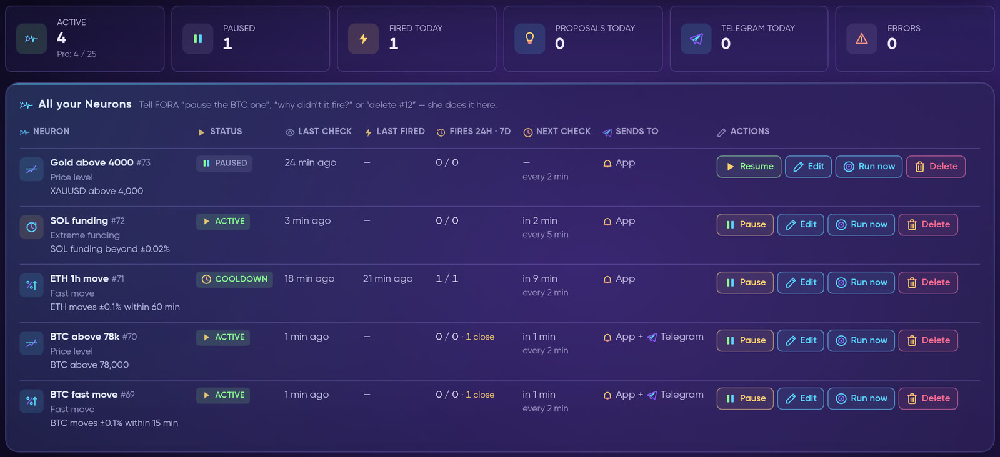
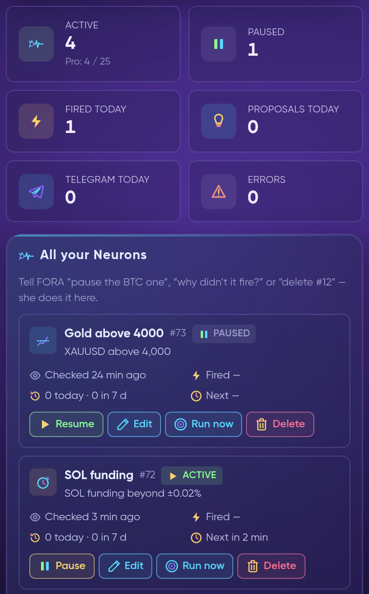
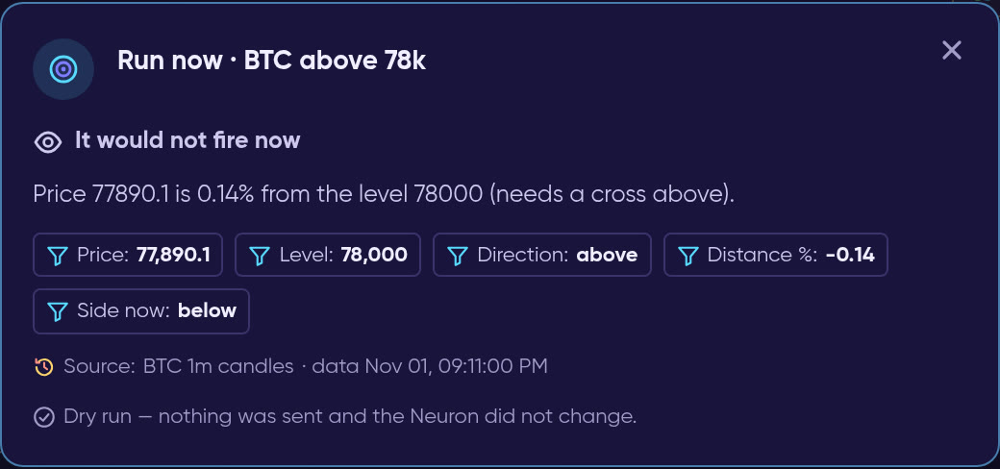
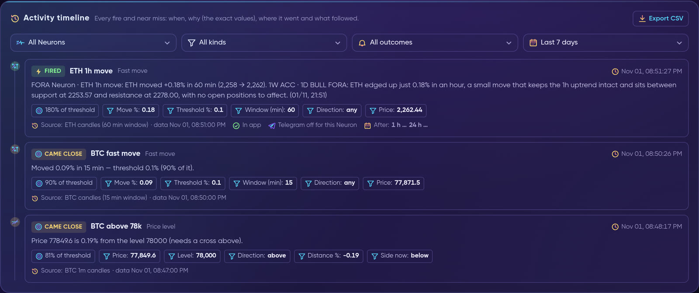
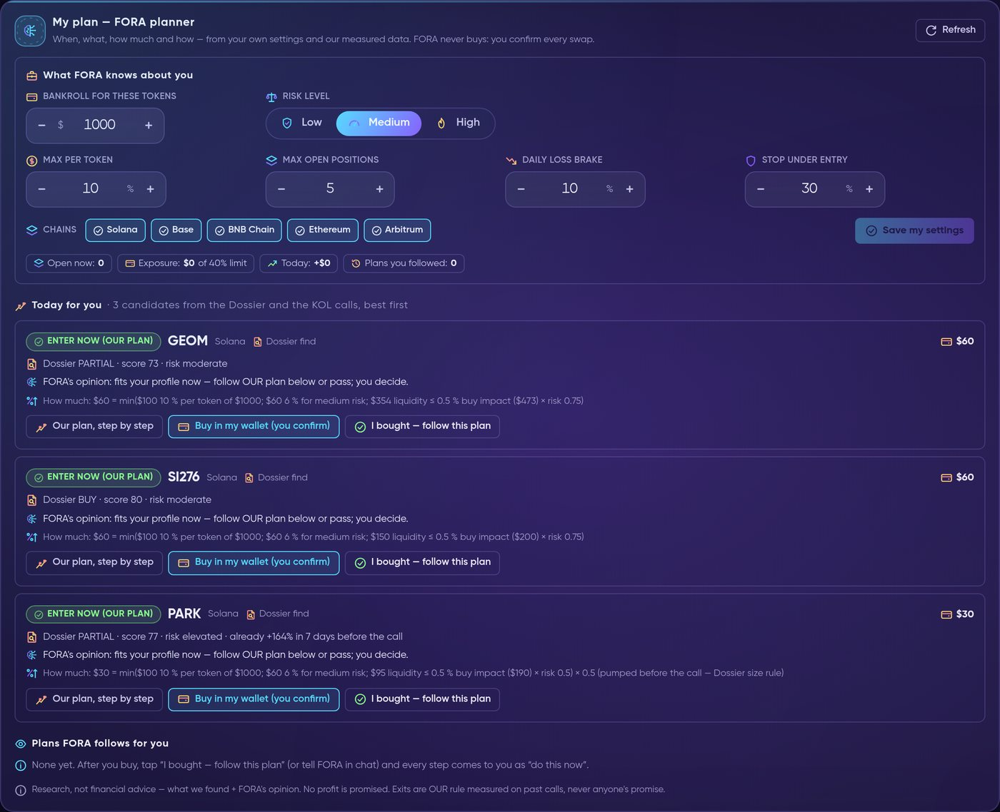
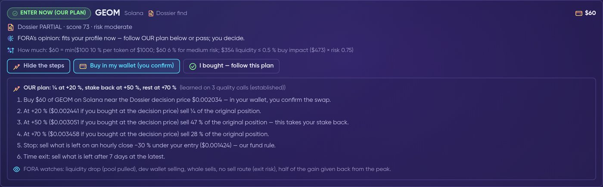
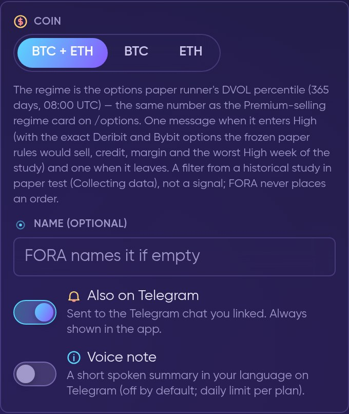
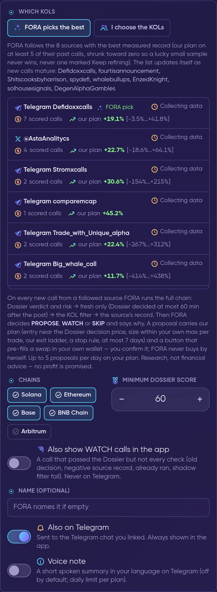

# 🧬 FORA Neurons

**FORA Neurons** are your always-on FORA watchers at **app.formion.ai → Neurons**. They keep looking while you are away and tell you in the app and on Telegram (the chat you linked under Alerts).


A Neuron never trades by itself — a proposal opens only when you tap it, on a DEMO account (Bybit for crypto, cTrader for gold and FX). Planner and KOL watch plans are never executed for you: you buy in your own wallet and confirm every swap.


Active Neurons per plan: **Neural (Free) 2 · Pro 25 · Institutional unlimited** (a FOM boost adds more — see **[FOM token](fom-token.md)**). Pricing details: **[Pricing & Tiers](pricing.md)**.

## The Neurons dashboard

Open **Neurons** in the main menu of [app.formion.ai/neurons](https://app.formion.ai/neurons?utm_source=docs&utm_medium=referral&utm_campaign=docs) — the green number next to it is how many Neurons you have active — or tap the Neurons icon in the FORA chat header. The dashboard answers one question: **what did my Neurons do, exactly when, why, and where did it go?**

<figure><video src=".gitbook/assets/clip-fora-neurons-dash.mp4" title="FORA Neurons dashboard: open Neurons, the table of Neurons, the activity timeline with the exact values, Run now and asking FORA why a Neuron fired (DEMO values)."></video><figcaption>
Open Neurons → see every Neuron → read the timeline → test one → ask FORA why (DEMO values).
</figcaption></figure>

<figure><figcaption>
The count tiles and <strong>All your Neurons</strong> (Docs Demo account, live data).
</figcaption></figure>

| Tile | What it counts |
|---|---|
| **Active** | Neurons running now, with your plan's limit under the number (for example Pro: 4 / 25). |
| **Paused** | Neurons you paused, or that are paused by your plan limit. |
| **Fired today** | How many times your Neurons fired today. |
| **Proposals today** | Trade and KOL proposals made today. |
| **Telegram today** | Messages delivered to your Telegram today. |
| **Errors** | Neurons whose last check failed. |

### All your Neurons

One row per Neuron: its type and rule, **Status** (active, cooldown, paused, paused · plan limit, done or error), **Last check**, **Last fired**, **Fires 24h · 7d** (plus how many times it came close in the last 24 hours), **Next check** with how often it checks, and **Sends to** (App, or App + Telegram). On a phone every Neuron is a card with the same facts and buttons.

<figure><figcaption>
On a phone: the same tiles, one card per Neuron.
</figcaption></figure>

| Action | What it does |
|---|---|
| **Pause / Resume** | Stops or restarts the Neuron. Nothing else changes. |
| **Edit** | Change the name, the values of the rule, **Also send to Telegram**, **Check every (min)** and **Quiet after a fire (min)**. Your plan sets the fastest check; a faster value is raised to it automatically. |
| **Run now** | Tests the Neuron with live data: **It would fire now** or **It would not fire now**, with the exact values, source and data time. It is a dry run — **nothing is sent and the Neuron does not change**. |
| **Delete** | Asks first, then removes the Neuron and its history. This cannot be undone, so pause it if you may need it later. |

<figure><figcaption>
<strong>Run now</strong> checks the rule on live data and sends nothing.
</figcaption></figure>

A real check also passes FORA's gate and the cooldown, so *It would fire now* does not always mean a message is on its way. Neurons that run research or a schedule cannot be dry-run; for those the window shows the next real check instead.

### Activity timeline — when, why, where

Under the table, the **Activity timeline** lists everything that mattered, newest first:

<figure><figcaption>
Each entry shows when, why (the exact values) and where it went (Docs Demo account, live data).
</figcaption></figure>

| Outcome | What it means |
|---|---|
| ⚡ **Fired** | The rule matched and the message went out. |
| 🎯 **Came close** | It nearly fired: at least 70 % of the threshold, or price within 0.5 % of your level. Logged at most once per Neuron every 30 minutes, unless it got clearly closer. |
| 👀 **Held by FORA** | The rule matched, but FORA's gate held it back. The reason is in the entry. |
| ⚠️ **Not delivered** | The rule matched, but neither the app nor Telegram took the message. |
| ⚠️ **Check failed** | The check itself failed, for example a data source was down. |
| 💡 **Proposed / Watching / Skipped** | What FORA decided on a **KOL watch** (see below) call. |
| 📤 **Plan step** | A "do this now" message from a plan you follow in **My plan** (see below). |

Every entry answers three questions:

* **When** — the time of the decision, to the second.
* **Why** — the exact values behind it, such as *Move %: 0.12* against *Threshold %: 0.1*, or *Price*, *Level* and *Distance %*, with the **source** and the **time of the data** it used.
* **Where** — **In app**, and the Telegram status: *Telegram delivered*, *Telegram not linked*, *Telegram notifications off*, *Telegram off for this Neuron*, *already sent*, *held: quiet hours* or *held: daily Telegram limit*.

When the entry is about a coin, **After** shows what its price did 1 hour and 24 hours later. That is context about the market, not a result and not a promise.

Filter by **Neuron**, **kind**, **outcome** and **period** (last 24 hours, 7 days or 30 days), use **Show more** for older entries and **Export CSV** to download what you filtered. Entries are kept for 30 days. Near misses are logged from November 1, 2026; older fires come from the existing history.

<figure><video src=".gitbook/assets/rec-fora-neurons-dashboard.mp4" title="Live recording of the Neurons dashboard on the demo account: count tiles, the table, Run now, the timeline and its outcome filter."></video><figcaption>
The real dashboard: tiles, Run now, the timeline and its filter (Docs Demo account).
</figcaption></figure>

### Manage Neurons by talking to FORA

Everything above also works in **[FORA](fora.md)** chat and by voice — she uses the same data and the same rules. Say it in your own words and name the Neuron, or use its number:

| You say | FORA does |
|---|---|
| *"Show me my neurons"* | The dashboard counts and every Neuron with its last and next check. |
| *"Tell me when BTC goes above 100k"* | Creates a Neuron, within your plan's limits. |
| *"Pause my gold alert"* | Pauses it. |
| *"Turn ETH funding back on"* | Resumes it. |
| *"Change the level to 95k for BTC 100k"* | Updates only that value. |
| *"Why did my funding neuron fire?"* | The exact values, the source and where the message went, read from the record. |
| *"Why didn't it tell me about SOL?"* | The last checks and values, any cooldown or error, and how close it came. |
| *"What did my neurons do today?"* | The activity of all your Neurons. |
| *"Test the BTC 100k neuron now"* | A dry run with live data. Nothing is sent. |
| *"Delete the BTC 100k neuron"* | Deletes it, because you said delete and named it in the same message. |

* If a name fits more than one Neuron, FORA asks which one you mean.
* *"Delete it"*, without saying which, only shows a card — it is deleted when you confirm.
* After every change FORA gives you a link that opens that Neuron's row on the dashboard.
* Your plan's limits and the checks on values are the same as in the app. A threshold that is out of range, such as a fast move under 0.1 %, is refused and FORA tells you why.

***

## Neuron types

| Neuron | What it watches |
|---|---|
| **Price level** | Tells you when price crosses a level. |
| **Fast move** | A % move within N minutes. |
| **Extreme funding** | Perp funding beyond a threshold. |
| **Open interest** | OI changes by % over a window. |
| **Volatility spike** | Range jumps vs its usual size. |
| **News watch** | Headlines with your words or coins. |
| **Social watch** | New posts from X, Telegram and YouTube accounts you pick. |
| **Several conditions** | Price, move, funding, open interest and news together (all or any). |
| **Macro playbook** | Before and after CPI, PPI, FOMC, NFP: how gold and BTC reacted since 2020, and the plan. |
| **Trader coach** (Pro+) | Reads your own trades, finds where you lose, tests strategies on 6 months. |
| **Price action** | Market structure on closed bars: CHoCH / BOS, swings, previous-day sweeps, order blocks, FVG, daily EMA 200, divergences, candle patterns. |
| **Daily brief** | Prices and mood at your time. |
| **Research watch** (Pro+) | Deep research on a topic; tells you only when it changes. |
| **Position guard** | Stop, liquidation and funding watch on your open positions. |
| **My strategy signal** | Your saved strategy runs live on its own data and tells you on a new signal. Never trades. |
| **Liquidity alerts** | Strong liquidation zones near price, order-book holes and third-party setups — each with our own measured record. |
| **Liquidation level** | Price near a strong level of our liquidation model, then a confirmed break or a rejection, with the context. Source: **Binance model (measured)** or **All venues in USD** (Formion model for every contract + Hyperliquid real positions, BTC / ETH / SOL / HYPE — its break history is not measured yet, and the messages say so). Context, not a signal. |
| **Liquidity walls** | Follows the 1–5 strongest resting walls of the **[Liquidity Map](liquidity-map.md)** and tells you in the app and on Telegram: price **approaching**, the wall **pulled** before price got there, price **touching** it, then a **reject / break / inside** on the close of the 1-minute candle 15 min or 1 h after the touch (closed candles only). Each message carries the wall size now vs at the start, its venues, how often it was pulled in 7 days, the last hour's flow by print size and the measured Level accuracy. At most 1 message per wall per stage in 6 h. Context signal — not an entry and not a signal. |
| **Options regime** (Pro+) | BTC / ETH options: one message when the DVOL premium-selling regime enters High and one when it leaves — see below. |
| **KOL watch** (Pro+) | Follows the KOLs you choose (or the best measured ones) and proposes, watches or skips each new call — see below. |
| **Spot scout** (Pro+) | Daily or weekly: which spot coins to buy, short and long term, each source weighted by its measured record. |

***

## My plan — the FORA planner

Under the dashboard, **My plan — FORA planner** answers four questions for the token calls Formion researches: **when** to act, **what** to pick, **how much** to put in and **how** to exit — from your own settings and our measured data. The same planner answers in FORA chat ("what should I buy today?", "how much X?", "make me a plan for $500", "when do I sell?"), on the KOL watch card and in the Dossier Telegram message.

<figure><figcaption>
Neurons → My plan: your settings on top, today's plans ranked for you below (Docs Demo account, live data).
</figcaption></figure>

<figure><video src=".gitbook/assets/clip-fora-planner.mp4" title="FORA planner: your settings, today's plans, how much, I bought — follow this plan, do this now messages and the Monday summary (DEMO values)."></video><figcaption>
From your settings to "do this now": the whole planner flow in 17 seconds (sample token, DEMO values).
</figcaption></figure>

### 1. What FORA knows about you

You set it once in **What FORA knows about you** (or tell FORA in chat). When something is missing, FORA asks **once**; after that it uses the defaults and tells you which ones it used.

* **Bankroll for these tokens** — the money you want planned, in USD.
* **Risk level** — Low, Medium or High (Medium is used until you pick).
* **Max per token**, **Max open positions**, **Daily loss brake** and **Stop under entry** — your own caps.
* **Chains** — Solana, Base, BNB Chain, Ethereum, Arbitrum.

Each risk level starts from OUR preset (you can override every number):

| | Low | Medium | High |
|---|---|---|---|
| **Size per plan** | 3 % of bankroll | 6 % | 10 % |
| **Max per token** | 5 % | 10 % | 20 % |
| **Max open positions** | 3 | 5 | 8 |
| **Max total exposure** | 25 % | 40 % | 60 % |
| **Daily loss brake** | 5 % | 10 % | 20 % |
| **Minimum Dossier score** | 70 | 60 | 55 |

FORA also reads what you already hold through Formion — plans you follow, Dossier entries you logged and the Dossier Autopilot book — to see your exposure, today's P&L and how your past plans did (the strip **Open now · Exposure · Today · Plans you followed**).

### 2. Today for you — what and when

Candidates are the Dossier's quality first calls (up to 48 hours old) and KOL calls that passed the **KOL watch** chain (up to 24 hours old). FORA ranks them for **you** and fills your portfolio in order, so a small account gets fewer plans, not all of them. Each plan gets one decision:

| Decision | Meaning |
|---|---|
| 🟢 **ENTER NOW (our plan)** | Fits your profile now — follow OUR plan or pass; you decide. |
| 🟡 **WAIT** | Worth watching, not buying yet (for example it already ran far above the Dossier decision price). |
| ⛔ **NOT TODAY** | It would break one of your limits: max open positions, same chain and class, or the daily loss brake. |
| 🔴 **SKIP** | Outside your risk level or score minimum, or the stake-back or stop level was already passed. |

Every reason comes from data: how far the token moved from the Dossier price, the verdict and risk, the age of the decision, the BTC regime (on Low risk), and your portfolio.

### 3. How much

The size is the **smallest** of: your max per token, the % for your risk level, the pool's liquidity (the buy may move the price at most 0.5 %, from the measured quote ladder, times a risk factor), your Dossier max per trade and your remaining exposure room — times the Dossier factor for the token's stage (for example half size when it pumped before the call). The math is shown in one line, e.g. *"$60 = min($100 10 % per token of $1000; $60 6 % for medium risk; $354 liquidity ≤ 0.5 % buy impact)"*. When the result is below a sensible minimum ticket ($15, Ethereum mainnet $100), it is raised to that minimum and you get **fewer positions** instead of tiny ones.

### 4. How — OUR exit plan

**Our plan, step by step** opens the steps: entry near the Dossier decision price, then OUR exit ladder measured on past calls of the same stage or class (for KOL calls the KOL plan), the stake-back step, the stop (−30 % on an hourly close, or your own stop) and a time exit after at most **7 days**, plus what FORA watches.

<figure><figcaption>
One plan opened: entry, OUR exit ladder, stop, time exit and the risk events FORA watches.
</figcaption></figure>

### 5. I bought — FORA follows the plan

**Buy in my wallet (you confirm)** pre-fills the swap in **[Formion Wallet](wallet.md)** — you review and sign. FORA never buys. After you buy, tap **I bought — follow this plan** (or tell FORA in chat). From then on FORA checks every 5 minutes and sends **"do this now"** in the app and on Telegram for:

* each step of the exit ladder and the stake-back step;
* the stop, giving back half of the gain from the peak, and the 7-day time exit;
* risk events from the live Dossier tracker: liquidity pulled from the pool, the dev wallet selling, whales selling, a worse sell route (exit risk).

Each message is sent exactly once. A plan closes by itself on the stop, the time exit or when every step is done; **Yes, I sold — stop** ends it any time. Every **Monday** you get *"How your plans did this week"* — plans, closed and open, and the result of OUR plan steps as a paper estimate from your entries.

### Free vs Pro

**Neural (Free)** sees what FORA likes today and why — the token, the reasons and FORA's opinion — **without numbers** (no entry, size or exits). **Pro** and **Institutional** add the entry, the size for your bankroll, OUR exit steps and FORA following every step for you; the same unlock is available with **FOM Lock**. Up to 3 plans at a time on Free, 5 on Pro and 10 on Institutional.

***

## Options regime Neuron

**Options regime** (Pro and Institutional) tells you **once** when the BTC or ETH options market enters the **High** premium-selling regime — and once when it leaves.

<figure><figcaption>
New Neuron → Options regime: pick BTC, ETH or both (Docs Demo account).
</figcaption></figure>

* **Off until you turn it on.** Like every Neuron it is never created for you — only the users who switch it on get its messages.
* **What it watches** — the DVOL percentile of its own 365 days, read once a day at 08:00 UTC (the same number as the Premium-selling regime card on **Options**). High = above the 66.7th percentile.
* **Entering High** — DVOL, the percentile, what the study measured in High (with the worst week) and the exact Deribit and Bybit options the frozen paper rules would sell, with credit and a margin estimate.
* **Leaving High** — the new state and what the study measured there: no measured edge for selling premium now.
* At most one message per coin, day and direction; a missing or stale reading never counts as a change.


A filter from a historical study in paper test (**Collecting data**), not a signal and not a promise of profit. FORA never places an order. **Neural (Free)** sees the Neuron with the Pro lock.


***

## KOL watch Neuron

**KOL watch** (Pro and Institutional) follows KOLs on X and Telegram and lets FORA decide on every new call they post.

<figure><figcaption>
New Neuron → KOL watch: pick the sources, chains and minimum Dossier score (Docs Demo account).
</figcaption></figure>

* **Which KOLs** — **FORA picks the best** (the sources with the best measured record: our plan on at least 5 of their past calls, never one marked *Keep refining*; the list updates itself) or **I choose the KOLs** from the measured list. Each source shows its scored calls, our plan's average with its range, and a status such as *Verified* or *Collecting data*.
* **The chain on every new call** — Dossier verdict and risk → fresh only (the Dossier decided at most 60 minutes after the post) → the KOL filter → the source's record. Then FORA decides **PROPOSE**, **WATCH** or **SKIP** and says why in one sentence.
* **A PROPOSE card** (app + Telegram) carries what we found, FORA's opinion and OUR plan: entry near the Dossier decision price, a size within your own max per trade, our exit ladder, the stop rule and at most 7 days — plus **Buy in my wallet**, which only pre-fills a swap you confirm. The card also carries your personal plan line from **My plan** (🧭 Your plan …).
* **Limits** — up to **5 proposals a day on Pro** and **20 on Institutional**; a FOM boost adds more.
* **Also show WATCH calls in the app** (optional) — calls that passed the Dossier but not every check. Never on Telegram.

### Free: one token of opportunity per week

Free users with active Neurons can get at most **one token of opportunity every 7 days** — and never a new one while the previous one is still open. It is only a call that passed the whole chain as PROPOSE, with the token, chain, why and FORA's opinion — **no entry, exit or amount**. The full plan is in Pro (7-day trial) or with FOM Lock.


Research, not financial advice — what we found + FORA's opinion. No profit is promised. Exits are OUR rule measured on past calls, never anyone's promise. Small samples are labelled *Collecting data*.

