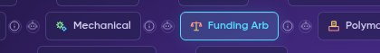
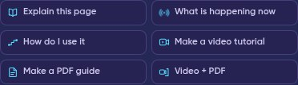
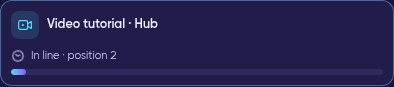
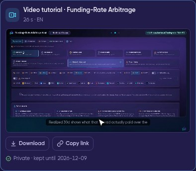
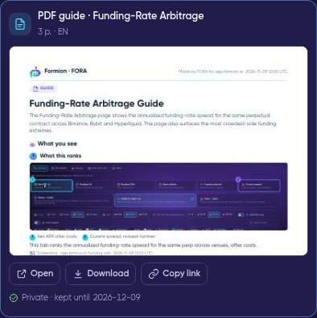
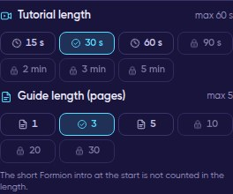

# 🎬 FORA Video & PDF Tutorials

FORA can turn any page of the app into a **short video tutorial** or a **PDF guide** — made for that exact page and delivered right in the FORA chat.
FORA opens the real page, clicks through it (views, sub-tabs, filters, sorting), and explains each part while drawing on the screen.

<figure><video src=".gitbook/assets/rec-fora-tutorials.mp4" title="Live recording: the FORA button next to ⓘ → Make a video tutorial → the video arrives and plays in the chat."></video><figcaption>
Live recording (demo account): the FORA button next to the ⓘ on Funding Arb → <strong>Make a video tutorial</strong> → the finished video plays right in the chat.
</figcaption></figure>

## 🚀 How to start one

There are three ways — all of them open the FORA chat on the page you want explained:

1. **The FORA button next to every ⓘ.** Next to every ⓘ info button (on pages, tabs and sub-tabs) there is a small **FORA button** (a robot head). Click it and a panel of quick actions opens: **Explain this page**, **What is happening now**, **How do I use it**, **Make a video tutorial**, **Make a PDF guide**, **Video + PDF** and **My tutorials**.
2. **Quick actions** in that panel — one click starts the tutorial.
3. **Just type it** in the FORA chat on that page: *"make me a video about this tab"*, *"PDF only"*, *"both"* (other languages work too). A typed request is confirmed first with **Yes, make it / No**, so a sentence that only mentions "video" never uses your limit.

<figure><figcaption>
Every ⓘ has a small FORA button (robot head) right next to it — also on tabs and sub-tabs.
</figcaption></figure>

<figure><figcaption>
The quick actions FORA opens for that page.
</figcaption></figure>

## 🎞️ What you get

| | 🎬 Video tutorial | 📄 PDF guide |
|---|---|---|
| **What it shows** | A guided tour of the **live** page: FORA clicks the real controls, zooms in on each part and draws a spotlight, numbered callouts and short labels. Short drawn scenes (marked **DEMO · illustration**) explain the idea behind the page. | The same tour printed: an annotated screenshot of each step with a numbered legend, the drawn diagrams, **How to use it** steps, a **Live data** table copied from the page at that moment (with the time) and **What it is not**. |
| **Sound** | Captions (word by word from the Free FOM steps and on paid plans), music and narration — depending on your plan and FOM step. | — |
| **Length** | 10 s up to 5 min (your plan + FOM step) | 1 up to 30 pages (your plan + FOM step) |
| **Branding** | A short Formion intro (about 1 second, not counted in the length) and a small Formion logo in the corner | Formion logo in the header |

The tour always runs on an internal **demo account** — never on your own account, so your balances, keys and positions never appear in a tutorial. Tutorials explain how a page works; they are **not trading advice** and never contain trade levels or profit promises.

## 📬 Delivery, privacy and how long files are kept

- A **progress card** appears in the chat right away and shows each step (planning the tour, opening the live page, narration, rendering, checking).
- When it is ready, the **video plays inside the chat** (download or copy a private link), or the **PDF card** shows its first page with a viewer and a download button.
- Files are **private to your account** — a link only works while you are signed in.
- Files are kept **7 days on Free** and **30 days on Pro and Institutional**. **My tutorials** in the FORA panel lists them.
- A tutorial that fails is **not counted** — your slot is given back.
- It usually takes **about 2–5 minutes** (long or 1080p videos take longer).

<figure><figcaption>
The progress card shows your place in line and then each step.
</figcaption></figure>

<figure><figcaption>
The finished video plays in the chat — download it or copy a private link.
</figcaption></figure>

<figure><video src=".gitbook/assets/sample-fora-tutorial-funding-arb.mp4" title="Sample FORA video tutorial: Funding Arb, 30 seconds"></video><figcaption>
A real 30-second FORA tutorial of the Funding Arb page (made on a demo account; narration plays when you unmute the full video).
</figcaption></figure>

<figure><figcaption>
A PDF guide in the chat: first-page preview, Open, Download and Copy link.
</figcaption></figure>

## 📏 Choose the length

In the FORA chat open **Settings** (gear) → **Tutorial length** (15 s · 30 s · 60 s · 90 s · 2 min · 3 min · 5 min) and **Guide length** (1 · 3 · 5 · 10 · 20 · 30 pages).
Pro and Institutional choose (defaults 60 s / 5 pages on Pro, 90 s / 10 pages on Institutional). Steps above your plan + FOM maximum show a **lock** — they open with a higher plan or with FOM Lock. Free uses its maximum automatically.

<figure><figcaption>
FORA chat Settings: lengths above your plan + FOM maximum show a lock (here on Pro: 60 s and 5 pages).
</figcaption></figure>

## 📊 Limits by plan and FOM step

Counted per **UTC day** (reset 00:00 UTC). Free without FOM gets **one video and one PDF to try, once**. The FOM step comes from the FOM you **lock** (or hold — held FOM counts half) — see **[FOM Boost](fom-token.md#fom-boost--more-on-every-plan)**.

| Plan · FOM step | 🎬 Videos | Max video | 📄 PDF guides | Max pages | Video production |
|---|---:|---:|---:|---:|---|
| **Free** | 1 to try | 10 s | 1 to try | 1 | Captions |
| Free **F1** · $25 lock | 1 / day | 15 s | 1 / day | 2 | Captions + music |
| Free **F2** · $50 lock | 1 / day | 20 s | 2 / day | 3 | Word-by-word captions + music |
| Free **F3** · $100 lock | 2 / day | 30 s | 3 / day | 4 | + narration |
| Free **F4** · Holder · $250 lock | 2 / day | 45 s | 3 / day | 5 | + narration |
| **Pro** | 3 / day | 60 s | 5 / day | 5 | Captions, music, narration, real screenshots |
| Pro **P1** · Holder · $250 lock | 4 / day | 75 s | 6 / day | 8 | + choose the voice (Narrator / FORA) |
| Pro **P2** · FORA Agent · $1,000 lock (90+ days) | 5 / day | 90 s | 8 / day | 10 | Premium voice, real screen recording, choose the music |
| Pro **P3** · $2,500 lock (90+ days) | 6 / day | 2 min | 10 / day | 12 | Premium |
| **Institutional** | 10 / day | 3 min (1080p) | 20 / day | 15 | Premium |
| Institutional **I1** · $1,000 lock (90+ days) | 12 / day | 3 min | 25 / day | 20 | Premium |
| Institutional **I2** · Agent Pro · $5,000 lock (90+ days) | 15 / day | 4 min | 30 / day | 25 | Premium |
| Institutional **I3** · FORA AGI · $25,000 lock (90+ days) | 20 / day | 5 min | 40 / day | 30 | Premium |

Holding FOM instead of locking: hold **twice** the lock amount (up to the Holder step). Steps above Holder need a **lock of at least 90 days**. During the launch period (until **13 November 2026**) every step needs half the amount shown. Tutorials do not use your monthly boost AI allowance.

### How do I see how many I have left?

Ask FORA: *"How many tutorials do I have left?"* — FORA reads **your own** account: your plan and FOM step, how many videos and PDFs you have used today (or your one Free try), your maximum length, the length you chose in Settings, and exactly what the next FOM step or plan would add.

### How do I get more?

- **Upgrade your plan** at [formion.ai/pricing](https://formion.ai/pricing?utm_source=docs&utm_medium=referral&utm_campaign=docs) — new accounts can start a **7-day Pro trial** (no card).
- **Lock FOM** in Formion Wallet → **Earn → FOM Lock** (live in beta) — see **[FOM Hold vs Lock](fom-hold-vs-lock.md)**.

## ❓ FAQ

**Why does my video have no voice?**
Narration depends on your plan and FOM step (Free and the first FOM steps get captions and music). On plans with narration, FORA uses our main voice provider and switches to a backup voice automatically if it is down. If no voice is available at that moment, or today's voice budget is used up, the video is made with captions and music and the chat says **"Narration unavailable"** — everything else stays the same.

**Why is it locked?**
Either you used your limit (Free: the one try; paid plans: today's count — it resets at 00:00 UTC), or you chose a length above your plan + FOM maximum. The lock shows both ways to unlock: a higher plan or FOM Lock.

**How long does it take?**
Usually 2–5 minutes. The progress card shows each step; you can keep using the app meanwhile.

**Does it use my account data?**
No. The tour runs on an internal demo account. Your keys, balances and positions are never shown.

**Which languages?**
Captions, narration and PDFs follow the language you chat in — all 11 app languages.
