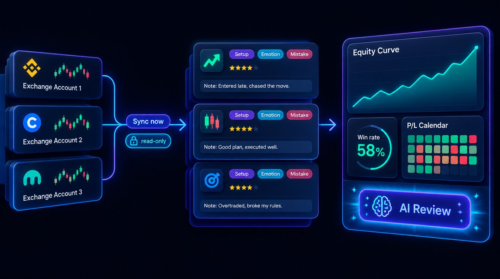
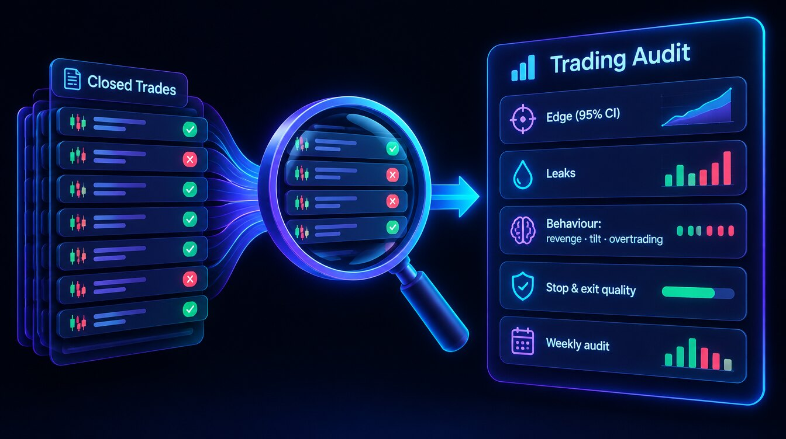

# 📓 Trading Journal

<figure><figcaption></figcaption></figure>

The Journal is your own record of trades — from connected exchanges, webhook pushes and manual entries — with full performance analytics.

## What it does

* **Log trades** — manual entry with setup, tags, emotion, mistakes, rating, notes and screenshots.
* **Exchange import** — connect an exchange account with a **read-only** API key (Bybit, Binance, OKX, Gate, MEXC, Bitget, KuCoin or Coinbase). Closed trades are imported with **Sync now** and kept up to date by a background auto-sync.
* **Webhook push** — create a DEX-wallet or generic webhook account and paste its URL into a TradingView alert or your own bot to push filled trades in.
* **Analytics** — P/L, win rate, equity curve, risk metrics, MAE/MFE, and breakdowns by symbol, side and session, plus Compare, Mindset (tags and emotions) and a P/L Calendar.
* **AI Review** — an on-demand AI review of your edge, leaks and behaviour.
* **Export & share** — CSV download, or send the CSV to your email or Telegram; shareable trade cards.

## By plan

| | Neural (Free) | Pro | Institutional |
|---|---|---|---|
| Journal history | 30 days | Unlimited | Unlimited |
| Image uploads | 10 | Unlimited | Unlimited |
| Exchange auto-import | — | ✅ | ✅ |

Open it from **[app.formion.ai](https://app.formion.ai) → Journal**.

## Trading Audit

<figure><figcaption></figcaption></figure>

**Trading Audit** reviews *your own* closed trades and tells you, with statistics rather than opinions, where your edge is and where money leaks. Open it at **Journal → Audit** (short link `app.formion.ai/audit`) or send **/audit** to [@formiontradingbot](https://t.me/formiontradingbot). Pick one Journal account or all of them.

What the audit checks:

* **Profile** — what, when and how you trade.
* **Edge** — your expectancy with a **95% confidence interval**, so a lucky streak isn't mistaken for skill.
* **Leaks** — setups, symbols, sessions or sides that cost you money, confirmed on a chronological **holdout** (trades the detector didn't see).
* **Behaviour** — revenge trading, tilt, size creep, overtrading, holding losers / cutting winners, and tail risk.
* **Stop & exit quality** — measured on real minute candles: were stops too tight, did exits leave money on the table? Alternative exits are judged only on unseen trades.
* **Follow-up** — adopt a recommendation as a rule and the next audit checks whether you kept it; an optional **weekly audit** arrives on Telegram.

Audits per day: **Neural 1** (basic), **Pro 3**, **Institutional 10**. Findings are only reported when they pass strict significance tests, so a short history may produce few findings — that is deliberate.

## Journal and tracked strategies

The Journal reviews your own trading decisions. [Trades History](trades-history.md) separately consolidates Formion's tracked strategy and signal outcomes; check whether a source represents paper tracking or live fills.
