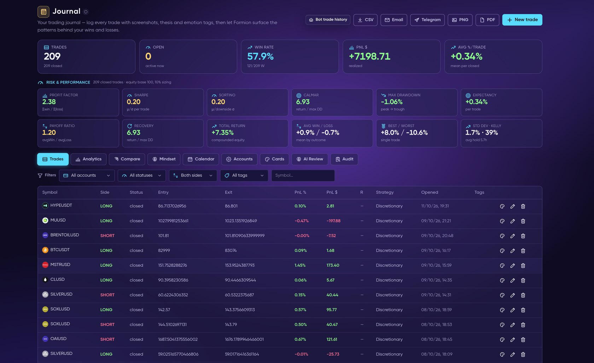
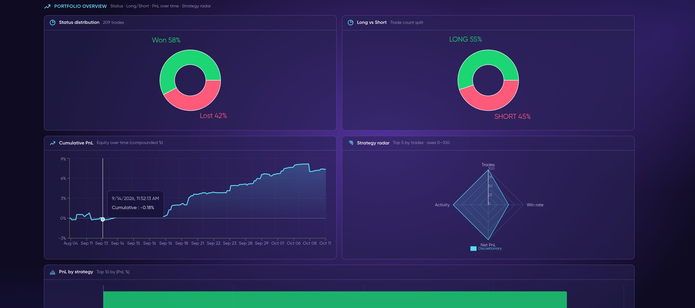
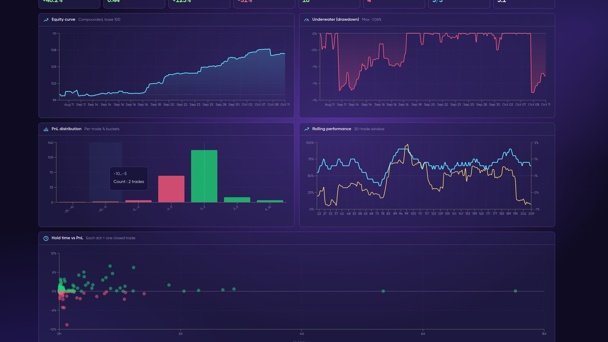
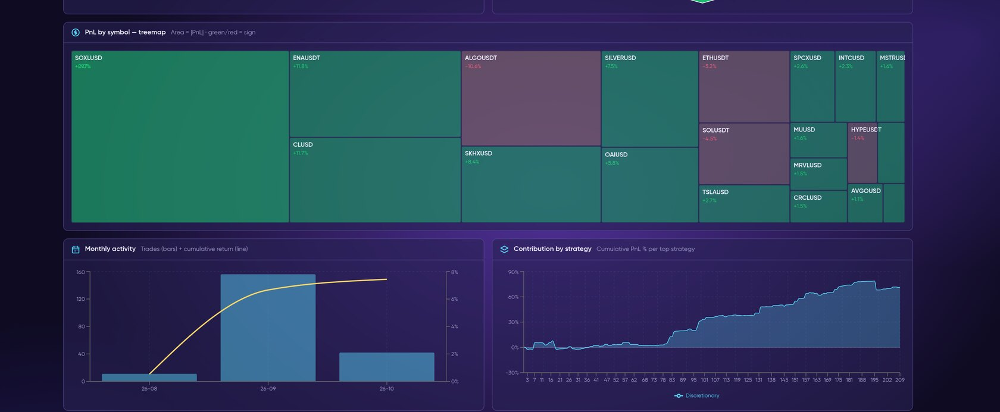
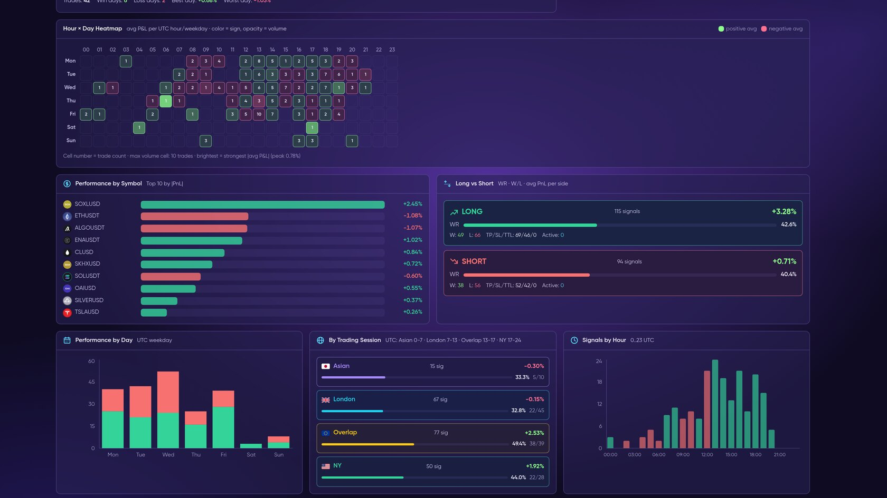
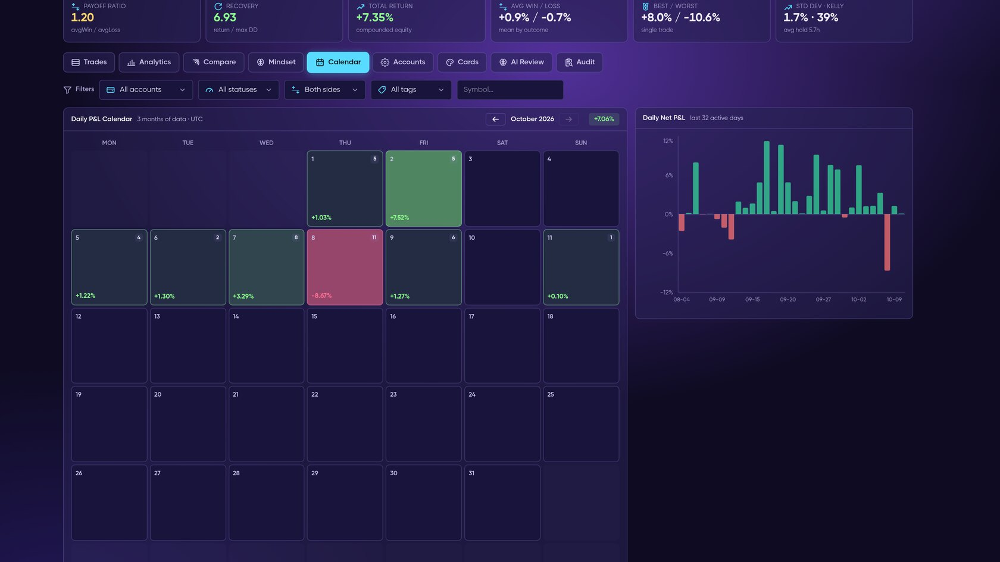
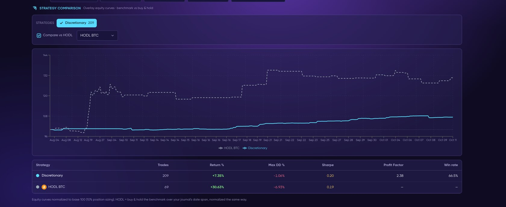
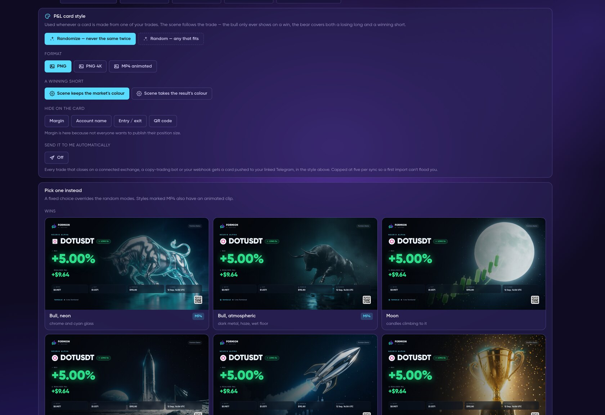
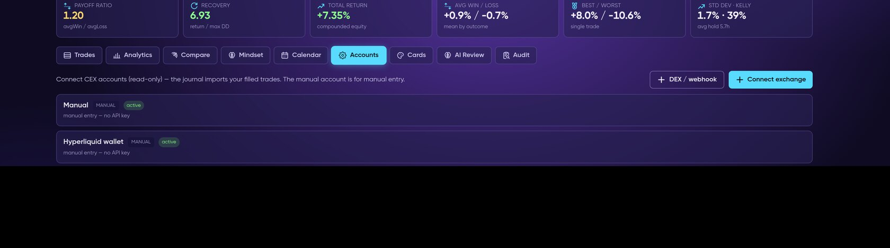

# 📓 Trading Journal

<figure><figcaption>
Journal → Trades: KPIs, risk & performance tiles and every closed trade.
</figcaption></figure>

The Journal is your own record of trades — from connected exchanges, webhook pushes and manual entries — with full performance analytics.

<figure><video src=".gitbook/assets/clip-journal.mp4" title="Trading Journal in 4 steps: connect and import, analytics, P&amp;L calendar, Trading Audit"></video><figcaption>
From import to audit in 16 seconds: connect an exchange → analytics → P&amp;L calendar → Trading Audit (demo values).
</figcaption></figure>

<figure><video src=".gitbook/assets/rec-journal-tour.mp4" title="Live recording on an empty demo account: the New trade form filled in by hand (cancelled, nothing saved), then the Audit tab with what each plan gets."></video><figcaption>
Live recording on an empty demo account: the New trade form filled in by hand (cancelled, nothing saved), then the Audit tab with what each plan gets.
</figcaption></figure>

## What it does

* **Log trades** — manual entry with setup, tags, emotion, mistakes, rating, notes and screenshots.
* **Exchange import** — connect an exchange account with a **read-only** API key (Bybit, Binance, OKX, Gate, MEXC, Bitget, KuCoin or Coinbase). Closed trades are imported with **Sync now** and kept up to date by a background auto-sync.
* **Webhook push** — create a DEX-wallet or generic webhook account and paste its URL into a TradingView alert or your own bot to push filled trades in.
* **Analytics** — P/L, win rate, equity curve, risk metrics, MAE/MFE, and breakdowns by symbol, side and session, plus Compare, Mindset (tags and emotions) and a P/L Calendar.
* **AI Review** — an on-demand AI review of your edge, leaks and behaviour.
* **Export & share** — CSV download, or send the CSV to your email or Telegram; shareable trade cards.


The screenshots on this page use **sample data**: the closed positions of a public Hyperliquid wallet, loaded into a demo account. Your Journal shows only your own trades.


## Analytics

The **Analytics** tab turns your history into charts — no setup needed.

<figure><figcaption>
Status and long/short split, cumulative P&amp;L and a strategy radar.
</figcaption></figure>

<figure><figcaption>
Equity curve, underwater drawdown, P&amp;L distribution and rolling performance.
</figcaption></figure>

<figure><figcaption>
P&amp;L by symbol as a treemap — green made money, red lost it — plus monthly activity.
</figcaption></figure>

<figure><figcaption>
Hour × day heatmap, performance by symbol, long vs short, day of week and session.
</figcaption></figure>

## Calendar and Compare

<figure><figcaption>
The P&amp;L Calendar — each day coloured by its net result, with daily net P&amp;L bars.
</figcaption></figure>

<figure><figcaption>
Compare: your equity curve against buy-and-hold BTC, with return, max drawdown, Sharpe, profit factor and win rate.
</figcaption></figure>

## P&L cards

<figure><figcaption>
Shareable P&amp;L cards: pick a style, choose what the card shows, then send it or post it.
</figcaption></figure>

## Accounts

<figure><figcaption>
Accounts: a manual account for hand-logged trades plus any connected exchange, DEX wallet or webhook.
</figcaption></figure>

## By plan

| | Neural (Free) | Pro | Institutional |
|---|---|---|---|
| Journal history | 30 days | Unlimited | Unlimited |
| Image uploads | 10 | Unlimited | Unlimited |
| Exchange auto-import | — | ✅ | ✅ |

Open it from **[app.formion.ai](https://app.formion.ai/?utm_source=docs&utm_medium=referral&utm_campaign=docs) → Journal**.

## Trading Audit

<figure><video src=".gitbook/assets/clip-trading-audit.mp4" title="Trading Audit of your own closed trades: profile, edge, leaks, behaviour, stop and exit quality, follow-up"></video><figcaption>
Trading Audit checks your own closed trades phase by phase: profile, edge with a 95% confidence interval, leaks confirmed on a holdout, behaviour, stop and exit quality, follow-up (demo values).
</figcaption></figure>

**Trading Audit** reviews *your own* closed trades and tells you, with statistics rather than opinions, where your edge is and where money leaks. Open it at **Journal → Audit** (short link `app.formion.ai/audit`) or send **/audit** to [@formiontradingbot](https://t.me/formiontradingbot). Pick one Journal account or all of them.

What the audit checks:

* **Profile** — what, when and how you trade.
* **Edge** — your expectancy with a **95% confidence interval**, so a lucky streak isn't mistaken for skill.
* **Leaks** — setups, symbols, sessions or sides that cost you money, confirmed on a chronological **holdout** (trades the detector didn't see).
* **Behaviour** — revenge trading, tilt, size creep, overtrading, holding losers / cutting winners, and tail risk.
* **Stop & exit quality** — measured on real minute candles: were stops too tight, did exits leave money on the table? Alternative exits are judged only on unseen trades.
* **Follow-up** — adopt a recommendation as a rule and the next audit checks whether you kept it; an optional **weekly audit** arrives on Telegram.

Audit allowance: **Neural** — 1 basic audit in total; **Pro trial** — 3 audits for the whole 7-day trial; **Pro** — 3 per day; **Institutional** — 10 per day. Findings are only reported when they pass strict significance tests, so a short history may produce few findings — that is deliberate.

## Journal and tracked strategies

The Journal reviews your own trading decisions. [Trades History](trades-history.md) separately consolidates Formion's tracked strategy and signal outcomes; check whether a source represents paper tracking or live fills.
