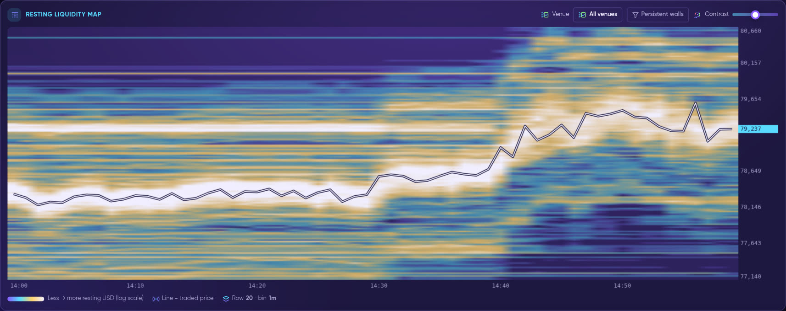
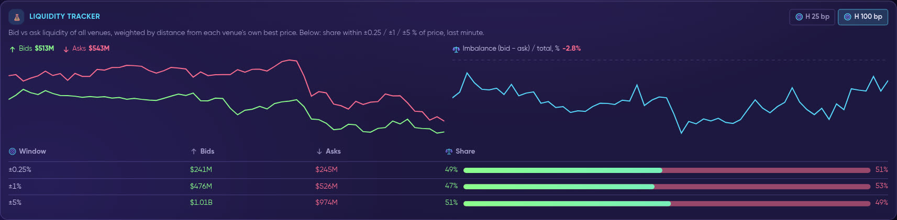
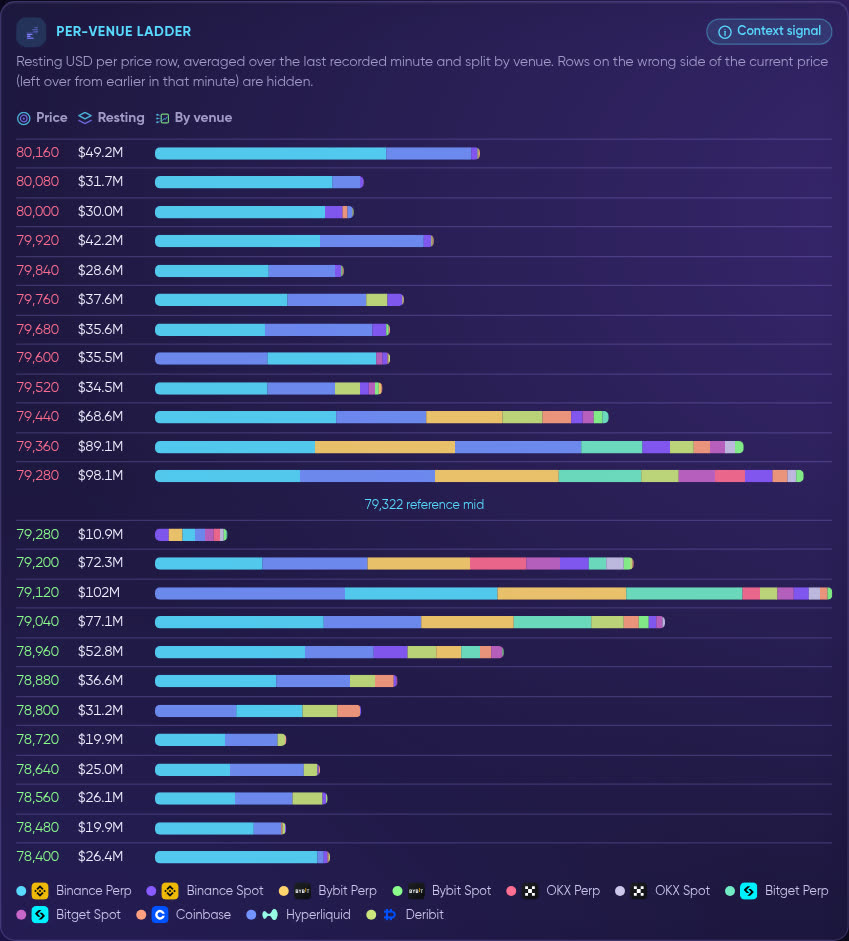
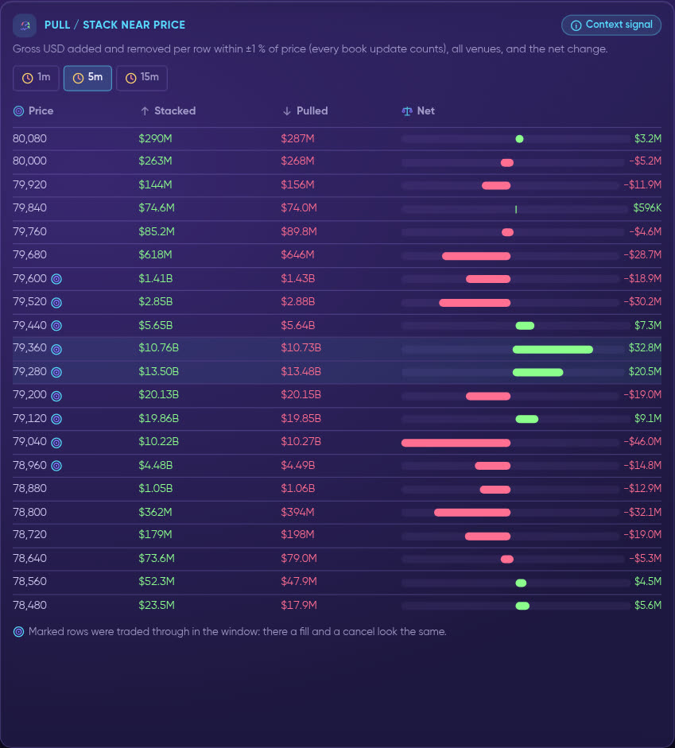
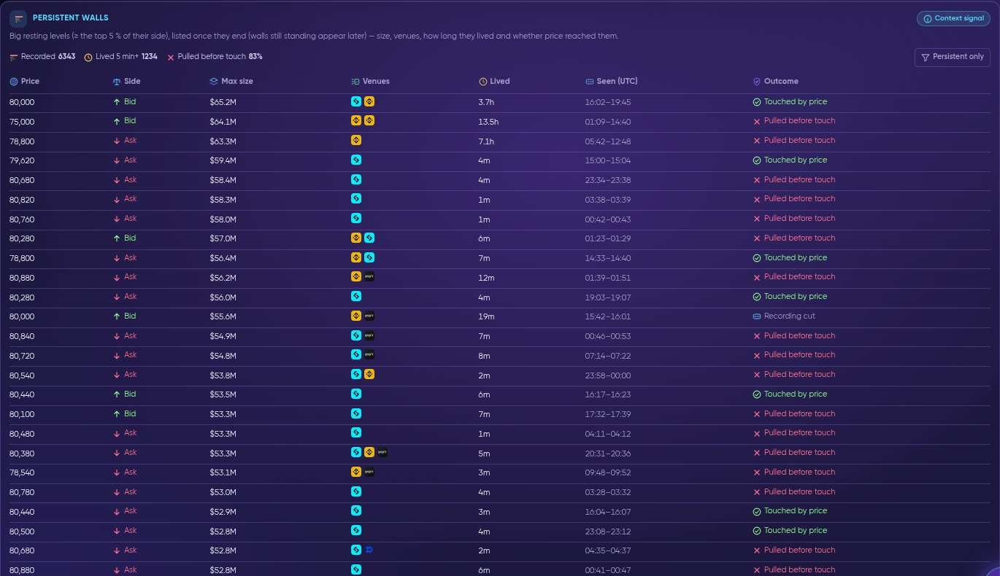
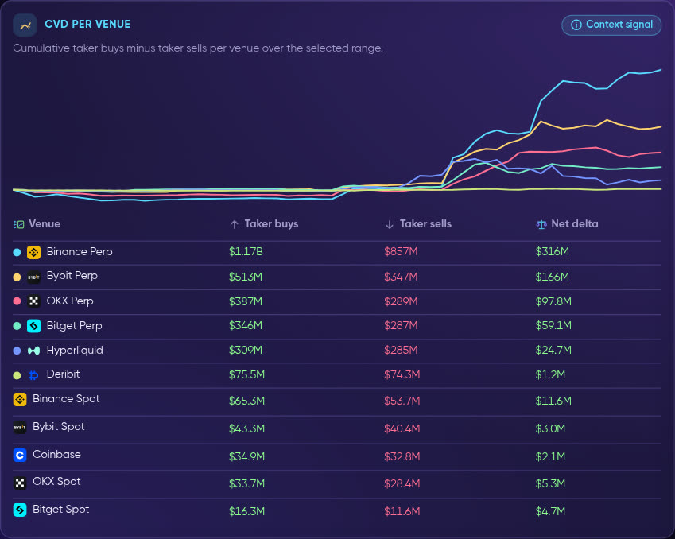
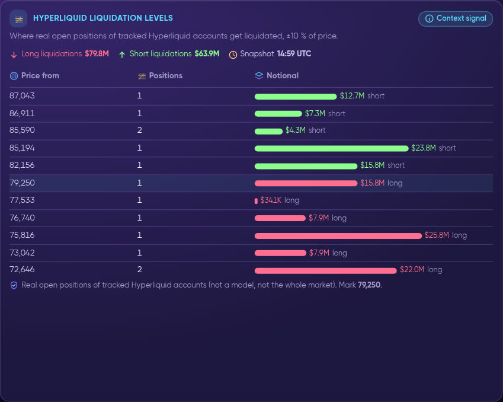

# 🗺️ Liquidity Map

<figure><figcaption>
The resting liquidity map: time left to right, price bottom to top; in the default Relative display brighter = more resting orders than usual at that distance from the price.
</figcaption></figure>

<figure><video src=".gitbook/assets/rec-liquidity-map-read.mp4" title="Live recording: pick a coin (ETH) and a range (6h), switch on the Persistent walls filter, hover the map to read a price row, then the Liquidity Tracker with H 25 bp and H 100 bp, the per-venue ladder and pull/stack. Dark vertical gaps are minutes that were not recorded — they are never filled in."></video><figcaption>
Live recording: pick a coin (ETH) and a range (6h), switch on the Persistent walls filter, hover the map to read a price row, then the Liquidity Tracker with H 25 bp and H 100 bp, the per-venue ladder and pull/stack. Dark vertical gaps are minutes that were not recorded — they are never filled in.
</figcaption></figure>

The **Liquidity Map** (app.formion.ai → Data Hub → **Liquidity Map**, `/liquidity-map`) shows where buyers and sellers had orders **resting** in the order books, minute by minute — summed across **11 markets**, recorded by Formion and kept for 30 days. It replaces the old **Heatmap** and **Agg Heatmap** pages; their links now open the Liquidity Map.

## Liquidity Map vs Liquidation Map

| | **Liquidity Map** (this page) | **[Liquidation Map](order-flow.md#liquidation-map)** |
|---|---|---|
| **What it is** | **Real resting limit orders** that Formion records from 11 venues | A **model estimate** of where leveraged positions would be force-closed |
| **What you see** | Where orders sit now and where they sat before, in **real USD** | Where forced orders could appear if price gets there — sizes are **relative strength, not dollars** |
| **Source** | Order books of Binance, Bybit, OKX, Bitget (perp + spot), Coinbase, Hyperliquid, Deribit | Binance USDⓈ-M (optionally Bybit coin-margined), as today |
| **Can it change?** | Yes — any order can be **pulled** at any moment | Yes — the estimate moves as positions open and close |

The **Hyperliquid liquidation levels** panel on this page is the exception that is real on both counts: they are the actual liquidation prices of open positions, but **only of the Hyperliquid accounts we track**, not the whole market.


The Liquidity Map is a **Context signal**. It describes what was in the books — it does not predict price and it never gives an entry, stop or target. Resting orders can be pulled at any moment, and in book data a fill and a cancel look the same.


## What is recorded

| | |
|---|---|
| **Coins** | BTC, ETH, SOL and HYPE |
| **Markets (11)** | Binance perp + spot, Bybit perp + spot, OKX perp + spot, Bitget perp + spot, Coinbase, Hyperliquid, Deribit |
| **How** | Every order book is sampled every **5 seconds** and averaged per minute; resting orders within **±5 %** of price are kept |
| **History** | **Recording since 2 Nov 2026**, kept for 30 days. A range longer than what has been recorded shows only the recorded part (with the % covered) — empty areas are never filled in |
| **Ranges** | 1h · 6h · 24h · 7d · 30d |

## The 7 panels

### 1. Resting liquidity map

<figure><figcaption>
Relative display (default): white / orange / red lines are price levels where far more orders rested than usual for their distance from the price; candles = traded price, bars at the bottom = traded volume.
</figcaption></figure>

* **What it shows:** time on the horizontal axis, price on the vertical axis; each cell is the resting liquidity at that price in that time bin. The **candles** are the traded price (wide, with a dark outline so they stay readable on bright rows) and the **bars in their own strip under the map** are the traded volume (taker buys + sells of the selected venues; the tallest few bins are clipped so one spike does not flatten the rest). The default view is the last **24 hours** (it switches to **7 days** once a full week has been recorded).
* **Display — Relative (default) or Raw USD:**
  * **Raw USD** colours each cell by the resting dollars as recorded. Because the book is always thickest right next to the price, on this scale the brightest band simply follows the price and covers the candles.
  * **Relative** removes that distance effect: every cell is divided by the **usual book at the same distance from that bin's traded price** (the median over all shown time bins at about the same distance). **1×** = normal for that distance, **4×** = four times the usual book there. So a wall far from the price stands out even if it is smaller in dollars than the always-thick book next to the price. Where the book at a distance is usually almost empty, the cell is compared with a minimum level instead (the 10th percentile of the non-empty cells in the view), and the tooltip says so. It is a display only — no amount is changed or added, and the tooltip always shows the real USD next to the ratio.
* **Colours:** the default colormap **Tide** runs deep blue (usual) → white → orange → red (far above usual). **Appearance** has 30 colormaps, Low / Peak, gamma, opacity, styles (Classic = crisp cells, no blur), and layers (candles, wide outlined candles, volume bars, last price line, current book profile, biggest levels now).
* **Controls:** **Venue** (all 11 markets summed, or one market), **Persistent walls** (shows only liquidity that stayed at least 5 minutes on 1h / 6h, or for the whole time bin on longer ranges — this hides orders that flash in and out), **Relative / Raw USD**, **Appearance** and **Full screen**. Hover a cell to read its price row, time, OHLC, the resting USD (split by venue) and, in Relative, how many times the usual book it is. Scroll = zoom, drag = pan, double-click = reset.
* **Full screen:** the **Full screen** button (or the **F** key) opens the map with its price axis, book profile and legend on the whole screen; **Esc**, **F** or the button closes it. On iPhone it fills the browser window.
* **Gaps:** minutes with no recording (for example during a restart) stay empty as dark vertical stripes — nothing is filled in.
* **How to read it:** a bright band that stays in place while price approaches is liquidity that was really sitting there; a band that disappears before price gets to it was pulled.
* **What it is NOT:** not a support/resistance promise and not a forecast — a band can vanish at any moment.

### 2. Liquidity Tracker

<figure><figcaption>
Bids vs asks over time, the imbalance line and the bid/ask share near price.
</figcaption></figure>

* **What it shows:** bid liquidity vs ask liquidity of all venues over the range, where each order is weighted by its distance from that venue's own best price. **H 25 bp / H 100 bp** is the half-life: an order this many basis points away counts half. Next to it, the **imbalance** (bid − ask) / total in %, and a table with the bid/ask **share within ±0.25 %, ±1 % and ±5 %** of price for the last minute.
* **How to read it:** H 25 bp focuses on the book right next to price; H 100 bp includes deeper orders. A positive imbalance means more resting bids than asks.
* **What it is NOT:** a lean in the book is not a direction call — the book can change in seconds.

### 3. Per-venue ladder

<figure><figcaption>
Resting USD per price row, split by venue (colour), asks above and bids below the reference mid.
</figcaption></figure>

* **What it shows:** resting USD per price row, averaged over the last recorded minute, with each bar split by venue. Rows on the wrong side of the current price (left over from earlier in that minute) are hidden.
* **How to read it:** see which venue a large level comes from — liquidity on one venue only is different from a level stacked on many.
* **What it is NOT:** not the live tick-by-tick book; it is a one-minute average.

### 4. Pull / stack near price

<figure><figcaption>
Gross USD stacked and pulled per row within ±1 % of price, and the net change, over 1, 5 or 15 minutes.
</figcaption></figure>

* **What it shows:** for each price row within ±1 % of price, the gross USD **added** (stacked) and **removed** (pulled) over the last **1, 5 or 15 minutes**, all venues together, and the net change. Every book update counts, so near price the gross numbers are large.
* **How to read it:** a net positive row is where orders were building; a net negative row is where they were leaving. Rows marked with the target icon were traded through in the window — there a fill and a cancel look the same.
* **What it is NOT:** "pulled" does not mean cancelled for sure where price traded.

### 5. Persistent walls

<figure><figcaption>
Big resting levels listed once they end: price, side, maximum size, venues, how long they lived, when they were seen and whether price reached them.
</figcaption></figure>

* **What it shows:** big resting levels (at least the top 5 % of their side of the book) that lived at least 60 seconds, listed **once they end**: price, side (Bid / Ask), maximum size, venues that held it, how long it lived, when it was seen (UTC) and the outcome — **Touched by price**, **Pulled before touch** or **Recording cut** (the recording stopped — a restart or a new UTC day — while the wall was still there; it was not pulled). The header counts recorded walls, walls that lived 5 min+, and the share pulled before touch; **Persistent only** keeps the 5 min+ walls.
* **How to read it:** use it to see how often big walls near the market were actually reached, and how often they were removed before price got there.
* **What it is NOT:** a wall that is still standing appears only after it ends. A wall is context about the book, not a promise of support or resistance.

### 6. CVD per venue

<figure><figcaption>
Cumulative taker buys minus taker sells per venue, with taker buys, taker sells and net delta.
</figcaption></figure>

* **What it shows:** cumulative taker buys minus taker sells (CVD) for each venue over the selected range, plus a table of taker buys, taker sells and net delta per venue. A venue with no recorded trades in the window is listed as such.
* **How to read it:** compare where aggressive buying or selling happened — for example perp venues vs spot venues.
* **What it is NOT:** executed flow, not resting orders; it does not tell you what comes next.

### 7. Hyperliquid liquidation levels

<figure><figcaption>
Where real open positions of tracked Hyperliquid accounts get liquidated, ±10 % of price.
</figcaption></figure>

* **What it shows:** the **real liquidation prices of open positions** held by the Hyperliquid accounts Formion tracks (about the top 2,000 accounts), within ±10 % of price, refreshed every 10 minutes: price row, number of positions and notional, long vs short, with the snapshot time and mark price.
* **How to read it:** long and short liquidations are coloured separately (with their totals above the table); large rows show where tracked positions would be forced to close if price got there.
* **What it is NOT:** not a model or an estimate, and **not the whole market** — only the tracked accounts on Hyperliquid.

## Free vs Pro

| | Free | Pro / Institutional |
|---|---|---|
| Coins | BTC | BTC, ETH, SOL, HYPE |
| Range | Last 1 hour | Up to 30 days of recorded history |
| Panels | Resting liquidity map + Liquidity Tracker | All 7 panels |

Locked coins, ranges and panels never leave the server for a Free account. See **[Pricing & Tiers](pricing.md)**.

## FORA

FORA can read the Liquidity Map as **context** (the state of the book, which can be pulled) and quotes only the real recorded numbers — it never uses it as an entry, stop or target and never as a prediction. See **[FORA](fora.md)**.

## Related

* **[Data Hub](data-hub.md)** — the other derivatives and order-flow pages.
* **[Order Flow & Microstructure](order-flow.md)** — Order Flow, DOM Pro, Liquidation Map and Walls.
* **[Screener → Order Book](screener.md#order-book)** — the book imbalance and walls for the top Binance perpetuals.
