# 📐 Options & GEX

<figure>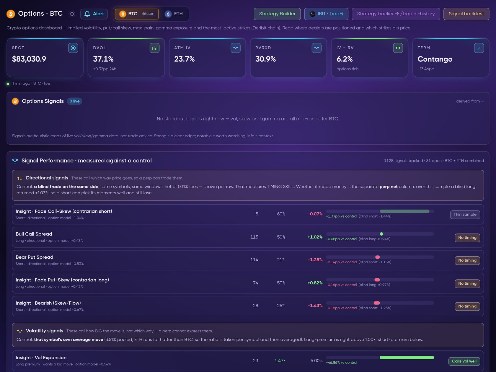<figcaption></figcaption></figure>

An options analytics desk for crypto (**BTC and ETH**, plus **SOL, HYPE and Gold (XAUT)** — see the section *SOL, HYPE and Gold options* below, built on Deribit with a multi-source view across Deribit, OKX, Bybit and Binance) and equities (**IBIT** plus dealer gamma on US indices and large caps) — implied volatility, the vol surface, Greeks, dealer gamma, and option structures scored to the current regime. Find it at **Data Hub → Options** and **Data Hub → Gamma**.


On the free **Neural** tier options analytics are a **3-row preview** (BTC, basic scorer). **Pro** and **Institutional** add ETH and the full scorer (strategies, regime, IV) — see **[Pricing & Tiers](pricing.md)**.


## What's inside

### Volatility & surface
* **IV smile** and full **volatility surface** (SVI-fit) per expiry
* **IV rank / IV percentile**, **realized-vol cone**, **IV–RV spread**
* **Term structure** (contango / backwardation) and DVOL — *contango* = longer expiries priced higher (calm), *backwardation* = the front expiry priced higher (stress or an event). The front expiry is the nearest one with **at least 2 days** to expiry, so a same-day daily option never sets the reading. The sign was corrected on 11 Nov 2026; term readings before 11 Nov 2026 22:56 UTC were removed, so term studies start from then.
* **Realized vol (RV30d)** is computed from the last **30 closed daily candles** of the perp, so the IV–RV spread compares like with like
* **Vol phase** — expansion, compression, coiling or consolidation, from IV percentile, DVOL velocity and term slope

<figure>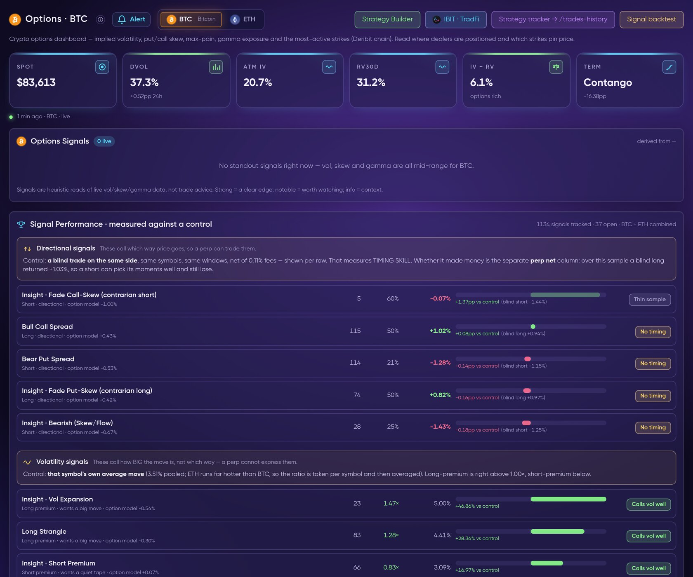<figcaption>
Options for BTC: spot, implied volatility, skew, term structure and signal performance measured against a control.
</figcaption></figure>

<figure>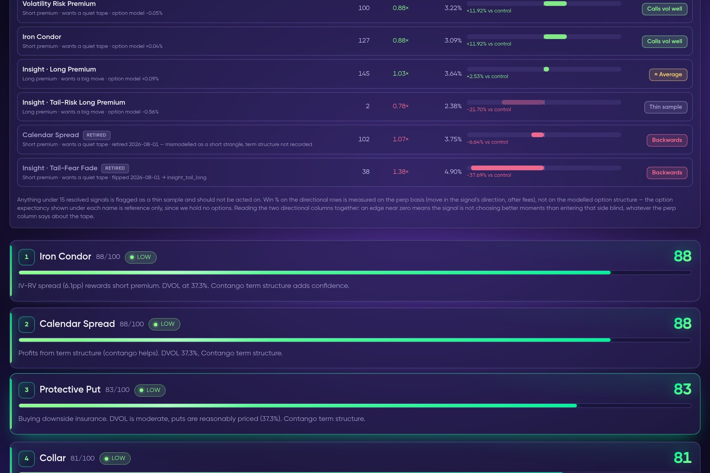<figcaption>
Strategy ranking — each options structure scored for the current volatility regime.
</figcaption></figure>

### Flow & positioning
* Crypto **options flow** and block trades — the Flow header states the **time window** its last N trades cover (e.g. *window 15:31–17:05 UTC (94 min)*), so every number below it belongs to that window only

<figure>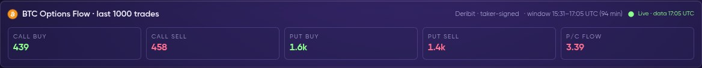<figcaption>
Options Flow: the window covered by the last 1,000 Deribit trades, plus the venue's own data time.
</figcaption></figure>

* **Put/Call** ratios, open interest by strike
* **Greeks** (delta / gamma / vega / theta) for your position in the **Strategy Builder**

### Scored option structures
Formion scores classic structures — **iron condor, short and long strangle, volatility risk premium, bull call and bear put spreads, calendar, covered call, protective put, collar** — against current IV, term structure and the IV–RV spread, so you see *which structure fits this regime*. Build a position and see its payoff and Greeks in the **Strategy Builder**. Equity-options coverage includes a dedicated **IBIT** page.

### Forward, Index and the data-time badge
* **Forward vs Index.** The GEX heatmap, the SVI surface fit and the IV smile are quoted on the **options forward** (the median of the venues' underlying across expiries) and are labelled **Forward**; the real Deribit **Index** is shown next to it. Distances such as *"Index is 3.0 % below the γ-flip"* in Insights are measured from the Index.
* **γ-flip = zero gamma.** One definition everywhere — the options GEX panel, the GEX heatmap, IBIT and Mechanical: the price at which the total dealer gamma of all listed options, re-priced at that price, changes sign. It is empty when no such price exists. Dealer GEX assumes dealers are long calls and short puts — dealer positions are **not observed**.
* **Data time.** Each panel shows the venue's **own data time** — *Live · data HH:MM UTC*. When the data is older than 10 minutes the badge turns to **not live**, so a frozen panel never looks live.

## 📏 Signal Performance — how to read it

<figure>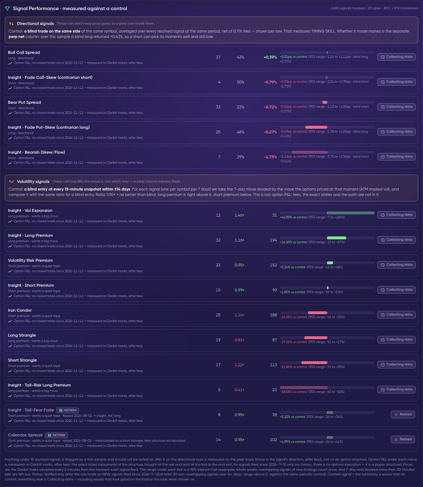<figcaption>
Signal Performance: every tracked options signal next to its control, with a 95 % range and a status word.
</figcaption></figure>

The scoreboard tracks the paper signals of the regime scorer and the Insights for **BTC + ETH** over a **7-day horizon**. There is **no options execution** behind it. Prices are the Deribit index, sampled every 5 minutes from the moment a signal fires.

* **Directional signals** (spreads, skew fades) — the move in the signal's direction, net of 0.11 % fees, compared with a **blind trade on the same side** of the same symbol over the same period (*pp vs control*). That measures timing; whether a rule made money is a separate question.
* **Volatility signals** (strangles, condors, volatility risk premium, long / short premium) — the 7-day move ÷ the move the options priced at that moment (ATM implied vol), compared with the same ratio for a **blind entry at every 15-minute snapshot within ±14 days**. *Ratio 1.00×* = no better than blind; long premium is right above 1, short premium below.
* Overlapping signals of one strategy count **once** (one per symbol per 7 days), 7-day exits booked more than 30 minutes late are left out, and every row shows a **95 % range** that resamples whole weeks.
* **Status words.** **Verified** only after a rule beats its control on **new** signals fired since 12 Nov 2026 (at least 30 non-overlapping signals over 14+ days, range above 0). **Context signal** = over its whole history the rule did worse than its control. Everything else is **Collecting data** — including results that look good on the history the rules were chosen on. Today every active options strategy is *Collecting data*; retired rules are marked *Retired*.
* **Option P&L.** The old modelled (Black-Scholes) option P&L is no longer shown anywhere. Each strategy now carries an **Option P&L** line *measured on Deribit marks, after fees*: the exact listed Deribit instruments of the structure, bought at the ask and sold at the bid at fire and at exit, Deribit taker + delivery fees deducted. It exists **only for signals fired since 12 Nov 2026** (no history); a leg without a real quote stays *unpriced*. It is a measured paper structure, not a verdict — the status word decides, and a few trades are noise.


**Neural** sees 3 open signals and the last 7 days of the scoreboard; **Pro** and **Institutional** see the full book. Options signals are volatility and regime tells — never a proven trade, and the bands on a signal are the rule's own expected-move levels.


## 🧭 Premium-selling regime

<figure>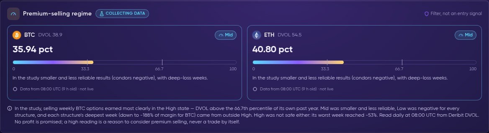<figcaption>
Premium-selling regime: where BTC and ETH implied vol (DVOL) sits within its own past year.
</figcaption></figure>

A card that tells you **when selling options has historically made sense** — a **filter, not an entry signal**.

* **What it measures:** the Deribit **DVOL** (30-day implied vol index) of BTC and ETH as a **percentile of its own trailing 365 days**, read once a day at 08:00 UTC. It is never "live" — the card shows the data time and a *not live* badge.
* **States:** **High** = above the 66.7th percentile · **Mid** = 33.3–66.7 · **Low** = below 33.3. If the reading is missing or older than 48 h, no state is shown.
* **How to read it:** in Formion's historical study of weekly Deribit options (sold Friday 08:00 UTC, held to expiry, after fees and spread) the average result per structure was **High > Mid > Low for every structure**. High was where selling weekly options earned most clearly; Mid was smaller and less reliable; **Low was negative for every structure**. High was **not safe** either — it also had deep losing weeks.
* **Status: Collecting data.** No rule is Verified. No profit is promised; a High reading is a reason to *consider* premium selling, never a trade by itself.

### Tail risk by structure

<figure>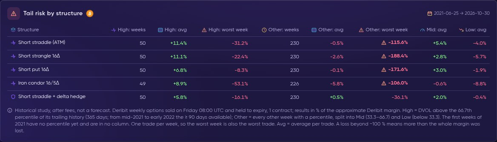<figcaption>
Tail risk by structure — historical study, after fees, not a forecast.
</figcaption></figure>

For the selected asset, the table lists **short straddle (ATM), short strangle 16Δ, short put 16Δ, iron condor 16/5Δ** and **short straddle + delta hedge**, each with: the number of weeks, the **average per trade** and the **worst week** in % of the approximate Deribit margin — in **High** weeks vs all **Other** weeks — plus the **Mid** and **Low** averages. One trade per week, so the worst week is also the worst trade; a loss beyond −100 % means more than the whole margin was lost. Every number comes from the study's own trades and is labelled **historical study, after fees, not a forecast**.

### Paper test of these rules

<figure>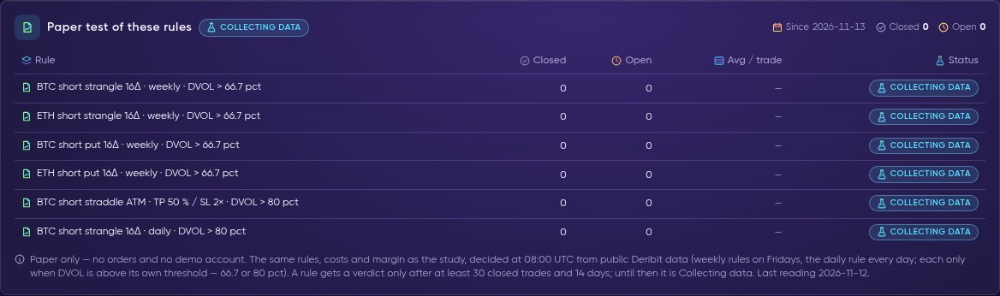<figcaption>
Six frozen rules run as a paper book from 13 Nov 2026 — no orders, no demo account.
</figcaption></figure>

Six frozen rules from the study run as a **paper book** from 13 Nov 2026 — no orders and no demo account, the same costs and margin as the study. Each rule gets a verdict only after **at least 30 closed trades and 14 days**; until then it is **Collecting data**.


The Premium-selling regime, the tail-risk table and the paper test are **open on every plan**. FORA reads the current regime too — and treats it only as a filter or context for a premium-selling idea, never as a reason to open a trade.


## 🧪 Backtest → Options · Vol

<figure>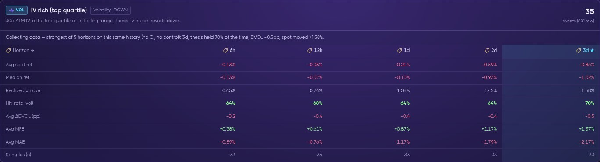<figcaption>
Options · Vol: what happened after each options signal type, at five horizons.
</figcaption></figure>

**Backtest → Options · Vol** is a forward-return study of the options volatility signals (term backwardation / contango, IV rich / cheap, DVOL momentum, skew fade, dealer gamma) for BTC, ETH or both, built from a 15-minute options recorder whose sample grows every day. Pick the **Lookback** (7 / 14 / 30 / 90 days) and a **Re-trigger cooldown** so one sticky regime is not counted dozens of times.

* Each signal type has a horizon table (**6h, 12h, 1d, 2d, 3d**) with average and median spot return, realized ±move, hit rate, average ΔDVOL, MFE, MAE and the sample size.
* The **★ highlighted horizon** is only the *strongest of the 5 horizons on this same history* — picked in-sample, with no costs, no confidence range and no drift control. **It is not proof** of an advantage; every row is **Collecting data**.
* The **term backwardation / contango rows start from 11 Nov 2026** (22:56 UTC): earlier term readings had the sign inverted and used a same-day daily option as the front, so they were removed.
* These are volatility / regime tells measured forward — not entries with levels. **Neural** sees a recent-history preview, **Pro** the full study.

## 🧪 Backtest → Options · Premium selling

<figure>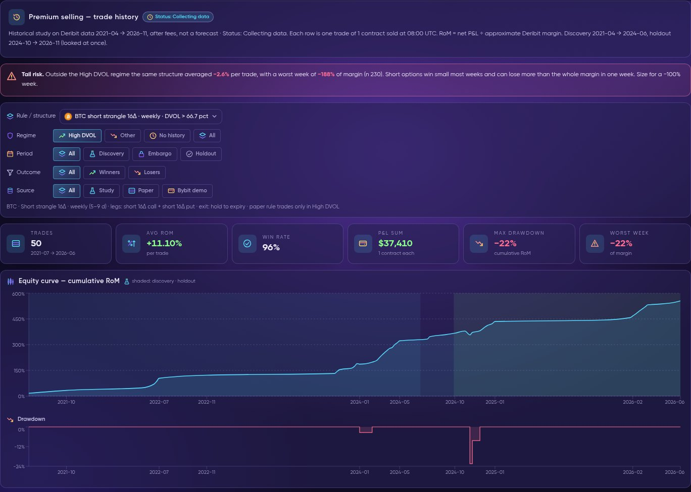<figcaption>
Backtest → Options → Premium selling: every trade of the historical study for the selected rule (Docs Demo account, Pro).
</figcaption></figure>

**Backtest → Options → Premium selling** (tab next to *Vol signals*) shows the **trade history** behind the Premium-selling regime card: every simulated trade of Formion's historical study of selling Deribit options (**2021-04 → 2026-11**, sold at 08:00 UTC, 1 contract, after Deribit fees and a half-spread estimate) for the six frozen paper rules and for each weekly hold-to-expiry structure (straddle, strangles, short puts, iron condor, covered call; BTC and ETH).

* **Header** — *Historical study on Deribit data, after fees, not a forecast · Status: Collecting data.* No rule is Verified.
* **Tail-risk box** (red, always visible) — what the same structure did **outside** the High DVOL regime: average per trade and worst week in % of margin. Short options win small most weeks and can lose more than the whole margin in one week.
* **Tiles** — trades, average return on margin (RoM) per trade, win rate, P&L sum (1 contract each), max drawdown and worst week.
* **Filters** — rule / structure, regime (High DVOL = DVOL above the 66.7th percentile of its own 365 days, the default; Other; No history), period (Discovery / Embargo / Holdout), outcome and source.
* **Equity curve and drawdown** of the cumulative RoM, the **10 worst weeks**, and a table of **every trade** — entry, exit or expiry, legs (study rows show the delta-chosen legs, paper and Bybit demo rows the real instruments), DVOL percentile, credit, exit reason, P&L per contract, RoM, regime and sample. Paper and Bybit demo trades of the frozen rules (from 13 Nov 2026) appear in the same table with their source.


**Neural (Free)** sees a preview: the summary tiles of the High DVOL trades, the tail-risk box and the **10 newest** High DVOL trades; the rest of the table, the filters, the curve and the worst weeks are part of **Pro** and **Institutional** (7-day free trial, no card). This is a historical study, not a forecast and not a promise of profit.


## 🪙 SOL, HYPE and Gold options

Since 17 November 2026 the options pages also cover **SOL**, **HYPE** and **Gold (XAUT)**, next to BTC and ETH, on every plan. Pick the coin in the coin picker at the top of the page.

| Asset | Venues | One contract |
|---|---|---|
| **SOL** | Deribit USDC linear options and Bybit USDT options | 1 SOL |
| **HYPE** | Deribit USDC linear options and Bybit USDT options | 1 HYPE |
| **Gold (XAUT)** | Bybit USDT options on XAUT (Tether Gold) | 1 XAUT (≈ 1 oz) |

Bybit has no XAU options and Deribit has no gold, so gold options come from Bybit XAUT only.

### Where you see them

* **Options → Strategy Builder** (`/options/builder`) — the same payoff, Greeks and breakevens as for BTC, on the live chain of that venue.
* **Data Hub → Options** (`/options`) — with SOL, HYPE or Gold selected, a market-state panel: index, **ATM IV (own)** for 7 and 30 days, the ATM IV term structure, 25Δ risk reversal, put / call open interest, the share of thin options near the money and a table per expiry.

<figure>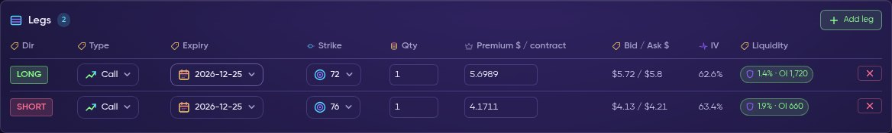<figcaption>
Strategy Builder with SOL legs: the Liquidity column shows the bid / ask spread and the open interest of every leg (Docs Demo account, Pro).
</figcaption></figure>

<figure>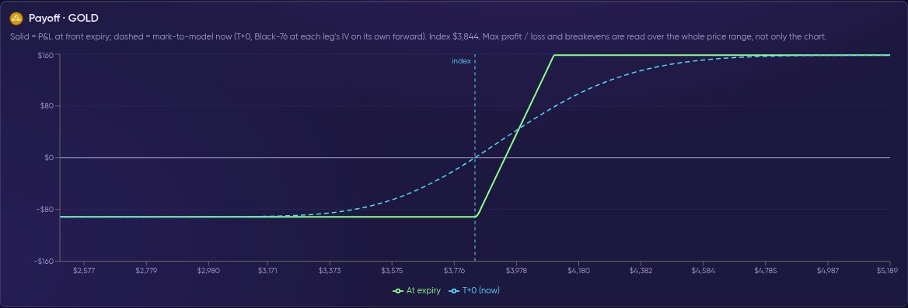<figcaption>
Payoff of a gold (XAUT) call spread: at expiry (solid) and now (dashed).
</figcaption></figure>

<figure>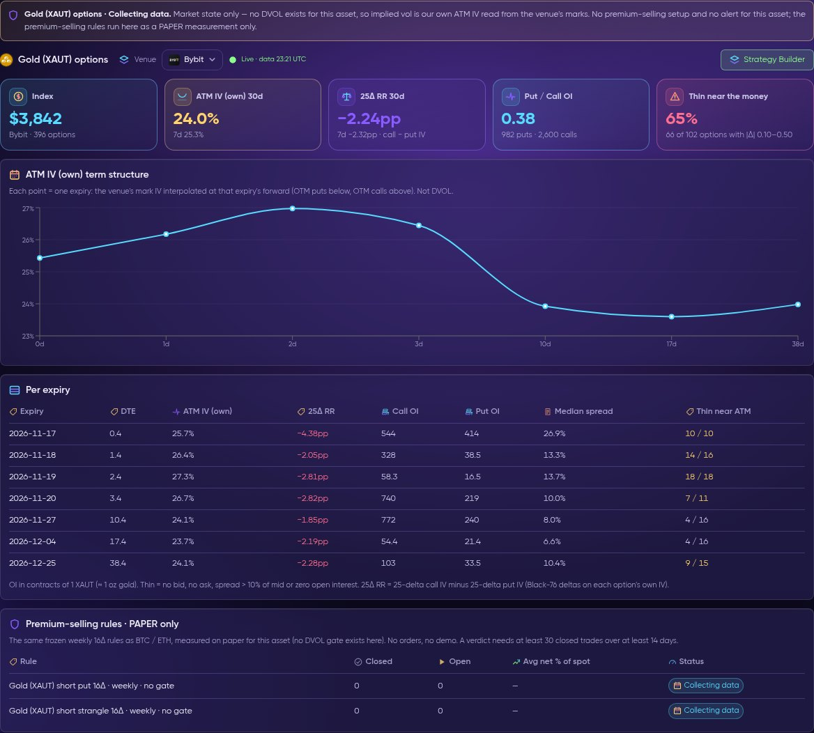<figcaption>
Data Hub → Options with Gold (XAUT) selected: market state, the term structure, the table per expiry and the paper rules (Docs Demo account, Pro).
</figcaption></figure>

### Thinner market — check every leg

These markets are much smaller than BTC and ETH.

* The builder shows a **Liquidity** column for every leg: the bid / ask spread in % and the open interest.
* A **Thin market** warning appears when a leg has no bid, no ask, a spread wider than 10 % of the mid price, or zero open interest. The mark premium can then be far from a real fill.
* **ATM IV (own)** is our own reading of the venue's mark IVs at each expiry's forward. It is **not DVOL** — Deribit publishes no DVOL for these assets.

### No setup — measurement only

* There is **no premium-selling setup card, no options alert, no Neuron and no trade idea** for SOL, HYPE or Gold. FORA never offers an option trade on them as a setup.
* **Compare with a perp** stays BTC and ETH only.
* The same frozen weekly 16Δ premium-selling rules as for BTC / ETH (short put 16Δ and short strangle 16Δ, entry Friday 08:00 UTC, 5–9 days, held to expiry) run for these assets **on paper only** — no orders, no demo account. First entries: 20 November 2026.
* Status **Collecting data** until a rule has at least 30 closed trades over at least 14 days.
* Nothing is ordered from these pages.

## ⚖️ Strategy Builder → Compare with a perp (Pro and Institutional)

<figure>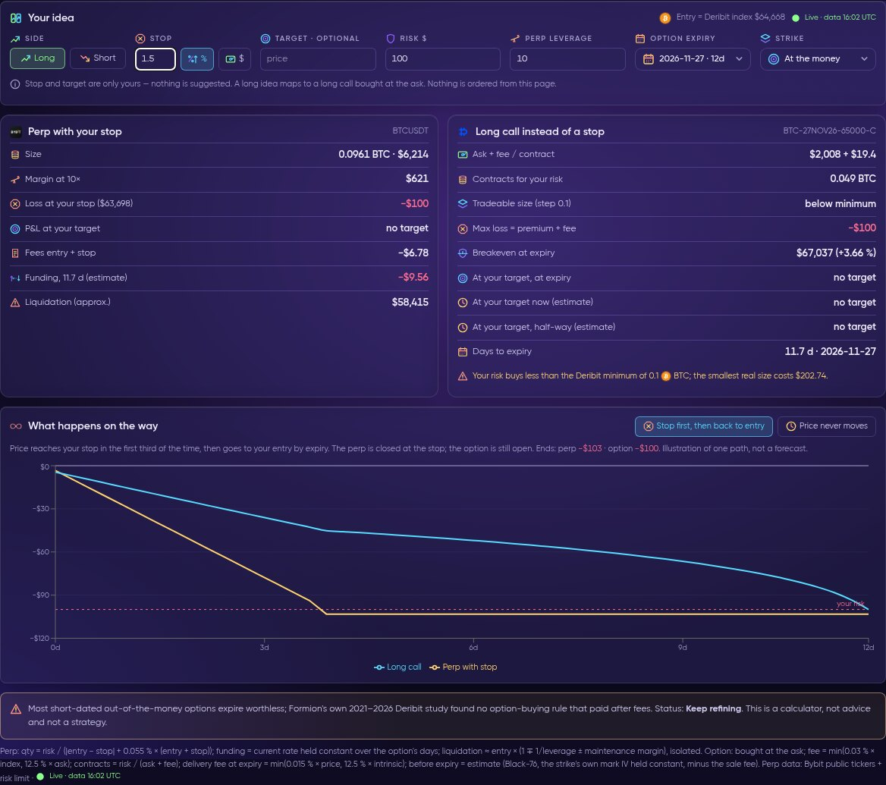<figcaption>
Compare with a perp: one idea, your own stop and $ risk, as a perp and as a long option on the live chain (Docs Demo account, Pro).
</figcaption></figure>

Open **Options → Strategy Builder** and pick the mode **Compare with a perp** (link: `/options/builder#compare`). It answers one question: *should I use an option instead of a stop?*

You enter **your own** idea — Formion never suggests a stop or a target:

* **Coin and side** — BTC or ETH, long or short.
* **Your stop** — % from entry or a price. **Target** (optional), **$ you are willing to lose**, perp **leverage**.
* **Option expiry** (default: the nearest one 7–30 days out) and **strike** (at the money, or at your target).

Entry is the option venue's current index. Then you see side by side:

* **Perp** (Bybit USDT perpetual) — sized so the loss at **your** stop, incl. both taker fees, equals your $ risk; margin at your leverage; P&L at your target after fees and a funding estimate; the approximate liquidation price, with a warning when it sits before your stop.
* **Long call** (long idea) or **long put** (short idea) from the live Deribit or Bybit chain, bought at the **ask** plus the venue fee — contracts for the same $ risk, max loss = the premium, breakeven at expiry, value at your target at expiry and before expiry (an estimate), and a warning when your risk buys less than the venue's minimum size.
* **What happens on the way** — three illustrative paths over the option's life: stop first then target, price never moves, straight to target.


Most short-dated out-of-the-money options expire worthless; Formion's own 2021–2026 Deribit study found no option-buying rule that paid after fees. Status **Keep refining** — a calculator, not advice, not a signal, never an order.



**Neural (Free)** sees the mode with a lock — what it does and the way to **Pro** (7-day free trial, no card), never prices or instruments. FORA answers *"option instead of a stop?"* with the live numbers on Pro and Institutional; on Free she explains the trade-off in words only.


## 🤖 FORA options setups (Pro and Institutional)

Ask FORA *"should I sell options now?"* or *"da li da prodam opcije?"* and she answers **only from the frozen paper rules of the study**:

* **High DVOL and a rule's gate open** — the exact Deribit options that rule would sell at its next decision (expiry 5–9 days, strikes nearest 16Δ), the credit at the best bids, Deribit fees, a margin estimate, breakevens, the maximum loss (the call side of a strangle has none), the matching Bybit USDT options and the study's High record with its worst week. Status **Collecting data**.
* **Mid or Low** — **Context signal**: no measured advantage now, with what the study measured in that state.
* **Buying options** is never proposed — no long-volatility variant passed the study.
* The only actions are **cards you click**: the **Options regime** Neuron and a Strategy Builder link that pre-fills the legs. **FORA never places an options order.**


On **Neural (Free)** FORA explains what the Options panels mean, but gives no live option numbers, instruments, credit or margin and no setup card — options setups and the Options regime Neuron are part of **Pro** and **Institutional**.


## ⚡ GEX — Dealer Gamma Exposure

<figure>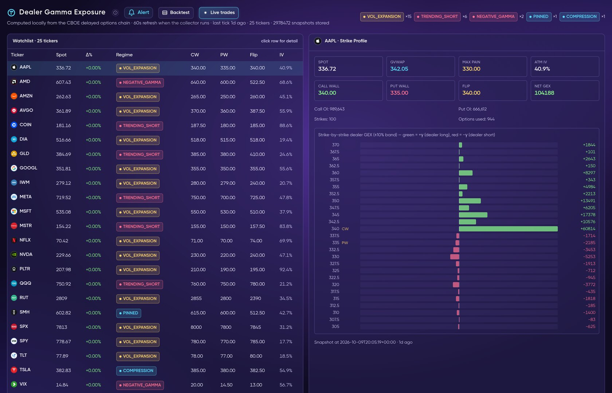<figcaption></figcaption></figure>

Formion runs an **in-house gamma engine** (computed from public option chains, refreshed every minute) covering US indices and ETFs (SPX, SPY, QQQ, IWM, DIA, VIX…) and large caps (NVDA, TSLA, AAPL, MSFT, COIN, MSTR…):

* **Gamma exposure** by strike, **flip level**, call/put walls
* Live **GEX regimes** — **pinned** (dealers long gamma dampen moves), **trending** (dealers short gamma amplify moves) and **cascade risk** (flip level near spot)
* Per-ticker dealer-positioning table + strike profile

<figure><video src=".gitbook/assets/clip-options-gex.mp4" title="Dealer gamma — call/put walls, flip level, pinned vs trending"></video><figcaption>
Long dealer gamma pins price near big strikes; short dealer gamma lets moves run. The flip level separates the two.
</figcaption></figure>

Gamma tells you where dealers are forced to hedge — i.e. where price gets pinned or where a move accelerates.
