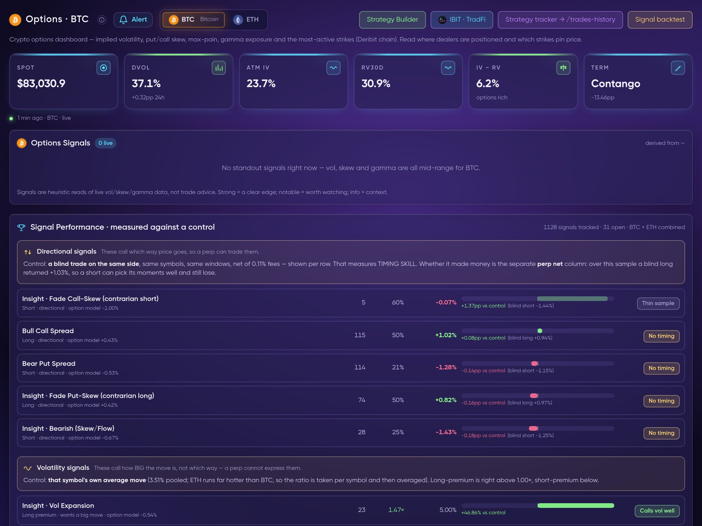
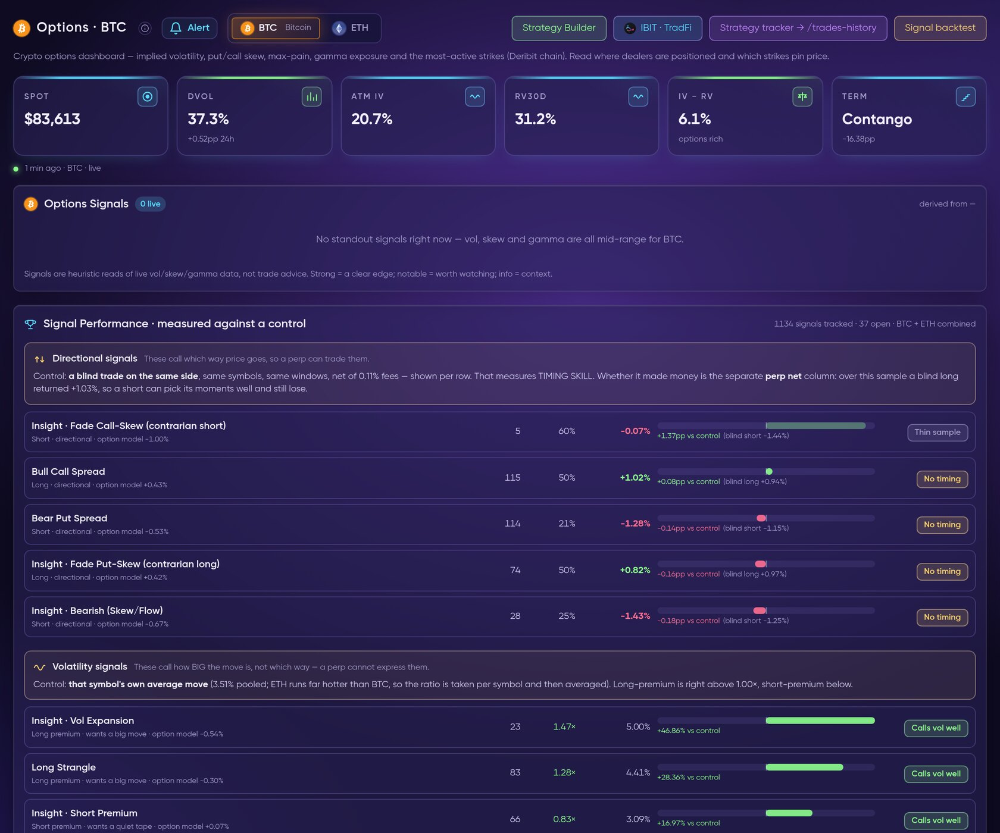
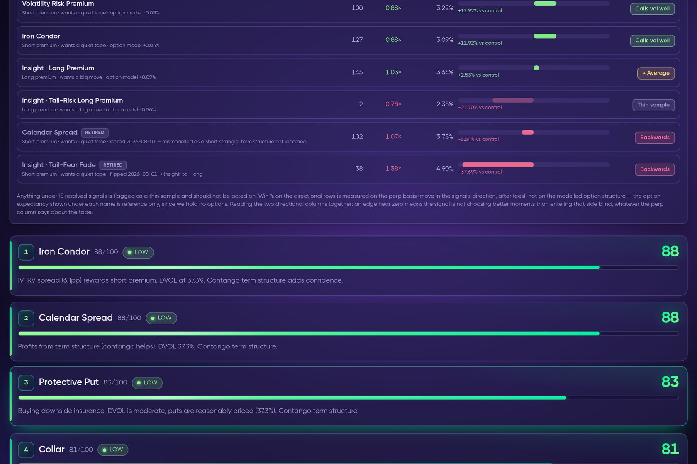
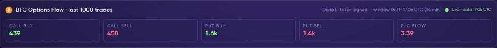
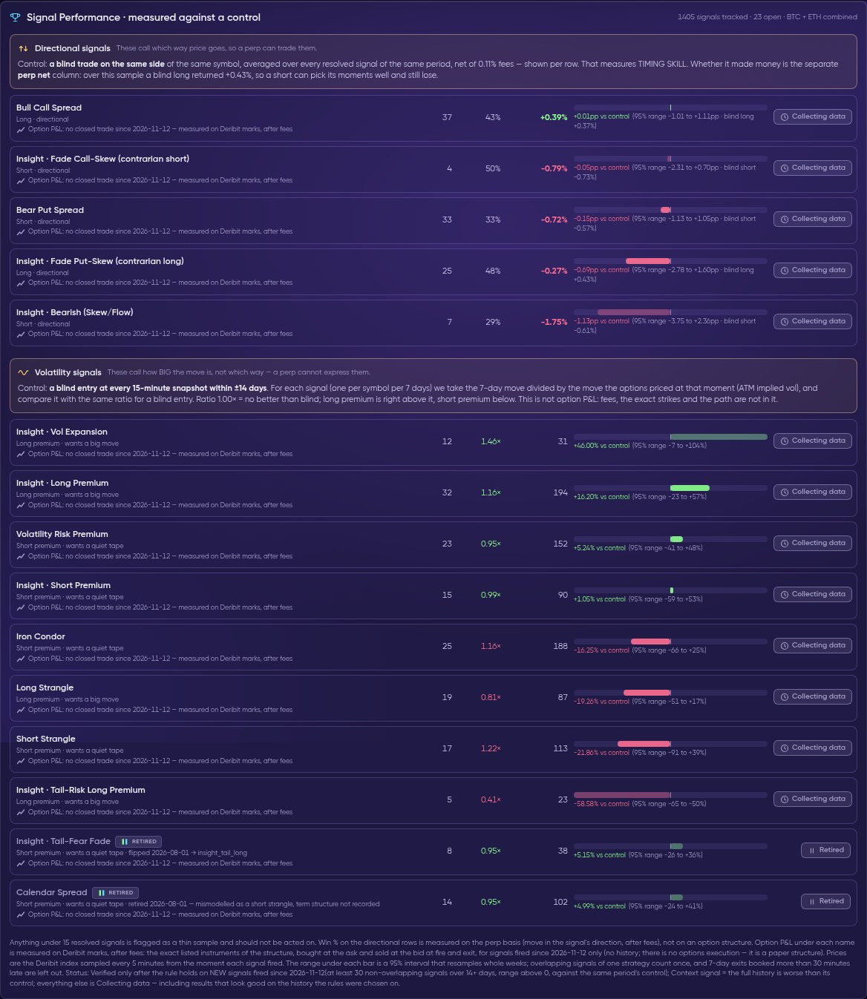
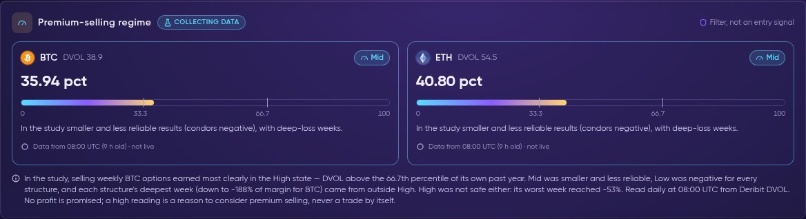
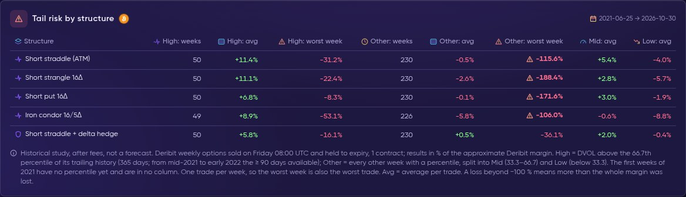
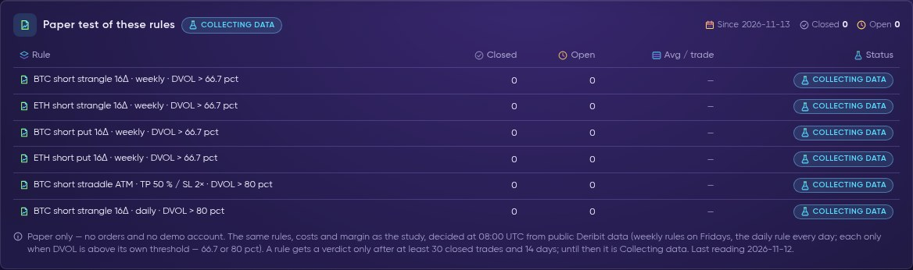
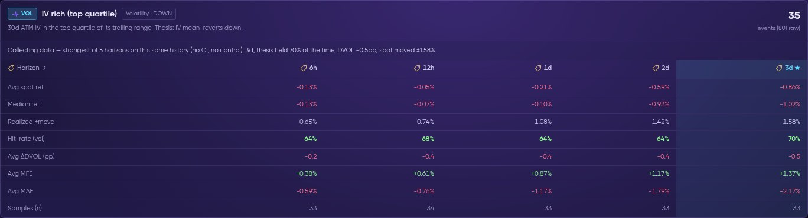
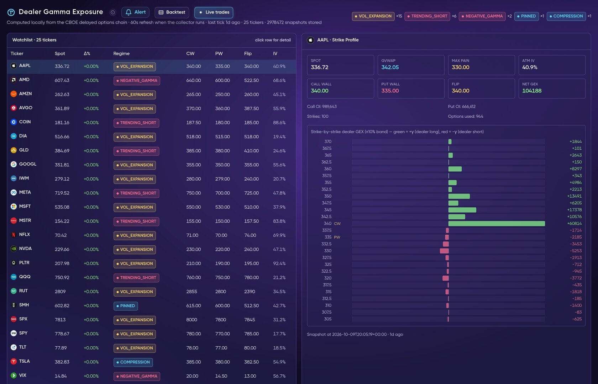

# 📐 Options & GEX

<figure><figcaption></figcaption></figure>

An options analytics desk for crypto (**BTC and ETH**, built on Deribit with a multi-source view across Deribit, OKX, Bybit and Binance) and equities (**IBIT** plus dealer gamma on US indices and large caps) — implied volatility, the vol surface, Greeks, dealer gamma, and option structures scored to the current regime. Find it at **Data Hub → Options** and **Data Hub → Gamma**.


On the free **Neural** tier options analytics are a **3-row preview** (BTC, basic scorer). **Pro** and **Institutional** add ETH and SOL and the full scorer (strategies, regime, IV) — see **[Pricing & Tiers](pricing.md)**.


## What's inside

### Volatility & surface
* **IV smile** and full **volatility surface** (SVI-fit) per expiry
* **IV rank / IV percentile**, **realized-vol cone**, **IV–RV spread**
* **Term structure** (contango / backwardation) and DVOL — *contango* = longer expiries priced higher (calm), *backwardation* = the front expiry priced higher (stress or an event). The front expiry is the nearest one with **at least 2 days** to expiry, so a same-day daily option never sets the reading. The sign was corrected on 11 Nov 2026; term readings before 11 Nov 2026 22:56 UTC were removed, so term studies start from then.
* **Realized vol (RV30d)** is computed from the last **30 closed daily candles** of the perp, so the IV–RV spread compares like with like
* **Vol phase** — expansion, compression, coiling or consolidation, from IV percentile, DVOL velocity and term slope

<figure><figcaption>
Options for BTC: spot, implied volatility, skew, term structure and signal performance measured against a control.
</figcaption></figure>

<figure><figcaption>
Strategy ranking — each options structure scored for the current volatility regime.
</figcaption></figure>

### Flow & positioning
* Crypto **options flow** and block trades — the Flow header states the **time window** its last N trades cover (e.g. *window 15:31–17:05 UTC (94 min)*), so every number below it belongs to that window only

<figure><figcaption>
Options Flow: the window covered by the last 1,000 Deribit trades, plus the venue's own data time.
</figcaption></figure>

* **Put/Call** ratios, open interest by strike
* **Greeks** (delta / gamma / vega / theta) for your position in the **Strategy Builder**

### Scored option structures
Formion scores classic structures — **iron condor, short and long strangle, volatility risk premium, bull call and bear put spreads, calendar, covered call, protective put, collar** — against current IV, term structure and the IV–RV spread, so you see *which structure fits this regime*. Build a position and see its payoff and Greeks in the **Strategy Builder**. Equity-options coverage includes a dedicated **IBIT** page.

### Forward, Index and the data-time badge
* **Forward vs Index.** The GEX heatmap, the SVI surface fit and the IV smile are quoted on the **options forward** (the median of the venues' underlying across expiries) and are labelled **Forward**; the real Deribit **Index** is shown next to it. Distances such as *"Index is 3.0 % below the γ-flip"* in Insights are measured from the Index.
* **γ-flip = zero gamma.** One definition everywhere — the options GEX panel, the GEX heatmap, IBIT and Mechanical: the price at which the total dealer gamma of all listed options, re-priced at that price, changes sign. It is empty when no such price exists. Dealer GEX assumes dealers are long calls and short puts — dealer positions are **not observed**.
* **Data time.** Each panel shows the venue's **own data time** — *Live · data HH:MM UTC*. When the data is older than 10 minutes the badge turns to **not live**, so a frozen panel never looks live.

## 📏 Signal Performance — how to read it

<figure><figcaption>
Signal Performance: every tracked options signal next to its control, with a 95 % range and a status word.
</figcaption></figure>

The scoreboard tracks the paper signals of the regime scorer and the Insights for **BTC + ETH** over a **7-day horizon**. There is **no options execution** behind it. Prices are the Deribit index, sampled every 5 minutes from the moment a signal fires.

* **Directional signals** (spreads, skew fades) — the move in the signal's direction, net of 0.11 % fees, compared with a **blind trade on the same side** of the same symbol over the same period (*pp vs control*). That measures timing; whether a rule made money is a separate question.
* **Volatility signals** (strangles, condors, volatility risk premium, long / short premium) — the 7-day move ÷ the move the options priced at that moment (ATM implied vol), compared with the same ratio for a **blind entry at every 15-minute snapshot within ±14 days**. *Ratio 1.00×* = no better than blind; long premium is right above 1, short premium below.
* Overlapping signals of one strategy count **once** (one per symbol per 7 days), 7-day exits booked more than 30 minutes late are left out, and every row shows a **95 % range** that resamples whole weeks.
* **Status words.** **Verified** only after a rule beats its control on **new** signals fired since 12 Nov 2026 (at least 30 non-overlapping signals over 14+ days, range above 0). **Context signal** = over its whole history the rule did worse than its control. Everything else is **Collecting data** — including results that look good on the history the rules were chosen on. Today every active options strategy is *Collecting data*; retired rules are marked *Retired*.
* **Option P&L.** The old modelled (Black-Scholes) option P&L is no longer shown anywhere. Each strategy now carries an **Option P&L** line *measured on Deribit marks, after fees*: the exact listed Deribit instruments of the structure, bought at the ask and sold at the bid at fire and at exit, Deribit taker + delivery fees deducted. It exists **only for signals fired since 12 Nov 2026** (no history); a leg without a real quote stays *unpriced*. It is a measured paper structure, not a verdict — the status word decides, and a few trades are noise.


**Neural** sees 3 open signals and the last 7 days of the scoreboard; **Pro** and **Institutional** see the full book. Options signals are volatility and regime tells — never a proven trade, and the bands on a signal are the rule's own expected-move levels.


## 🧭 Premium-selling regime

<figure><figcaption>
Premium-selling regime: where BTC and ETH implied vol (DVOL) sits within its own past year.
</figcaption></figure>

A card that tells you **when selling options has historically made sense** — a **filter, not an entry signal**.

* **What it measures:** the Deribit **DVOL** (30-day implied vol index) of BTC and ETH as a **percentile of its own trailing 365 days**, read once a day at 08:00 UTC. It is never "live" — the card shows the data time and a *not live* badge.
* **States:** **High** = above the 66.7th percentile · **Mid** = 33.3–66.7 · **Low** = below 33.3. If the reading is missing or older than 48 h, no state is shown.
* **How to read it:** in Formion's historical study of weekly Deribit options (sold Friday 08:00 UTC, held to expiry, after fees and spread) the average result per structure was **High > Mid > Low for every structure**. High was where selling weekly options earned most clearly; Mid was smaller and less reliable; **Low was negative for every structure**. High was **not safe** either — it also had deep losing weeks.
* **Status: Collecting data.** No rule is Verified. No profit is promised; a High reading is a reason to *consider* premium selling, never a trade by itself.

### Tail risk by structure

<figure><figcaption>
Tail risk by structure — historical study, after fees, not a forecast.
</figcaption></figure>

For the selected asset, the table lists **short straddle (ATM), short strangle 16Δ, short put 16Δ, iron condor 16/5Δ** and **short straddle + delta hedge**, each with: the number of weeks, the **average per trade** and the **worst week** in % of the approximate Deribit margin — in **High** weeks vs all **Other** weeks — plus the **Mid** and **Low** averages. One trade per week, so the worst week is also the worst trade; a loss beyond −100 % means more than the whole margin was lost. Every number comes from the study's own trades and is labelled **historical study, after fees, not a forecast**.

### Paper test of these rules

<figure><figcaption>
Six frozen rules run as a paper book from 13 Nov 2026 — no orders, no demo account.
</figcaption></figure>

Six frozen rules from the study run as a **paper book** from 13 Nov 2026 — no orders and no demo account, the same costs and margin as the study. Each rule gets a verdict only after **at least 30 closed trades and 14 days**; until then it is **Collecting data**.


The Premium-selling regime, the tail-risk table and the paper test are **open on every plan**. FORA reads the current regime too — and treats it only as a filter or context for a premium-selling idea, never as a reason to open a trade.


## 🧪 Backtest → Options · Vol

<figure><figcaption>
Options · Vol: what happened after each options signal type, at five horizons.
</figcaption></figure>

**Backtest → Options · Vol** is a forward-return study of the options volatility signals (term backwardation / contango, IV rich / cheap, DVOL momentum, skew fade, dealer gamma) for BTC, ETH or both, built from a 15-minute options recorder whose sample grows every day. Pick the **Lookback** (7 / 14 / 30 / 90 days) and a **Re-trigger cooldown** so one sticky regime is not counted dozens of times.

* Each signal type has a horizon table (**6h, 12h, 1d, 2d, 3d**) with average and median spot return, realized ±move, hit rate, average ΔDVOL, MFE, MAE and the sample size.
* The **★ highlighted horizon** is only the *strongest of the 5 horizons on this same history* — picked in-sample, with no costs, no confidence range and no drift control. **It is not proof** of an advantage; every row is **Collecting data**.
* The **term backwardation / contango rows start from 11 Nov 2026** (22:56 UTC): earlier term readings had the sign inverted and used a same-day daily option as the front, so they were removed.
* These are volatility / regime tells measured forward — not entries with levels. **Neural** sees a recent-history preview, **Pro** the full study.

## ⚡ GEX — Dealer Gamma Exposure

<figure><figcaption></figcaption></figure>

Formion runs an **in-house gamma engine** (computed from public option chains, refreshed every minute) covering US indices and ETFs (SPX, SPY, QQQ, IWM, DIA, VIX…) and large caps (NVDA, TSLA, AAPL, MSFT, COIN, MSTR…):

* **Gamma exposure** by strike, **flip level**, call/put walls
* Live **GEX regimes** — **pinned** (dealers long gamma dampen moves), **trending** (dealers short gamma amplify moves) and **cascade risk** (flip level near spot)
* Per-ticker dealer-positioning table + strike profile

<figure><video src=".gitbook/assets/clip-options-gex.mp4" title="Dealer gamma — call/put walls, flip level, pinned vs trending"></video><figcaption>
Long dealer gamma pins price near big strikes; short dealer gamma lets moves run. The flip level separates the two.
</figcaption></figure>

Gamma tells you where dealers are forced to hedge — i.e. where price gets pinned or where a move accelerates.
