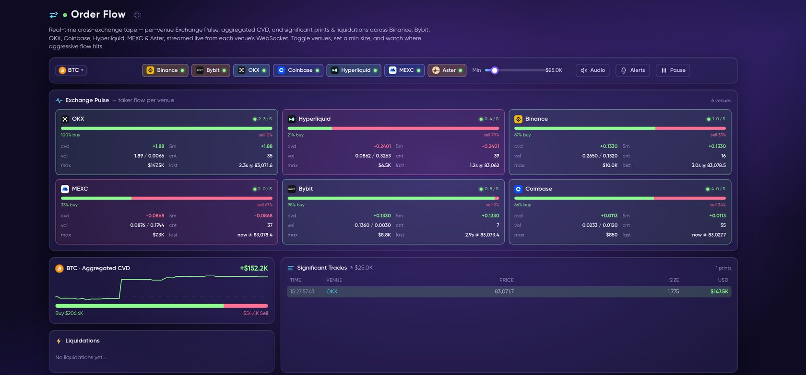
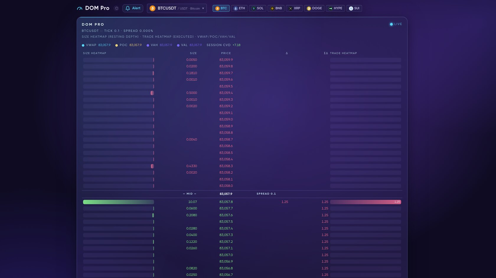
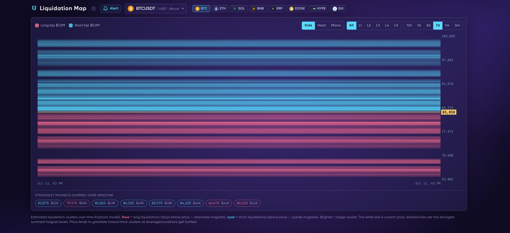
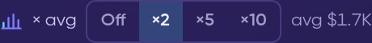
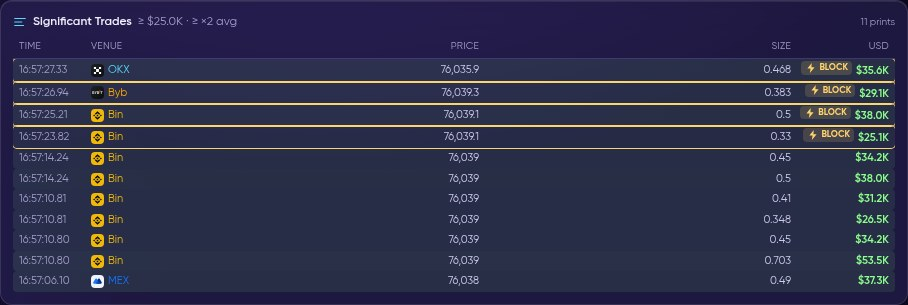
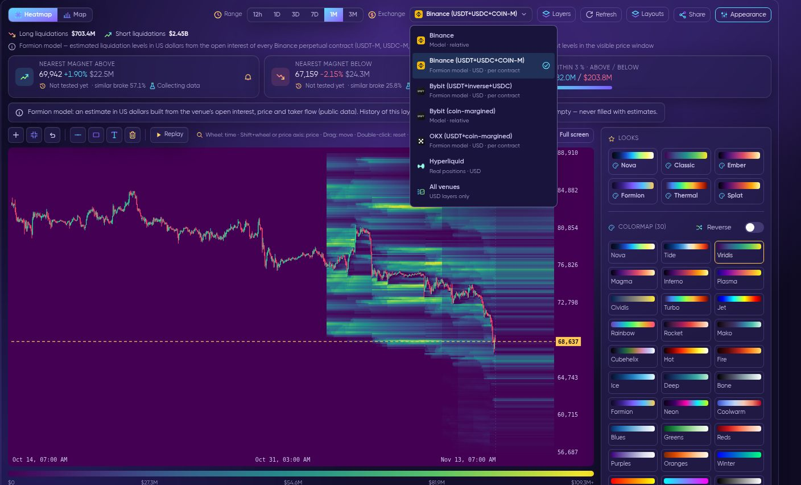
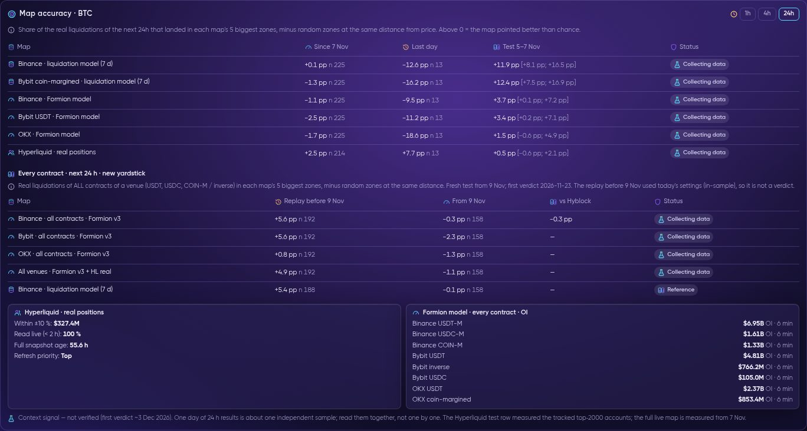
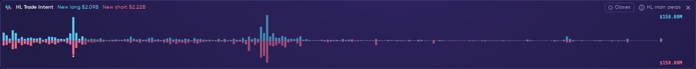
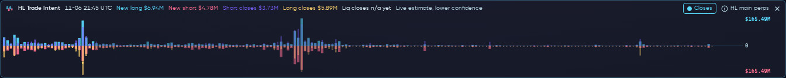

# 🌊 Order Flow & Microstructure

<figure><figcaption></figcaption></figure>

<figure><video src=".gitbook/assets/rec-order-flow-tour.mp4" title="Live recording: Data Hub → Order Flow, Orderbook Heatmap, DOM Pro, Liquidation Map and Walls."></video><figcaption>
Live recording: Data Hub → Order Flow, Orderbook Heatmap, DOM Pro, Liquidation Map and Walls.
</figcaption></figure>

See **what's happening inside the candle**. Formion ships a full market-microstructure suite — the order-book, the tape, large trades, liquidations and where the big resting orders sit — across multiple exchanges.


The microstructure tools live both as dedicated pages under **Data Hub** and as panels inside **Chart Pro → Constructor**.


## The tools

| Tool | What it shows |
|---|---|
| **Order Flow** | Trades and liquidations streamed from Binance, Bybit, OKX and Coinbase, with an aggregated CVD and a **Significant Trades** feed. Filter prints by USD size or by **relative size (×2 / ×5 / ×10 the average print)**; prints of ×10 or more are marked **BLOCK**. See **Relative size filter** (see below) below |
| **Tape Feed** (Time & Sales) | Every print in real time (Constructor panel) |
| **DOM Pro** | A depth-of-market ladder with a size heatmap, a trade heatmap and VWAP / POC / VAH / VAL levels |
| **Liquidity Map** | Recorded resting liquidity over time, summed across 11 markets, with tracker, ladder, pull/stack, walls, CVD and Hyperliquid liquidation levels. It replaces the old Order-Book Heatmap and Agg Heatmap pages — see **[Liquidity Map](liquidity-map.md)** |
| **Footprint** | Bid/ask volume **inside** each candle by price tick (Constructor panel) |
| **Walls** | Live wall detector plus a history of confirmed, broken and pulled walls. A wall is resting liquidity that can be pulled at any time, so it is context, not a support or resistance promise. The **Walls Bot** paper book (v2, real fills, measured from 2 Nov 2026) and its Backtesting filters are described under **[Screener → Order Book](screener.md)** |
| **Liquidation Map** | A model estimate of where leveraged positions would be force-closed — every perpetual contract of Binance, Bybit and OKX in USD, plus Hyperliquid real positions, with its own measured Map accuracy. See **Liquidation Map** (see below) below |
| **HL Trade Intent** (preview) | A pane under the chart in **Chart Pro**: per bar, how many dollars of **new longs** and **new shorts** were opened on Hyperliquid, and on request how many longs and shorts were closed. See **HL Trade Intent** (see below) below |
| **Spoof / Iceberg detector** | Flags levels cancelled without being filled and levels that refill after being eaten (Constructor panel) |

<figure><figcaption>
DOM Pro — depth-of-market ladder with size and trade heatmaps.
</figcaption></figure>

<figure><figcaption>
Liquidation Map — clustered liquidation levels over time.
</figcaption></figure>

## Relative size filter and BLOCK prints

On the **Order Flow** page (`/orderflow`) the tape has two size filters that work together:

* **USD minimum** — the slider you already know: only prints of at least this many dollars.
* **× avg** — **Off** (default), **×2**, **×5** or **×10**: only prints (and liquidations) at least that many times the **average print of this symbol**.

The average is a **rolling average of the last 2,000 prints** of the symbol, across every venue you have switched on (liquidations are not counted in it), refreshed 5 times a second. The relative filter starts working after the first 200 prints, and the control shows the current average next to the buttons (for example `avg $1.7K`). Because the average moves with the market, **×5 means "big for BTC right now"** on BTC and **"big for this coin right now"** on a small coin — the same setting works on any symbol.

* **BLOCK** — a print of **×10 or more** the average gets an amber **BLOCK** tag in **Significant Trades**. Hover any print to see its multiple (for example `×12.4 the average print · block print`).
* **Title** — when the filter is on, the Significant Trades title shows it, for example `Significant Trades ≥ $50K · ≥ ×5 avg`.
* **Venue logos** — every row in Significant Trades carries the real logo of the venue the print came from (for example Binance, Bybit, OKX, Coinbase, MEXC, Hyperliquid, Asterdex).

<figure><video src=".gitbook/assets/clip-orderflow-relative.mp4" title="Relative size filter: the tape, the ×5 filter, a BLOCK print and the same setting on another coin."></video><figcaption>
×5 keeps only prints at least 5× the average print of this symbol; a print of ×10 or more gets a BLOCK tag; the average follows each coin. Sample values (DEMO).
</figcaption></figure>

<figure><figcaption>
The × avg control: Off, ×2, ×5 or ×10 the average print of this symbol; next to it, the current average (here $1.7K).
</figcaption></figure>

<figure><figcaption>
Significant Trades with the ×N filter on: venue logo per print and the BLOCK tag on prints of ×10 or more.
</figcaption></figure>


**Context data, not a signal.** A large or BLOCK print shows that someone traded a lot at that moment. It does not tell you who it was, whether the trade opened or closed a position, or where price goes next.


## Liquidation Map

The **Liquidation Map** (Data Hub → **Liquidation Levels**, `/liquidation-map`) estimates **where leveraged positions would be force-closed**. Above price are the **short** liquidations (shorts are closed if price rises there), below price the **long** liquidations. **Heatmap** shows the levels over time with candles, **Map** shows them by price (and by leverage group on the relative maps).

### Exchange picker — every contract, in US dollars

<figure><figcaption>
The exchange picker: each option says what the layer is — Formion model in USD per contract, real Hyperliquid positions, or an older relative-strength map.
</figcaption></figure>

Since 8 Nov 2026 the Formion model covers **every perpetual contract** of the big venues, not only the USDT ones. Each venue is shown **stacked per contract**, in **US dollars**. The picker says next to each option what the layer is:

| Option | What it is | Unit |
|---|---|---|
| **Binance (USDT+USDC+COIN-M)** | Formion model from the open interest of every Binance perpetual: USDT-M, USDC-M and COIN-M | USD · per contract |
| **Bybit (USDT+inverse+USDC)** | Formion model from every Bybit perpetual: USDT, inverse and USDC | USD · per contract |
| **OKX (USDT+coin-margined)** | Formion model from every OKX perpetual swap: USDT and coin-margined | USD · per contract |
| **Hyperliquid** | **Real positions**: each Hyperliquid account's own liquidation price (daily full snapshot + accounts re-read live) | USD |
| **All venues** | The US-dollar layers added up: the Formion model for every contract of Binance, Bybit and OKX + Hyperliquid real positions | USD |
| **Binance** · **Bybit (coin-margined)** | The older model maps (Binance USDⓈ-M, Bybit coin-margined) | **relative strength, not dollars** — compare levels with each other only; never added into All venues |

* **Coverage:** for BTC, ETH, SOL and HYPE the model now covers **100 %** of the perpetual open interest on Binance, Bybit, OKX and Hyperliquid (before: BTC 79 %, ETH 75 %, SOL 90 %, HYPE 99.8 %). Contract sizes are converted to the coin (for example a Binance COIN-M BTC contract = $100) and then to USD. Some contracts simply do not exist (Binance HYPE USDC-M / COIN-M, OKX USDC swaps).
* **History:** the history of a USD layer starts with its first recorded snapshot; earlier columns stay empty and are never filled with estimates.
* **Real liquidations** (Layers): bubbles where positions were actually liquidated on Binance, Bybit and OKX.
* **Full screen:** the **Full screen** button above the chart (or the **F** key) opens the whole panel — chart with its price axis, the lower pane, the legend and Appearance — on the whole screen; **Esc**, **F** or the button closes it. On iPhone it fills the browser window.

### How to read it

* A bright cluster is a price where **the model** expects many forced orders if price gets there. The row above the chart shows the **nearest magnet above / below** and the size within 3 % each way.
* Several venues or contracts on one level = the estimate is spread across markets; compare sizes in USD only on the USD layers.
* On **Hyperliquid** the levels are real liquidation prices of open positions, not an estimate. The card **Refresh priority** says how fresh they are: BTC, ETH and HYPE accounts are re-read first (**Top**), SOL and XRP next (**High**), every other asset is **Best effort** (daily full snapshot plus a limited number of live re-reads).

### Map accuracy — "Every contract"

<figure><figcaption>
Map accuracy: every map against random zones at the same distance, the new "Every contract" test, Hyperliquid coverage and the open interest of every contract the model reads.
</figcaption></figure>

The **Map accuracy** panel under the chart measures the map on what really happened:

* **What is measured:** the share of the **real liquidations** of the next 24 h (of ALL contracts of a venue — USDT, USDC, COIN-M / inverse) that landed inside each map's **5 biggest zones**, minus random zones at the same distance from price, in percentage points.
* **Upper table:** each map (the older Binance / Bybit coin-margined models, the Formion model per venue, Hyperliquid real positions) with **Since 7 Nov**, **Last day** and **Test 5–7 Nov**, for 1h / 4h / 24h. Above 0 = the map pointed better than chance. One day of 24 h results is about one independent sample — read them together.
* **Every contract table:** one row per map with **Replay before 9 Nov**, **From 9 Nov** (the fresh test on new days, with n), a comparison with the reference map and **Status** (the Binance 7-day liquidation model row is the **Reference**). The replay before 9 Nov used today's settings, so it is in-sample and **not a verdict**.
* **Formion model · every contract · OI** card: the open interest in USD and the data age of every contract the model reads.
* **Status:** the test on new days started on **9 Nov 2026**; the first verdict is due on **23 Nov 2026** (final on 7 Dec). Until then the status is **Collecting data** and the map is a **Context signal**. A "better than" comparison is shown only if it holds on the new days.


**What it is NOT.** Except for the Hyperliquid real positions, these are **estimated** levels from public data (open interest, price and taker flow) — not orders in the book, not real positions and not a forecast. They only show where forced orders could appear if price gets there. Measured so far, liquidation zones for the next 1 h / 4 h are not better than random zones, so FORA uses them as context, never as an entry, stop or target.


### Live mode

The **Live** button in the chart header (off by default, remembered on this browser) moves the current candle and a dashed **LIVE** price line tick by tick and flashes events on the chart: price **entering one of the strongest liquidation zones**, a **real liquidation** (spark with its USD), a **big trade** (≥ $100K, bubble) and the recorded resting limit walls of the **[Liquidity Map](liquidity-map.md)**. Every event is labelled by side — **LIMIT BUY** (green) / **LIMIT SELL** (red), **MARKET BUY / SELL**, **LONG LIQ / SHORT LIQ** — and the last 10 are listed under the chart. Live is **not final**: levels, accuracy, alerts and FORA use complete minutes only, and Live creates no new signal.

### FORA and Neurons

* **"What changed?"** — FORA compares the USD zones now with a snapshot from 1–4 h ago, in the same price buckets.
* **"Is this a signal?"** — FORA answers honestly: no, it is a **Context signal**. Instead of a direction it offers an alert, a Neuron or a paper scenario.
* **Neuron "Liquidation level"** has a source option **All venues in USD** (the same zones FORA quotes, BTC / ETH / SOL / HYPE). Its messages say plainly that the break history of this map is **not measured yet** — see **[FORA Neurons](fora-neurons.md)**.

### Assets and plan

The asset picker has the same **30 assets** as the Liquidity Map (see **[What is recorded](liquidity-map.md)**). The Formion model and Hyperliquid positions for the assets added on 9 Nov 2026 started that day without history; their accuracy is a separate segment (**Collecting data**) and is never mixed with BTC / ETH / SOL / HYPE. The Live mode and the shared layers from the Liquidity Map follow the **Liquidity Map plan** (Free = BTC) — see **[Pricing & Tiers](pricing.md)**.

### Liquidity Map vs Liquidation Map

| | **[Liquidity Map](liquidity-map.md)** | **Liquidation Map** |
|---|---|---|
| **What it is** | **Real resting limit orders** that Formion records from 11 venues | A **model estimate** of where leveraged positions would be force-closed |
| **What you see** | Where orders sit now and where they sat before, in **real USD** | Where forced orders could appear — in **USD** on the per-contract layers (relative strength on the older Binance / Bybit coin-margined maps) |
| **Source** | Order books of 11 markets (Binance, Bybit, OKX, Bitget perp + spot, Coinbase, Hyperliquid, Deribit) | Formion model from every perpetual contract of Binance, Bybit and OKX + Hyperliquid real positions |
| **Can it change?** | Yes — any order can be **pulled** at any moment | Yes — the estimate moves as positions open and close |

The **Hyperliquid** layer is real on both pages — actual liquidation prices of open positions, not a model. On the Liquidation Map it reads every Hyperliquid account (daily full snapshot + accounts re-read live); the Liquidity Map's Hyperliquid panel shows the accounts we track.

<figure><video src=".gitbook/assets/rec-order-flow-constructor.mp4" title="Live recording: Chart Pro → Constructor — chart + volume profile, tape feed and liquidations side by side, then the Heatmap Focus preset."></video><figcaption>
Live recording: Chart Pro → Constructor — chart + volume profile, tape feed and liquidations side by side, then the Heatmap Focus preset.
</figcaption></figure>

## HL Trade Intent (Hyperliquid)


**Rolling out** — HL Trade Intent is currently in preview and not yet available on every account.


**HL Trade Intent** is a pane under the chart in **[Chart Pro](chart-pro.md)**. For every bar it shows the USD value of **new longs opened** (bars up) and **new shorts opened** (bars down) on **Hyperliquid**. The **Closes** button adds the longs and shorts that were **closed** in the same bar.

<figure><figcaption>
HL Trade Intent under a BTC chart: new longs opened (up) and new shorts opened (down) per bar. The title sums the visible range.
</figcaption></figure>

* **Title:** `New long $X · New short $Y` — the totals for the range you can see on the chart.
* **Hover a bar:** the time, all four numbers (new long, new short, short closes, long closes), liquidation closes and how confident the bar is.
* **Turn it on:** HL tab → **Show trade intent**, or in the **Order Flow Suite** settings. The **✕** in the pane hides it again.

<figure><figcaption>
Closes switched on and one bar hovered: new long, new short, short closes, long closes and the confidence of that bar.
</figcaption></figure>

### How it is measured

Every Hyperliquid trade carries the **buyer's and the seller's address**. Each side is classified from that address's position **before** the trade:

| Position before the trade | A buy is… | A sell is… |
|---|---|---|
| **Flat** | a new long | a new short |
| **Long** | adding to the long (new long) | closing the long — anything larger flips: the rest is a new short |
| **Short** | closing the short — anything larger flips: the rest is a new long | adding to the short (new short) |

Positions start from a daily snapshot of all Hyperliquid positions and are rolled forward through the live trade tape.

<figure><video src=".gitbook/assets/clip-hl-trade-intent.mp4" title="HL Trade Intent: one trade, its buyer and seller, their positions before the trade, and the bars in the pane."></video><figcaption>
One trade, two addresses: the buyer was short, so part of the buy closes the short and the rest is a new long; the seller was flat, so the whole sell is a new short. The pane adds it up per bar. Sample values (DEMO).
</figcaption></figure>

### Accuracy and confidence

| Bar label | What it means |
|---|---|
| **Exact (Hyperliquid fill labels)** | Hyperliquid's own direction label for every fill. Hyperliquid publishes a day about **1.5 days** later; that day then replaces our live numbers. Liquidation amounts are shown only on these days |
| **Live estimate, lower confidence** | The last ~1–2 days, classified by Formion from the live tape. Measured at about **97–99 %** agreement with Hyperliquid's later labels |

We checked the classification against Hyperliquid's own per-fill direction labels: **98.0–99.8 % agreement by notional** on 3 full days (3–5 Nov 2026). The small rest comes mostly from trades that Hyperliquid's public feed does not deliver during very large bursts, such as liquidation cascades.

* **Coverage:** Hyperliquid **main perps** only (the pane says **HL main perps**). HIP-3 markets are not included.
* **Data, not a signal:** HL Trade Intent shows **who is opening and who is closing**. It is not a buy or sell signal and says nothing about where price goes next.

## Why it matters

<figure><video src=".gitbook/assets/clip-order-flow.mp4" title="Order flow — footprint, delta, CVD, absorption, walls and liquidation magnets"></video><figcaption>
Absorption, a resting wall and a liquidation cluster — the three patterns these tools help you read.
</figcaption></figure>

Indicators lag; order flow is the cause, not the effect. Seeing absorption at a level, where large resting orders sit, or where liquidations cluster helps you read what the market is doing right now. Resting orders can be pulled at any time, so treat walls as context about the current book, not as a promise of support or resistance. Formion puts that read in one place.
