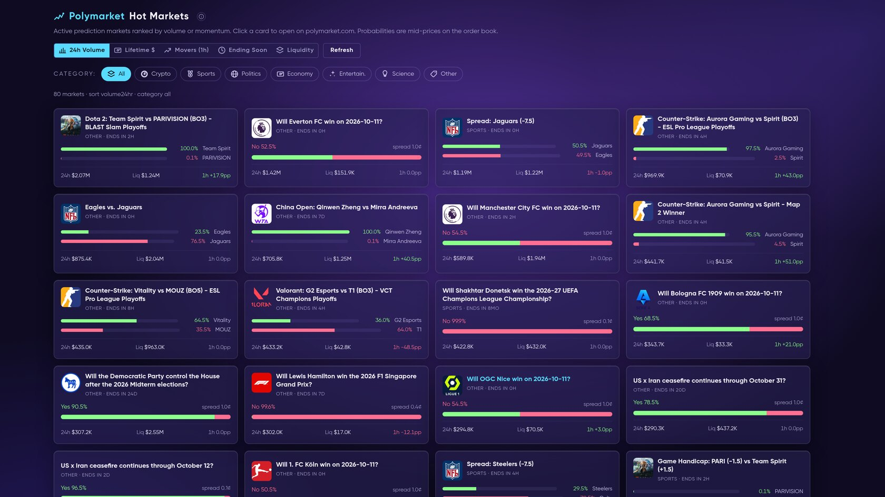
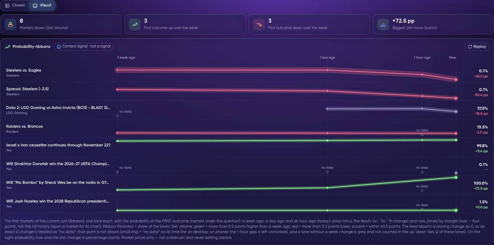
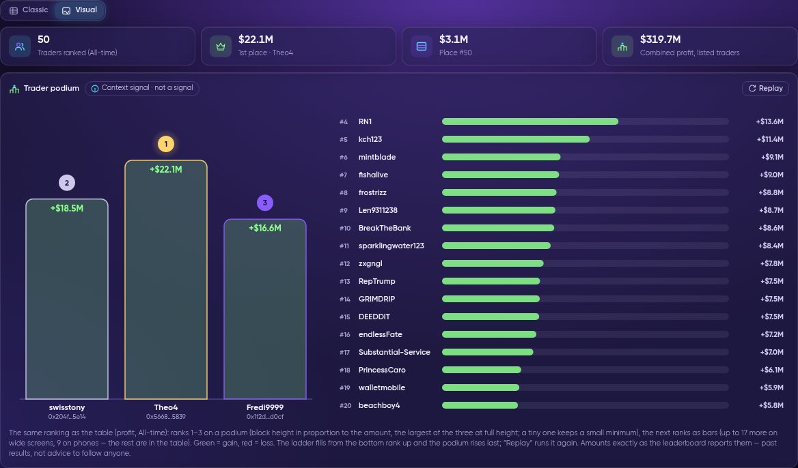

# 🎲 Prediction Markets

<figure><figcaption></figcaption></figure>

Formion brings prediction markets — led by **Polymarket** — into the same terminal as your charts and bots: browse markets, see the top traders, read the price history, link your own account and place bets, and follow Formion's prediction-market bots.


Browsing and analytics are included on every plan, and so are manual bets from your own linked account. **Live auto-execution** of prediction-market bots is an **Institutional** feature.


## Browse & analyze (Polymarket hub)
* **Sort & rank** markets by **24h volume**, **movers (1h)**, **ending soon**, **liquidity** or **lifetime $**
* **Filter by category** — Crypto · Sports · Politics · Economy · Entertainment · Science · Other
* Each market shows **YES/NO probability**, 24h volume, 1h/24h price change, time to resolution and liquidity, with a **price history** chart
* Open a market for its **detail page**: YES/NO order book, recent trades tape, top holders per outcome, and a preview form that opens the trade on polymarket.com
* **Top Traders** — the Polymarket leaderboard by profit or volume (1 day, 1 week, 1 month, all time)

## 🎛️ Markets and Top Traders — Classic · Visual

Both Polymarket pages have a **Classic · Visual** switch. Visual draws only the answer the page already loaded — nothing new is fetched:

* **Markets** — **Probability ribbons**: the first 8 markets of the current sort (6 on phones), one lane each, with the probability of the **first** outcome (named under the question) a week ago, a day ago, an hour ago and now — four points joined by straight lines, not the full history (open a market for its chart). Thickness = the market's share of the lanes' 24 h volume; green = more than 0.5 points higher than a week ago, red = more than 0.5 lower. The feed reports a missing change as 0, so an exact-0 point is not drawn and is marked **no data**. On the right: probability now and the 24 h change in points.
* **Top Traders** — **Trader podium**: the same ranking as the table (profit or volume, same period and size). Ranks 1–3 stand on a podium (block height in proportion to the amount); the next ranks are bars (up to 17 more on wide screens, 9 on phones — the rest stay in the table). Profit: green = gain, red = loss. **Replay** runs it again.

<figure><figcaption>
Polymarket → Visual: the first outcome’s probability a week, a day and an hour ago and now.
</figcaption></figure>

<figure><figcaption>
Top Traders → Visual: ranks 1–3 on the podium, the next ranks as bars.
</figcaption></figure>

Market prices and other traders' past results — not a forecast, never betting advice and not advice to follow anyone. **Context signal · not a signal**. Same data as Classic, same plan limits; **Auto** (the default in [Settings → Visual mode](settings.md)) starts it in Classic — one click on **Visual** switches, and the panel remembers it.

## Connect & trade
On **formion.ai → Profile → Connections** (or the dashboard), the **Prediction markets** card links your **Polymarket**, **Kalshi** or **Limitless** account. From there you can search markets, place a bet in USD, and review your open positions and resting orders (with cancel).


The **Predictions** tab in app.formion.ai is marked **Soon**. It is planned as an AI price-projection panel, not a betting desk.


## In-house engines

Formion runs its own prediction-market bot (tracked in **[Trade History](journal.md)**):

| Bot | Pool | What it does |
|---|---|---|
| **Polymarket Whale Copy · Beta** | live | Copies the BUY orders of a tracked Polymarket whale at the smallest size (max $3 per trade, $15 per day, stop at −$15). All-time **−12.8%** on 44 trades (30 Oct 2026) — an early beta, shown honestly. |

The same bots appear in **[Bots & Automation](bots.md)**, with their pool shown on each card.
