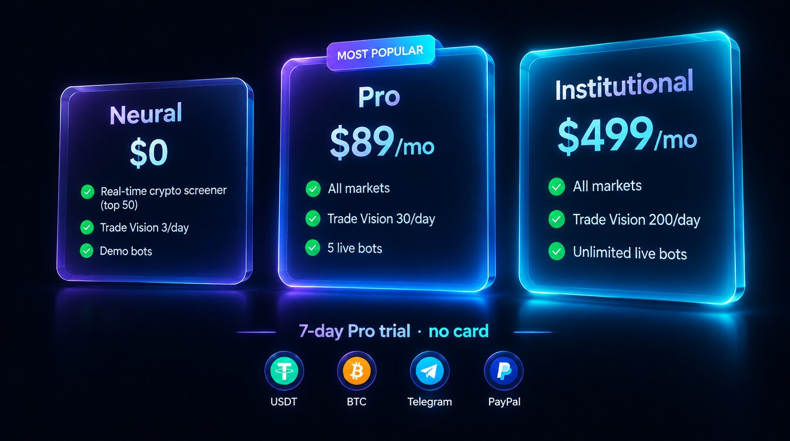

# 💳 Pricing & Tiers

<figure><figcaption></figcaption></figure>

Formion has three plans. New accounts get **7 days of Pro free — no card required** — once the email address is confirmed (see [7-day Pro trial](#7-day-pro-trial)); if you don't upgrade, you auto-downgrade to the free **Neural** tier (which stays free forever).


Pay at the **formion.ai checkout** in crypto — **USDT or USDC** on Ethereum, Base, Arbitrum, Optimism, Polygon, BSC or Solana, **USDT on Tron (TRC20)**, or **BTC** / **SOL** / **LTC** — or with **PayPal** on the same checkout page. You can also pay through **Telegram Crypto Pay** with `/license` in [@formiontradingbot](https://t.me/formiontradingbot), which gets an **extra 3% discount** (Crypto Pay only). Card payments are not available. Longer billing is cheaper (3-mo −5%, 6-mo −10%, 12-mo −20%). Bring-Your-Own-Key (BYOK) for AI is available on **every** tier.


<figure><video src=".gitbook/assets/rec-pricing-scroll.mp4" title="Live recording: formion.ai/pricing — the three plans, then the full feature-by-feature comparison."></video><figcaption>
Live recording: formion.ai/pricing — the three plans, then the full feature-by-feature comparison.
</figcaption></figure>

## Plans at a glance

| | 🆓 Neural (Free) | 💎 Pro | 🏛️ Institutional |
|---|---|---|---|
| **Price** | $0 forever | **$89 / mo** ($71.20/mo billed yearly) | **$499 / mo** ($399/mo billed yearly) |
| **AI budget** | ~$2 / month | $5 / day | $30 / day (priority queue) |
| **Exchanges (CEX)** | 2 | Unlimited | Unlimited |
| **Wallets** | 2 | Unlimited | Unlimited |
| **DEX accounts** | 1 | Unlimited | Unlimited |
| **cTrader broker accounts** | 1 | 5 | Unlimited |
| **Annual total (USD)** | $0 | $853 | $4,790 |
| **Sub-account slots** | 0 | 3 | 6 |
| **Live bots** | 0 (demo/paper unlimited) | 5 (auto-execute) | Unlimited |
| **Paper bots** | Unlimited | Unlimited | Unlimited |
| **Watchlist symbols** | 25 | Unlimited | Unlimited |
| **Chart** | 5 symbols · 4 TFs · 2 indicators | All symbols/TFs/indicators · SMC · replay | Same as Pro |
| **Screener** | crypto · 3-row preview | real-time: all markets (crypto, stocks, commodities, forex) | Same as Pro |
| **AI signals stack** | Trade Vision + RAG Research within daily limits | Full (RAG, Trade Vision, RF, Multi-AI Consensus, all signals) | Same as Pro, priority AI queue |
| **Signal tables** (screener, setup scanner, volatility, signals, patterns, options, Strategy Finder) | 3-row preview · last 7 days of history · signals delayed 30 min | Full, real-time, full history | Full, real-time, full history |
| **FORA realtime voice** | ✅ (mini model) | ✅ (mini model) | ✅ (full model) |
| **FORA Neurons (active)** | 2 | 25 | Unlimited |
| **FORA planner (My plan)** | Token, why and FORA's opinion — no numbers (up to 3) | Entry, size for your bankroll, OUR exit steps + FORA follows every step (up to 5) | Same as Pro (up to 10) |
| **KOL watch Neuron** | 1 token of opportunity per 7 days (no numbers) | ✅ 5 proposals / day with OUR plan | ✅ 20 proposals / day with OUR plan |
| **Saved AI strategies** | 1 | Unlimited | Unlimited |
| **Trading Audit** | 1 in total (basic) | 3 / day + weekly report (trial: 3 in total) | 10 / day + weekly report |
| **Wallet Insights MFE/MAE tracking** | — | — | ✅ |
| **Prop-firm simulator** | — | Coming soon | Coming soon |
| **Backtesting + Strategy Lab** | Builder + 3 backtests/day | ✅ (50 backtests/day) | ✅ (unlimited) |
| **Trading Journal** | 30 days, 10 image uploads | Unlimited history + uploads + exchange auto-import | Same as Pro |
| **Quantum Pulse** (beta, [details](pulse.md#plans)) | Market Narrative · trader profile header + three numbers · 1 followed trader | Full trader profiles + follower simulation · 10 followed traders · crowd per horizon | + crowd vs smart money, regimes · unlimited follows · X Lens with FOM |
| **Zone Hunter** (beta, [details](screener.md)) | Crypto · Buy the dip + Sell the top · 3 full rows per section · last 7 days of paper trades (FOM Hold: 5 rows + S/R Flip, 14 days · FOM Lock: every crypto row + Trend Shift, 30 days) | All markets, every section incl. Adaptive brain, full paper book (+ per-trade MFE / MAE with FOM Lock) | Same as Pro + per-trade MFE / MAE + CSV export |
| **Custom alerts (active)** | 3 | 100 + email alerts | Unlimited + email alerts |
| **Prediction-market bots live execution** | — | — | ✅ |
| **White-label REST + WebSocket SDK** | — | — | ✅ |
| **Team seats** | 1 | 1 | 5 |
| **Uptime SLA** | — | — | 99.9% |

<!-- PLANLADDER-20261112 -->
## 🪜 The plan ladder — six steps

Every page of app.formion.ai follows the same six steps. Each step gives **more** than the one before; **Institutional includes everything**,
and FOM never replaces a plan — it only adds on top. Prices do not change with FOM.

| Step | Who | FOM |
|---|---|---|
| 1 · Free | a free account | — |
| 2 · Free + FOM Hold | Free + FOM held in your verified wallet | hold counts at half value, up to the F2 boost step |
| 3 · Free + FOM Lock | Free + a FOM Lock (beta) | lock from the F3 step, Holder at $250 |
| 4 · Pro | paid Pro, the 7-day trial, or the FORA Agent FOM level | licence level by FOM lock or hold (see [FOM token](fom-token.md)) |
| 5 · Pro + FOM Lock | Pro + a FOM Lock | only a lock adds on Pro (Pro + hold = Pro) |
| 6 · Institutional | paid Institutional, or the Agent Pro / FORA AGI FOM level | everything; FOM steps I1–I3 are extra |

Where something is locked, the panel shows what your step includes and a **Next step** line with what the next step adds and how to get it
(the plan, or the FOM hold / lock amount). What changes per service:

| Service | Free | Free + FOM Hold | Free + FOM Lock | Pro | Pro + FOM Lock | Institutional |
|---|---|---|---|---|---|---|
| Quantum Screener → Trends (full rows, the rest blurred) | 3 · crypto top 50 | 5 · crypto top 100 | 15 · crypto + metals | all markets | all | all |
| Signal scanners (Setup Scanner, Divergences, OI Surge, Volatility, Market & Spot signals, Gamma, Options) | 3 rows · 30 min delay · 7 days | 10 · 15 min · 14 days | 20 · 5 min · 30 days | all, real-time | all | all |
| Mechanical board | 10 rows | 12 | 20 | all | all | all |
| Mechanical Study | — | — | 1 study a day | 50 backtests a day | 150 | unlimited |
| Pairs scanner / Pairs desk | 2 rows / — | 5 / — | 15 / 1 pair a day | all / full desk | all | all |
| Liquidity Map | BTC, 1 h | BTC + ETH, up to 6 h | top 10 assets, up to 24 h | every asset, 30 days, every panel | same | same |
| Listings backtest | 1 venue, 24 h | 1 venue, every horizon | 2 venues, every horizon | all + Best right now | same | + CSV |
| Patterns book history (Bias Map grid: last 7 days for everyone) | 7 days | 14 days | 30 days + Bias Map segments | all | all | all |
| Quantum Pulse — traders you follow | 1 | 2 | 3 | 10 | 20 | unlimited |
| Zone Hunter | 3 crypto rows · 7 days | 5 · 14 days | all crypto · 30 days | all markets · full book | + MFE / MAE | + CSV |

Every account on a step gets that whole column: Free + FOM Hold starts at the first FOM boost step (a $25 lock or a $50 hold), Free + FOM Lock at a $100 lock (the Holder lock is $250).
Live views stay open to everyone: Trend, Bias Map, Patterns, Radar, Hunt, the heatmaps, Context, Coins Hub, Chart Pro and Data Hub.
Daily AI limits (Trade Vision, RAG, FORA, voice, backtests) follow the [FOM Boost tables](fom-token.md#fom-boost--more-on-every-plan).

> **FORA Dossier** follows the same ladder when it leaves the invite-only beta: research list 3 · 10 · all rows, full token reports
> 1 · 3 · 10 a day then unlimited, PDF reports from Free + FOM Lock, and Our calls as a summary (Free), 24 h late (Hold), 6 h late (Lock),
> live (Pro) and on Telegram from Pro + FOM Lock. On-demand research, Scout sources and the live wallet stay in the beta.

## 📊 Daily limits

Usage limits are counted **per UTC day** and reset at **00:00 UTC**. The app shows how much you have used (for example *"used 2/3 today"*) with an upgrade option when you reach a limit.

| | 🆓 Neural (Free) | 💎 Pro | 🏛️ Institutional |
|---|---|---|---|
| **Trade Vision analyses** | 3 / day | 30 / day | 200 / day |
| **RAG Research reports** | 1 / day | 10 / day | 50 / day |
| **Strategy Lab backtests** | 3 / day (+ Builder) | 50 / day | Unlimited |
| **Custom alerts (active)** | 3 | 100 | Unlimited |
| **Live bots** | 0 (demo/paper unlimited) | 5 | Unlimited |
| **Screener** | Crypto, 3-row preview | All markets, real-time | All markets, real-time |
| **FORA realtime voice** | 3 sessions/day × 3 min (gpt-realtime-2.1-mini) | 25 sessions/day × 15 min (gpt-realtime-2.1-mini) | 80 sessions/day × 30 min (full gpt-realtime-2.1) |
| **Trading Audit** | 1 in total (basic) | 3 / day | 10 / day |
| **FORA video tutorials** ([how](fora-tutorials.md)) | 1 to try · up to 10 s | 3 / day · up to 60 s | 10 / day · up to 3 min (1080p) |
| **FORA PDF guides** | 1 to try · 1 page | 5 / day · up to 5 pages | 20 / day · up to 15 pages |
| **KOL watch proposals** | 1 token of opportunity per 7 days | 5 / day (+ FOM boost) | 20 / day (+ FOM boost) |
| **FORA text chat (AI budget)** | $2 / month | $5 / day | $30 / day |
| **Coins Hub (public cards)** | ✅ | ✅ | ✅ |

With your own AI key (**BYOK**), FORA text chat runs on your provider without the platform AI budget cap.

FORA video tutorials and PDF guides grow with FOM too (Free from $25 locked) — the full table is on **[FORA Video & PDF Tutorials](fora-tutorials.md#limits-by-plan-and-fom-step)**.

## 🎁 7-day Pro trial

* **7 days of Pro, no card required.**
* The trial starts only **after your email address is confirmed**. Google sign-ups are confirmed automatically; if you signed up with Telegram, add and confirm an email in your profile to receive it.
* **One trial per person and device.**
* Sign-ups from datacenter or VPN networks are not eligible for the trial.
* When the 7 days end, the account returns to the free **Neural** tier unless you upgrade.

## 🆓 Neural — Free forever

Try Formion with no commitment: link 2 exchanges, 2 wallets, 1 DEX and 1 cTrader broker account, use Binance and Bybit demo (testnet) accounts, run unlimited **paper** bots, talk to the AI within a $2/month budget, use FORA realtime voice (3 sessions a day, 3 minutes each), Trade Vision (3 a day), one RAG Research report a day, the Strategy Lab builder with 3 backtests a day and 1 saved AI strategy, a 3-row preview of the crypto screener and every signal table (last 7 days, signals delayed 30 minutes), 2 FORA Neurons, a basic Trading Audit once a day and core charts. The path to unlimited AI on the free tier is **BYOK** (connect your own AI provider key or your ChatGPT account).

## 💎 Pro — $89/mo

Full retail trading: unlimited exchanges, wallets and DEX accounts, 5 cTrader broker accounts, 3 sub-account slots, **5 live bots** with auto-execute, the complete AI stack (Trade Vision 30/day, Research RAG 10/day, RF predictor, Multi-AI Consensus) with a $5/day AI budget, FORA realtime voice (25 sessions a day, 15 minutes each), 100 active custom alerts, all signal feeds, real-time screener on every market, backtesting + Strategy Lab (50 backtests a day), full charting (all symbols, timeframes and indicators, SMC zones, replay), 25 FORA Neurons and Trading Audit 3/day with a weekly report. The prop-firm simulator is **coming soon** on Pro and Institutional.

## 🏛️ Institutional — $499/mo

Everything in Pro, plus **unlimited** live bots and broker accounts, 6 sub-account slots, **live execution** of prediction-market bots, a $30/day AI budget with a priority queue and team-shared BYOK, FORA realtime voice on the full model (80 sessions a day, 30 minutes each), Trade Vision 200/day and Research RAG 50/day, unlimited FORA Neurons, Trading Audit 10/day, Wallet Insights MFE/MAE tracking, white-label REST/WebSocket SDK, 5 team seats, dedicated support and a 99.9% uptime SLA.

## 🔑 BYOK — Bring Your Own Key

On any tier you can connect your own AI provider key — Anthropic, OpenAI, Google Gemini, xAI (Grok), DeepSeek, Moonshot (Kimi), Zhipu (GLM), MiniMax or OpenRouter — in **Profile → License → AI keys**, or connect your ChatGPT subscription. Keys are tested before saving and **AES-256-GCM encrypted at rest**; your AI usage is then billed by your own provider and subject to its limits.

## 💸 Payment methods

When you upgrade (from the **[Pricing](https://formion.ai/pricing?utm_source=docs&utm_medium=referral&utm_campaign=docs)** page or **Profile → License**), pick how you want to pay:

* **Crypto checkout on formion.ai.** Choose **USDT or USDC** on **Ethereum, Base, Arbitrum, Optimism, Polygon, BSC or Solana**, **USDT on Tron (TRC20)**, or pay in **BTC**, **SOL** or **LTC**, straight to Formion's wallet. Send the exact amount on the exact network shown; the licence activates automatically once the payment is confirmed on-chain.
* **PayPal** — on the same formion.ai checkout page.
* **Telegram Crypto Pay.** Use `/license` in [@formiontradingbot](https://t.me/formiontradingbot) (link Telegram in **Profile → Connections** first). Crypto Pay gets an **extra 3% discount**. Follow the asset and amount shown in that invoice.

Card payments are not available.

Payments are one-time for the period you choose (1, 3, 6 or 12 months) — nothing renews automatically. Every method activates the **same** licence (Pro or Institutional) as soon as the payment is confirmed, and longer periods are cheaper (3-mo −5%, 6-mo −10%, 12-mo −20%). A promo code and a referral discount don't stack — the larger one applies. When you upgrade, the unused paid part of your current plan is credited.

## ↩️ Refunds

A licence (Pro or Institutional) is refunded within **7 days** of the payment if the paid features did not work for you because of a problem on our side, or if you were charged by mistake (renewals and upgrades: within 72 hours). Duplicate payments and overpaid amounts are always refunded; trading results are never a reason for a refund. Full rules: [formion.ai/refunds](https://formion.ai/refunds?utm_source=docs&utm_medium=referral&utm_campaign=docs).

Request a refund at [formion.ai/refunds](https://formion.ai/refunds?utm_source=docs&utm_medium=referral&utm_campaign=docs) or support@formion.ai (payments older than 30 days are not refunded); a decision follows within 5 business days. Crypto refunds are sent in **USDC or USDT** to the wallet you give us (on the same network you paid on), minus the network fee. **PayPal payments are refunded through PayPal.** When a refund is approved, access to the purchase ends immediately.

## 🪙 Paying with FOM

Licences are priced in **USD** and keep their current payment methods (crypto or PayPal); paying for a licence in FOM (20% cheaper) is coming and not available yet. **FOM also boosts every plan** — from $25 locked (or $50 held) a Free account already gets more Trade Vision, alerts, watchlist, screener symbols and signal history; Pro and Institutional get higher daily limits too. See the full step tables under **[FOM Boost](fom-token.md#fom-boost--more-on-every-plan)**. You can also reach them with **FOM** — by **holding** it in a wallet you verify or by **locking** it with FOM Lock (live in beta): the **FORA Agent** level (FOM worth $2,000 held, or $1,000 locked for at least 90 days, at the lower of the 7-day and 30-day average price) includes a **Pro** licence and **Agent Pro** ($10,000 held or $5,000 locked) includes an **Institutional** licence. With Formion Wallet these values are halved. **FOM** is Formion's ERC-20 token on **Base**, launched on Uniswap (Base) on **Wed 14 Oct 2026**. It is used for FORA Agent levels (held or locked, not spent), the monthly Dossier Autopilot subscription (50% of every payment burned), agent credits, add-ons and, later, marketplace items. Dossier Autopilot is a separate product that no licence includes; automated trading can lose money, including the whole auto-trade wallet balance. Invite-only beta: max $1,000 per user, $10,000 in total; 7-point risk confirmation before it trades (experimental phase). These roll out in phases; see **[FOM token](fom-token.md)** and [formion.ai/fom](https://formion.ai/fom?utm_source=docs&utm_medium=referral&utm_campaign=docs).
