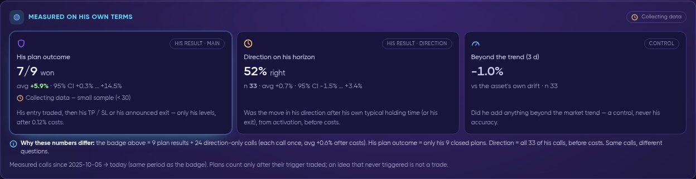
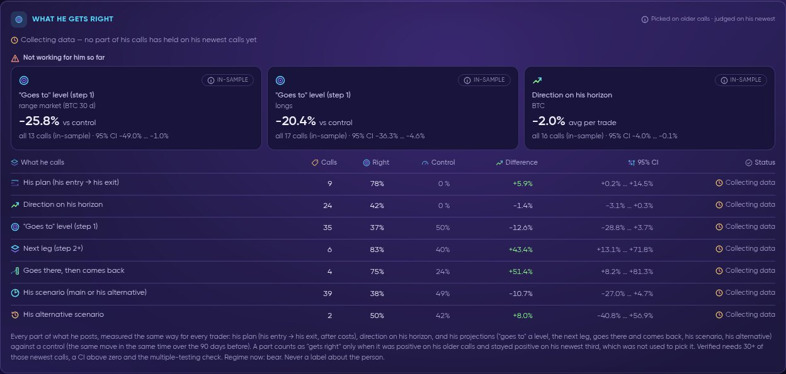
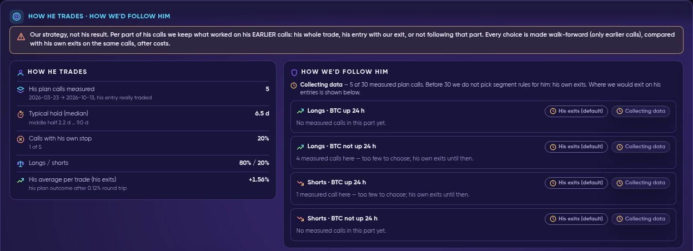
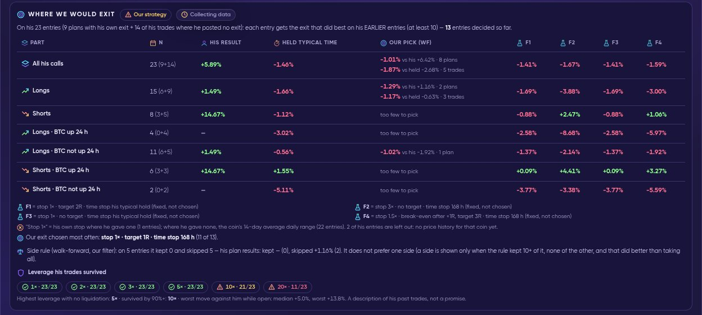
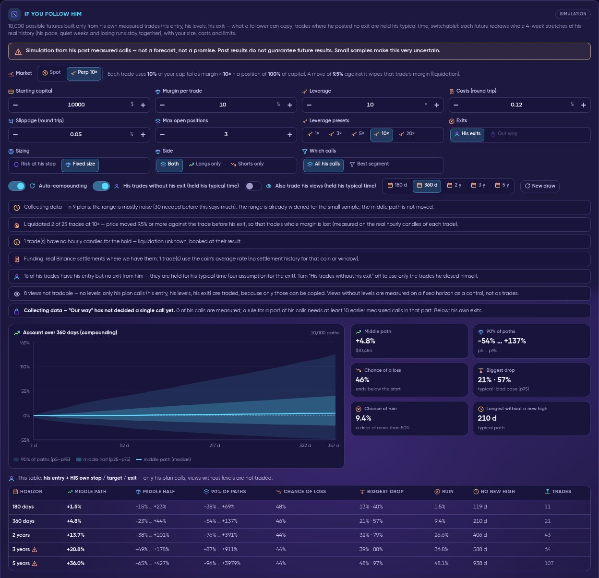
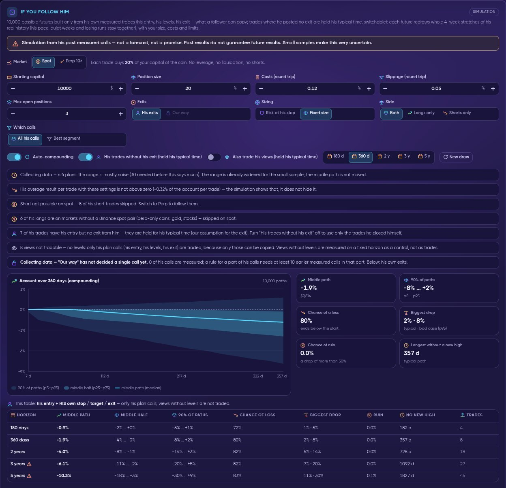
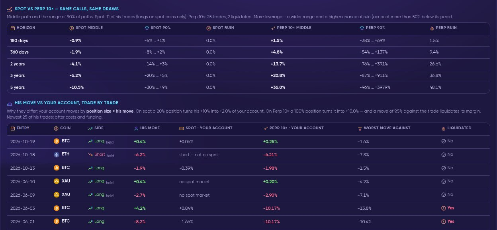

# 👤 Pulse Trader Profile

<figure><video src=".gitbook/assets/rec-pulse-trader-profile.mp4" title="Live recording: a Pulse trader profile — the three numbers, What he gets right, How we'd follow him, Where we would exit, and the If you follow him simulation switched between Spot and Perp 10×."></video><figcaption>
Live recording: a trader profile from the three numbers to the follower simulation, switched between Spot and Perp 10×.
</figcaption></figure>

Every trader that Quantum Pulse follows has a profile at **app.formion.ai/pulse/trader/&lt;handle&gt;**. It answers three questions, always on the trader's **own terms**:

1. **What did he actually call, and how did it go?** — only his own entry, stop, target and exit, measured from the moment his entry really traded.
2. **Where is he good, and where not (yet)?** — split into parts (side, market regime, coin group, type of call), judged on calls that were not used to pick them.
3. **What would following him have done to an account?** — a simulation with your size, leverage, costs and limits.


A profile describes **measured past calls**. It is not a recommendation, not a signal and not a promise of future results. Small samples are labelled **Collecting data**. Everything marked **Our strategy** or **our assumption** is Formion's own way of following a trader — **never his result**. Formion does not trade for you.


Quantum Pulse is in **beta** and is opened step by step. On the **Free** plan the profile shows the header, the badge and the three numbers; the rest of the profile, the charts and the simulation need **Pro** or higher (or the matching FOM Lock level). See [plans](pulse.md#plans).

## Header and badge

The header shows the account (with a link to his X profile), its status and the measuring period:

* **N measured calls · Badge** — every counted call once: his **plan outcome** where he gave a plan, otherwise **direction on his horizon**, after 0.12 % costs (for example *"33 measured calls = 9 his plan outcome · 24 direction on his horizon"*).
* **Verified** needs at least **30** counted calls, the lower end of the 95 % confidence interval above zero, a multiple-testing check across all traders, **and** his newest third of calls (never used to decide anything) above zero. Everything else is **Collecting data**. A badge is never negative — Pulse never labels a person as bad.
* **Live since 2026-11-01** — new ideas are followed from the moment they are posted; earlier ideas (from 2025-10-01) are the measured archive, older posts are history only.
* **Is this you? Claim your profile** and **Request correction / removal** are on every profile. *Claimed* only proves who owns the X account; it never changes a number.

## Measured on his own terms — the three numbers

<figure><figcaption>
The three numbers side by side, each with its own question.
</figcaption></figure>

| Card | Role | Question it answers |
| --- | --- | --- |
| **His plan outcome** | His result · main | His entry traded, then his TP / SL or his announced exit came first — only his levels, after 0.12 % costs. |
| **Direction on his horizon** | His result · direction | Did price move his way after **his own typical holding time** (or his exit), counted from activation, before costs? |
| **Beyond the trend** | Control | Did he add anything beyond the asset's own drift over his horizon? A **control**, never his accuracy. |

**Why the three numbers differ.** They are the same calls asked different questions. The **badge** counts every call once (plans by their outcome, the rest by direction, after costs). **His plan outcome** uses only his closed plans. **Direction** uses all of his calls, before costs. A trader can therefore have a strong plan outcome on a few plans and an ordinary direction score on many views — the profile always says how many calls each number uses.

Next to it, **Style and holding time** shows his style (scalp, intraday, swing, position) and his typical hold (median, shorter quarter p25, longer quarter p75), computed from his own closed trades. His horizon above uses that holding time.

## What he trades, how he manages trades, what a follower got

* **What he trades** — long vs short share, the coins he posts about, and how often his own words say "spot" or "perps / futures / leverage". Formion never assumes spot or futures.
* **How he manages his trades** — break-even moves, partial profits, posted stop-outs and announced exits, read only from his own later posts. A trade he never updated counts as not managed.
* **What a follower would have got** — a follower enters when his entry is actually available (the next hourly close for a trade he is already in, or his trigger price for a plan) and exits on his own stop, target or exit post.
* **Best and weakest part of his calls** — the best part is chosen on his older 2/3 of calls and judged on the newest 1/3; the weakest part is shown in-sample, as information only.
* **His projections** — where he says price goes ("goes to" a level, the next leg, *goes there, then comes back*), each step against a control (the same move in the same time over the 90 days before). Projections are not trades.

## What he gets right

<figure><figcaption>
Every part of what he posts, against a control. "Gets right" only when it held on his newest calls.
</figcaption></figure>

Every part of what a trader posts is measured the same way for everyone: **his plan** (entry → exit, after costs), **direction on his horizon**, and his projections (**"goes to" level**, **next leg**, **goes there, then comes back**, **his scenario**, **his alternative scenario**). Each row shows **Calls**, **Right**, **Control**, **Difference** and the **95 % CI**.

* A part shows at the top as *what he gets right* only when it was positive on his **older** calls **and stayed positive on his newest third**, which was not used to pick it.
* **Not working for him so far** shows the weakest parts **in-sample** — a description, never a label about him.
* Splits use side (longs / shorts), coin group, the BTC market regime (bull / bear / range) and his timeframe. Verified needs 30+ of those newest calls, a CI above zero and the multiple-testing check.

## Charts

* **Price with his ideas** — the price with an arrow at each post (up = long, down = short). Dot = his entry traded, square = exit; lines are only levels he wrote or drew. Hover or tap to preview the post, click to open it on X. The **gear** menu switches Candles / Line / Heikin-Ashi, grid lines and post markers; drag to go back in time, wheel or pinch to zoom, double-click to reset.
* **Result curve**, **Best vs worst move** (MFE / MAE per call), **Right by horizon** (a control) and **Rolling hit rate**.
* **When he hits** — a heatmap of weekday × session (or × hour, UTC) at the time his entry traded, coloured by average result, direction right or best move. Cells with fewer than 5 calls stay grey and dashed (*Collecting data*).
* **When his best move comes** — hours from activation to his best move (MFE), and in which session it happened.
* **Every call: best vs worst move** — one dot per call: right = worst move against him (**MAE**), up = best move his way (**MFE**). Above the diagonal the move went further his way than against him.
* **Profile radar** — eight measured sides (direction, plan outcome, best / worst, consistency, levels given, management, sample, speed), each 0–100, against the median of the followed traders. Dashed axes have fewer than 10 calls. It is a shape, never one overall score.
* **Segment map** — beyond the trend by side × regime / idea type / asset (a control).

## How he trades · How we'd follow him

<figure><figcaption>
Left: his style. Right: how Formion would follow each part of his calls — our strategy, not his result.
</figcaption></figure>

**How he trades** lists his measured plan calls, typical hold, how many calls carry his own stop, his long / short split and his average per trade with his own exits.

**How we'd follow him** decides, per part of his calls (longs / shorts × BTC up or not up over 24 h), one of: **His whole trade**, **His entry + our exit**, **Don't follow**, or **His exits (default)**. Each choice is made **walk-forward** — only from his earlier calls — and compared with his own exits on the same calls, after costs. Below **30** measured plan calls no rule is picked for him: his own exits are used, and the part says *Collecting data*.

## Where we would exit

<figure><figcaption>
Our exits on his entries, next to his own result. Labelled "Our strategy".
</figcaption></figure>

On every entry he gave (his plans with his own exit, plus his trades where he posted no exit), the table compares:

| Column | Whose? | Meaning |
| --- | --- | --- |
| **His result** | **His** | His entry + his own exit, after 0.12 % round trip. |
| **Held typical time** | **Our assumption** | His trades without an exit from him, held for his typical holding time. |
| **Our pick (WF)** | **Our strategy** | For each entry, the exit that did best on his **earlier** entries (at least 10), from a fixed list of 120 exits written down before any result. Shown separately for his plans and for his trades, always *"vs his"* on the same calls. |
| **F1–F4** | **Our strategy** | Four fixed exits (for example *stop 3× · no target · 7 days*), described, not chosen. |

* **"Stop 1×"** is his own stop where he gave one; where he gave none, the coin's 14-day average daily range is used — the table says how many entries used which.
* **His total is a mix** — when his longs and shorts have opposite signs, a card shows them separately (for example longs below zero, shorts above zero), so one weak side does not hide a good one.
* **Side rule** (walk-forward, our filter) — shown only when it would have kept one side clearly better than taking all.
* **Leverage his trades survived** — how many of his trades would have stayed open at 1× … 20× on his worst move against him while open, plus the highest leverage with no liquidation. A description of his past trades, not a promise.

## If you follow him — the simulation

<figure><figcaption>
Default: Perp 10× (10 % margin × 10 = a position of 100 % of capital). Liquidations, funding and skipped calls are listed above the chart.
</figcaption></figure>

The simulation builds **10,000 possible futures** only from his own measured trades — his entry, his levels, his exit, i.e. what a follower can copy. Each future redraws whole **4-week stretches** of his real history, so his pace, quiet weeks and losing runs stay together, then applies your settings.


**Simulation from his past measured calls — not a forecast, not a promise.** Past results do not guarantee future results. With few calls the range is mostly noise (*Collecting data* below 30; no simulation below 5). Longer horizons (3–5 years) are marked as extrapolation.


**Controls**

* **Market: Spot | Perp** — *Perp* (default 10×) uses a margin per trade × leverage; *Spot* buys a share of your capital (default 20 %) with no leverage, no liquidation and **no shorts**.
* **Starting capital**, **Margin per trade** / **Position size**, **Leverage** (presets 1× … 20×), **Costs** (0.12 % round trip), **Slippage** (0.05 %), **Max open positions**.
* **Exits: His exits | Our way** — *Our way* applies the per-part rules from *How we'd follow him*; it stays locked until a rule has decided a call.
* **Sizing: Risk at his stop | Fixed size** — risk mode needs his own stop on enough of his plans; a call without his stop is never given an invented one.
* **Side: Both | Longs only | Shorts only** — your filter. It is **in-sample** (a description, not proof) and the page says so.
* **Which calls: All his calls | Best segment** (the best segment is optimistic, because it was chosen on the same calls).
* **Auto-compounding**, **His trades without his exit (held his typical time)** — our assumption, on by default, can be switched off — and **Also trade his views** (off by default; views without levels are normally not traded).
* Horizon **180 d · 360 d · 2 y · 3 y · 5 y** and **New draw**.

**Liquidation and funding (Perp)**

* A trade is **liquidated** when the worst move against it, measured on the real hourly candles between his entry and his exit, reaches **1 / leverage − 0.5 %** (9.5 % at 10×), unless his own stop was tighter. The trade's whole margin plus costs is lost.
* **Funding** uses real exchange settlements for each trade's hold; where history is missing, the coin's average rate is used and the page says so.

**Results** — the fan chart (90 % of paths, middle half, middle path), **Middle path**, **90 % of paths**, **Chance of a loss**, **Biggest drop** (typical · bad case), **Chance of ruin** (a drop of more than 50 %) and **Longest without a new high**, plus a table for each horizon. **How it is calculated** shows each step: plan calls used, average move per trade, position per trade, result per trade on the account, trades a year at his pace and the uncertainty of his average.

<figure><figcaption>
Spot: no leverage and no liquidation, but his shorts and markets without a spot pair are skipped.
</figcaption></figure>

<figure><figcaption>
Spot vs Perp 10× on the same calls, and his move vs your account, trade by trade.
</figcaption></figure>

* **Spot vs Perp 10× — same calls, same draws** — middle path, 90 % range and ruin for both. More leverage means a wider range and a higher chance of ruin.
* **His move vs your account, trade by trade** — your account moves by **position size × his move**: on spot a 20 % position turns his +10 % into +2 % of your account; on Perp 10× a 100 % position turns it into +10 % — and a move of 9.5 % against the trade liquidates it, even when his trade later ended in profit.

## Ask FORA

[FORA](fora.md) knows every section of the profile and reads the same measured numbers. Ask it *"why are his three numbers different?"* or *"what happens if I follow him at 10×?"* — FORA explains the range and the risks, never a promised profit, and never invents an entry, stop or target he did not give.

***

**Related:** [Formion Pulse](pulse.md) · [Glossary](glossary.md#quantum-pulse) · [FAQ](faq.md#quantum-pulse)
