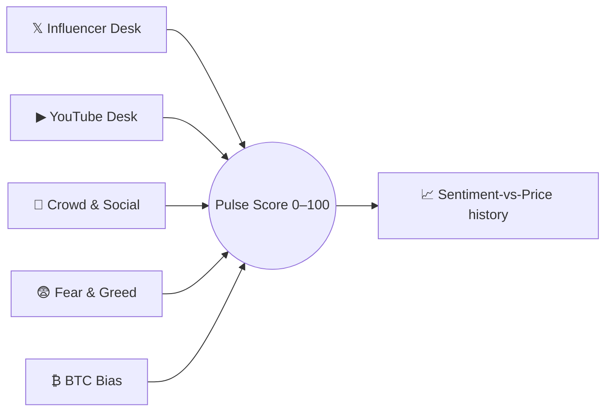

# 📡 Formion Pulse — Market Narrative

<figure><figcaption>Formion Pulse: one score from many voices.</figcaption></figure>

<figure><video src=".gitbook/assets/rec-pulse-scroll.mp4" title="Live recording: Pulse Score and BTC bias, the source filter, Pulse vs market history and the X Influencer Desk."></video><figcaption>
Live recording: Pulse Score and BTC bias, the source filter, Pulse vs market history and the X Influencer Desk.
</figcaption></figure>

Formion Pulse answers one question other tools ignore: **what are the big voices and the crowd actually *saying* right now?**

It is deliberately different from a Fear & Greed gauge or a long/short ratio (those measure *positioning*). Pulse reads the **narrative** — crypto X (Twitter) traders, YouTube influencers, social chatter and headlines — and blends it with price into a single **Pulse Score (0–100)**, where 50 = balanced, higher = more bullish narrative.

Find it at **app.formion.ai → Coins Hub → Pulse** (also linked from the Analytics strip).

## What it watches

* **𝕏 Influencer Desk** — recent posts from a curated roster of crypto traders, each classified **bull / bear / neutral** with a one-line thesis and the coin it refers to. When an influencer posts a bare **chart screenshot**, a vision model *reads the chart itself* — drawn levels, arrows, long/short annotations — and labels it (**"CHART READ"** badge).
* **▶ YouTube Desk** — the latest videos from top crypto channels, each scored bull / bear / neutral by title + description.
* **📣 Crowd & Social** — recent market headlines and social chatter, synthesised into a short read with a bull/bear split and a mood (fearful → euphoric).
* **😨 Fear & Greed** and **₿ BTC Bias** — global mood plus BTC price and multi-horizon momentum (24h / 7d / vs 50-period SMA).

<figure><figcaption>
The X Influencer Desk — tracked posts, each classified bullish, bearish or neutral.
</figcaption></figure>

## Sentiment history & filtering

* **Sentiment-vs-Price history** — the Pulse Score plotted against the BTC price over the last 30 days, so you can see how the narrative moved relative to the market.
* **Source filter** — mute or un-mute any account or channel. The **Pulse Score and desks recompute instantly for you** — so you can see the market through only the voices *you* trust. Your selection is remembered on your device.

<figure><figcaption>
Pulse vs market — the Pulse Score plotted against BTC over time.
</figcaption></figure>

## Trader records and badges

Pulse also keeps a measured record for each followed trader. Trader records are in preview and are being rolled out step by step.

### Measured since 2026-11-01

Live tracking started on **2026-11-01** (00:00 UTC). Every idea a trader posts from that day on is followed from the moment it is posted. Ideas posted **before** that date are marked **Archive**: they are still shown and clearly labelled. The badge and every measured number (accuracy, win rate, average, confidence range) use calls **measured since 1 Oct 2025** (00:00 UTC); older posts are kept only as **History (not measured)** to describe the trader's style and are never part of the badge. The card shows the live part separately ("Live since 2026-11-01"), so archive ideas never inflate the live number.

### What counts as a call

A **counted call** is measured on the trader's own terms, each idea once:

* **His plan outcome** — when his entry actually traded, the result of *his* plan: his take-profit or stop-loss, whichever came first on the price path, or the exit he announced himself.
* **Otherwise, direction on his horizon** — if he gave no exit, the price move in his direction over his own typical holding time (the median of his earlier closed trades; 3 days until he has 5 closed trades), counted from the moment his entry traded.
* Every number is **after costs** (0.12 % round trip). An idea whose entry never traded is not a trade and is not counted. Only levels the trader wrote or drew are used — Formion never adds an entry, stop or target of its own.

### Badge rules

| Badge | Rule |
| --- | --- |
| **Verified** | At least **30** counted calls, the lower bound of the 95 % confidence interval of the average result per call is **above 0**, and a multiple-testing check across all traders (Benjamini–Hochberg) passes |
| **Profitable (early)** | At least **10** counted calls and the lower bound of the 95 % confidence interval is **above 0** |
| **Collecting data** | Everything else — too few calls, or the result is not yet clear |

A badge is never negative: Pulse never labels a trader as bad. A badge describes measured past calls only; it is not a promise of future results.

### Labels on single ideas

* **Timeframe is our reading** — he wrote "close above / below a level" without a timeframe; the level is his, the 1h and 1d readings of that close are ours, and the weaker number is shown.
* **Uncertain outcome (1h vs 1d)** — the same case, but the 1h and the 1d reading give a different outcome. The idea is never left out: the **weaker** of the two outcomes is used. If only one reading's entry traded and that trade gained, the weaker outcome is "no trade", so the idea is shown as not triggered.


Pulse reads what people *say*. It is a sentiment and research tool, not a signal to act on blindly — pair it with your own analysis before trusting any voice.


## Use Pulse with the current workspace

Compare narrative context with [News and macro events](news.md), ask [FORA](fora.md) to explain the market context, and review trader calls in [Swarm](swarm.md). Pulse sentiment is an analytical input, not an instruction to execute.
