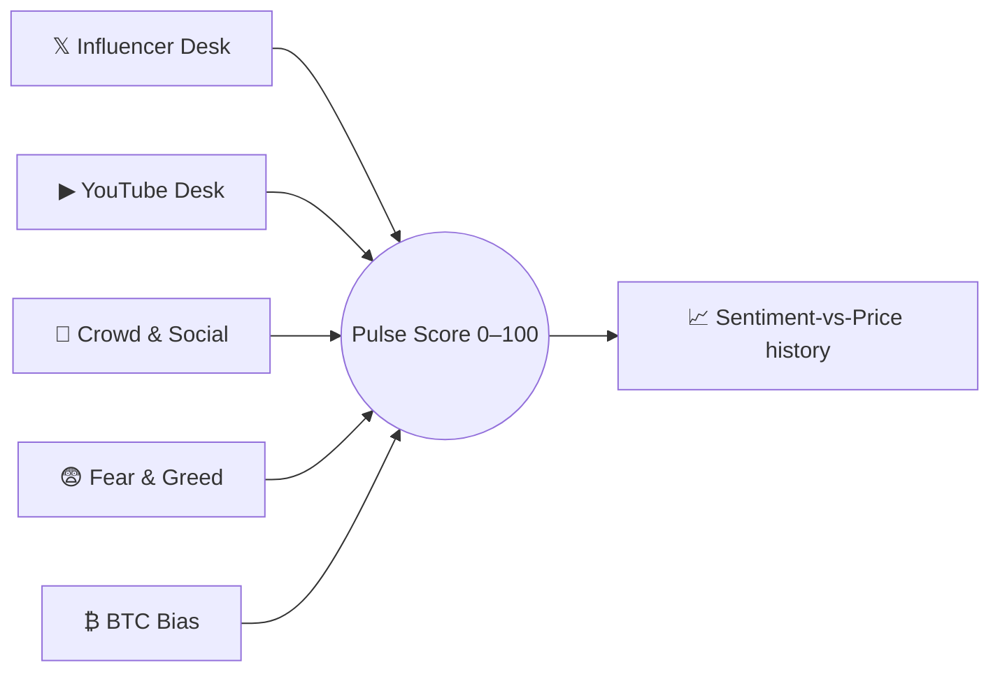
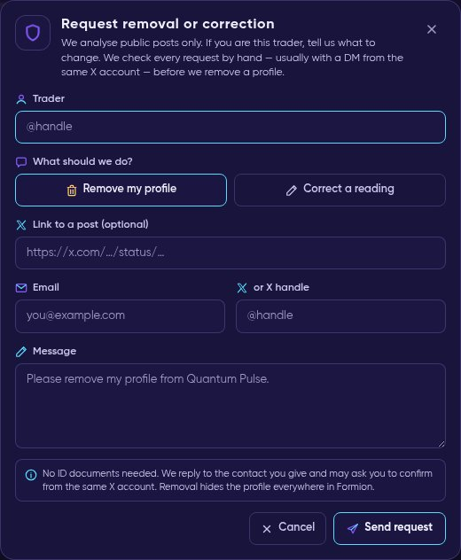

# 📡 Formion Pulse — Market Narrative

<figure><figcaption>Formion Pulse: one score from many voices.</figcaption></figure>

<figure><video src=".gitbook/assets/rec-pulse-scroll.mp4" title="Live recording: Pulse Score and BTC bias, the source filter, Pulse vs market history and the X Influencer Desk."></video><figcaption>
Live recording: Pulse Score and BTC bias, the source filter, Pulse vs market history and the X Influencer Desk.
</figcaption></figure>

Formion Pulse answers one question other tools ignore: **what are the big voices and the crowd actually *saying* right now?**

It is deliberately different from a Fear & Greed gauge or a long/short ratio (those measure *positioning*). Pulse reads the **narrative** — crypto X (Twitter) traders, YouTube influencers, social chatter and headlines — and blends it with price into a single **Pulse Score (0–100)**, where 50 = balanced, higher = more bullish narrative.

Find it at **app.formion.ai → Coins Hub → Pulse** (also linked from the Analytics strip).

## What it watches

* **𝕏 Influencer Desk** — recent posts from a curated roster of crypto traders, each classified **bull / bear / neutral** with a one-line thesis and the coin it refers to. When an influencer posts a bare **chart screenshot**, a vision model *reads the chart itself* — drawn levels, arrows, long/short annotations — and labels it (**"CHART READ"** badge).
* **▶ YouTube Desk** — the latest videos from top crypto channels, each scored bull / bear / neutral by title + description.
* **📣 Crowd & Social** — recent market headlines and social chatter, synthesised into a short read with a bull/bear split and a mood (fearful → euphoric).
* **😨 Fear & Greed** and **₿ BTC Bias** — global mood plus BTC price and multi-horizon momentum (24h / 7d / vs 50-period SMA).

<figure><figcaption>
The X Influencer Desk — tracked posts, each classified bullish, bearish or neutral.
</figcaption></figure>

## Sentiment history & filtering

* **Sentiment-vs-Price history** — the Pulse Score plotted against the BTC price over the last 30 days, so you can see how the narrative moved relative to the market.
* **Source filter** — mute or un-mute any account or channel. The **Pulse Score and desks recompute instantly for you** — so you can see the market through only the voices *you* trust. Your selection is remembered on your device.

<figure><figcaption>
Pulse vs market — the Pulse Score plotted against BTC over time.
</figcaption></figure>

## Quantum Pulse — who is actually right

Quantum Pulse adds measured records on top of the narrative: what the followed traders, the crowd, prediction markets and any X account said — and what price did afterwards. Since **12 November 2026** Quantum Pulse is **public**: every logged-in account sees it by its plan step (see **Plans** below). app.formion.ai needs an account, so a visitor who is not logged in is sent to the login page first. Only **public** posts (X, YouTube, public Telegram) are measured.

| Tab | What it shows |
| --- | --- |
| **Market Narrative** | The Pulse Score, BTC bias, desks, source filter and history described above. |
| **Traders (v3)** | The **Fair rank** — each followed trader on his own terms: avatar, handle, status (**Verified** / **Collecting data**), **His plan** outcome, direction on his horizon, beyond the trend (a control), the 95 % CI, best right now, how far he is from Verified and his segments. Each row opens his [trader profile](pulse-trader-profile.md). Which columns are open depends on the plan step. |
| **Pulse Shift** | The exact moment the Pulse Score changed regime (held for two readings), with BTC / ETH / SOL / HYPE prices at the first signal and at confirmation, and the best / worst price move afterwards (4 h / 24 h / 7 d). Context, not a signal. |
| **Following** | The traders you follow and your alerts when one of them posts a new idea, flips bias or an idea changes status — on Telegram (via @formiontradingbot) and Web Push, with quiet hours in your time zone. An alert is information about *his* post, never an order. |
| **Crowd Pulse** | What the followed X accounts say per coin: an index 0–100 (50 = neutral) for today and 7 days, and per horizon short / mid / long (a horizon only from the trader's own evidence). Crowd talk vs positioning, stance timelines (green dot = bull call, red dot = bear call; hover for his post, click to open it on X) and the Quantum Crowd indicator (line width = number of votes, brightness = how one-sided the crowd is). Everything is *Collecting data* until it holds on new days. |
| **Prediction Markets** | What Kalshi and Polymarket post about crypto on X, and what their monthly "how low / how high" markets price. Each post is measured from the minute it was posted: **1)** direction right and how far (best move their way, worst against) vs a control, **2)** the close, **3)** their level reached, **4)** calibration of "X % chance" posts. Example: price 75,000, they call 70,000 this month, price drops to 73,000 → a good direction call even though 70,000 was never reached. |
| **X Lens** | Type any X account: Formion keeps only posts where the author himself states a price forecast (BTC, ETH, SOL, XRP, gold, silver, oil, S&P 500, NASDAQ) and measures each one the same way — direction and best / worst move first, then the close, the level and the calibration. A dot sits on the candle of each post (green = direction right, red = wrong, grey = open); hover shows the post, click pins the card. X Lens does **not** feed the Pulse Score or any trader record. |
| **My Calls** | Your own up / down calls on a market and horizon, scored on real prices against the asset's own drift, with a community leaderboard (nicknames only). A call cannot be edited afterwards. |
| **Community Vote** | One vote per market per UTC day: up / down / sideways, shown next to the X crowd and what price actually did. A measurement of opinion, not a signal. |

Every followed trader also has a **[trader profile](pulse-trader-profile.md)**: the three numbers, what he gets right, how Formion would follow him, where we would exit, and a follower simulation with Spot | Perp, leverage, liquidation and funding.

### Request removal / correction

<figure><figcaption>
The form opens in the page; no account is needed to send it.
</figcaption></figure>

Pulse analyses public posts only. Every trader profile and the Fair rank carry a short note with a **Request removal / correction** button. It opens a form with:

* **Trader** — the @handle (filled in on a profile, typed under the Fair rank);
* **What should we do?** — **Remove my profile** or **Correct a reading**;
* a **link to the post** (needed for a correction, optional for a removal);
* your **email** or **X handle**, so Formion can reply, and a **message**.

The request becomes a Formion support ticket and is checked by hand — usually by asking the trader to confirm from the same X account. No ID documents are needed, and no Formion account is needed to send it. A removed trader **disappears from every Pulse view**: his profile no longer opens, and he is left out of the Fair rank, Following alerts and FORA answers.

## Trader records and badges

### Measured since 2026-11-01

Live tracking started on **2026-11-01** (00:00 UTC). Every idea a trader posts from that day on is followed from the moment it is posted. Ideas posted **before** that date are marked **Archive**: they are still shown and clearly labelled. The badge and every measured number use calls **measured since 1 Oct 2025** (00:00 UTC); older posts are kept only as **History (not measured)** to describe the trader's style and are never part of the badge. The profile shows the live part separately ("Live since 2026-11-01"), so archive ideas never inflate the live number.

### What counts as a call

A **counted call** is measured on the trader's own terms, each idea once:

* **His plan outcome** — when his entry actually traded, the result of *his* plan: his take-profit or stop-loss, whichever came first on the price path, or the exit he announced himself.
* **Otherwise, direction on his horizon** — if he gave no exit, the price move in his direction over his own typical holding time (the median of his earlier closed trades; 3 days until he has 5 closed trades), counted from the moment his entry traded.
* Every number is **after costs** (0.12 % round trip). An idea whose entry never traded is not a trade and is not counted. Only levels the trader wrote or drew are used — Formion never adds an entry, stop or target of its own.

Next to these two, **Beyond the trend** (his move minus the asset's own drift) is shown as a **control** — it answers "did he add anything beyond the market?", never "was he right?". Why the three numbers can differ is explained on the [trader profile](pulse-trader-profile.md) page.

### Badge rules

| Badge | Rule |
| --- | --- |
| **Verified** | At least **30** counted calls, the lower bound of the 95 % confidence interval of the average result per call is **above 0**, a multiple-testing check across all traders (Benjamini–Hochberg) passes, **and** his newest third of calls — never used for the decision — is above zero |
| **Collecting data** | Everything else — too few calls, or the result is not yet clear |

A badge is never negative: Pulse never labels a trader as bad. A badge describes measured past calls only; it is not a promise of future results.

### Labels on single ideas

* **Timeframe is our reading** — he wrote "close above / below a level" without a timeframe; the level is his, the 1h and 1d readings of that close are ours, and the weaker number is shown.
* **Uncertain outcome (1h vs 1d)** — the same case, but the 1h and the 1d reading give a different outcome. The idea is never left out: the **weaker** of the two outcomes is used. If only one reading's entry traded and that trade gained, the weaker outcome is "no trade", so the idea is shown as not triggered.

## Plans

Every logged-in account sees Quantum Pulse by its **plan step**. Limits are enforced on the server, and a locked number is never sent to the browser. There are six steps, from lowest to highest:

**🆓 Free** → **🪙 Free + FOM Hold** → **🔒 Free + FOM Lock** → **💎 Pro** → **💎🔒 Pro + FOM Lock** → **🏛️ Institutional**

* **FOM Hold** and **FOM Lock** use the same FOM levels as the rest of the app (thresholds in the [pricing ladder](pricing.md) and on [FOM token](fom-token.md)). **Pro + FOM Hold** counts as **Pro**; on Pro only a FOM Lock adds more. FOM adds nothing on **Institutional**.
* FOM Lock levels also unlock whole plans: **FORA Agent** includes Pro and **Agent Pro** includes Institutional.
* Every locked part shows the same animated lock with what the next step adds and two buttons: **Upgrade** and **FOM Lock**.

| Pulse feature | 🆓 Free | 🪙 Free + Hold | 🔒 Free + Lock | 💎 Pro | 💎🔒 Pro + Lock | 🏛️ Institutional |
| --- | --- | --- | --- | --- | --- | --- |
| **Market Narrative** | ✅ | ✅ | ✅ | ✅ | ✅ | ✅ |
| **Fair rank** — traders, avatar, status | ✅ | ✅ | ✅ | ✅ | ✅ | ✅ |
| **Fair rank** — "His plan" column | First trader only (the rest blurred) | All traders | All traders | All traders | All traders | All traders |
| **Fair rank** — other columns (direction, beyond trend, CI, best now, to Verified, segments) | 🔒 | 🔒 | ✅ | ✅ | ✅ | ✅ |
| **Trader profile** | Header (avatar, handle, status) | + the three numbers | Full profile, segments, charts | Full profile | Full profile | Full profile |
| **If you follow him** (simulation) | 🔒 | 🔒 | 🔒 | ✅ | ✅ | ✅ |
| **Following** — traders | 1 | 2 | 3 | 10 | 20 | Unlimited |
| **Following** — alerts | Daily digest at 08:00 | Digest 2× a day (08:00 · 20:00) | Digest 3× a day (08:00 · 14:00 · 20:00) | Instant, up to 50 / day | Instant, up to 100 / day | Instant, unlimited |
| **Pulse Shift history** | 7 days | 30 days | 90 days | Full | Full | Full |
| **Crowd Pulse** | Combined index | Combined index | + per horizon | + opinion map, stance timelines | Same as Pro | + regimes, CSV export |
| **Prediction Markets** | 5 newest posts | 10 posts | All posts | All posts + study "Are the markets right?" | Same as Pro | Same as Pro |
| **X Lens** — new accounts / day | Example account only | Example account only | Example account only | 1 | 2 | 5 |
| **Trader Verifier · Accuracy Leaderboard** (rows) | 1 | 3 | All | All | All | All |
| **My Calls** (open at once) | 3 | 3 | 3 | 20 | 20 | Unlimited |
| **Community Vote** | ✅ | ✅ | ✅ | ✅ | ✅ | ✅ |
| **History** | 30 days | 30 days | 90 days | 365 days | 365 days | Full |
| **FORA Pulse questions** | 3 / day | 5 / day | 10 / day | Chat budget | Chat budget | Chat budget |
| **Strategies built from Pulse traders** (saved) | 0 | 0 | 0 | 3 | 6 | Unlimited |
| **FORA Neurons Pulse tools** | — | — | — | — | — | ✅ |

X Lens on Institutional no longer needs FOM. The Institutional **exchange positioning** and **Quantum Crowd indicator** views in Crowd Pulse are **temporarily unavailable**.


Pulse reads what people *say*. It is a sentiment and research tool, not a signal to act on blindly — pair it with your own analysis before trusting any voice.


## Use Pulse with the current workspace

Open a [trader profile](pulse-trader-profile.md) for the full record of one trader. Compare narrative context with [News and macro events](news.md), ask [FORA](fora.md) to explain the market context, and review trader calls in [Swarm](swarm.md). Pulse sentiment is an analytical input, not an instruction to execute.
