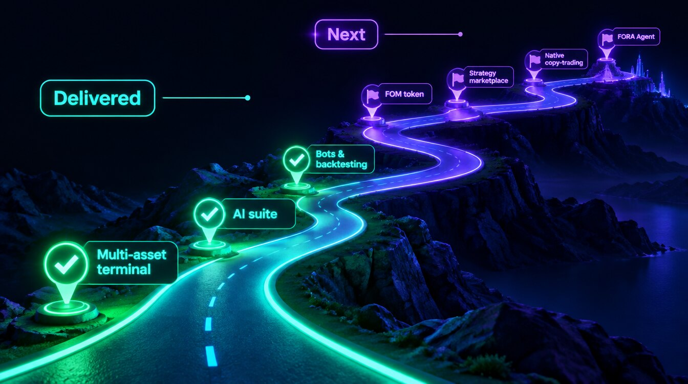

# 🚩 Roadmap

<figure><figcaption></figcaption></figure>

Where Formion is today and where it's going. (Updated 2026.)

## ✅ Delivered

* **Multi-asset platform** — 8 CEX, 4 DEX, EVM/Solana/Sui/TON wallets, prediction markets.
* **Quantum Terminal** ([app.formion.ai](https://app.formion.ai/?utm_source=docs&utm_medium=referral&utm_campaign=docs)) — screeners, Chart Pro, Data Hub, Coins Hub, 12+ analytics tools, Signals, News, Trade, Bots, Journal.
* **AI suite** — FORA assistant (web + Telegram, text + realtime voice), Command Center, AI Advisor (Quick Advisor, AI Chat, Track Record), Trade Vision, Research RAG-LLM, Multi-AI Consensus.
* **Bots & automation** — DCA, Grid, Indicator, Trailing, Funding-arb, Alarm bots; **chart-alert webhook automation** (CEX + DEX); tracked live and paper strategies.
* **Backtesting** — multi-year backtests, walk-forward optimizer, Strategy Lab + no-code builder, Pine generator.
* **Markets** — crypto, forex and CFDs (cTrader), stocks (US + international), commodities (gold/silver/oil), options (major crypto options venues), prediction markets (Polymarket/Kalshi/Limitless).
* **Accounts** — 3-tier pricing, 7-day Pro trial, BYOK, 2FA, referrals, portfolio aggregation, trading journal with AI review.
* **Unified trade history** — every bot, strategy and signal engine streams into one analytics hub (KPIs, equity curve, per-symbol/session/hour breakdowns), each signal scored against its realized forward outcome.
* **Alerts** — multi-channel notifications across in-app, sound, Telegram, email and webhook, with per-strategy routing.

## 🔜 2026 — Next up

* **FOM token launch** — **Wed 14 October 2026** on Uniswap (Base), fixed supply of 1,000,000,000, LP locked for 24 months. See [FOM](fom-token.md).
* **Phased agent utility (Q4 2026)** — Holder level, paying in FOM, FORA Agent beta and points.
* **Hold FOM for levels (Q4 2026, in phases)** — reach FOM levels by holding FOM in a verified wallet; **FOM Lock v3** live in beta since 28 Oct 2026 (Formion Wallet → Earn). **Dossier Autopilot** live-trading packages, unlocked by holding, locking or paying monthly in FOM (50% burned).
* **Personal API tokens** — self-serve API keys in **Profile → License** (the card shows *Coming soon*). Until then, [Data API](developer-api.md) keys are issued manually on request.
* **Auto-discovery of new listings** — mini-backtest new perps and promote the ones that pass.
* **Mandatory walk-forward validation** before any strategy is published.
* **Native Formion copy-trading** — copy selected Formion bots/strategies directly in-app (today you can copy via your exchange's native copy trading, e.g. Bybit).
* **Custom Strategy Marketplace** — list, buy and sell strategies (builder, gating and payout rails built; opening to creators in phases).
* **Compliance hardening** — audit-log export, IP allowlist, mandatory team 2FA.

## 🌅 Later phases

Target dates from the official [FOM page](https://formion.ai/fom?utm_source=docs&utm_medium=referral&utm_campaign=docs#roadmap):

* **Q1 2027** — Agent Pro, FORA Trader Coach, personal TradingView webhooks, staking v1 (Q1–Q2 2027), Dossier, marketplace in FOM.
* **Q2 2027** — FORA AGI beta (autonomy on the user's own accounts, within risk caps), Prediction, Academy, author staking.
* **H2 2027** — Meme hunter, FOM/ETH LP farming rewards (end of 2027; LP trading fees already work in the wallet Earn tab), FOM Visa card, governance, entity and team KYC.
* **Q3–Q4 2027 — Formion Lending** — borrow USDC against your crypto without selling it, with Formion supplying the liquidity. Self-custody: collateral sits in audited on-chain lending contracts, not with Formion. Starts with BTC and ETH as collateral; FOM as collateral is planned once FOM liquidity is deep enough. A plan, not an offer: no rates are set or promised.

Dates are targets; each step ships when it is ready and tested.

## Availability labels

**Academy** and **Predictions** are marked coming soon in public navigation. News, Swarm, Funding Carry and Trades History have dedicated research and review guides; a navigation label alone does not establish live execution.


Roadmap items are directional and can change. For what's live **right now**, see **[The App](the-app.md)** and **[Pricing & Tiers](pricing.md)**.

