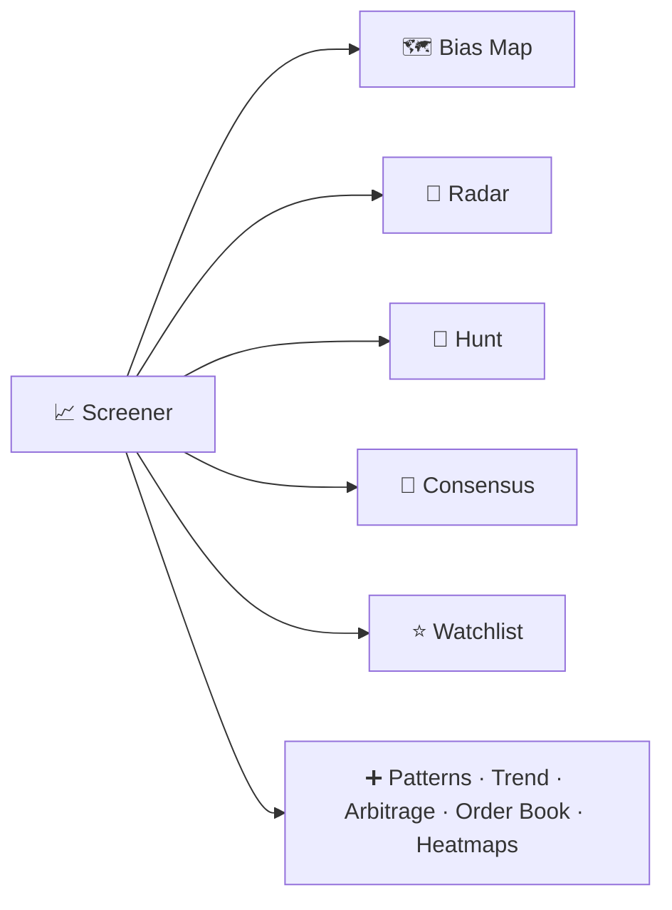

# 📈 Screener

<figure><figcaption>The Screener — every market, ranked by Formion's native scoring.</figcaption></figure>

<figure><video src=".gitbook/assets/rec-screener-scroll.mp4" title="Live recording: scrolling the Screener — market chips, live feed, the ranked table, then a row's chart opened inline."></video><figcaption>
Live recording: scrolling the Screener — market chips, live feed, the ranked table, then a row's chart opened inline.
</figcaption></figure>

The **Screener** is Formion's home view and the engine the rest of the app is built on: a ranked, sortable table of crypto, stock and forex markets, each scored by **native signals** rather than a single indicator.

Open it at **[app.formion.ai](https://app.formion.ai/?utm_source=docs&utm_medium=referral&utm_campaign=docs)** — it's the first thing you see.

## How scoring works

<figure><video src=".gitbook/assets/clip-screener.mp4" title="How a setup surfaces in the Screener"></video><figcaption>
Trend, momentum, volume, volatility and signal tags combine into one score and a bull / bear / neutral bias.
</figcaption></figure>

Every symbol gets one composite score:

* **Trend, momentum, volume and volatility** — live prices are scored on all four, then deduplicated across timeframes into **one number per symbol**
* **Signal tags** — structure and flow events such as FVG / order-block entries, VWAP reclaims and rejections, break of structure / CHoCH, regime changes, Wyckoff springs and Adaptive-RSI turns
* **Bias** — each row is classed bull, bear or neutral

The table shows score, price, 24h change, the strongest signals and a mini sparkline per row. Sort by any column and filter by asset class (crypto, stocks, forex), bias and signal, so you can jump straight to "what's set up *right now*".

## Sub-tools

<figure><video src=".gitbook/assets/rec-screener-subtabs.mp4" title="Live recording: switching between Bias Map, Radar, Hunt, Consensus and Watchlist."></video><figcaption>
Live recording: switching between Bias Map, Radar, Hunt, Consensus and Watchlist.
</figcaption></figure>

### 🗺️ Bias Map

<figure><figcaption>
Bias Map: green = long bias, red = short, by timeframe.
</figcaption></figure>

A market-wide **directional bias heatmap** across 5 timeframes (5m → 1d) with a selectable anchor timeframe. Green = long bias, red = short, yellow = neutral. Twelve views (Mosaic, Matrix, Grid, Quadrant, 3D, Strength, Confluence, Treemap, Sector, Sunburst, History, Quality) and a Min-Score slider let you read the whole market's lean at a glance.

### 📡 Radar

<figure><figcaption>
Radar: preset scans rendered as signal cards.
</figcaption></figure>

30+ TradingView preset scans (movers, breakouts, trend shifts, volume…) rendered as signal cards, across crypto, forex, indices/CFDs and stock markets (US, Canada, UK, Germany, France, Japan, Hong Kong, India, Australia). Subscribe to a preset to be alerted on fresh matches.

### 🎯 Hunt

<figure><figcaption>
Hunt: market regime → top sectors → top industries → setup candidates.
</figcaption></figure>

A top-down **US-equities** setup funnel (long-only): market regime (SPY/QQQ vs their 21/50 EMAs) → strongest sectors → strongest industries → ignition-and-flag and 8/21-EMA pullback setups, each with entry, stop and a 2R target.

### 🤝 Consensus

<figure><figcaption>
Consensus: symbols ranked by how many engines agree on the same direction.
</figcaption></figure>

Multi-signal confluence: symbols ranked by how many of Formion's engines and indicators agree on the same direction.

### ⭐ Watchlist

<figure><figcaption>
Watchlist: your saved symbols with live bias, price and volume.
</figcaption></figure>

Your saved symbols with live scores and signals, plus a workspace to curate the list against a live multi-timeframe bias matrix.

### ➕ More lenses

**Patterns** (chart-formation detector), **Trend** (trend-strength scan, see below), **Arbitrage** (cross-exchange price spreads and funding carry), **Order Book** (resting bids vs asks near price and walls, see below), **VWAP Bubble**, **RSI Heat**, **MACD Heat** and **EMA Cloud**.

<figure><figcaption>
RSI Heatmap — every symbol coloured by RSI.
</figcaption></figure>

<figure><figcaption>
Patterns: detected formations, regime radar and a forward-tested track record by pattern.
</figcaption></figure>

### 📈 Trend

<figure><figcaption>
Trend: regime decision plus a trend board across crypto, commodities and US stocks.
</figcaption></figure>

<figure><figcaption>
Trend scanner: one card per coin with its score and bias, on closed candles only.
</figcaption></figure>

The Trend scanner gives every coin (Binance USD-M perpetuals, top by 24h volume) a **trend score from −100 to +100** on the timeframe you pick (5m → 1d):

* **Score** — built from three parts, all in % of price: EMA9 vs EMA21 (up to ±50), how much EMA9 moved over the last 18 bars (up to ±30) and price vs EMA21 (up to ±20).
* **Bias** — **Long** from +25, **Short** from −25, **Neutral** in between. It describes the recent trend; it says nothing proven about what comes next.
* **Closed candles only** — the score, bias and change % move only when a candle closes, so a signal never repaints. The last candle on the chart and the price are live, but they do not count until that candle closes.
* **How far to compare** — because the score is in % of price, the same number is not comparable across timeframes or between a calm and a wild coin.
* **Renamed or dead symbols show no score** — a symbol whose market stopped trading or was renamed (for example **TON → GRAM**, MATIC → POL) shows no score and a "Renamed to …" note, never a fake "neutral 0".

**Trend backtesting (paper book).** The **Backtesting** sub-tab measures a paper book that takes trades from the trend score on 1h. Entries, stops and targets are **Formion's own rules** (ATR-based), not anyone's signal. How the book is measured:

* A signal fires only on a **just-closed** 1h candle.
* Entry is the real executable price at that moment (ask for long, bid for short).
* Exits are taken at the **real exchange price**: a stop fills at the first real trade after it is triggered, a target fills only when price trades **through** it, and a time expiry closes at the last real trade price.
* Results are shown after costs (editable) and include the funding actually charged.
* **Measurement restarted on 2 Nov 2026.** Old rows whose recorded outcome was contradicted by exchange data were removed, so the default view starts from the restart.
* Free users see the last 7 days, Pro and up the whole book. Until there are at least 30 trades over at least 14 days the status reads **Collecting data**.

### ⚖️ Order Book

<figure><figcaption>
Order Book: resting bids vs asks near price (5-minute average), walls, spread and volume for the top 80 coins.
</figcaption></figure>

The Order Book tab shows how the **resting orders near the current price** are split between buyers and sellers, for the top 80 Binance USD-M perpetuals by 24h volume. It is a **Context signal**: it shows the state of the book now, not where price will go, and it never gives an entry, stop or target.

* **Imbalance** = (bid − ask) ÷ (bid + ask) × 100, in dollars of resting orders **within ±0.10 % of the mid price**. Switch to **±0.25 %** with the Band filter. That wider band is shown only when the book actually reaches it; otherwise the cell shows "—". Every coin is measured over the same price distance, so the numbers are comparable.
* **The main number is a 5-minute average**, not a single snapshot, because the book changes second by second. Until five readings exist, the row says "warming up".
* **Bid heavy** = +15 % or more (more resting buy orders near price), **Ask heavy** = −15 % or less, **Balanced** in between.
* **Wall** = one price level at least **6× the median level** within ±0.25 %, seen in **2 readings in a row**. If no level passes, the cell shows "—". The biggest level on its own is not called a wall.
* **Resting orders can be pulled at any time.** A wall or a heavy side describes the state of the book, not a direction.
* All users share one snapshot of the book. If it is older than about 2.5 minutes, the tab shows a **stale** warning instead of "Live".

#### 🧱 Walls Bot & Backtesting

The **Backtesting** sub-tab (also opened from **Walls Bot →**) measures what happens when price touches a wall:

* **Walls v2** has been measured from **2 Nov 2026** on Binance USD-M perpetuals with **real fills**. A trade exists only when a real trade print touches a confirmed wall. The entry is the first real print on the taking side, i.e. at the bid or ask, 1–6 s after the touch. The stop is checked on the real trade path and fills at the first real trade after it is hit. The target fills only when price trades through it. Results are **net** of fees, slippage and real funding.
* The stop and target levels are **Formion's own strategy rules** (based on 1-hour ATR), not levels from the book or from any trader.
* **v1 is an archive** (an older, simpler measurement). It is shown below v2 and labelled "archive v1, not directly takeable".
* **Filters** (side, session, days, coin and more) work over the whole book. Every filter shows a status:
  * **Too few data** — not enough trades or days yet
  * **Collecting data**
  * **Past only, fades recently** — positive in the past but not recently
  * **Holds in both halves** — positive after costs in both halves of the period and recently
* **The first verdict needs at least 30 trades and at least 14 days.** Until then, v2 reads **Collecting data**.
* **Who sees what:** you need to be logged in. Free users see the last 7 days, and Pro and up see the whole book.

## Logos & live data everywhere

Every symbol carries its asset logo, and rows update live. Click any row to open its full chart and analysis in **Chart Pro**.


On the free **Neural** tier the Screener covers crypto as a **3-row preview** (last 7 days of history; signals are delayed 30 minutes). **Pro** and **Institutional** get the full real-time screener on all markets — crypto, stocks, commodities and forex — see **[Pricing & Tiers](pricing.md)**.

