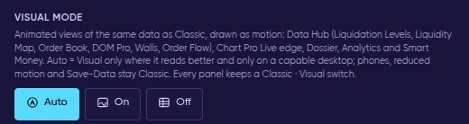

# ⚙️ Settings

The **Settings** button (slider icon, top right of the app) holds the choices that apply to the whole app. They are saved in your browser and in your account, so they follow you to another device.

## 🎛️ Visual mode

Many panels can be shown two ways:

* **Classic** — tables and charts as you know them.
* **Visual** — the **same data** drawn as motion: magnet fields, flows, ladders, rivers. Visual adds no new numbers, no signal and no extra limit; your plan limits stay exactly as in Classic.

**Settings → Visual mode** sets the default for every panel:

| Option | What happens |
| --- | --- |
| **Auto** (default) | Visual starts only where it reads better — **Liquidation Levels** and **Liquidity Map** — and only on a desktop. Phones, *reduced motion* and *Save-Data* stay Classic. Every other panel starts in Classic. |
| **On** | Visual starts on every panel that has one. |
| **Off** | Classic everywhere; the Classic · Visual switch is hidden. |

<figure><figcaption>
Settings → Visual mode: Auto, On or Off.
</figcaption></figure>

Above each supported panel there is a **Classic · Visual** switch. Your last click on a panel wins over the default and is remembered for that panel.

### Where Visual is available

* **Data Hub** — Liquidation Levels, Liquidity Map, Order Book, DOM Pro, Walls, Order Flow ([Data Hub](data-hub.md), [Order Flow](order-flow.md), [Liquidity Map](liquidity-map.md))
* **Chart Pro** — the **Live edge** toolbar button: Live edge and Zone pass ([Chart Pro](chart-pro.md))
* **Dossier** — the dimension scanner ([Dossier](dossier.md))
* **Analytics** — the cockpit ([Analytics](analytics.md)) and SmartMoney money rivers ([Copy Trading & Whale Tracking](copy-trading.md))
* **Data Hub → Multi-Exchange** — the exchange orchestra ([Data Hub](data-hub.md))
* **HL Whales** — the liquidation radar ([Copy Trading & Whale Tracking](copy-trading.md))
* **Quantum Screener → Strength Rank** — the strength race ([Quantum Screener](screener.md))
* **Formion Wallet** — Portfolio flow on the overview ([Formion Wallet](wallet.md))
* **Quantum Screener** — Trends, Trend, Regime Detector, Bias Map, RSI / MACD / VWAP / EMA heatmaps, Zone Hunter, Hunt, Divergences, Patterns and Watchlist ([Quantum Screener](screener.md))
* **Data Hub** — HL Perps, OI Surge, Funding & Arb (Desk and Spreads) and DEX Flow ([Data Hub](data-hub.md)); Order Flow print rain, Order Book depth canyon, Imbalance scales and the Liquidation scanner ([Order Flow](order-flow.md))
* **Options** — Gamma landscape and the Options · Vol signal surface ([Options & GEX](options.md))
* **Analytics** — Correlation, ETF Flows, Mechanical Recorder and Study ([Analytics](analytics.md)); HL Directory and HL Fills ([Copy Trading & Whale Tracking](copy-trading.md))
* **Chart tools** — Multi-Chart and Constructor ([Chart Pro](chart-pro.md)), Indicator Lab ([Chart Indicators](chart-indicators.md)), Liquidity Lab → Confluence ([Strategy Lab](strategy-lab.md))
* **Signals** — Consensus and Screener Radar ([Quantum Screener](screener.md)), Live Signals and My Alerts ([Alerts](alerts.md)), Telegram Signals ([Telegram Signals](telegram-signals.md)), Mechanical Live ([Analytics](analytics.md))
* **Community and news** — Pulse Traders (v3) ([Formion Pulse](pulse.md)), Economic Calendar ([News 24/7 & Macro](news.md)), Swarm ([Formion Swarm](swarm.md))

### A direct link

Add `?visual=1` to a page address to open its panels in Visual for that visit, or `?visual=0` for Classic — handy for sharing a view. Example: `app.formion.ai/liquidation-map?visual=1`.


Every Visual view is labelled **Context signal · not a signal**. It shows the data in motion; it is never an entry, a stop or a target.

