# 🖥️ Trading Terminal — The App

<figure>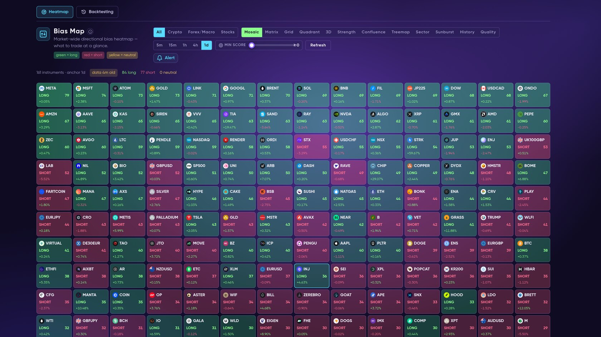<figcaption></figcaption></figure>

[app.formion.ai](https://app.formion.ai/?utm_source=docs&utm_medium=referral&utm_campaign=docs) is the **Quantum Terminal** — Formion's full trading workspace. This page tours every area of the top navigation so you know where each tool lives.


🎬 **Screen · Analyze · Execute — Formion AI in 2 minutes.** A tour of the trading terminal.



Feature access depends on your plan — see **[Pricing & Tiers](pricing.md)**. The free **Neural** tier is genuinely useful; **Pro** unlocks the full stack.


## Navigation — where everything lives

The top menu has four groups, in the order you usually work: **Find** a market, **Read** the context, **Act** on it, then **Review** what happened.

| Group | Tabs (left to right) | What you do there |
|---|---|---|
| 🔎 **Find** | Quantum Screener · Chart Pro · Signals · Pulse · Coins Hub | Find what is moving: the ranked screener, the chart, live signals, what traders and the crowd say, and the coin dashboard |
| 📖 **Read** | Data Hub · Analytics · News · AI Advisor | Read the context: positioning and order-flow data, analytics tools, news and macro, and AI ideas |
| ⚡ **Act** | Trade · Bots · Neurons · Dossier | Act on it: place an order, run a bot, let a FORA Neuron watch a market for you, or read our own published calls in [Dossier](dossier.md) (**Beta**, shown on Pro and Institutional) |
| 🔁 **Review** | Strategies · Journal · Swarm · Predictions · Academy | Review and improve: backtests and strategies, your journal, trader calls graded on real prices; Predictions and Academy are marked **Soon** |

* **Desktop** — the tabs sit in two rows without group names: the first row is **Find + Read**, the second row is **Act + Review**.
* **Tablet and narrow screens** — the same tabs in the same order, in one row you can swipe.
* **Phone** — the menu shows the group names (**Find**, **Read**, **Act**, **Review**) with their tabs under each name, in the same order.
* **Sub-tabs** — Quantum Screener, Chart Pro, Signals, Coins Hub, Data Hub, Analytics, Bots and Strategies are hubs: opening one shows a second row of sub-tabs for the tools inside it.
* **Strategies** is the former **Backtest** tab (the address stays app.formion.ai/backtest).

<figure>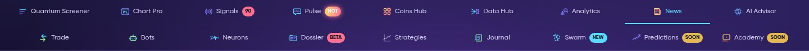<figcaption>
Desktop: row 1 = Find + Read, row 2 = Act + Review.
</figcaption></figure>

<figure>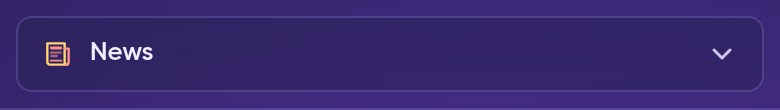<figcaption>
Phone: tap the current tab to open the menu.
</figcaption></figure>

<figure>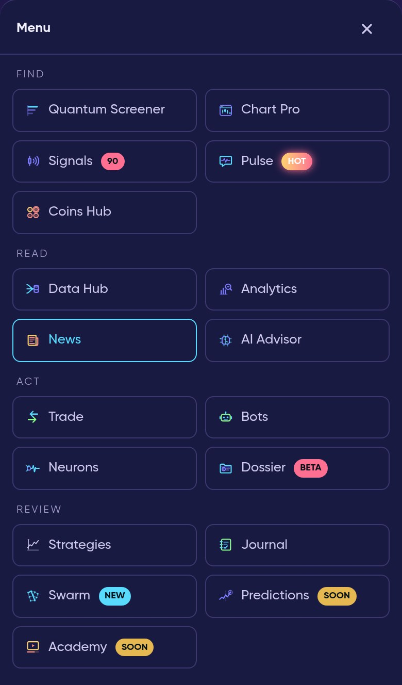<figcaption>
Phone menu: the four groups with their tabs.
</figcaption></figure>

### 📈 Quantum Screener

<figure>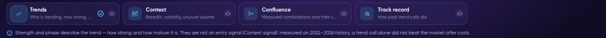<figcaption>
The Quantum Screener sections.
</figcaption></figure>

The home view: which markets are trending, how strong and how mature each trend is, in four sections — **Trends** (the ranked table with Details), **Context** (breadth, volatility, BTC regime, unusual volume), **Confluence** (measured combinations, none Verified yet) and **Track record** (how past calls did, plus *Does a higher score do better?*). Strength and phase describe the trend; they are not an entry signal. The hub's second row holds **Trend**, **Bias Map**, **Mechanical**, **Patterns**, **Radar**, **Hunt**, **Divergences**, **Zone Hunter** and **Heatmaps**.

**[Full guide → Quantum Screener](screener.md)**

### 📊 Chart Pro (Quantum Terminal)

<figure>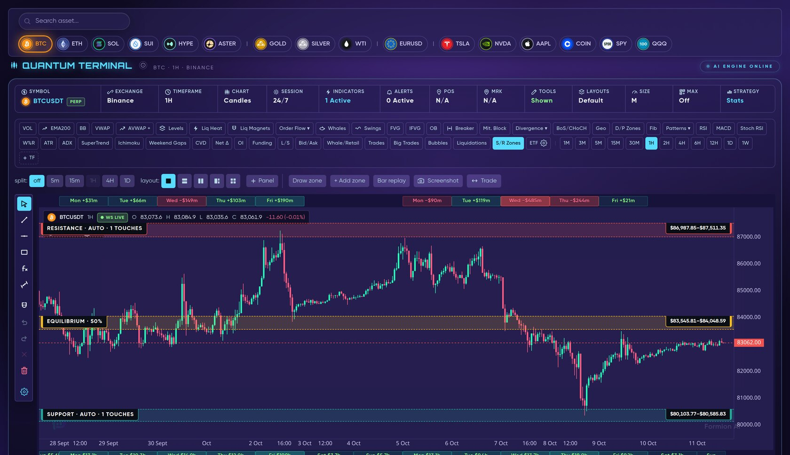<figcaption></figcaption></figure>

A professional chart: live OHLCV, 12 timeframes (1m → 1W), 100+ indicators (incl. the proprietary **FormionTSI**), custom Pine scripts via the **User Indicator Studio**, drawing tools, **replay mode**, multi-chart split view, a **Multi-Chart** screen with up to 8 Formion charts, saved layouts, and an order-flow **Constructor** workspace (volume profile, footprint, DOM ladder, orderbook heatmap, tape and liquidations, spoofing/iceberg detection). A new **HL Trade Intent** pane (preview) shows new longs and new shorts opened on Hyperliquid per bar. Runs on **Quantum Terminal** (Swift + Velocity engines). **[Full guide → Chart Pro](chart-pro.md)**

### 🛰️ Data Hub

<figure>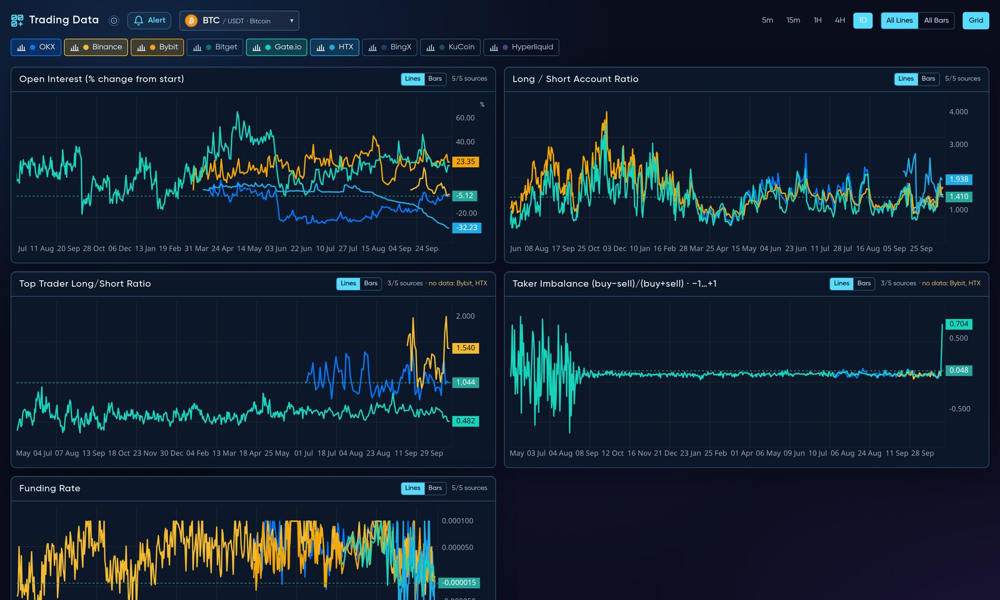<figcaption></figcaption></figure>

Real-time multi-exchange market data: open interest, long/short ratio, top-trader positioning, taker buy/sell delta and funding (OKX, Binance, Bybit, Gate and HTX by default). Plus the **[Liquidity Map](liquidity-map.md)** (recorded resting liquidity across 11 markets) the **Order Book** tab (Book · DOM · Imbalance · Walls), Order Flow, Liquidation Levels and scanners — **Funding**, **OI Surge**, **Divergences**, **Patterns**, **Volatility**, **Options**, **Gamma/GEX**, **Events** and **US Stocks**. **[Full guide → Data Hub](data-hub.md)**

### 🪙 Coins Hub

<figure>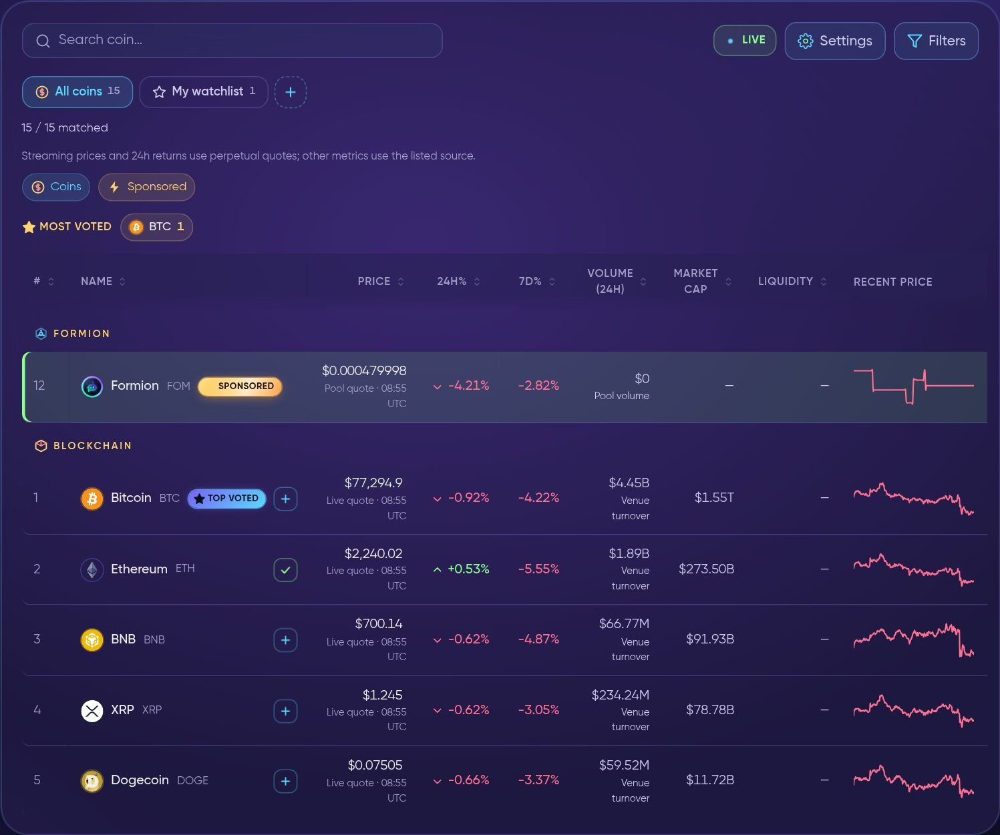<figcaption>
Coins Hub → Dashboard — the live coin table with watchlists.
</figcaption></figure>

**Dashboard** — Trend Watch plus a live coin table (search, filters, watchlists, ST/LT trend scores and a detail page for every coin) — and **Presale Watch** are open to everyone; **Sniper** and **DEX Swaps** need a login. **GMGN** is being rebuilt, and Token Scanner, Smart Wallets, Graduation Radar and Listing Radar are temporarily unavailable while we fix logic errors (Coins Hub is labelled **BETA**). **[📡 Formion Pulse](pulse.md)** has its own tab in the **Find** group. **[Full guide → Coins Hub](coins-hub.md)**

### 🧠 Analytics

<figure>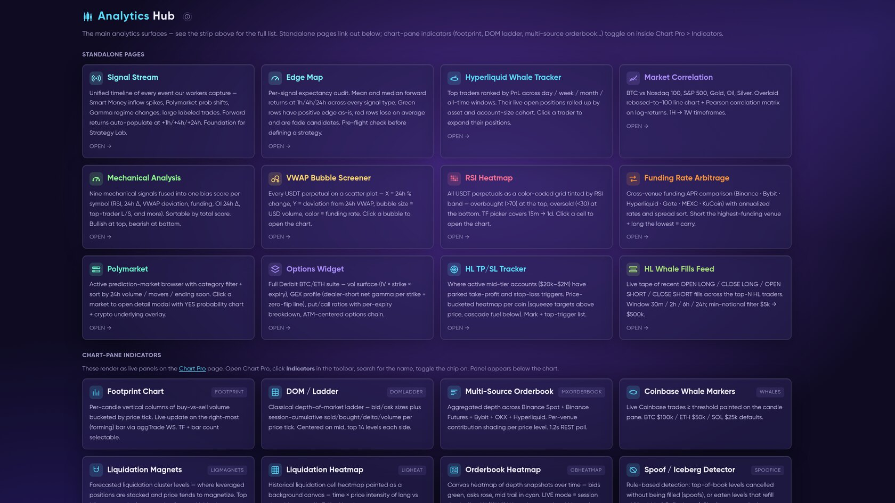<figcaption></figcaption></figure>

A hub of 20+ standalone tools: **Signal Stream** & **Expectancy Map** (per-signal expectancy), **HL Whales** / **HL TP-SL** / **HL Fills** / **HL Directory** / **HL Whale Compass**, **Correlation** (BTC vs Nasdaq/S&P/Gold/Oil), **Premium**, **Spot vs Perp**, **ETF Flows**, **Mechanical**, **Funding Arb**, **Sentiment**, **SmartMoney**, VWAP/RSI/MACD/EMA heatmaps, **AI Brain**, and the **Polymarket** browser + top traders. **[Full guide → Analytics](analytics.md)**

### 🤖 AI Advisor

<figure>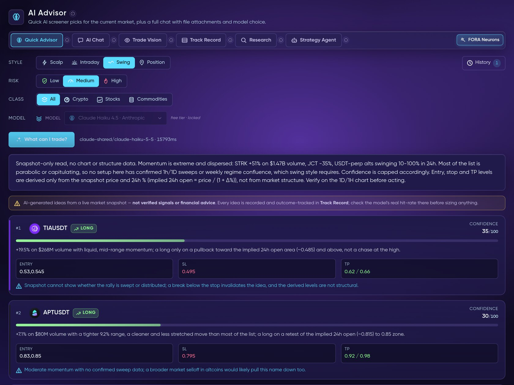<figcaption></figcaption></figure>

Pick a style/risk/asset class and the AI ranks tradeable ideas from a live screener snapshot. Includes free-form **AI Chat** (file attachments, model picker, thinking toggle), **Trade Vision** (screenshot → plan), a **Track Record** of the advisor's past ideas, **Research** (RAG reports + Portfolio Builder) and the **Strategy Agent**.

### 🧬 Neurons

Your always-on FORA watchers have their own menu item in the **Act** group, next to Bots; the green number shows how many are active. The dashboard lists every Neuron with Pause, Edit, Run now and Delete, and a timeline of when each one fired or came close, why and where the message went. See **[FORA Neurons](fora-neurons.md)**.

### 🧪 Strategies (Backtest)

The **Strategies** tab (formerly Backtest) is a hub with many sub-tabs: the **Backtester**, **All Trades** ([Trades History](trades-history.md)) unified across engines, **Trade Ideas**, **[Strategy Lab](strategy-lab.md)** (no-code builder + **Strategy Finder** AutoML + **Marketplace** to publish your strategy and earn), **My Strategies** (backtest your saved strategies), **All Sources**, **Compare**, plus dedicated trackers for **GEX**, **TP/SL strategies**, **Gold DCA**, **Stocks DCA**, **Polymarket**, **Options · Vol**, **Confluence**, **Telegram Signals**, **Setup Backtest** and **Footprint**. (The former **Signalix** tracker is archived: it was retired on 12 Nov 2026 and publishes no more signals.)

### 🔔 Signals

<figure>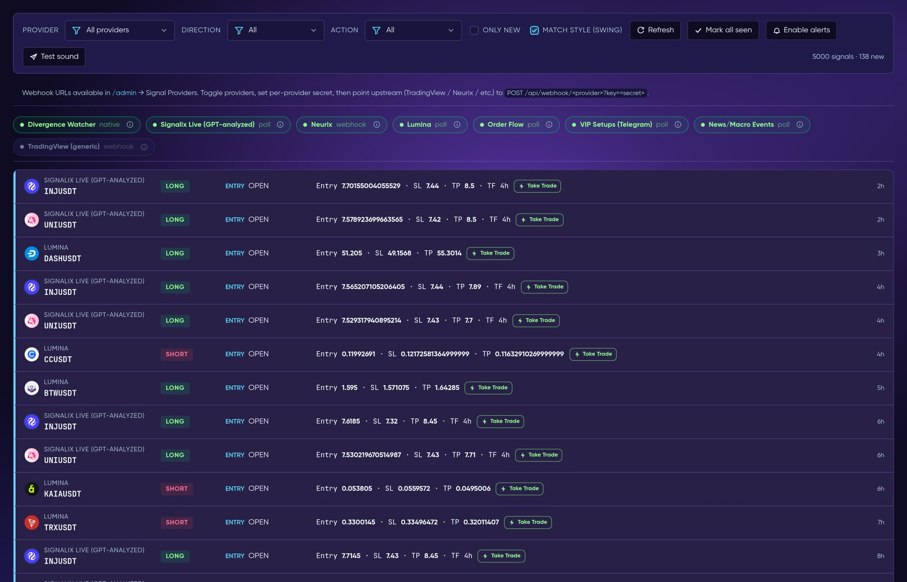<figcaption></figcaption></figure>

A dense live stream of signals from every provider (webhooks + polling), with win/loss coloring, audio + browser notifications, and a **My Alerts** builder for custom price/RSI/SMC/liquidation rules delivered to browser, sound, email or Telegram.

### 📰 News

<figure>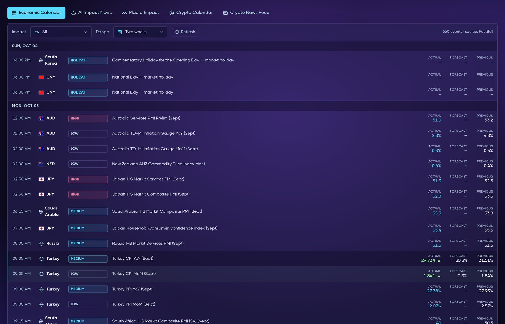<figcaption></figcaption></figure>

Economic calendar (impact-colored), AI-scored impact news (bullish/bearish/neutral), crypto event calendar and a headline feed.

### 💱 Trade

A live order-entry dock: symbol search, size calculator, entry/stop/TP brackets, real-time P&L and position management.

### 🦾 Bots

<figure>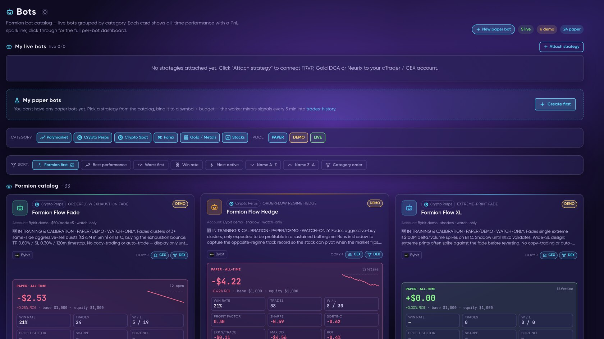<figcaption></figcaption></figure>

The catalog of Formion bots (crypto, gold/metals, forex, stocks, prediction markets…) with their tracked results, plus your own user-built bots under **My Bots**. See **[Bots & Automation](bots.md)**.

### 📓 Journal

Per-trade journaling with notes, tags, screenshots and full performance review, exchange import, an AI review of your trades and P&L share cards. See **[Trading Journal](journal.md)**.

### ⭐ Watchlist

<figure>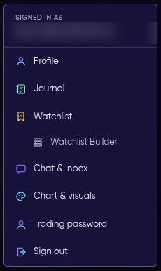<figcaption>
Account menu: Journal, Watchlist and Watchlist Builder sit together.
</figcaption></figure>

The Watchlist is personal, so it moved out of the Screener: open your **account menu** (your name, top right) → **Watchlist** or **Watchlist Builder**. The page has two views, **My list** and **Builder**.

<figure>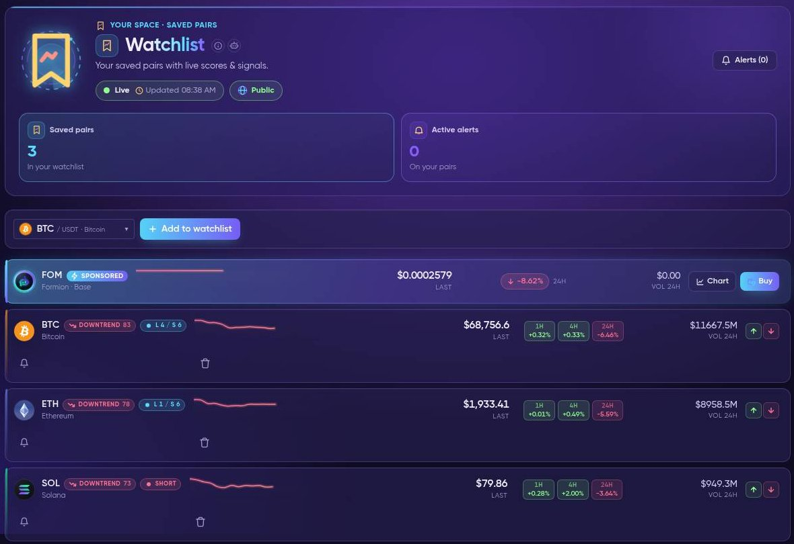<figcaption>
Watchlist → My list: your saved pairs with live price, trend badge, 1h / 4h / 24h change and alerts.
</figcaption></figure>

* **My list** — your saved pairs with live price, a trend badge, 1h / 4h / 24h change and 24h volume; add a pair with **Add to watchlist**, set an alert with the bell, remove it with the bin.
* **Builder** — curate the list against a live multi-timeframe bias matrix.
* The number of watchlist symbols depends on your plan — see **[Pricing & Tiers](pricing.md)**.

### ⚙️ Settings → Live Feed exchange

<figure>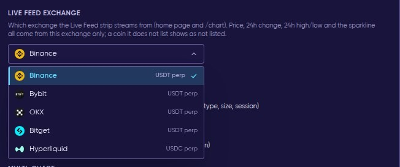<figcaption>
Settings → Live Feed exchange: pick the exchange the Live Feed strip streams from.
</figcaption></figure>

Open **Settings** (the sliders icon at the top) → **Live Feed exchange** to choose where the Live Feed strip (home page and Chart Pro) takes its data from: **Binance** (default), **Bybit**, **OKX**, **Bitget** (USDT perp) or **Hyperliquid** (USDC perp). Price, 24h change, 24h low / high and the sparkline then come from that exchange only; a coin it does not list shows **Not listed on <exchange>**. The green **LIVE** dot shows Live, Delayed or Offline — see **[Quantum Screener](screener.md)**. Your choice is saved with your other settings.

### 🐝 Swarm

Formion's trader social space: post calls, have them graded against real price action, and compare contributors on the leaderboard. See **[Swarm](swarm.md)**.

### 🔜 Coming soon

**Predictions** (an AI price-projection panel) and **Academy** are marked **Soon** in the navigation; a few introductory lessons are already at [formion.ai/academy](https://formion.ai/academy?utm_source=docs&utm_medium=referral&utm_campaign=docs). Funding Carry and spread research are available through the Screener and Analytics workflows.

## Current workflow additions

Use [Command Center](command-center.md) on the formion.ai dashboard to launch FORA, [News](news.md) for macro and crypto events, [Swarm](swarm.md) for trader calls, [Funding Carry](funding-carry.md) for cross-venue research, and [Trades History](trades-history.md) for tracked outcomes. Connect **cTrader forex/CFD brokers** alongside crypto exchanges.

Academy and Predictions are marked **Soon** in the navigation.
