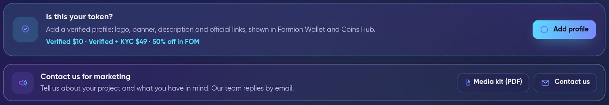
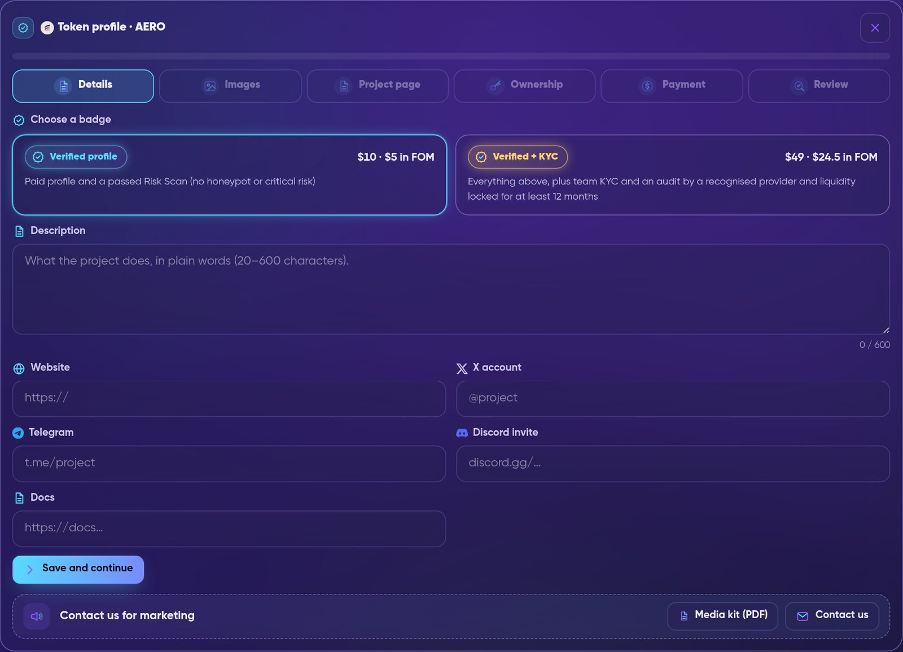

# ⭐ Token Profiles & Promotion

<figure><figcaption>
The "Is this your token?" card and "Contact us for marketing" card under any EVM token in Formion Wallet → Explorer → Tokens.
</figcaption></figure>

This page is for **crypto projects**. If you run a token, you can add an official **token profile** to Formion: a logo, banner, description, official links and a full project page. Traders see it in [Formion Wallet](wallet.md) (Explorer → Tokens → **Profile**) and in the **Token profiles** panel of [Coins Hub](coins-hub.md).

Before a profile goes live, you prove that you control the token and our team reviews it. If you pay for a profile and it passes our checks, it gets a **Verified** badge. Live profiles can also buy clearly labelled promotion.


A profile or badge means the project proved it controls the token and passed our checks. **It is not an endorsement, a guarantee or investment advice.** Formion shows "Verification ≠ endorsement" next to every badge.


## Supported tokens

| Item | Details |
|---|---|
| **Networks** | Base, Ethereum, Arbitrum, BNB Chain (EVM token contracts) |
| **Where it shows** | Formion Wallet → Explorer → Tokens (card + **Profile** tab), Coins Hub "Token profiles" panel, a public share page |
| **Who can submit** | Any signed-in Formion user who can prove control of the token (see [Ownership proof](#ownership-proof)) |
| **Open submissions** | Up to 10 open profiles per account, one open profile per token |

A token that our Risk Scan flags as dangerous (honeypot, "danger" grade or a failed critical check) is never listed.

## How to add a profile

Open your token in Formion Wallet → **Explorer → Tokens** (paste the contract address), then press **Add profile** on the "Is this your token?" card. A step-by-step wizard opens.

<figure><figcaption>
The token profile wizard: six steps, starting with the badge choice and the basic details.
</figcaption></figure>

| Step | What you do |
|---|---|
| **1. Details** | Choose a badge (Verified or Verified + KYC). Write a description (20–600 characters). Add the official website and/or X account, plus Telegram, Discord and Docs if you have them. |
| **2. Images** | Upload a square logo (PNG, JPG or WebP, at least 64×64, up to 2 MB). A banner is optional (at least 600×200, up to 2 MB). We keep our own copy of every image. |
| **3. Project page** | Optional rich page with videos, documents, tokenomics, team, roadmap and more (see [Project page](#project-page)). Changes save automatically. |
| **4. Ownership** | Prove that you control the token. |
| **5. Payment** | Pay on-chain for the badge you chose (see [Prices and payment](#prices-and-payment)). |
| **6. Review** | Send it for review. Our team checks the payment, the ownership proof and the token's Risk Scan. |

When it is approved, the profile shows the status **Live**. If our team asks for changes, you see **Changes requested**. If a paid submission is rejected, the refund goes back to the paying address.

## Ownership proof

Every profile, paid or free, needs an ownership proof. This stops impersonation, for example someone publishing fake links for a real token. Choose one way:

| Method | How it works |
|---|---|
| **Signature** | The token's owner or deployer address signs a message (`personal_sign`). Sign in Formion Wallet, or paste a signature made in another wallet. |
| **Website code** | Put the code we give you in `https://<your-site>/.well-known/formion-verify.txt` or anywhere on the homepage. We check it within about 2 minutes. |
| **X post** | Post the code from the project's official X account and paste the post link. A Formion admin checks it. |


If we cannot find the owner or deployer of your contract, use the website or X method.


## Badges

A badge exists **only when the project paid for it on-chain** and passed the checks for that badge. Free listings show as **Listed profile**, without a badge.

| Badge | Price | Requirements |
|---|---|---|
| **Listed profile** | Free (set by our team) | Ownership proof, admin review and a passed Risk Scan. No verification badge. |
| **Verified profile** (blue) | $10 | Paid profile + a passed Risk Scan (no honeypot and no critical risk). |
| **Verified + KYC** (gold) | $49 | Everything for blue, plus team KYC by a recognised provider, a contract audit by a recognised auditor, and liquidity at least 90% locked or burned on-chain for at least 12 months. |

**KYC and audit.** Formion never does KYC itself and never asks for identity documents. KYC and audits count only through the provider's **public page** on its own site. Our team opens and checks that page.

* **Recognised KYC providers:** SolidProof, CertiK, Assure DeFi, PinkSale KYC, Cyberscope, InterFi Network, Coinsult.
* **Recognised auditors:** SolidProof, CertiK, Hacken, PeckShield, OpenZeppelin, Trail of Bits, Quantstamp, Halborn, Cyberscope, InterFi Network, Coinsult.

**Upgrades.** A live profile can buy a badge later:

* free listing → **Get Blue** ($10) or **Get Gold** ($49);
* paid blue → gold for the **$39 difference**;
* a suspended badge cannot buy an upgrade.

The badge you choose cannot be changed after payment.

### Daily re-check

Every live profile is re-scanned every day. The daily check can **only lower** a badge:

* If a risk flag appears (honeypot, danger grade or a failed critical check), the badge becomes **Verification suspended**.
* If a gold profile's liquidity is no longer locked, it drops to **blue**.
* Missing or partial data never changes a badge.

Only our team can raise a badge again, after a fresh Risk Scan.

Facts shown as chips on a profile come from our own on-chain scan: **KYC**, **Audit**, **LP locked until …** / **LP burned** / **LP locked forever**, **No mint**, **Ownerless** and **Formion partner**.

## Prices and payment

| Item | Price |
|---|---|
| **Verified profile** | $10 |
| **Verified + KYC** | $49 ($39 upgrade from a paid blue) |
| **Updates of a live profile** | Free |
| **Paying in FOM** | 50% off |

* **Networks and coins:** USDC, ETH or [FOM](fom-token.md) on **Base**; USDC or ETH on **Ethereum**. USDT is offered only where it is available in your region.
* **Exact amount:** every quote has a unique amount, and the last digits identify your payment. Send exactly that amount to the address shown. You can pay from Formion Wallet, scan the QR code with any wallet, or paste the transaction hash.
* **Confirmation:** 10 blocks on Base, 12 blocks on Ethereum. We also watch the address and confirm on our own within a few minutes.
* **ETH quotes** are valid for 30 minutes because the price moves. If an ETH payment arrives late and is worth less than the price, our team contacts you. Nothing is lost.
* **FOM price:** the lower of the 7-day and 30-day average price of the FOM/WETH pool on Base.


Payments are on-chain transfers that **you sign in your own wallet**. Formion never asks for your keys and never pulls funds from your wallet. Always check the amount, the network and the receiving address before you send.


## Project page

Open the **Profile** tab of a live token to see its full project page. Every section is optional; fill in what you have.

| Section | What it holds |
|---|---|
| **Basics** | Tagline, long description, category, launch date, 16:5 cover |
| **Media** | Up to 3 YouTube videos (they load from youtube-nocookie.com only after a click) and up to 8 images |
| **Documents** | Whitepaper and pitch deck as PDF (up to 15 MB) or a link, plus a litepaper link. PDFs are checked and cleaned by Formion (no scripts, no attachments) |
| **Links** | GitHub, Medium, CoinGecko, CoinMarketCap, up to 5 audit report links |
| **Tokenomics** | Stated supply, allocation and vesting/unlocks. Our on-chain supply and measured tax sit next to them, with a warning if they differ |
| **Team** | Up to 12 people. Marked "provided by the project"; "Team KYC" shows only for gold profiles |
| **Roadmap** | Phases marked Done / In progress / Planned |
| **Partners** | Partners and backers with logos |
| **Exchanges** | Where to trade: DEX pools from our on-chain index plus exchange links from the project |
| **Contracts** | The same token on other networks (Base, Ethereum, Arbitrum, BNB Chain), each verified on-chain |
| **FAQ** | Up to 15 questions and answers |

**Checked by Formion.** The badge, on-chain facts, Risk Scan and market data come from our own checks. The project cannot edit them.

**Updates and events.** Projects can post short news, events or AMAs to their page. Our team approves each post before it appears.

## Editing a live profile

Open **My token profiles** and choose **Update profile**. You can change the logo, banner, links, description or project page.

* Updates are **free**. Our team reviews them again.
* Your live profile stays as it is until the update is approved.
* A **new ownership proof** is needed only if you add or change links (website, socials, docs, project/audit/exchange/document/team/partner links, links in texts) or contracts on other networks. Otherwise the existing proof carries over.
* A profile can be updated up to **3 times in 30 days**.

## Share page

Every live profile has a public share page:

`https://formion.ai/t/<chain>/<contract>`

It comes with a preview card for X, Telegram and Discord and is available in 11 languages. The **Share** button on the Profile tab copies this link. The badge and facts on it come from the live profile and are never recalculated.

## Promotion

Projects with a **live profile they own** and a **safe Risk Scan** can buy paid placements. Open **Explorer → Tokens → My token profiles → Promote**. Payment uses the same flow as profiles ([Prices and payment](#prices-and-payment)), including 50% off in FOM.

| Product | Price | What you get |
|---|---|---|
| **Boost · 24 hours** | $49 | Top of Discover and the Coins Hub, labelled Sponsored. Max 3 boosted tokens at once (shared with 7-day boosts). |
| **Boost · 7 days** | $199 | Same as above for a week. |
| **Coins Hub listing** | $99 | A full token card in the app.formion.ai Coins Hub: price, chart, Risk Scan and your profile link. |
| **Banner · 1 week** | $149 | Banner at the top of Discover and the Coins Hub, labelled Ad. Max 2 at once. Desktop 1600×400 and mobile 800×400 (PNG, JPEG or WebP, max 2 MB, never SVG). |
| **Project of the day** | $99 | Your own Spotlight card in the wallet for one day. One project per day. |
| **Sponsored post** | $199 | One post on X, our Telegram channel and group, tagged #ad. Our team approves the text. Max 2 per week. |
| **AMA in our Telegram group** | $299 | You book a date and time (at least 2 hours ahead); our team confirms it. A summary post follows, also approved by our team. |
| **Project Spotlight video** | $499 | A narrated video about your project, delivered to you and published on our channels on a booked Saturday (one per Saturday, booked at least 3 days ahead), labelled Sponsored. |
| **Mention in our weekly video** | $149 | A 10–15 s segment in the Sunday weekly recap, labelled Sponsored. One per week. |
| **Opt-in alert** | $149 | Push or Telegram message only to users who opted in to sponsored alerts. One per day. |
| **Newsletter feature** | $199 | A sponsored block in the Formion member newsletter, sent only to members who agreed to marketing email. Max 2 per week. |
| **Project Pro · 1 month** | $49 | Owner dashboard: profile views, link clicks, followers, holder growth, big buys and sells, top traders, weekly report. |

If a slot is booked out, the next free slot is shown. Our team reviews every paid order before it goes live, and the slot can move to the next free one.

### Promotion rules

Every buyer accepts these terms with each order:

* **Labelled.** Every paid placement is clearly labelled **Sponsored** or **Ad**; posts carry **#ad**.
* **Payment buys visibility only.** It never changes FORA, signals, Risk Scan, badges or any ranking. Sponsored items are shown in their own blocks and never mixed into organic lists.
* **Safe tokens only.** We re-check promoted tokens every day. If a risk appears, the placement is switched off at once, **without a refund**.
* **No promises.** Our team approves every text: no profit or price promises. Marketing services carry no guarantee of price, volume, reach or results.
* **Regions.** Paid placements are not shown to visitors in the United Kingdom (including Guernsey, Jersey and the Isle of Man), or when the visitor's country cannot be determined.

## Media kit and marketing contact

* **Media kit:** [formion.ai/media-kit](https://formion.ai/media-kit) — badges, project page, promotion menu with prices, rules and how to order (PDF download: [formion.ai/media-kit.pdf](https://formion.ai/media-kit.pdf)).
* **Contact us for marketing:** open your token in Formion Wallet → Explorer → Tokens and press **Contact us** on the "Contact us for marketing" card. You can also open a ticket at [formion.ai/support](https://formion.ai/support) with the category **Marketing**. Our team replies by email.

## Related pages

<table data-view="cards"><thead><tr><th></th><th></th><th data-hidden data-card-target data-type="content-ref"></th></tr></thead><tbody>
<tr><td><strong>🪙 Coins Hub</strong></td><td>Where traders discover tokens, including the Token profiles panel.</td><td><a href="coins-hub.md">coins-hub.md</a></td></tr>
<tr><td><strong>🪙 FOM token</strong></td><td>Pay for profiles and promotion in FOM at 50% off.</td><td><a href="fom-token.md">fom-token.md</a></td></tr>
<tr><td><strong>🤝 Partner Program</strong></td><td>For creators and communities who send traders to Formion.</td><td><a href="partners.md">partners.md</a></td></tr>
<tr><td><strong>🔐 Security</strong></td><td>How Formion protects accounts and wallets.</td><td><a href="security.md">security.md</a></td></tr>
</tbody></table>
