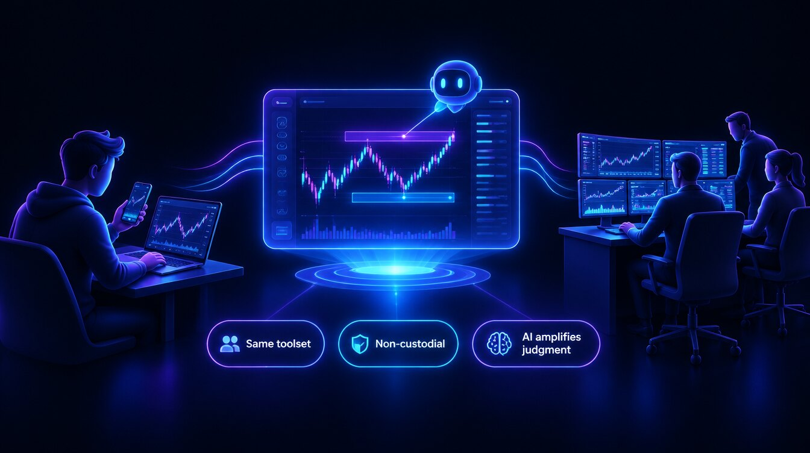

# 🪄 Vision

<figure><figcaption></figcaption></figure>

A world where a retail trader and an institutional desk work from the **same toolset** — where AI amplifies judgment instead of replacing it, execution friction disappears, and a strategy you sketch on Tuesday can be backtested, walk-forward-validated, paper-traded and run live without writing code.

### Principles

* **Accessibility** — professional-grade multi-asset tools, drivable from a phone or Telegram, usable by beginners and pros alike.
* **Transparency** — detailed analytics on every bot, signal and strategy; performance and risk shown honestly, including what didn't work.
* **Non-custodial by default** — your funds and keys stay yours; Formion never holds or withdraws. The one opt-in exception is Dossier Autopilot, which trades from a separate auto-trade wallet whose key is held by the Formion signer.
* **AI that amplifies** — the AI does the heavy lifting (scanning, scoring, drafting), the trader stays in control of every decision.
* **Multi-asset, multi-venue** — one workflow across crypto, forex, stocks, commodities, options and prediction markets.

### Where we're going

* **Closer parity across web, mobile and Telegram** — today Formion runs in your phone's browser (add it to your home screen) and FORA works in Telegram.
* **Native Formion copy-trading** for selected bots (today you can copy via your exchange, e.g. Bybit).
* **A strategy marketplace** where builders list and monetize strategies.
* **Community programme governance** via the FOM token, once governance ships (never a vote on Formion as a company).
* **The FORA Agent** — FOM-unlocked agent levels, from a browser agent that drives the chart up to autonomous trading on your own accounts within your risk caps (see [FOM](fom-token.md)).

This is directional — for what's live today, see **[The App](the-app.md)**; for the sequence, see the **[Roadmap](roadmap.md)**.

## Current product context

The workflow includes cTrader forex/CFD broker accounts alongside crypto venues, and FORA text and realtime voice from the dashboard Command Center. FOM access levels are a phased utility model on Base — reached by holding FOM (and, once the lock contract is live, by locking it) — and the higher levels include a USD platform licence. See [The App](the-app.md) and [FOM](fom-token.md).
