# 🧩 Formion Wallet for Chrome (2.0)

**Formion Wallet for Chrome** is the full [Formion Wallet](wallet.md) as a Chrome extension. Version 2.0 brings the web wallet's tools into the browser: ten networks with one recovery phrase, swaps and bridges including native Bitcoin, Hyperliquid, staking, FOM Lock, orders, gas in USDC, an address book and send protection. Every site connection, signature and transaction opens a Formion review window first.


**Your keys stay on your device.** The recovery phrase and private keys are created, encrypted and used only inside the extension in this browser. Formion never sees or stores them, never holds your funds and cannot recover a lost phrase. Bridges, staking and trading use third-party protocols: start with small amounts.


<table data-view="cards"><thead><tr><th></th><th></th><th data-hidden data-card-target data-type="content-ref"></th></tr></thead><tbody>
<tr><td><strong>⬇️ Install & create</strong></td><td>Add it from the Chrome Web Store, pin it, then create a wallet or import MetaMask, Phantom or Trust Wallet.</td><td><a href="wallet-extension.md#install">wallet-extension.md</a></td></tr>
<tr><td><strong>🌐 10 networks</strong></td><td>Bitcoin, Ethereum, Base, Arbitrum, BNB Chain, Solana, Tron, Sui, HyperEVM and Hyperliquid.</td><td><a href="wallet-extension.md#networks-and-accounts">wallet-extension.md</a></td></tr>
<tr><td><strong>🔄 Swap & Bitcoin bridge</strong></td><td>Best-route swaps, USDC bridges and native BTC on your own address — now also from BNB Chain.</td><td><a href="wallet-extension.md#swap-and-bridge">wallet-extension.md</a></td></tr>
<tr><td><strong>🌊 Hyperliquid</strong></td><td>Perps and spot signed with your own key, with chart, order book and TP / SL.</td><td><a href="wallet-extension.md#hyperliquid">wallet-extension.md</a></td></tr>
<tr><td><strong>💰 Earn & gas in USDC</strong></td><td>Staking, FOM/WETH liquidity, FOM Lock (Beta), and network fees paid in USDC on Base.</td><td><a href="wallet-extension.md#earn">wallet-extension.md</a></td></tr>
<tr><td><strong>🛡️ Protection</strong></td><td>Review window with simulation, send protection, address book and passkey unlock.</td><td><a href="wallet-extension.md#security">wallet-extension.md</a></td></tr>
</tbody></table>

<figure><video src=".gitbook/assets/rec-ext-tour.mp4" title="Live recording of Formion Wallet for Chrome 2.0 with a test wallet: home, other networks, Formion tools and the Swap screen."></video><figcaption>
Live recording of the extension with a test wallet: home, other networks, Formion tools and Swap.
</figcaption></figure>

## Install

<figure><video src=".gitbook/assets/clip-ext-install.mp4" title="Install Formion Wallet from the Chrome Web Store, pin it, choose popup or side panel, then create a wallet or import a recovery phrase."></video><figcaption>
Install, pin, choose popup or side panel, then create or import.
</figcaption></figure>

1. Open **Formion Wallet** on the [Chrome Web Store](https://chromewebstore.google.com/detail/formion-wallet/dkmpdbcfnenlobgkbmnahkhblogebhmj) and click **Add to Chrome**, then **Add extension**. Install only from this official listing; updates then install automatically.
2. Click the puzzle icon in the Chrome toolbar and **pin** Formion Wallet.
3. Click the Formion icon. Choose **Create a new wallet** or **Import MetaMask, Phantom, Trust…**.
4. Set a wallet password. It encrypts the vault in this browser and unlocks the extension.

| Option | What happens |
| --- | --- |
| **Create a new wallet** | A fresh recovery phrase made on your device. Write it on paper and keep it offline. |
| **Import a recovery phrase** | Paste the phrase from MetaMask, Phantom, Trust Wallet or another wallet. The extension uses the same derivation paths, so you see the same addresses. |
| **Password** | Encrypts the vault on this device. Formion cannot reset it; the recovery phrase is the only way back. |


Formion will never ask for your recovery phrase — not by email, chat, Telegram or support. Anyone who has it controls your funds.


### Popup or side panel

The extension opens as a **popup** from the toolbar. The side-panel button at the top keeps the wallet open in Chrome's **side panel** next to every page (Chrome 116 or newer). Switch back to the popup at any time.

## Networks and accounts

<figure>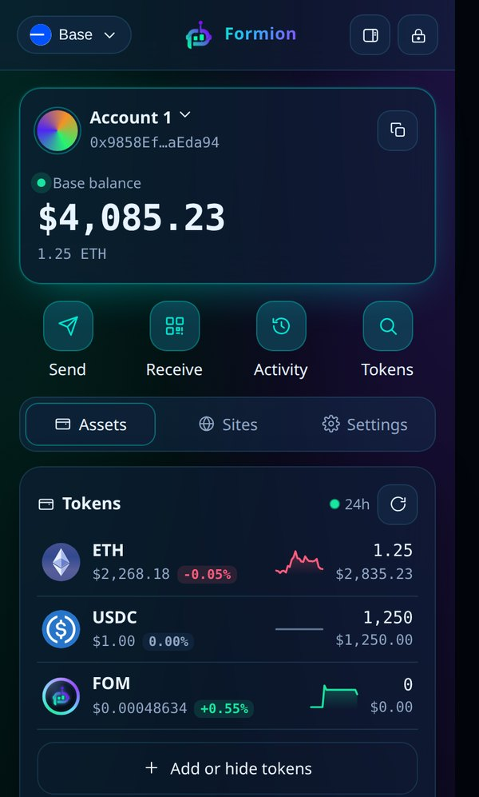<figcaption>
Home: your balance on the selected network, the main actions and your tokens with 24-hour change.
</figcaption></figure>

* **Networks:** Ethereum, Base, Arbitrum, BNB Chain, HyperEVM, Bitcoin, Solana, Tron, Sui and Hyperliquid — all from **one recovery phrase**. One EVM address works on every EVM network; Bitcoin, Solana, Tron and Sui each have their own address.
* **Other networks** on the home screen show balances, prices and 24-hour change for Bitcoin, Solana, Tron and Sui.
* **Accounts:** add Account 1, 2, 3… from the same phrase, plus **watch-only** addresses.
* **Tokens:** add any token by contract address, or tick it from the popular list. NFTs can be viewed and sent.

<figure>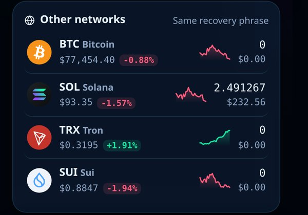<figcaption>
Other networks: Bitcoin, Solana, Tron and Sui on the same recovery phrase.
</figcaption></figure>

## Send and receive

* **Send** works for every network's coin and tokens. You see the network fee before you confirm, and the review window shows what leaves and what arrives.
* **Address book** on every network, including Bitcoin and BNB Chain. Each contact has a type (private person, exchange (CEX) and more) and a note. Import and export as CSV or JSON. Pick a contact in every recipient field.
* **`.fom` names** resolve in every recipient field.
* **Send to many:** paste a list or upload a CSV, on EVM networks and Solana.
* **Request:** create a payment request with an amount, note and QR code.
* **Clipboard guard:** if the pasted address differs from the one you just copied, the wallet stops and warns you. It also warns about look-alike addresses.

<figure>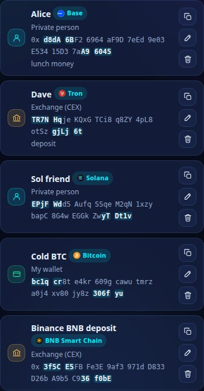<figcaption>
Address book: contacts on every network, with type and note. The addresses shown are examples.
</figcaption></figure>

<figure><video src=".gitbook/assets/rec-ext-send-book.mp4" title="Live recording: Send, pick a saved contact from the address book, type an amount and see the review before anything is signed."></video><figcaption>
Live recording: send to a saved contact — nothing is signed before you confirm.
</figcaption></figure>

## Swap and bridge

Open **Formion tools** on the home screen.

| Tool | What it does |
| --- | --- |
| **Swap** | Best-route swaps on Ethereum, Base, Arbitrum, BNB Chain, Solana, Sui, Tron and HyperEVM. |
| **Bridge** | USDC between networks with Circle CCTP, and verified routes between EVM networks. |
| **Bridge to / from Bitcoin** (Beta) | Turn USDC, ETH, FOM, cbBTC, SOL and more into **native BTC** on your own `bc1q…` address — and BTC back into USDC on Base, Solana, Ethereum, Arbitrum, **BNB Chain** or HyperEVM. |

Before you sign, the wallet checks the route: your own address as the receiver, only allowed contracts, and the guaranteed minimum. Token approvals are always for the exact amount, never unlimited.

<figure>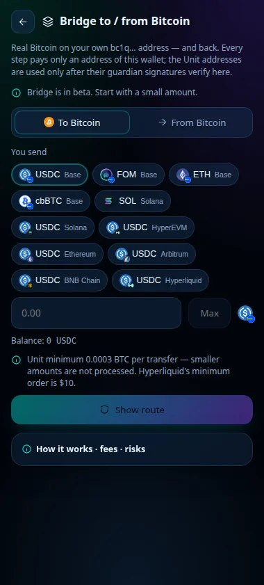<figcaption>
Bridge to / from Bitcoin: pick what you send, including USDC on BNB Chain.
</figcaption></figure>

<figure><video src=".gitbook/assets/clip-ext-btc-bridge.mp4" title="Bitcoin bridge in steps: choose To Bitcoin, pick the source token and network, enter the amount, show the route, review and sign; BTC arrives on your own bc1q address."></video><figcaption>
Bitcoin bridge step by step (DEMO values).
</figcaption></figure>

**How the Bitcoin bridge works**

1. Open **Bridge to / from Bitcoin** and choose **To Bitcoin** or **From Bitcoin**.
2. Pick the token and network you send.
3. Enter the amount. The minimum is **0.0003 BTC per transfer**; smaller amounts are not processed.
4. Click **Show route**. You see the steps, fees and expected time before you sign.
5. Review and sign in the Formion window. Every step pays only an address of this wallet; the bridge's deposit addresses are used only after **2 of 3 guardian signatures** are verified inside the extension. Formion takes no fee.


The Bitcoin bridge is in **Beta**. Start with a small amount. Sending from BNB Chain needs a little BNB for gas on BNB Chain.


## Hyperliquid

Open **Hyperliquid** in Formion tools to trade perps and spot straight from the extension, signed with your own key — no separate account and no custody.

* Perps with **take profit / stop loss**, market and limit orders, cross or isolated margin.
* **Spot** trading, collateral (borrow USDC against BTC or HYPE) and funding history.
* Deposit and withdraw to the token and network you choose; moves to and from **HyperEVM**.
* Live chart, order book and trades.
* **Auto-move** in the extension only suggests a move and opens an approval window — nothing moves without your click.

<figure><video src=".gitbook/assets/rec-ext-staking-hl.mp4" title="Live recording with a test wallet: Staking (Solana native, JitoSOL, Sui), then Hyperliquid and its Markets list."></video><figcaption>
Live recording: Staking, then Hyperliquid markets.
</figcaption></figure>

<figure>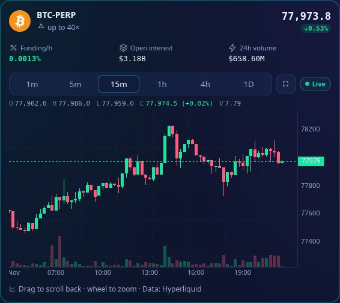<figcaption>
Hyperliquid market: funding, open interest, volume and the live chart.
</figcaption></figure>

<figure>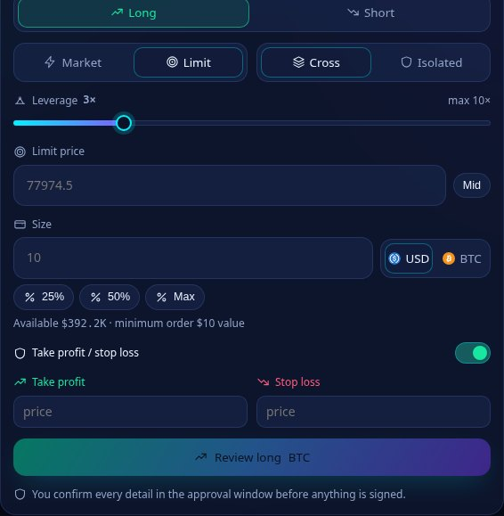<figcaption>
Order ticket: you confirm every detail in the approval window before anything is signed.
</figcaption></figure>

Fees, routes, collateral and liquidation are explained in **[Hyperliquid in Formion Wallet](hyperliquid-faq.md)**. Leverage can lose more than you expect, and positions can be liquidated.

## Earn

| Product | What it is |
| --- | --- |
| **Staking** | Native **SOL** (delegate to a validator), **JitoSOL** liquid staking, native **SUI** and **ETH with Lido** (stETH). Your coins stay on your own address; Formion never holds them and takes no fee. |
| **FOM/WETH liquidity** | Add FOM and ETH to the official Uniswap v3 pool on Base (1% fee tier), collect fees or remove liquidity. Impermanent loss applies. |
| **FOM Lock** (Beta) | Lock FOM on Base to reach a FORA level. See **[FOM Hold vs Lock](fom-hold-vs-lock.md)**. |

<figure>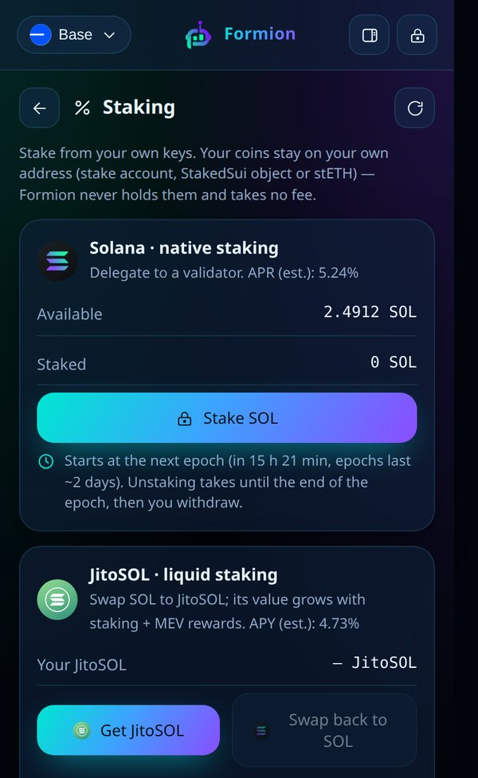<figcaption>
Staking: you sign every step; APR is an estimate and changes every epoch.
</figcaption></figure>

<figure>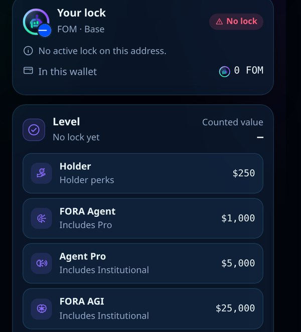<figcaption>
FOM Lock (Beta): your lock and the level it counts toward.
</figcaption></figure>

Yields and fees depend on the market and are never guaranteed.

## Gas in USDC

No ETH on Base? Send a token anyway — the network fee is paid in **USDC** through Circle Paymaster.

1. Start a send on Base with no ETH. The wallet offers **Pay the network fee in USDC**.
2. You see the maximum fee before you sign. Circle adds 10% on Base. Unused USDC is refunded in the same transaction.
3. The first time, your address gets a one-time smart-account upgrade (EIP-7702). Same address, same recovery phrase. Regular sends with ETH keep working.

Nothing is signed before you click **Confirm**.

<figure>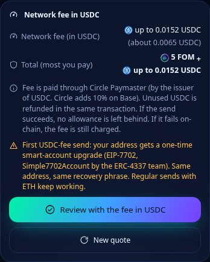<figcaption>
Network fee in USDC: the maximum is shown before you sign.
</figcaption></figure>

## Orders, history and tools

* **Orders:** DCA, limit and grid orders — Jupiter on Solana, CoW Protocol on EVM networks — plus Formion Auto Orders and DCA reminders. See **[Orders and DCA](wallet.md#orders-and-dca)**.
* **History** with CSV export and a PDF report; **review and revoke token approvals**.
* **Discover, token pages, Radar, FOM Explorer and Risk Scan** for any contract.

## Connect to a dApp

The extension is a standard wallet for websites:

* **EVM sites:** it appears as **Formion Wallet** in the site's wallet list (EIP-6963, EIP-1193).
* **Solana sites:** it appears in the Solana wallet list (Wallet Standard).
* **WalletConnect:** paste a `wc:` link or scan the QR code in **Formion tools → WalletConnect**.

1. On the site, click **Connect wallet** and choose **Formion Wallet**.
2. The Formion window shows the site, its security (HTTPS) and what it will be able to do. Click **Connect** or **Reject**.
3. Every later signature or transaction opens the same window with a preview of what leaves and what arrives. Nothing is approved automatically.
4. See and remove connected sites in the **Sites** tab.

<figure><video src=".gitbook/assets/rec-ext-connect.mp4" title="Live recording with a local DEMO test dApp: Connect wallet opens the Formion window, Connect, then Sign message shows the text to sign, Sign."></video><figcaption>
Live recording with a local DEMO test dApp: connect, then sign a message — each step in the Formion window.
</figcaption></figure>

Raw `eth_sign` requests are always refused. Known phishing sites and risky tokens are flagged.

## Optional: connect your Formion account

The wallet works fully without a Formion account. Linking your free account adds the account features: **Insights** (P&L per token and reports), **alerts** (price alerts, incoming payments, reminders and the Whale Tracker as browser notifications), **exchange balances** in your net worth, `.fom` name registration, token profiles and promotion for projects. Beta features follow your Formion plan.

1. Open **Settings → Formion account** and click **Connect Formion account**.
2. Click **Open page**, sign in to formion.ai if asked, type the code shown in the extension and approve. The code is valid for 10 minutes; the extension finishes by itself.
3. To unlink, click **Disconnect account**. The link also expires after 30 days.

The link can **never sign or move funds**. Your keys stay in this browser; Formion only learns that this extension belongs to your account.

<figure>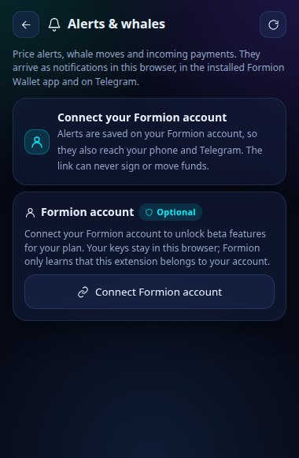<figcaption>
Account features show a "Connect your Formion account" card until you link it.
</figcaption></figure>

## Security

| Protection | What it does |
| --- | --- |
| **Review window** | Every connection, message and transaction opens a Formion window first, with a simulation preview of what leaves and what arrives. |
| **Send protection** | A daily send limit in USD, a password prompt above an amount you choose, or sending only to your address book and own accounts. It applies to every way value can leave the wallet. |
| **Passkey unlock** | Optional fingerprint, face or device PIN instead of typing the password. It works only on this device for this extension; your password stays as the backup. |
| **Blind signing blocked** | Raw `eth_sign` is always refused; phishing sites and risky tokens are flagged. |
| **Auto-lock** | The wallet locks itself after a period of inactivity, and you can lock it at any time with the lock button. |

<figure>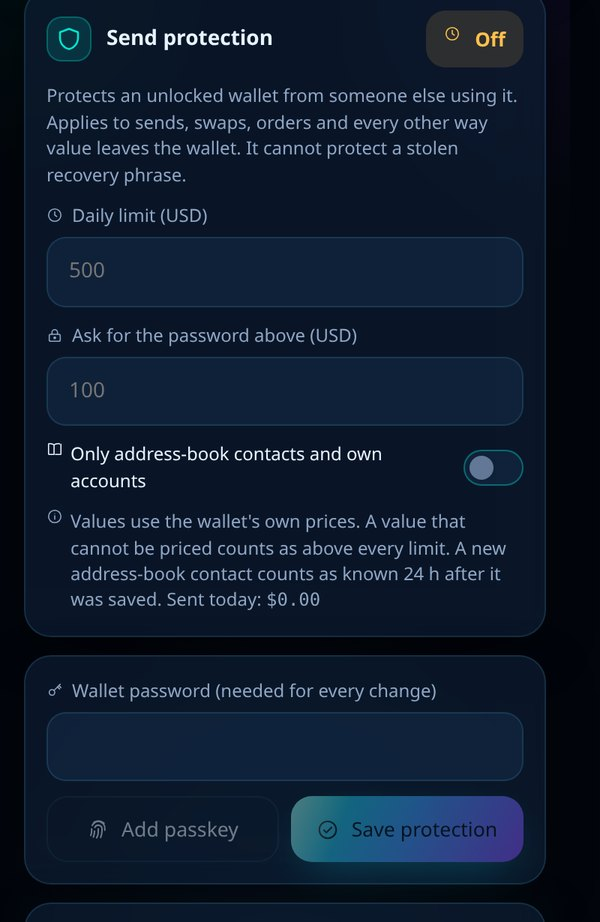<figcaption>
Send protection: limits apply to sends, swaps, orders and every other way value leaves the wallet.
</figcaption></figure>

<figure>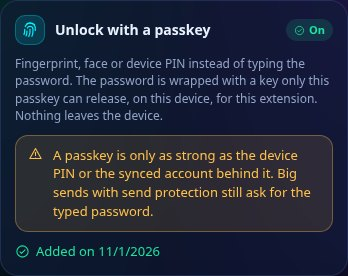<figcaption>
Passkey unlock: big sends with send protection still ask for the typed password.
</figcaption></figure>


The **passkey account** (a Safe smart account controlled by a passkey) is available only on [wallet.formion.ai](https://wallet.formion.ai): a passkey is tied to the website's domain. The extension explains this and links there.


## Languages and theme

The extension speaks **11 languages**: English, Español, Français, Português, Русский, Deutsch, Türkçe, Italiano, Polski, Srpski and Hrvatski. It follows your browser language, and you can change it in **Settings**, together with the dark, light or Formion theme. Recovery phrases always use the official English BIP39 words.

## Privacy and support

* **Privacy policy:** [formion.ai/extension/privacy](https://formion.ai/extension/privacy) — exactly what the extension stores and sends.
* **Help:** [formion.ai/support](https://formion.ai/support) or **support@formion.ai**.
* **Web wallet:** [wallet.formion.ai](https://wallet.formion.ai) — the same wallet in any browser and on your phone.


Some money features (for example USDT payments and deposits) are available only where allowed. Nothing in the wallet is investment advice.

