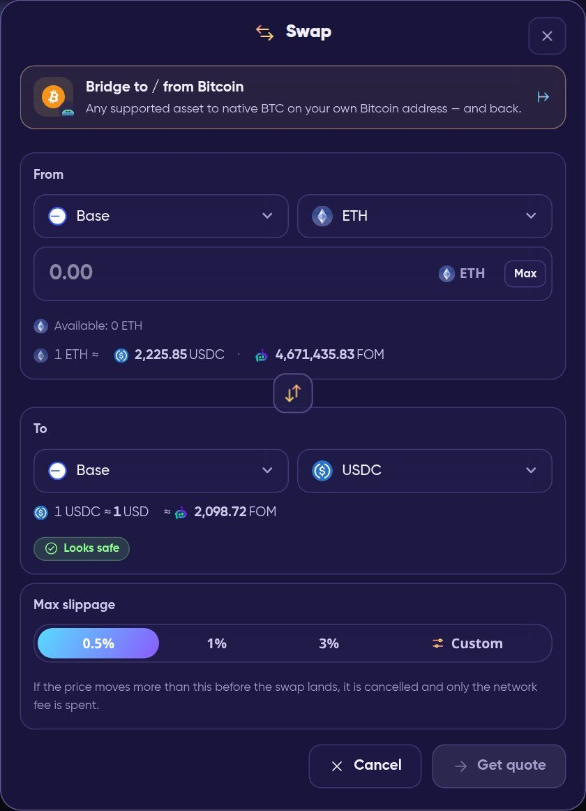
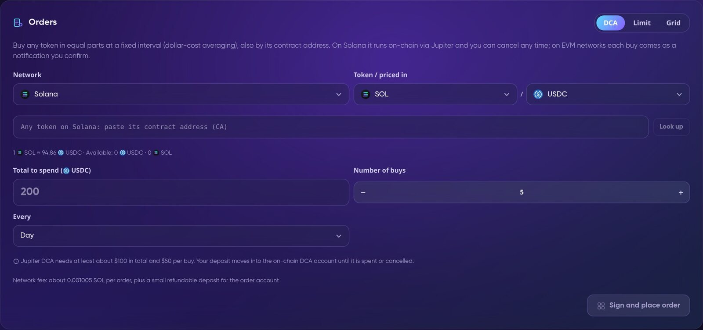
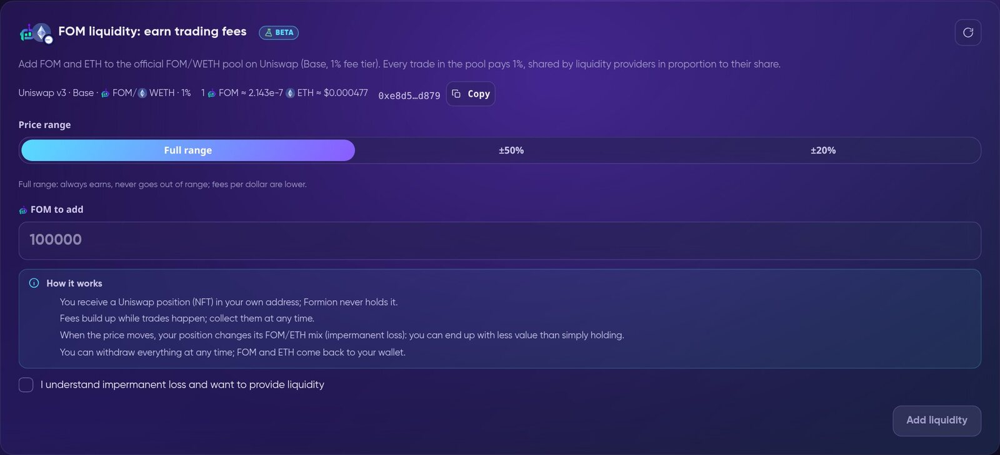
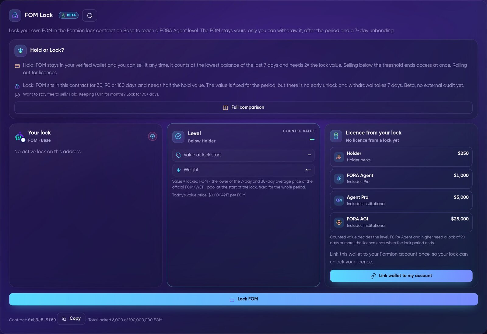
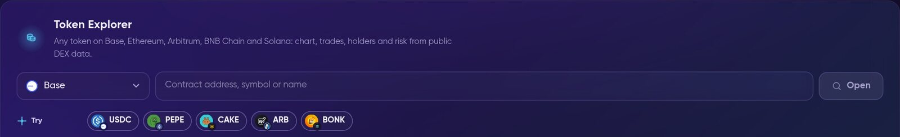
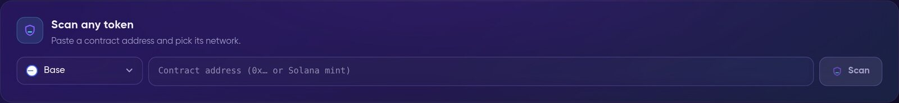
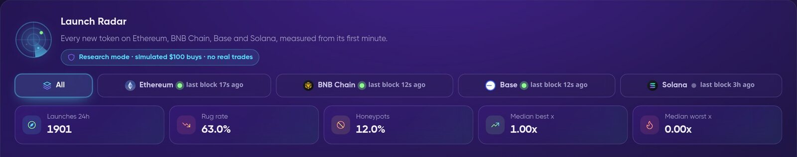
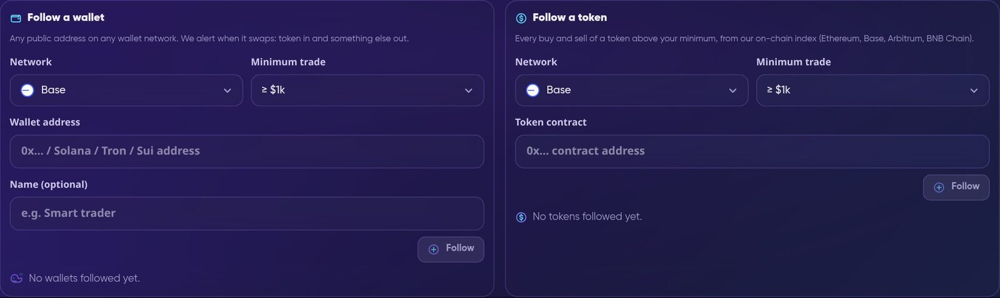

# 👛 Formion Wallet

**Formion Wallet** ([wallet.formion.ai](https://wallet.formion.ai)) is Formion's self-custody wallet for Ethereum, Base, Arbitrum, BNB Chain, Solana, Tron, Sui, HyperEVM and Bitcoin. You can send, swap, bridge, set orders, earn, trade on Hyperliquid and research any token from one screen.


**Your keys stay in your browser.** Your recovery phrase and private keys are created, encrypted and used only in your browser. Formion never sees or stores them and cannot recover them. Formion never holds your funds. You review and sign every transaction yourself. If you lose the recovery phrase, nobody can restore the wallet, including Formion.


<table data-view="cards"><thead><tr><th></th><th></th><th data-hidden data-card-target data-type="content-ref"></th></tr></thead><tbody>
<tr><td><strong>🔑 Create & import</strong></td><td>A new 12 or 24-word phrase, or your MetaMask, Phantom or Trust Wallet phrase. Nine networks, many accounts.</td><td><a href="wallet.md#create-or-import">wallet.md</a></td></tr>
<tr><td><strong>📤 Send & receive</strong></td><td>Checks who you are sending to, warns you if the clipboard changed, payment requests with QR codes, and sending to many people at once.</td><td><a href="wallet.md#send-and-receive">wallet.md</a></td></tr>
<tr><td><strong>🔄 Swap & bridge</strong></td><td>Best-route swaps on each network and across networks, Circle CCTP for USDC, and a bridge to and from Bitcoin.</td><td><a href="wallet.md#swap-and-bridge">wallet.md</a></td></tr>
<tr><td><strong>⏱️ Orders</strong></td><td>DCA, limit and grid orders. Formion Auto Orders run them automatically on Base.</td><td><a href="wallet.md#orders-and-dca">wallet.md</a></td></tr>
<tr><td><strong>💰 Earn</strong></td><td>Native and liquid staking, FOM/WETH liquidity, and FOM Lock (Beta).</td><td><a href="wallet.md#earn">wallet.md</a></td></tr>
<tr><td><strong>🌊 Perps</strong></td><td>Hyperliquid perps and spot, traded from your own wallet (Beta).</td><td><a href="wallet.md#hyperliquid-perps">wallet.md</a></td></tr>
<tr><td><strong>🔍 Explorer & Radar</strong></td><td>Token Explorer, Token Risk Scan, FOM Explorer and Launch Radar for new tokens.</td><td><a href="wallet.md#explorer-and-risk-scan">wallet.md</a></td></tr>
<tr><td><strong>🐋 Alerts & whales</strong></td><td>Whale Tracker, price alerts, incoming-payment alerts and payment reminders.</td><td><a href="wallet.md#whales-and-alerts">wallet.md</a></td></tr>
<tr><td><strong>🔐 Security</strong></td><td>Fingerprint or face unlock, send protection, a preview of every transaction before you sign, and revoking token approvals.</td><td><a href="wallet.md#security">wallet.md</a></td></tr>
</tbody></table>


**Beta** means a feature is live with real money but still being built and tested. In the wallet it carries a **Beta** label. Start with small amounts.


<figure><video src=".gitbook/assets/rec-wallet-tour.mp4" title="Live recording with a fresh, never-funded test wallet: home, a Swap quote (0.05 ETH → USDC, never signed — the preview warns the empty wallet has no gas), Hyperliquid Perps, then Earn with FOM Lock."></video><figcaption>
Live recording with a fresh, never-funded test wallet: home, a Swap quote (0.05 ETH → USDC, never signed — the preview warns the empty wallet has no gas), Hyperliquid Perps, then Earn with FOM Lock.
</figcaption></figure>

## Create or import

| Option | What happens |
| --- | --- |
| **Create a new wallet** | You get a fresh 12 or 24-word recovery phrase. It mixes two independent random sources, and you can add your own dice rolls. A short quiz checks that you wrote it down. |
| **Import recovery phrase** | Pick where the phrase comes from: MetaMask, Phantom, Trust Wallet or another wallet. The wallet uses the same derivation paths, so you see the same addresses. It then shows which accounts were already used. |
| **Import private key** | An EVM/Tron key or a Solana key. It covers only that network family. |
| **Password** | Encrypts the vault on this device with AES-256 and 600,000 PBKDF2 rounds. It unlocks the wallet only in this browser. |

* **Networks:** Ethereum, Base, Arbitrum, BNB Chain, Solana, Tron, Sui, **HyperEVM** (Beta) and **Bitcoin** (Beta). One EVM address works on all EVM networks. Solana, Tron, Sui and Bitcoin each have their own address. You can hide networks you do not use in **Settings → Networks**.
* **Bitcoin** gets a Native SegWit (BIP84) address from your recovery phrase. It is the same address Sparrow, Electrum, Trust Wallet and Ledger show for that phrase. Wallets imported from a single private key have no Bitcoin address.
* **Accounts:** add Account 1, 2, 3… from the same phrase, like in MetaMask or Phantom.
* Recovery phrases always use the official English BIP39 words, in every language of the app.
* The wallet locks itself after a period of inactivity that you choose, and when you close the tab.

## Send and receive

**Send** works for every network's coin and tokens. You can pick the fee speed (slow, normal, fast or custom), and the fee is shown before you sign. Before signing, you see a preview of what will leave your wallet and what will arrive.

**Send safety** (Beta) checks the recipient while you type and labels it:

| Label | Meaning |
| --- | --- |
| Your own account | One of your addresses |
| Saved contact | From your address book |
| Exchange wallet | An exchange's own wallet. It is not a personal deposit address, and exchanges usually do not credit funds sent there. |
| Likely exchange deposit | An estimate based on where this address sent funds before |
| Bridge / DEX / smart contract | A contract. Sending tokens straight to a contract can lose them. |
| New address | It has never sent a transaction on this network. Check every character. |

* **Clipboard warning:** if the address you paste differs from the one you just copied in the wallet, the wallet stops and warns you. This is how address-swapping malware is caught. It also warns about look-alike addresses, a common scam.
* Exchange labels are available on Ethereum, Base, Arbitrum and BNB Chain. If an exchange's deposit page shows a **Memo or Tag**, do not send from here, because this wallet cannot add one.
* **Receive** shows your address and QR code for the network you choose, with a reminder to send only assets on that network.
* **Request** creates a payment request: amount, note, a QR code for any wallet or a Formion link, and an invoice you can print or save as PDF.
* **Send to many** pays many recipients at once. Paste a list or upload a CSV (`address, amount, optional token`, `.fom` names allowed). On Solana and Sui many payments fit into one transaction.
* **`.fom` names:** claim a short name like `name.fom` (3–20 characters, one per Formion account) that others can send to. The wallet proves each linked address with its own signature, so a name can only point to wallets you control.
* **Address book**, **watch-only addresses** and **NFTs** (Ethereum, Base, Arbitrum, BNB Chain, with suspicious NFTs hidden) are also in the wallet.

## Swap and bridge

<figure><figcaption>
Swap: pick the network and token on each side, set the max slippage, then get a quote.
</figcaption></figure>

| Where | Route |
| --- | --- |
| Solana | Jupiter |
| Ethereum, Base, Arbitrum, BNB Chain and cross-chain | LI.FI |
| Sui | Cetus (Beta) |
| Tron | SunSwap (Beta) |
| HyperEVM | HyperEVM swaps (Beta) |
| USDC between Ethereum, Base, Arbitrum, Solana and HyperEVM | **Bridge** with Circle CCTP, native burn-and-mint (Beta) |
| To / from Bitcoin | **Bridge to / from Bitcoin**: native BTC on your own Bitcoin address, routed through your Hyperliquid account (Beta) |

Before you sign, the wallet checks the route: only allowed programs and routers, your own address as the receiver, and the guaranteed minimum. On Solana it also simulates the swap. Token approvals are always for **the exact amount, never unlimited**. If the price moves beyond your max slippage, the swap is cancelled and you pay only the network fee.

## Orders and DCA

<figure><figcaption>
Orders: DCA, limit and grid orders from your own wallet.
</figcaption></figure>

| Order | How it runs |
| --- | --- |
| **DCA** | Buys any token in equal parts at a fixed interval, also by its contract address. On **Solana** it runs on-chain through Jupiter (at least about $100 in total and $50 per buy). On **EVM networks** you choose **Reminder**, where each buy arrives as a notification with the swap already filled in and you sign it, or **Automatic**, which uses your own 1-of-1 Safe smart account with CoW Protocol and needs your explicit consent. |
| **Limit** | Buys or sells at your price. Solana: Jupiter limit order. Ethereum, Base, Arbitrum, BNB Chain: CoW Protocol, gasless. Your funds stay in your wallet until the order fills. |
| **Grid** | A ladder of limit orders between a low and a high price: buys below the current price, sells above it. |

**Formion Auto Orders** run automatic DCA from $1, limit and grid orders on Base, plus "ETH rules" for FOM, straight from your own address. It uses EIP-7702: the first time, one signature switches your address to Formion account mode, and you can turn this off at any time. Formion only runs each plan exactly as you set it. The contract checks fair-price protection on-chain, and bought tokens always land on your address.

| Plan | Accounts with Auto Orders | Plans per account |
| --- | --- | --- |
| Free | 1 | 3 |
| Pro | 10 | 50 |
| Institutional | 20 | 200 |


Formion Auto Orders are **not available** to citizens or residents of the United States, the EU/EEA, the United Kingdom, Canada, Australia, Singapore, Hong Kong, Japan, South Korea or sanctioned countries. They are also unavailable when the country cannot be confirmed. DCA by reminder and limit orders you sign yourself still work. Orders run at the price you set, markets can move past it, and nothing here is investment advice.


## Earn

The whole **Earn** tab is in Beta.

<figure><figcaption>
FOM liquidity: add FOM and ETH to the official FOM/WETH pool (Uniswap v3, Base, 1% fee tier).
</figcaption></figure>

| Product | What it is |
| --- | --- |
| **Staking** | Native **SOL** and **SUI** staking, **JitoSOL** (liquid SOL) and **Lido stETH**. You sign every step yourself, and the stake stays in your own address or stake account. APR is shown with its source. It changes every epoch and is not guaranteed. |
| **FOM liquidity** | Add FOM and ETH to the official FOM/WETH pool. You receive a Uniswap position (NFT) in your own address and can collect fees or withdraw at any time. Impermanent loss applies. |
| **FOM Lock** | Lock FOM in the FOM Lock contract on Base for 30, 90 or 180 days to reach a FORA Agent level. Only you can withdraw it, after the period and a 7-day unbonding. See **[FOM Hold vs Lock](fom-hold-vs-lock.md)** and **[FOM token](fom-token.md)**. |

<figure><figcaption>
FOM Lock (Beta): your lock, its counted value and the licence it unlocks.
</figcaption></figure>


FOM staking and farming rewards are on the roadmap (staking Q1–Q2 2027, farming end of 2027). Fees and staking yields depend on the market and are never guaranteed.


## Hyperliquid perps

The **Perps** tab (Beta) trades Hyperliquid perps and spot from your own wallet. You can fund it from USDC, ETH, SOL, BTC, FOM and more, borrow against BTC or HYPE, and withdraw to the token and network you choose. Fees, routes, Auto-move, collateral and liquidation are all explained in **[Hyperliquid in Formion Wallet](hyperliquid-faq.md)**.

## Apps, extension and Telegram

* **WalletConnect** (tab **Apps**): connect the wallet to any site that supports WalletConnect, by pasting its `wc:` link or scanning the QR code. You approve every signature and transaction in the wallet. Known phishing sites are flagged, and raw `eth_sign` requests are always rejected.
* **Browser extension:** **Formion Wallet for Chrome** on the [Chrome Web Store](https://chromewebstore.google.com/detail/formion-wallet/dkmpdbcfnenlobgkbmnahkhblogebhmj) (more at [formion.ai/extension](https://formion.ai/extension)). It brings the wallet to EVM dApps in the browser (EIP-1193 / EIP-6963). Every connection, signature and transaction opens an approval window, and nothing is approved automatically.
* **Install as an app:** add Formion Wallet to your phone's home screen or your computer to get notifications.
* **Telegram Mini App** (Beta): open the wallet inside Telegram from the Formion bot. Your Telegram must be linked to your Formion account (Profile → Connections). Your keys stay on the device, encrypted with your wallet password.

## Explorer and Risk Scan

<figure><figcaption>
Token Explorer: open any token on Base, Ethereum, Arbitrum, BNB Chain or Solana.
</figcaption></figure>

* **Token Explorer** opens any token on Base, Ethereum, Arbitrum, BNB Chain and Solana. It shows the chart, trades, holders, top traders, liquidity depth and risk, all from public DEX data. **Buy** and **Sell** only fill in the wallet's own Swap screen, and you sign there.
* **FOM Explorer** gives a live on-chain view of FOM on Base: price, pair info, liquidity depth, holders by size, vesting and every trade.
* **Verified project profiles** (badges, links, documents) appear on the token page. Projects can find out how to add one in **[Token Profiles & Promotion](token-profiles.md)**.

<figure><figcaption>
Token Risk Scan: paste any contract address.
</figcaption></figure>

**Token Risk Scan** gives any token a score from 0 to 100 and a grade: **Safe**, **Caution**, **Danger** or **Honeypot**. It checks for honeypots, taxes, owner powers, holders and the liquidity lock, and it runs Formion's own buy + sell simulation. If a check cannot be done, it never makes a token look safer. The Swap screen also warns you before you buy a token that fails critical checks. A scan reads public data at this moment. It is not financial advice, and owners can still act later.

## Launch Radar

<figure><figcaption>
Launch Radar: new tokens on Ethereum, BNB Chain, Base and Solana, measured from their first minute.
</figcaption></figure>

**Radar** lists every new token on Ethereum, BNB Chain, Base and Solana as soon as its pool gets liquidity. For each token you see its age, liquidity, risk flags (honeypot, LP locked or not, taxes, dev holding, early buyers) and status: tracking, rugged, honeypot or dead. The 24-hour statistics show launches, the rug rate, the share of honeypots, and the median best and worst multiple.


Radar runs in **research mode**. Every number comes from **simulated $100 buys** on live chain data, with fees, taxes, price impact and gas included. No real trades are made. New tokens are very risky.


## Whales and alerts

<figure><figcaption>
Whale Tracker: follow any wallet or any token, with your own minimum trade size.
</figcaption></figure>

**Whale Tracker** (tab **Alerts**) sends one alert per buy or sell, with the amount, USD value, price, DEX and a link to the transaction.

* **Follow a wallet:** any public address on any wallet network.
* **Follow a token:** every buy and sell above your minimum, on Ethereum, Base, Arbitrum and BNB Chain.
* Buy alerts include a **Buy too** link. It opens a pre-filled swap, and you review and sign it.

| Plan | Wallets | Tokens | Alerts per day |
| --- | --- | --- | --- |
| Free | 3 | 3 | 20 |
| Pro | 25 | 25 | 200 |
| Institutional | 100 | 50 | 1,000 |

The same tab also has **price alerts** (a % move, above or below a price), **incoming payments** (opt-in: a notification when funds arrive) and **recurring payment reminders** (on the due day, Send opens already filled in). Alerts arrive as phone or desktop notifications and on Telegram (@FormionTradingBot). Whale moves are information, not a signal to buy or sell.

## Insights and net worth

* **Insights:** a day, week or month report for your wallet. It covers portfolio value, profit or loss for the period, money moved in and out, fees, your stablecoin share, concentration, allocation, P&L per token and the trend against the 20- and 50-period moving averages. An optional **FORA analysis** reads only the report numbers (never your addresses or keys) and suggests hold, watch, trim or add. This is not financial advice.
* **Exchange balances** (Beta): add the balances of exchanges you connected in your [Trading Journal](journal.md) to your net worth (Wallet + Exchanges). This is opt-in and uses read-only keys only. A key that can trade or withdraw is not used, and demo accounts are shown but not counted.
* **Discover:** Formion trend and phase signals from Coins Hub, plus trending Solana tokens. Trending is not a recommendation.
* **History:** your on-chain history with the value on the day of each movement. You can export it to CSV or PDF for bookkeeping.

## Gas in USDC and passkey account

| Feature | What it does |
| --- | --- |
| **Pay the fee in USDC** (Beta) | No ETH on Base? Pay the network fee in USDC through Circle Paymaster (Circle adds 10% on Base). You see the maximum fee before you sign, and unused USDC is refunded in the same transaction. The first time, your address gets a one-time EIP-7702 smart-account upgrade. You keep the same address and the same recovery phrase. |
| **Passkey account** (Beta) | A separate Safe smart account on Base, controlled by a passkey on your device. You sign with your fingerprint, face or device PIN, and fees are paid in USDC. Recovery is 12 backup words that you write down once. Formion never saves them, and they can always move the funds, also in Safe{Wallet}. |

## Security

* **Fingerprint or face unlock:** a passkey on your device unlocks the wallet. It works only on this device, and your password stays as the backup.
* **Send protection:** a daily send limit in USD, a password prompt above an amount you set, or sending only to your address book, `.fom` names and your own addresses.
* **Transaction preview:** before you sign Send, Swap or WalletConnect requests, you see what will leave and what will arrive. The wallet uses simulation where the network supports it.
* **Token approvals:** see which apps can spend your tokens and revoke them. The wallet itself only ever approves exact amounts.
* **Settings integrity:** if your address book or protection settings were changed outside the wallet, the wallet stops trusting them until you confirm them with your password.

See also **[Security](security.md)**.


Write your recovery phrase on paper and keep it offline. Anyone who has it controls your funds. Formion support will never ask for it.

